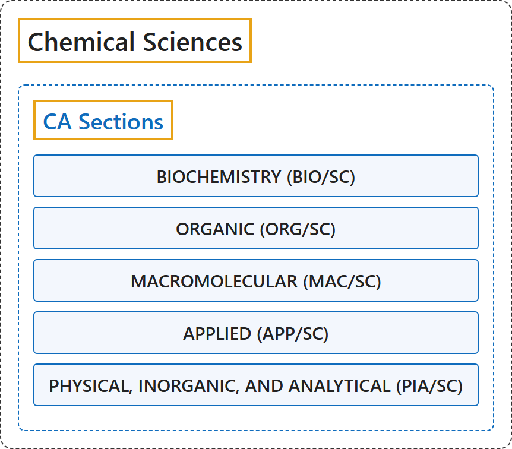

# Chemical Sciences

## Classification

## Glossary

| Term | Definition | 中文翻译 | Source |
|---|---|---|---|
| **Chemical Sciences** CA 类目（《化学文摘》分类） | (context) "the **scientific study of the basic characteristics of substances** and **the ways in which they react or combine**" | （语境）对**物质基本特性的科学研究**，以及**物质发生反应或化合的方式** | [Cambridge University Press & Assessment, n.d., "chemistry" noun (SCIENCE)](https://dictionary.cambridge.org/dictionary/english/chemistry) |
| **[CA Sections](ca-sections/index.md)** CA 类目（《化学文摘》分类） | "You will find that CAS information is divided into **80 different sections**. Each CA section covers only **one broad area of scientific inquiry**." | 你会发现，CAS 信息被划分为 **80 个不同的类目**。每个 CA 类目只涵盖**一个宽泛的科学研究领域**。 | [Chemical Abstracts Service, n.d., 1 and list item 1](https://www.cas.org/training/documentation/references/ca-sections#:~:text=You%20will%20find%20that%20CAS%20information%20is%20divided%20into) |

## References

Cambridge University Press & Assessment. (n.d.). Chemistry. In *Cambridge Dictionary*. Retrieved October 27, 2026, from <https://dictionary.cambridge.org/dictionary/english/chemistry>

Chemical Abstracts Service. (n.d.). *The sections of CA*. Retrieved October 27, 2026, from <https://www.cas.org/training/documentation/references/ca-sections>
