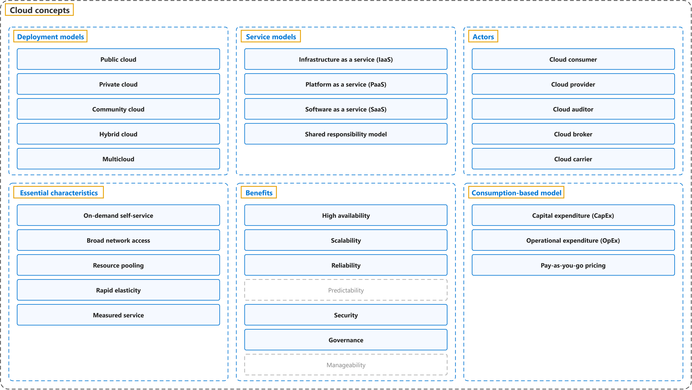

# 1. Cloud concepts

## Coverage

| Certification | Part of the exam |
|---|---|
| AZ-900 Microsoft Azure Fundamentals | [Describe cloud concepts (25–30%)](https://learn.microsoft.com/en-us/credentials/certifications/resources/study-guides/az-900#describe-cloud-concepts-2530) |

| Course | Weeks | Groups |
|---|---|---|
| CST8911 Introduction to Cloud Computing | 1, 2, 4, 7 | Deployment models, service models, actors, essential characteristics, benefits, consumption-based model |
| CST8912 Cloud Solution Architecture | 1, 5, 6 | Deployment models, service models, actors, essential characteristics, benefits, consumption-based model |
| CST8913 Cloud Migration | 2, 3, 5 | Deployment models, service models, actors, benefits, consumption-based model |
| CST8915 Full-stack Cloud-native Development | 1, 2, 4, 6 | Deployment models, service models, essential characteristics, benefits |
| CST8916 Remote Data and Real-time Applications | 1, 5 | Deployment models, service models, benefits |

## Contents

| No. | Page | Covers |
|---|---|---|
| 1.1 | [Describe cloud computing](describe-cloud-computing.md) | Shared responsibility model, deployment models, consumption-based model |
| 1.2 | [Describe the benefits of using cloud services](describe-the-benefits-of-using-cloud-services.md) | High availability, scalability, reliability, predictability, security, governance, manageability |
| 1.3 | [Describe cloud service types](describe-cloud-service-types.md) | Infrastructure as a service, platform as a service, software as a service |
| 1.4 | [The NIST Definition of Cloud Computing](the-nist-definition-of-cloud-computing.md) | Essential characteristics, service models, deployment models |
| 1.5 | [NIST Cloud Computing Reference Architecture](nist-cloud-computing-reference-architecture.md) | Cloud consumer, provider, auditor, broker and carrier |

## References

- Liu, F., Tong, J., Mao, J., Bohn, R., Messina, J., Badger, L., & Leaf, D. (2011). *NIST cloud computing reference architecture* (NIST Special Publication 500-292). National Institute of Standards and Technology. https://doi.org/10.6028/NIST.SP.500-292
- Mell, P., & Grance, T. (2011). *The NIST definition of cloud computing* (NIST Special Publication 800-145). National Institute of Standards and Technology. https://doi.org/10.6028/NIST.SP.800-145
- Microsoft. (n.d.). *Microsoft Azure Fundamentals: Describe cloud concepts* [Learning path]. Microsoft Learn. Retrieved October 21, 2026, from https://learn.microsoft.com/en-us/training/paths/microsoft-azure-fundamentals-describe-cloud-concepts/
- Microsoft. (2026). *Study guide for Exam AZ-900: Microsoft Azure Fundamentals*. Microsoft Learn. https://learn.microsoft.com/en-us/credentials/certifications/resources/study-guides/az-900
