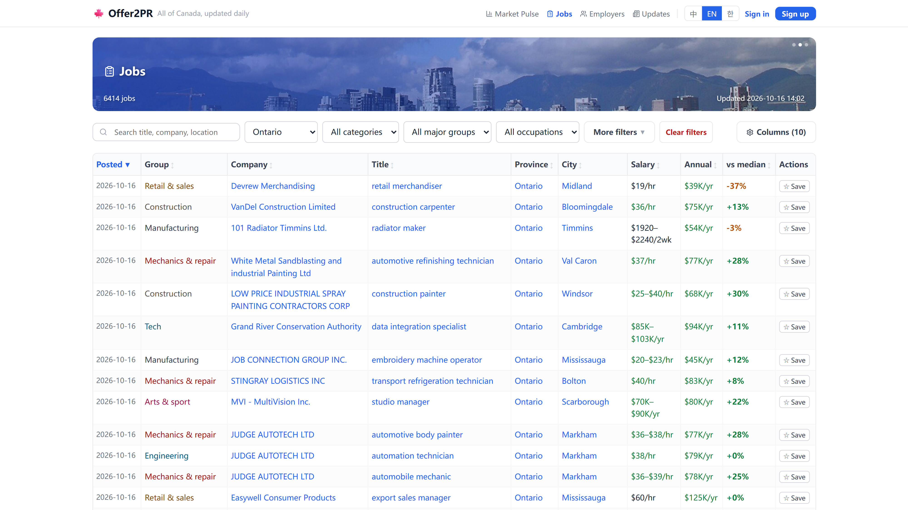
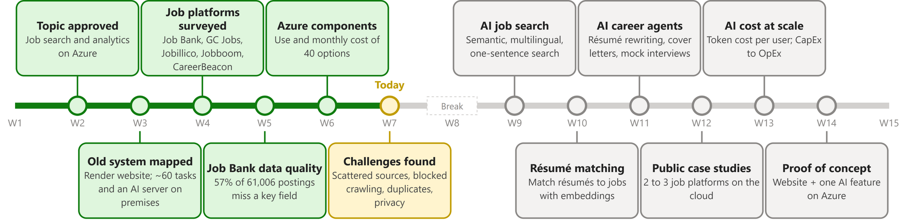
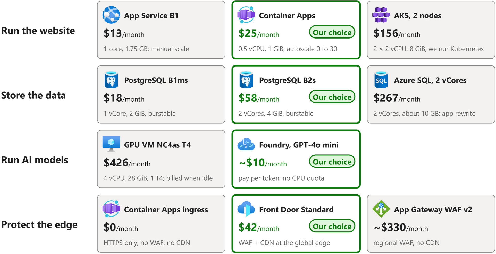
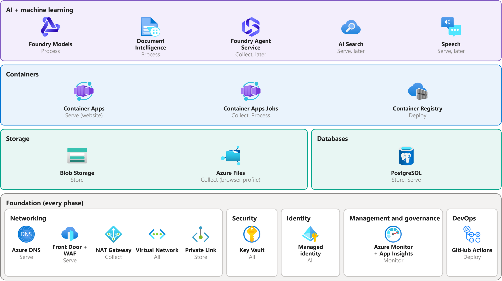

# Group Presentation 1: Cloud-Based Job Search and Analytics Platform

| | |
|---|---|
| Course | CST8912 Cloud Solutions Architecture, Section 011 |
| Professor | Ragini Madaan |
| Group | CST8912 011 - 1 |
| Members | David Yin, Hye Ran Yoo, Naol Meherete, Peng Wang, Tao Lu |
| Presentation date | 2026-10-22 (Week 7) |
| Research topic | Cloud-Based Job Search and Analytics Platform (approved by email in September) |
| Use case | Our job platform (offer2pr), moved to Microsoft Azure |

| # | Slide | Presenter | Handout deliverable |
|---|---|---|---|
| 1 | Cloud-Based Job Search and Analytics Platform | | Introductory slide with topic and presenters |
| 2 | Research Progress | Hye Ran Yoo | Progress of the research assignment |
| 3 | Today's System | | Progress of the research assignment |
| 4 | Cloud Architecture and Services | | Cloud architecture chosen along with cloud services |
| 5 | Service Recommendation: Cost and Performance | | Recommendation of cloud services, cost and performance |
| 6 | Components in Every Phase | | Key cloud architectural components used in every phase |
| 7 | Key Challenges | Hye Ran Yoo | Key challenges faced when implementing the solution |
| 8 | Lessons Learned | | Lessons learned |
| 9 | Quiz | | One slide contains a quiz |
| 10 | Bibliography | | Bibliography slide |

## Slide 1: Cloud-Based Job Search and Analytics Platform

**On the slide**

> Cloud-Based Job Search and Analytics Platform
>
> on Microsoft Azure
>
> Group 1: David, Lannie, Naol, Frank, Tao

**Speaker notes**

Hi, we are Group 1. Our topic is a cloud-based job search and analytics platform on Azure. Our use case is a real job platform one of us runs today. We will show the architecture, our service choices, the main challenges and what we learned.

## Slide 2: Research Progress

**On the slide**

> Which Azure services best run a job search and analytics platform, and how does AI change it?

**Speaker notes**

Our question is: which Azure services best run a job search platform, and how does AI change it?

Since our topic was approved, we mapped the old system, surveyed the Canadian job platforms, checked Job Bank data quality, and priced 40 Azure options. Today we share the challenges we found.

After the break we research AI in jobs: AI search, résumé matching, AI career agents, public case studies and AI cost. We end with a proof of concept on Azure.

## Slide 3: Today's System

**On the slide**

> Website on Render; about 60 data tasks and an AI server on premises: one single point of failure.

**Speaker notes**

This is how our platform runs today. Follow the numbers.

Users reach the website on Render, which reads PostgreSQL.

About 60 Docker tasks and a GPU server run on our own machines. They collect jobs and sync clean data to the database.

If that one site goes down, data collection stops. That is the main reason to move to the cloud.

## Slide 4: Cloud Architecture and Services

**On the slide**

> Managed Azure services in Canada Central: serve, store, collect and process.

**Speaker notes**

This is our design on Azure, in Canada Central. Follow the numbers.

Users come in through Azure DNS and Front Door. The website runs on Container Apps and reads PostgreSQL.

Scheduled tasks collect jobs, save them to Blob Storage, use Foundry and Document Intelligence, and load only complete jobs into the database.

Everything is managed, so we run no servers.

## Slide 5: Service Recommendation: Cost and Performance

**On the slide**

> Container Apps, PostgreSQL, Foundry, Front Door: best cost and performance for us.

**Monthly cost of every component** (USD, Canada Central, Azure Retail Prices API, Oct 16 2026, 730 hours a month; Foundry, NAT Gateway and private endpoint from Azure's pricing pages).

| Component | Tier or usage | Monthly cost (USD) |
|---|---|---|
| Container Apps (website) | 0.5 vCPU, 1 GiB, autoscale | 25 |
| Container Apps Jobs | ~60 scheduled tasks, billed while running | 13 |
| PostgreSQL flexible server | B2s, 2 vCores, 4 GiB | 58 |
| Blob Storage | Hot + Cool, lifecycle rule | 5 |
| Foundry (GPT-4o mini) | Pay per token at our volume | ~10 |
| Front Door | Standard, WAF + CDN | 42 |
| NAT Gateway | One static outbound IP | 34 |
| Azure Monitor + App Insights | Logs, metrics, alerts | 14 |
| Private endpoint | Database reachable only inside our network | ~7 |
| Container Registry | Basic | 5 |
| Azure DNS | One zone | 1 |
| Key Vault | Standard | <1 |
| Managed identity | | 0 |
| GitHub Actions | Free minutes | 0 |
| **Total** | | **~215** |

**Speaker notes**

For each need we compared Azure options on price and performance.

Website: Container Apps, 25 dollars, scales automatically.
Database: PostgreSQL, 58 dollars, no rewrite.
AI: Foundry, about 10 dollars, versus 426 for a GPU machine.
Edge: Front Door, 42 dollars, firewall and CDN together.

We picked the managed option that fits at the lowest cost.

## Slide 6: Components in Every Phase

**On the slide**

> AI, containers and data sit on one foundation; each component serves a phase.

| Azure category | Component | Phase | Official definition | What it does here |
|---|---|---|---|---|
| AI + machine learning | Foundry Models (GPT-4o mini) | Process | "Microsoft Foundry unifies agents, models, and tools under a single management grouping with built-in enterprise-readiness capabilities including tracing, monitoring, evaluations, and customizable enterprise setup configurations." ([source](https://learn.microsoft.com/azure/foundry/what-is-foundry)) | Format job descriptions, classify occupations, write cover letters, chat |
|  | Document Intelligence | Process | "Azure Document Intelligence in Foundry Tools is a cloud-based Foundry Tools service that you can use to build intelligent document processing solutions." ([source](https://learn.microsoft.com/azure/ai-services/document-intelligence/overview)) | Read uploaded résumés (PDF, Word) |
|  | Foundry Agent Service (later) | Collect | "Foundry Agent Service is a managed platform for building, deploying, and scaling AI agents." ([source](https://learn.microsoft.com/azure/foundry/agents/overview)) | AI agents find new job sources and careers pages |
|  | AI Search (later) | Serve | "Azure AI Search is a fully managed, cloud-hosted service that connects your data to AI." ([source](https://learn.microsoft.com/azure/search/search-what-is-azure-search)) | Semantic search and résumé-to-job matching; PostgreSQL full-text + pgvector until then |
|  | Speech (later) | Serve | "Azure Speech in Foundry Tools provides speech to text, text to speech, and other capabilities through a Microsoft Foundry resource." ([source](https://learn.microsoft.com/azure/ai-services/speech-service/overview)) | Mock interviews by voice |
| Containers | Container Apps | Serve | "Azure Container Apps is a serverless platform for running containerized applications without managing the underlying infrastructure." ([source](https://learn.microsoft.com/azure/container-apps/overview)) | Runs the website: search, filters and trend charts |
|  | Container Apps Jobs | Collect, Process | "Azure Container Apps jobs enable you to run containerized tasks that run for a finite duration and then stop." ([source](https://learn.microsoft.com/azure/container-apps/jobs)) | Runs our ~60 scheduled tasks: download postings, then clean, de-duplicate and quality-check them |
|  | Container Registry | Deploy | "Azure Container Registry is a managed registry service based on the open-source Docker platform." ([source](https://learn.microsoft.com/azure/container-registry/container-registry-intro)) | Stores the images of the website and tasks |
| Storage | Blob Storage | Store | "Azure Blob Storage is Microsoft's object storage solution for the cloud." ([source](https://learn.microsoft.com/azure/storage/blobs/storage-blobs-introduction)) | Keeps every raw posting, including incomplete ones |
|  | Azure Files | Collect | "Azure Files provides fully managed file shares in the cloud that you can access through the industry-standard SMB and NFS protocols." ([source](https://learn.microsoft.com/azure/storage/files/storage-files-introduction)) | Keeps the crawler's browser profile (sign-ins, cookies) between runs; Container Apps mounts it as a folder |
| Databases | PostgreSQL | Store, Serve | "Azure Database for PostgreSQL is a fully managed database service." ([source](https://learn.microsoft.com/azure/postgresql/overview)) | Keeps complete postings, users and applications for the website |
| Networking | Azure DNS | Serve | "Azure DNS provides DNS hosting, resolution, and load balancing for your applications by using the Microsoft Azure infrastructure." ([source](https://learn.microsoft.com/azure/dns/dns-overview)) | Our custom domain |
|  | Front Door + WAF | Serve | "Azure Front Door is an advanced content delivery network (CDN) for the cloud." ([source](https://learn.microsoft.com/azure/frontdoor/front-door-overview)) | Single public entry; blocks attacks and caches static files |
|  | NAT Gateway | Collect | "Azure NAT Gateway is a fully managed and highly resilient network address translation (NAT) service." ([source](https://learn.microsoft.com/azure/nat-gateway/nat-overview)) | Gives those tasks one fixed outbound IP address |
|  | Virtual Network | All | "Azure Virtual Network provides the fundamental building block for your private network in Azure." ([source](https://learn.microsoft.com/azure/virtual-network/virtual-networks-overview)) | Connects Container Apps, the private endpoint and the NAT Gateway |
|  | Private Link (private endpoint) | Store | "A private endpoint is a network interface that uses a private IP address from your virtual network." ([source](https://learn.microsoft.com/azure/private-link/private-endpoint-overview)) | Keeps the database off the public internet |
| Security | Key Vault | All | "Securely store and tightly control access to tokens, passwords, certificates, API keys, and other secrets." ([source](https://learn.microsoft.com/azure/key-vault/general/overview)) | Keeps all passwords and keys in one place |
| Identity | Managed identity | All | "Applications can use managed identities to obtain Microsoft Entra tokens without having to manage any credentials." ([source](https://learn.microsoft.com/entra/identity/managed-identities-azure-resources/overview)) | Lets services sign in to each other without stored passwords |
| Management and governance | Azure Monitor (with Application Insights) | Monitor | "Azure Monitor is Microsoft's unified observability service for collecting, analyzing, and acting on telemetry from cloud and hybrid environments." ([source](https://learn.microsoft.com/azure/azure-monitor/fundamentals/overview)) Application Insights is "an application performance monitoring (APM) feature of Azure Monitor" ([source](https://learn.microsoft.com/azure/azure-monitor/app/app-insights-overview)). | Collects logs, alerts us when a task fails, and shows website speed and errors |
| DevOps | GitHub Actions | Deploy | "GitHub Actions is a continuous integration and continuous delivery (CI/CD) platform." ([source](https://docs.github.com/actions/get-started/understand-github-actions)) | Builds and deploys new versions |

**Speaker notes**

Here are all our Azure components, grouped by Azure's own product categories.

The foundation sits at the bottom: networking, security, identity, monitoring and DevOps. Every phase uses it.

On top are data, containers and AI. The grey word under each icon is the phase it serves.

AI plugs into three phases: an agent to collect, Foundry Models and Document Intelligence to process, AI Search and Speech to serve.

## Slide 7: Key Challenges

**On the slide**

> Fragmented sources, incomplete data, blocked collection, security.

**Speaker notes**

We picked the four biggest challenges.

Fragmented sources: Canadian jobs are spread over many sites, each with its own format, in English or French. So we use one pipeline per source type.

Incomplete data: 57% of postings miss a key field. Only complete postings go live.

Blocked collection: sites block cloud IPs and limit robots, so we crawl slowly and politely.

Security: we store personal data, so we use a firewall, a private database and Key Vault.

## Slide 8: Lessons Learned

**On the slide**

> Real prices change decisions.
>
> Data quality shapes the design.
>
> Move when the business needs it.

**Speaker notes**

We learned three things.

One: real prices change decisions. A GPU machine costs about 40 times more than Foundry.

Two: data quality shapes the design. Bad data stays in Blob; only complete jobs go live.

Three: move when the business needs it. The hardware is paid for, so staying costs about 70 dollars a month; Azure would cost about 215. We move when revenue covers the Azure bill.

## Slide 9: Quiz

**On the slide**

> Quiz time! Join on Kahoot.

**Kahoot:** [CST8912 Group 1 Quiz](https://create.kahoot.it/details/cst8912-group-1-quiz/1b5add03-e8b6-492f-9e3e-ae3a23de1ea8) (private; open it while signed in and choose Host live to show the game PIN and QR code)

| # | Slide | Question | Choices | Answer |
|---|---|---|---|---|
| 1 | 2 Research Progress | Which job site's data did we check for quality? | A. LinkedIn B. Indeed C. Job Bank D. Glassdoor | C |
| 2 | 3 Today's System | What is the main weakness of today's system? | A. One on-premises site is a single point of failure B. Too many users C. No custom domain D. The website is slow | A |
| 3 | 4 Architecture | Which service is the single public entry that blocks attacks and caches files? | A. Azure DNS B. Key Vault C. Blob Storage D. Front Door | D |
| 4 | 5 Recommendation | Why did we choose Foundry over a GPU VM for AI? | A. Faster GPU B. About $10 vs $426 a month C. Works offline D. More memory | B |
| 5 | 6 Phases | Where do we keep every raw job posting, including incomplete ones? | A. PostgreSQL B. Key Vault C. Blob Storage D. Azure Monitor | C |
| 6 | 7 Challenges | About what share of Job Bank postings miss a key field? | A. 7% B. 27% C. 87% D. 57% | D |
| 7 | 8 Lessons | Why not move to Azure today? | A. Staying costs about $70 a month until revenue grows B. Azure has no Canadian region C. Azure cannot run containers D. The database cannot move | A |

**Speaker notes**

Let's check what you remember. Please open Kahoot and enter the code on the screen. There are seven questions, one for each slide, about 20 seconds each.

## Slide 10: Bibliography

Mell, P., & Grance, T. (2011). *The NIST definition of cloud computing* (NIST Special Publication 800-145). National Institute of Standards and Technology. https://doi.org/10.6028/NIST.SP.800-145

Microsoft. (n.d.-a). *Azure Container Apps overview*. Microsoft Learn. https://learn.microsoft.com/azure/container-apps/overview

Microsoft. (n.d.-b). *Azure Database for PostgreSQL flexible server overview*. Microsoft Learn. https://learn.microsoft.com/azure/postgresql/flexible-server/overview

Microsoft. (n.d.-c). *Azure Key Vault overview*. Microsoft Learn. https://learn.microsoft.com/azure/key-vault/general/overview

Microsoft. (n.d.-d). *Azure Monitor overview*. Microsoft Learn. https://learn.microsoft.com/azure/azure-monitor/overview

Microsoft. (n.d.-e). *Azure Well-Architected Framework*. Microsoft Learn. https://learn.microsoft.com/azure/well-architected/

Microsoft. (n.d.-f). *Choose an Azure compute service*. Microsoft Learn. https://learn.microsoft.com/azure/architecture/guide/technology-choices/compute-decision-tree

Microsoft. (n.d.-g). *Jobs in Azure Container Apps*. Microsoft Learn. https://learn.microsoft.com/azure/container-apps/jobs

Microsoft. (n.d.-h). *Optimize costs by automatically managing the data lifecycle*. Microsoft Learn. https://learn.microsoft.com/azure/storage/blobs/lifecycle-management-overview

Microsoft. (n.d.-i). *Pricing calculator*. Microsoft Azure. https://azure.microsoft.com/pricing/calculator/

Microsoft. (n.d.-j). *What is Azure Web Application Firewall on Azure Front Door?* Microsoft Learn. https://learn.microsoft.com/azure/web-application-firewall/afds/afds-overview

Microsoft. (n.d.-k). *Microsoft Foundry documentation*. Microsoft Learn. https://learn.microsoft.com/azure/ai-foundry/

Microsoft. (n.d.-l). *Azure App Service plan overview*. Microsoft Learn. https://learn.microsoft.com/azure/app-service/overview-hosting-plans

Microsoft. (n.d.-m). *Compute options in Azure Database for PostgreSQL flexible server*. Microsoft Learn. https://learn.microsoft.com/azure/postgresql/flexible-server/concepts-compute

Microsoft. (n.d.-n). *NCasT4_v3 series*. Microsoft Learn. https://learn.microsoft.com/azure/virtual-machines/nct4-v3-series

Microsoft. (n.d.-o). *Resource limits for single databases using the vCore purchasing model*. Microsoft Learn. https://learn.microsoft.com/azure/azure-sql/database/resource-limits-vcore-single-databases

Microsoft. (n.d.-p). *Azure Retail Prices REST API overview*. Microsoft Learn. https://learn.microsoft.com/rest/api/cost-management/retail-prices/azure-retail-prices

Microsoft. (n.d.-q). *What is Azure NAT Gateway?* Microsoft Learn. https://learn.microsoft.com/azure/nat-gateway/nat-overview

Microsoft. (n.d.-r). *What is Azure Web Application Firewall on Azure Application Gateway?* Microsoft Learn. https://learn.microsoft.com/azure/web-application-firewall/ag/ag-overview

Microsoft. (n.d.-s). *What is Azure AI Search?* Microsoft Learn. https://learn.microsoft.com/azure/search/search-what-is-azure-search

Microsoft. (n.d.-t). *What is Azure AI Document Intelligence?* Microsoft Learn. https://learn.microsoft.com/azure/ai-services/document-intelligence/overview

Microsoft. (n.d.-u). *What is the Speech service?* Microsoft Learn. https://learn.microsoft.com/azure/ai-services/speech-service/overview

Microsoft. (n.d.-v). *What is Foundry Agent Service?* Microsoft Learn. https://learn.microsoft.com/azure/ai-foundry/agents/overview

Image credits: title background is a screenshot of our own platform, offer2pr.com (Oct 16 2026); cat reaction GIFs via Tenor (tenor.com), used for a class presentation; Azure icons from Microsoft Azure Architecture Icons; brand logos from Simple Icons (CC0); Healthchecks logo from the Healthchecks project.
