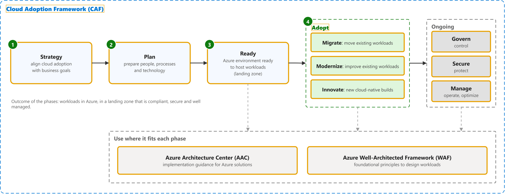
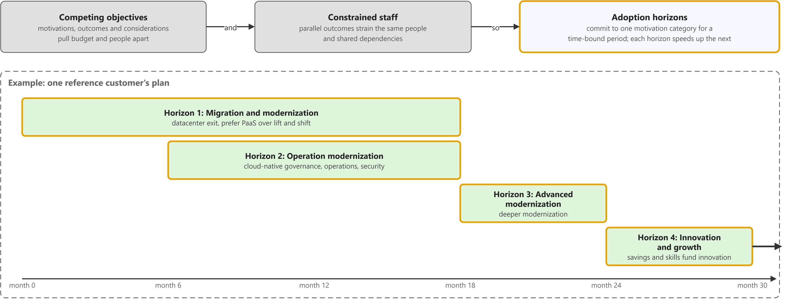
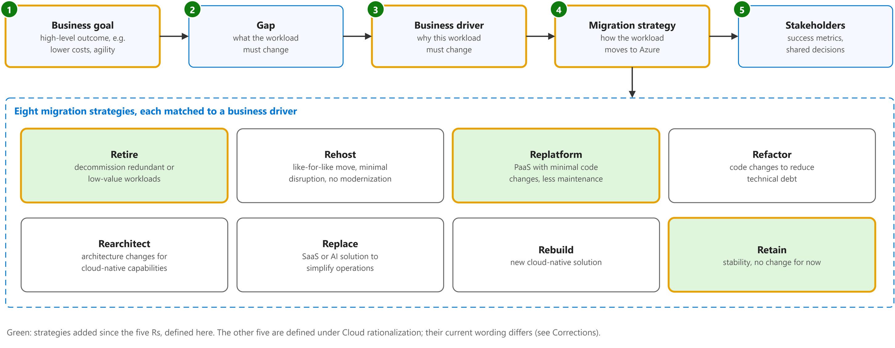
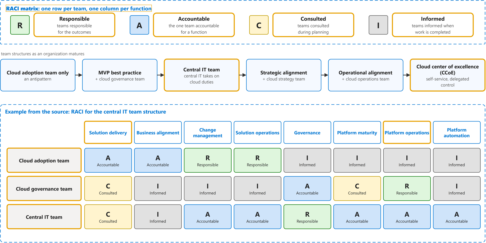
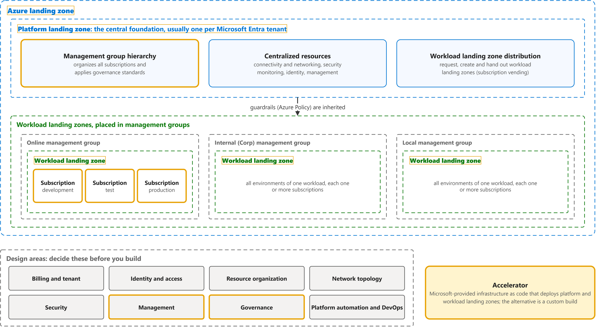

# Cloud Adoption Framework for Azure

Study notes on [Microsoft Learn documentation set](https://learn.microsoft.com/en-us/azure/cloud-adoption-framework/), which CST8913 Cloud Migration (Algonquin College, Fall 2026) uses in weeks 2 and 3. Each section follows one part of the source. Start from the figure: the framed terms are the ones to learn, and the table below it defines them in the same order, each with a citation linked to the passage.

## [Cloud Adoption Framework overview](https://learn.microsoft.com/en-us/azure/cloud-adoption-framework/overview)

| Term | Definition | 中文解释 | Source |
|---|---|---|---|
| **Cloud Adoption Framework (CAF)** (云采用框架) | "The Microsoft Cloud Adoption Framework (CAF) helps decision makers make better decisions, faster. It provides proven guidance to reduce risk, accelerate adoption, and create a foundation that supports current and future workloads." *Note: CAF now lists Strategy, Plan, Ready, Adopt, Govern, Secure, Manage; Migrate, Modernize and Cloud-native sit under Adopt.* | 微软官方的上云指南，按阶段告诉企业怎么一步步上 Azure；它让决策更快、风险更小。 | [Microsoft, n.d., para. 1](https://learn.microsoft.com/en-us/azure/cloud-adoption-framework/overview#:~:text=The%20Microsoft%20Cloud%20Adoption%20Framework%20%28CAF%29%20helps%20decision%20makers%20make) |
| **Strategy** (策略阶段) | "1. Strategy: What should our Azure adoption look like?" | 策略阶段是 CAF 的第 1 步，先回答“我们的 Azure 采用应该是什么样子”；后面的计划和准备都以它为方向。 | [Microsoft, n.d., "How the Cloud Adoption Framework works" section, table, row 1](https://learn.microsoft.com/en-us/azure/cloud-adoption-framework/overview#how-the-cloud-adoption-framework-works:~:text=What%20should%20our%20Azure%20adoption%20look%20like) |
| **Plan** (计划) | "Successful cloud adoption ... requires a cloud adoption plan. A cloud adoption plan converts your cloud strategy into an actionable plan that's specific to your goals." | CAF 第二步：把上云策略变成能执行的具体计划，比如先迁哪些系统、谁负责。 | [Microsoft, n.d., para. 1](https://learn.microsoft.com/en-us/azure/cloud-adoption-framework/plan/prepare-organization-for-cloud#:~:text=Successful%20cloud%20adoption) |
| **Ready** (就绪) | "The Ready phase of the Cloud Adoption Framework helps you design your Azure landing zone to meet your organization's requirements." | CAF 第三步：在搬系统之前先把 Azure 环境搭好（也就是落地区）；地基好了，后面的工作负载才有地方放。 | [Microsoft, n.d., para. 1](https://learn.microsoft.com/en-us/azure/cloud-adoption-framework/ready/landing-zone/#:~:text=The%20Ready%20phase%20of%20the%20Cloud%20Adoption%20Framework%20helps%20you) |
| **CAF Adopt phase** (CAF 采用阶段) | "4. Adopt: How will we migrate, modernize, and build workloads?" *Note: The /adopt/ page now redirects; quoted from the phase table on the CAF overview.* | 采用阶段是 CAF 第 4 步，真正动手迁移、现代化或新建工作负载。 | [Microsoft, n.d., "How the Cloud Adoption Framework works" section, table, row 4](https://learn.microsoft.com/en-us/azure/cloud-adoption-framework/overview#how-the-cloud-adoption-framework-works:~:text=How%20will%20we%20migrate%2C%20modernize%2C%20and%20build%20workloads) |
| **Migrate (CAF)** (迁移（CAF 阶段）) | "Migration changes where or how a workload runs. Modernization changes the workload to achieve a better outcome. An initiative can do both." | 把现有系统从本地或别的云搬到 Azure，重点是换个地方运行；它和现代化（改造系统本身）不一样。 | [Microsoft, n.d., "1.3 Modernization versus migration" section, para. 1](https://learn.microsoft.com/en-us/azure/cloud-adoption-framework/modernize/prepare-organization-cloud-modernization#13-modernization-versus-migration:~:text=Migration%20changes%20where%20or%20how%20a%20workload%20runs.%20Modernization%20changes) |
| **Modernize** (现代化) | "Modernization improves an existing workload or workload component to better meet current or future business requirements. It can change different parts of a workload, such as its platform, application, data, or operating model." | 改造已有的系统（平台、代码、数据或运维方式），让它更好地满足业务需要；不一定要改到最新，够用就行。 | [Microsoft, n.d., "1. What is modernization?" section, para. 1](https://learn.microsoft.com/en-us/azure/cloud-adoption-framework/modernize/prepare-organization-cloud-modernization#1-what-is-modernization:~:text=Modernization%20improves%20an%20existing%20workload%20or%20workload%20component%20to%20better) |
| **Innovate** (创新（现称云原生）) | "A cloud-native solution creates business value by building new workloads or enhancing existing ones. Whether you're developing a new application or adding new features to an existing system, cloud-native development is a journey through planning, building, deploying, and optimizing your workloads." *Note: CAF now calls this phase Cloud-native; the old Innovate page redirects here.* | 在云上直接开发新应用或新功能，给业务带来新价值；不是搬旧系统，而是造新东西。 | [Microsoft, n.d., para. 1](https://learn.microsoft.com/en-us/azure/cloud-adoption-framework/cloud-native/plan-cloud-native-solutions#:~:text=A%20cloud%2Dnative%20solution%20creates%20business%20value%20by%20building%20new%20workloads) |
| **Govern** (治理) | "Cloud governance is how an organization controls its use of cloud services by establishing guardrails. These guardrails are a set of policies, procedures, and tools that define acceptable and unacceptable cloud activities." | 给云的使用定规矩（策略、流程、工具），明确哪些能做、哪些不能做；这样可以控制风险、成本和合规。 | [Microsoft, n.d., para. 1](https://learn.microsoft.com/en-us/azure/cloud-adoption-framework/govern/build-cloud-governance-team#:~:text=Cloud%20governance%20is%20how%20an%20organization%20controls%20its%20use%20of) |
| **CAF Secure phase** (CAF 安全阶段) | "The Cloud Adoption Framework for Azure Secure methodology provides a structured approach for securing your Azure cloud estate." | 安全阶段讲怎样保护整个 Azure 环境；它贯穿 CAF 的每个阶段。 | [Microsoft, n.d., para. 1](https://learn.microsoft.com/en-us/azure/cloud-adoption-framework/secure/overview#:~:text=The%20Cloud%20Adoption%20Framework%20for%20Azure%20Secure%20methodology%20provides) |
| **Manage** (管理) | "Managing your Azure environment isn't just about keeping the lights on. It's about maintaining governance and security while ensuring your cloud stays aligned with business goals over time." | 上云以后的日常运维：监控、保护、持续优化；目的是让云环境长期稳定，并且一直符合业务目标。 | [Microsoft, n.d., para. 1](https://learn.microsoft.com/en-us/azure/cloud-adoption-framework/manage/ready-cloud-operations#:~:text=Managing%20your%20Azure%20environment%20isn%27t%20just%20about%20keeping%20the%20lights) |
| **Azure Architecture Center** (Azure 架构中心) | "The Azure Architecture Center is a catalog of solution ideas, example workloads, reference architectures, technology decision guides, and architecture guides that help cloud architects and engineers build workloads ..." | Azure 架构中心是微软的架构资料库，有参考架构和设计指南，帮你设计云上的系统。 | [Microsoft, n.d., para. 1](https://learn.microsoft.com/en-us/azure/architecture/#:~:text=Design%20solutions%20on%20Azure%20by%20using%20established%20patterns) |
| **Azure Well-Architected Framework** (Azure 良好架构框架) | "The Azure Well-Architected Framework is a design framework that can improve the quality of a workload by helping it to: Be resilient, available, and recoverable. Be as secure as you need it to be." | 良好架构框架是检查单个工作负载设计质量的框架，分可靠性、安全、成本、运维、性能五大支柱。 | [Microsoft, n.d., para. 1](https://learn.microsoft.com/en-us/azure/well-architected/what-is-well-architected-framework#:~:text=The%20Azure%20Well%2DArchitected%20Framework%20is%20a%20design%20framework) |

## [Develop a cloud adoption strategy](https://github.com/MicrosoftDocs/cloud-adoption-framework/blob/a5351162040659171fbb4f5674ce36ac9259deb3/docs/strategy/index.md)

| Term | Definition | 中文解释 | Source |
|---|---|---|---|
| **cloud adoption strategy** (云采用策略) | "A cloud adoption strategy directs how your business adopts cloud technology. It connects executive intent to measurable outcomes and sets the standards that every workload team operates within." *Note: The 2022 CAF listed different steps. Current CAF steps: motivations, mission and objectives; strategy team; prepare the organization; inform your strategy.* | 云采用策略说明企业为什么上云、怎么上云；它把高层目标变成可衡量的结果。 | [Microsoft, n.d., para. 1](https://learn.microsoft.com/en-us/azure/cloud-adoption-framework/strategy/#:~:text=A%20cloud%20adoption%20strategy%20directs%20how%20your%20business%20adopts) |
| **motivation** (动机) | "Various motivations can drive business transformations that are supported by cloud adoption. Several motivations likely apply at the same time." *Note: Quoted from the 2022 CAF page (archived on GitHub). Current CAF groups motivations as reduce business risk, accelerate innovation, and enhance agility and efficiency.* | 动机就是企业上云的理由；通常同时有好几个，先说清楚才能定策略。 | [Microsoft, 2022, October 18, "Motivations" section, para. 1](https://github.com/MicrosoftDocs/cloud-adoption-framework/blob/a5351162040659171fbb4f5674ce36ac9259deb3/docs/strategy/motivations.md#motivations:~:text=Various%20motivations%20can%20drive%20business%20transformations%20that%20are) |
| **critical business event** (关键业务事件) | "When responding to critical business events is the highest priority, it's important to get started with migration early, often in parallel with strategy and planning efforts." | 关键业务事件是逼着企业马上行动的事，比如数据中心到期、并购、技术停止支持；这时要尽早开始迁移。 | [Microsoft, 2022, October 18, "Classify your motivations" section, para. 2](https://github.com/MicrosoftDocs/cloud-adoption-framework/blob/a5351162040659171fbb4f5674ce36ac9259deb3/docs/strategy/motivations.md#classify-your-motivations:~:text=When%20responding%20to%20critical%20business%20events%20is%20the%20highest) |
| **migration motivation** (迁移动机) | "The migration motivations listed near the top of the motivations table are the most common reasons for adopting the cloud but not necessarily the most significant." | 迁移动机是把现有系统搬上云的理由，比如省钱、简化运维；最常见，但不一定最重要。 | [Microsoft, 2022, October 18, "Migration" section, para. 1](https://github.com/MicrosoftDocs/cloud-adoption-framework/blob/a5351162040659171fbb4f5674ce36ac9259deb3/docs/strategy/motivations.md#migration:~:text=The%20migration%20motivations%20listed%20near%20the%20top%20of%20the) |
| **innovation motivation** (创新动机) | "Data is the new commodity, and modern applications are the supply chain driving that data into various experiences. In today's business market, it's hard to find a transformative product or service that isn't built on top of data, insights, and customer experiences." | 创新动机是想用云做出新产品、新体验的理由；重点不是搬家，而是靠数据和新应用创造价值。 | [Microsoft, 2022, October 18, "Innovation" section, para. 1](https://github.com/MicrosoftDocs/cloud-adoption-framework/blob/a5351162040659171fbb4f5674ce36ac9259deb3/docs/strategy/motivations.md#innovation:~:text=Data%20is%20the%20new%20commodity%2C%20and%20modern%20applications%20are) |
| **business outcome** (业务成果) | "This article series is designed to help customers identify business outcomes that are concise, defined, and drive observable results or change in business performance, supported by a specific measure." *Note: Quoted from the 2022 CAF page (archived on GitHub). Current CAF uses mission, objectives and key results (OKRs) instead.* | 业务成果是上云后业务上能看到、能量化的变化；用业务语言讲结果，各部门才容易达成一致。 | [Microsoft, 2022, October 18, para. 1](https://github.com/MicrosoftDocs/cloud-adoption-framework/blob/a5351162040659171fbb4f5674ce36ac9259deb3/docs/strategy/business-outcomes/index.md#:~:text=This%20article%20series%20is%20designed%20to%20help%20customers%20identify) |
| **fiscal outcome** (财务成果) | "Financial or fiscal performance is the cleanest business outcome for many business leaders, but not the only one." | 财务成果就是钱方面的变化，比如降本、增收；最直观，但不是唯一的成果。 | [Microsoft, 2022, October 18, "Fiscal outcomes" section, para. 1](https://github.com/MicrosoftDocs/cloud-adoption-framework/blob/a5351162040659171fbb4f5674ce36ac9259deb3/docs/strategy/business-outcomes/index.md#fiscal-outcomes:~:text=Financial%20or%20fiscal%20performance%20is%20the%20cleanest%20business%20outcome) |
| **agility outcome** (敏捷成果) | "Today's fast-changing business environment places a premium on time. The ability to respond to and drive market change quickly is the fundamental measure of business agility." | 敏捷成果看的是速度：能多快应对或推动市场变化。 | [Microsoft, 2022, October 18, "Agility outcomes" section, para. 1](https://github.com/MicrosoftDocs/cloud-adoption-framework/blob/a5351162040659171fbb4f5674ce36ac9259deb3/docs/strategy/business-outcomes/index.md#agility-outcomes:~:text=Today%27s%20fast%2Dchanging%20business%20environment%20places%20a%20premium%20on%20time) |
| **reach outcome** (覆盖范围成果) | "In a constantly shrinking market, global reach (ability to support global customers and users) can be measured by compliance in geographies that are relevant to the business." | 覆盖范围成果看的是能否服务全球客户；用在相关地区是否合规来衡量。 | [Microsoft, 2022, October 18, "Reach outcomes" section, para. 1](https://github.com/MicrosoftDocs/cloud-adoption-framework/blob/a5351162040659171fbb4f5674ce36ac9259deb3/docs/strategy/business-outcomes/index.md#reach-outcomes:~:text=In%20a%20constantly%20shrinking%20market%2C%20global%20reach) |
| **customer engagement outcome** (客户互动成果) | "Social marketplaces are redefining winners and losers at an unheard-of pace. Responding to user needs is a key measure of customer engagement." | 客户互动成果看的是对用户需求响应得好不好；响应得好，客户才留得住。 | [Microsoft, 2022, October 18, "Customer engagement outcomes" section, para. 1](https://github.com/MicrosoftDocs/cloud-adoption-framework/blob/a5351162040659171fbb4f5674ce36ac9259deb3/docs/strategy/business-outcomes/index.md#customer-engagement-outcomes:~:text=Social%20marketplaces%20are%20redefining%20winners%20and%20losers%20at%20an) |
| **performance outcome** (性能成果) | "Performance and reliability are assumed. When either falters, reputation damage can be painful and long-lasting." | 性能成果看的是系统快不快、稳不稳；一出问题，声誉损失很大。 | [Microsoft, 2022, October 18, "Performance outcomes" section, para. 1](https://github.com/MicrosoftDocs/cloud-adoption-framework/blob/a5351162040659171fbb4f5674ce36ac9259deb3/docs/strategy/business-outcomes/index.md#performance-outcomes:~:text=Performance%20and%20reliability%20are%20assumed) |
| **sustainability outcome** (可持续性成果) | "Environmental sustainability is quickly moving from a "nice to have" function of Corporate Social Responsibility (CSR) to a centerpiece of business strategy, increasingly embedded into everything a company does." | 可持续性成果看的是环保目标，比如减少碳排放；它正从“加分项”变成企业战略的核心。 | [Microsoft, 2022, October 18, "Sustainability outcomes" section, para. 1](https://github.com/MicrosoftDocs/cloud-adoption-framework/blob/a5351162040659171fbb4f5674ce36ac9259deb3/docs/strategy/business-outcomes/index.md#sustainability-outcomes:~:text=Environmental%20sustainability%20is%20quickly%20moving%20from%20a) |
| **financial considerations** (财务考量) | "A digital transformation goes hand-in-hand with a financial transformation. When you're making the shift to the cloud, there are financial considerations around how the cloud will impact your financial position, accounting KPIs, and processes..." | 财务考量是上云对公司财务的影响，比如从一次性买设备（CapEx）变成按用量付费（OpEx）；财务团队必须看懂。 | [Microsoft, 2022, October 18, para. 1](https://github.com/MicrosoftDocs/cloud-adoption-framework/blob/a5351162040659171fbb4f5674ce36ac9259deb3/docs/strategy/financial-considerations/index.md#:~:text=A%20digital%20transformation%20goes%20hand%2Din%2Dhand%20with%20a%20financial%20transformation) |
| **technical considerations** (技术考量) | "When you're making the shift to the cloud, there are technical considerations around how it will help improve how you manage and maintain your cloud and workloads." | 技术考量是上云在技术上带来的好处，比如可扩展、高可用、安全合规、按需使用容量。 | [Microsoft, 2022, October 18, para. 1](https://github.com/MicrosoftDocs/cloud-adoption-framework/blob/a5351162040659171fbb4f5674ce36ac9259deb3/docs/strategy/technical-considerations/index.md#:~:text=When%20you%27re%20making%20the%20shift%20to%20the%20cloud%2C%20there) |
| **scalability** (可扩展性) | "Scalability, or the ability to scale out your resources depending on usage, utilization, and demand, is one of the foremost technical benefits of moving to the cloud." | 可扩展性就是按使用量和需求增减资源；这是上云最重要的技术好处之一。 | [Microsoft, 2022, October 18, "Scalability" section, para. 1](https://github.com/MicrosoftDocs/cloud-adoption-framework/blob/a5351162040659171fbb4f5674ce36ac9259deb3/docs/strategy/technical-considerations/index.md#scalability:~:text=Scalability%2C%20or%20the%20ability%20to%20scale%20out%20your%20resources%20depending) |
| **high availability** (高可用性) | "On-premises, it's more costly to build highly available infrastructure. It's less costly to architect highly available infrastructure in the cloud." | 高可用性就是系统出故障时服务也尽量不中断；在云上搭高可用的基础设施比自建机房便宜。 | [Microsoft, 2022, October 18, "Availability" section, para. 1](https://github.com/MicrosoftDocs/cloud-adoption-framework/blob/a5351162040659171fbb4f5674ce36ac9259deb3/docs/strategy/technical-considerations/index.md#availability:~:text=On%2Dpremises%2C%20it%27s%20more%20costly%20to%20build%20highly%20available%20infrastructure) |
| **security and compliance** (安全与合规) | "When it comes to security and compliance, Microsoft is continually expanding our security infrastructure and toolsets to keep you on par with what's transpiring with respect to security threats on global networks." *Note: Quoted from the 2022 CAF source (archived on GitHub).* | 安全与合规指云厂商持续加强安全设施和工具，帮你跟上安全威胁并满足法规。 | [Microsoft, 2022, October 18, "Security and compliance" section, para. 1](https://github.com/MicrosoftDocs/cloud-adoption-framework/blob/a5351162040659171fbb4f5674ce36ac9259deb3/docs/strategy/technical-considerations/index.md#security-and-compliance:~:text=When%20it%20comes%20to%20security%20and%20compliance%2C%20Microsoft%20is) |
| **capacity optimization** (容量优化) | "Capacity optimization, where you only pay for the resources you utilize over time, is another technical benefit of the cloud." *Note: Quoted from the 2022 CAF source (archived on GitHub).* | 容量优化就是只为实际用到的资源付费，用弹性随时加减资源。 | [Microsoft, 2022, October 18, "Capacity optimization" section, para. 1](https://github.com/MicrosoftDocs/cloud-adoption-framework/blob/a5351162040659171fbb4f5674ce36ac9259deb3/docs/strategy/technical-considerations/index.md#capacity-optimization:~:text=Capacity%20optimization%2C%20where%20you%20only%20pay%20for%20the) |
| **business case** (商业论证) | "A business case provides a view of the technical and financial timeline of your environment. Developing a business case includes building a financial plan that takes technical considerations into account and aligns with business outcomes." | 商业论证用数字说明上云值不值；它把技术和财务放在同一条时间线上，用来争取财务和管理层支持。 | [Microsoft, 2022, August 5, para. 3](https://github.com/MicrosoftDocs/cloud-adoption-framework/blob/a5351162040659171fbb4f5674ce36ac9259deb3/docs/strategy/cloud-migration-business-case.md#:~:text=A%20business%20case%20provides%20a%20view%20of%20the%20technical) |

## [Build a digital transformation timeline](https://github.com/MicrosoftDocs/cloud-adoption-framework/blob/a5351162040659171fbb4f5674ce36ac9259deb3/docs/strategy/digital-transformation-timeline.md)

| Term | Definition | 中文解释 | Source |
|---|---|---|---|
| **adoption horizons** (采用视野（分阶段推进）) | "To create clarity and alignment, it's suggested that complex digital transformation projects align to an organization's horizons or phased program delivery. In this type of approach, the company commits to a single motivation category for a time-bound period." | 采用视野就是把复杂的上云转型分阶段做：每个阶段在一段固定时间内只专注一类动机，大家一起完成后再进入下一阶段。 | [Microsoft, 2021, May 1, "De-risk with cloud adoption horizons" section, para. 3](https://github.com/MicrosoftDocs/cloud-adoption-framework/blob/a5351162040659171fbb4f5674ce36ac9259deb3/docs/strategy/digital-transformation-timeline.md#de-risk-with-cloud-adoption-horizons:~:text=To%20create%20clarity%20and%20alignment%2C%20it%27s%20suggested%20that%20complex) |
| **Horizon 1 migration and modernization** (视野 1：迁移与现代化) | "Prioritize the datacenter exit with a focus on modern platform as a service (PaaS) solutions over a basic lift-and-shift migration." | 第一个视野：迁移与现代化，优先完成退出数据中心，尽量迁到 PaaS，而不是简单地原样搬迁。 | [Microsoft, 2021, May 1, "Example of a cloud adoption plan with four horizons" section, table, row 1, Objective](https://github.com/MicrosoftDocs/cloud-adoption-framework/blob/a5351162040659171fbb4f5674ce36ac9259deb3/docs/strategy/digital-transformation-timeline.md#example-of-a-cloud-adoption-plan-with-four-horizons:~:text=Prioritize%20the%20datacenter%20exit%20with%20a%20focus%20on%20modern%20platform) |
| **Horizon 2 operation modernization** (视野 2：运营现代化) | "Prioritize operational improvements built on cloud-native governance, operations management, security, and compliance capabilities." | 第二个视野：运营现代化，借助云原生的治理、运维管理、安全和合规能力改进日常运维。 | [Microsoft, 2021, May 1, "Example of a cloud adoption plan with four horizons" section, table, row 2, Objective](https://github.com/MicrosoftDocs/cloud-adoption-framework/blob/a5351162040659171fbb4f5674ce36ac9259deb3/docs/strategy/digital-transformation-timeline.md#example-of-a-cloud-adoption-plan-with-four-horizons:~:text=Prioritize%20operational%20improvements%20built%20on%20cloud%2Dnative%20governance) |
| **Horizon 3 advanced modernization** (视野 3：深度现代化) | "With post-migration and operational improvements, the team will have sufficient data and cloud skills to perform deeper modernization of complex architectures." | 第三个视野：深度现代化，迁移和运维改进之后，团队有了足够的数据和云技能，再去深度改造复杂架构。 | [Microsoft, 2021, May 1, "Example of a cloud adoption plan with four horizons" section, table, row 3, Objective](https://github.com/MicrosoftDocs/cloud-adoption-framework/blob/a5351162040659171fbb4f5674ce36ac9259deb3/docs/strategy/digital-transformation-timeline.md#example-of-a-cloud-adoption-plan-with-four-horizons:~:text=With%20post%2Dmigration%20and%20operational%20improvements%2C%20the%20team%20will%20have) |
| **Horizon 4 innovation and growth** (视野 4：创新与增长) | "Redirect capital reduction from datacenter exits and new skills in central IT to focus on accelerating continued innovation." | 第四个视野：创新与增长，把退出数据中心省下的资金和 IT 新学到的技能，转投到持续创新上。 | [Microsoft, 2021, May 1, "Example of a cloud adoption plan with four horizons" section, table, row 4, Objective](https://github.com/MicrosoftDocs/cloud-adoption-framework/blob/a5351162040659171fbb4f5674ce36ac9259deb3/docs/strategy/digital-transformation-timeline.md#example-of-a-cloud-adoption-plan-with-four-horizons:~:text=Redirect%20capital%20reduction%20from%20datacenter%20exits%20and%20new%20skills%20in) |

## [Cloud rationalization](https://github.com/MicrosoftDocs/cloud-adoption-framework/blob/e29e30c4ebd52d8446d00f5dfdee5742328c2c11/docs/digital-estate/5-rs-of-rationalization.md)

| Term | Definition | 中文解释 | Source |
|---|---|---|---|
| **cloud rationalization** (云合理化) | "Cloud rationalization is the process of evaluating assets to determine the best way to migrate or modernize each asset in the cloud." | 云合理化就是逐个评估现有的 IT 资产，决定每个资产上云的最佳方式；结果用“五个 R”来标记。 | [Microsoft, 2023, March 1, para. 1](https://github.com/MicrosoftDocs/cloud-adoption-framework/blob/e29e30c4ebd52d8446d00f5dfdee5742328c2c11/docs/digital-estate/5-rs-of-rationalization.md#:~:text=Cloud%20rationalization%20is%20the%20process%20of%20evaluating%20assets%20to%20determine) |
| **Rehost** (重新托管) | "Also known as a lift and shift migration, a rehost effort moves a current state asset to the chosen cloud provider with minimal change to the overall architecture." | 重新托管就是几乎原样把系统搬到云上，整体架构基本不改；它最快、风险最低。 | [Microsoft, 2023, March 1, "Rehost" section, para. 1](https://github.com/MicrosoftDocs/cloud-adoption-framework/blob/e29e30c4ebd52d8446d00f5dfdee5742328c2c11/docs/digital-estate/5-rs-of-rationalization.md#rehost:~:text=Also%20known%20as%20a%20lift%20and%20shift%20migration%2C%20a%20rehost%20effort) |
| **lift and shift** (平移迁移) | "Lift-and-shift migration: You set up cloud resources similar to your on-premises datacenter, and then move your workloads to the IaaS infrastructure." | 平移就是在云上搭一套和本地差不多的环境，把系统原样搬过去，基本不改代码。 | [Microsoft, n.d., "Scenarios" section, bullet 1](https://learn.microsoft.com/en-us/training/modules/describe-cloud-service-types/2-describe-infrastructure-service#scenarios:~:text=Lift%2Dand%2Dshift%20migration) |
| **Refactor** (重构) | "Platform as a service (PaaS) options can reduce the operational costs that are associated with many applications. It's a good idea to slightly refactor an application to fit a PaaS-based model." *Note: Current CAF calls this Replatform; see Corrections.* | 重构（五个 R 里的意思）就是把应用稍微改一改，让它能跑在 PaaS 上，从而降低运维成本。 | [Microsoft, 2023, March 1, "Refactor" section, para. 1](https://github.com/MicrosoftDocs/cloud-adoption-framework/blob/e29e30c4ebd52d8446d00f5dfdee5742328c2c11/docs/digital-estate/5-rs-of-rationalization.md#refactor:~:text=Platform%20as%20a%20service%20%28PaaS%29%20options%20can%20reduce%20the%20operational%20costs) |
| **Rearchitect** (重新架构) | "Some aging applications aren't compatible with cloud providers. This incompatibility is because of the architectural decisions that were made when the application was built. In these cases, the application might need to be rearchitected before transformation." | 重新架构就是重新设计应用的架构；老应用因为当初的架构决定跑不了云，就要先改架构再迁移。 | [Microsoft, 2023, March 1, "Rearchitect" section, para. 1](https://github.com/MicrosoftDocs/cloud-adoption-framework/blob/e29e30c4ebd52d8446d00f5dfdee5742328c2c11/docs/digital-estate/5-rs-of-rationalization.md#rearchitect:~:text=Some%20aging%20applications%20aren%27t%20compatible%20with%20cloud%20providers) |
| **Rebuild** (重建) | "In some scenarios, the delta that must be overcome to carry an application forward can be too large to justify further investment. ... To resolve the issue, create a new code base to align with a cloud-native approach." | 重建就是用云原生的方式重新写一套代码；老应用差距太大、不值得再改时用它。 | [Microsoft, 2023, March 1, "Rebuild" section, para. 1](https://github.com/MicrosoftDocs/cloud-adoption-framework/blob/e29e30c4ebd52d8446d00f5dfdee5742328c2c11/docs/digital-estate/5-rs-of-rationalization.md#rebuild:~:text=In%20some%20scenarios%2C%20the%20delta%20that%20must%20be%20overcome%20to%20carry) |
| **cloud-native** (云原生) | "Cloud-native architecture and technologies are an approach to designing, constructing, and operating workloads that are built in the cloud and take full advantage of the cloud computing model." | 云原生是指一开始就为云设计和运行的系统，充分利用云的弹性和托管服务。 | [Microsoft, n.d., para. 3](https://learn.microsoft.com/en-us/dotnet/architecture/cloud-native/definition#:~:text=Cloud%2Dnative%20architecture%20and%20technologies%20are%20an%20approach%20to%20designing) |
| **Replace** (替换) | "Sometimes software as a service (SaaS) applications can provide all the necessary functionality for the hosted application. In these scenarios, a workload can be scheduled for future replacement, which removes it from the transformation effort." | 替换就是不再自己开发维护，改用现成的 SaaS 应用；这个工作负载就不用迁移了。 | [Microsoft, 2023, March 1, "Replace" section, para. 1](https://github.com/MicrosoftDocs/cloud-adoption-framework/blob/e29e30c4ebd52d8446d00f5dfdee5742328c2c11/docs/digital-estate/5-rs-of-rationalization.md#replace:~:text=Sometimes%20software%20as%20a%20service%20%28SaaS%29%20applications%20can%20provide%20all) |

## [Select your cloud migration strategies](https://learn.microsoft.com/en-us/azure/cloud-adoption-framework/plan/select-cloud-migration-strategy)

| Term | Definition | 中文解释 | Source |
|---|---|---|---|
| **business goal** (业务目标) | "Business goals are high-level outcomes the organization wants to achieve from cloud adoption, such as adopting AI, increasing agility, accelerating innovation, reducing costs, and improving resilience." | 业务目标是组织想通过上云得到的大方向结果，比如降本、更敏捷、更有韧性；它是所有迁移决定的背景。 | [Microsoft, n.d., "Determine business drivers before migration" section, step 1](https://learn.microsoft.com/en-us/azure/cloud-adoption-framework/plan/select-cloud-migration-strategy#determine-business-drivers-before-migration:~:text=Business%20goals%20are%20high%2Dlevel%20outcomes%20the%20organization%20wants%20to%20achieve) |
| **business driver** (业务驱动因素) | "A business driver defines why a workload needs to change in order to support a specific business goal." | 业务驱动因素说明某个工作负载为什么要变；它来自现状和目标之间的差距，用来选迁移策略。 | [Microsoft, n.d., "Determine business drivers before migration" section, para. 1](https://learn.microsoft.com/en-us/azure/cloud-adoption-framework/plan/select-cloud-migration-strategy#determine-business-drivers-before-migration:~:text=A%20business%20driver%20defines%20why%20a%20workload%20needs%20to%20change) |
| **migration strategy** (迁移策略) | "A migration strategy defines how each workload transitions to Azure based on its business driver." | 迁移策略说明每个工作负载怎样转到 Azure（八个 R 之一）；按它的业务驱动因素来选。 | [Microsoft, n.d., "Select the right migration strategy" section, para. 1](https://learn.microsoft.com/en-us/azure/cloud-adoption-framework/plan/select-cloud-migration-strategy#select-the-right-migration-strategy:~:text=A%20migration%20strategy%20defines%20how%20each%20workload%20transitions%20to%20Azure) |
| **Retire** (停用) | "Retire decommissions workloads that no longer provide business value." | 把已经没用、没价值的系统直接下线，不搬；省掉迁移成本。 | [Microsoft, n.d., "1. Retire (decommission)" section, para. 1](https://learn.microsoft.com/en-us/azure/cloud-adoption-framework/plan/select-cloud-migration-strategy#1-retire-decommission:~:text=Retire%20decommissions%20workloads%20that%20no%20longer%20provide%20business%20value) |
| **Replatform** (更换平台) | "Replatforming moves workloads to a modern hosting environment with minimal code changes." | 少量改动，把应用换到更现代的托管平台（如从虚拟机换到 App Service）；省掉系统维护。 | [Microsoft, n.d., "3. Replatform (modernize hosting environment)" section, para. 1](https://learn.microsoft.com/en-us/azure/cloud-adoption-framework/plan/select-cloud-migration-strategy#3-replatform-modernize-hosting-environment:~:text=Replatforming%20moves%20workloads%20to%20a%20modern%20hosting%20environment%20with%20minimal) |
| **Retain** (保留) | "A retain strategy keeps workloads in their current environment when they're stable, compliant, and meet all current and future business needs with no near-term driver to move." | 暂时保持原样不迁移，比如受法规或技术依赖限制的系统；以后条件变了再考虑。 | [Microsoft, n.d., "8. Retain (keep as is)" section, para. 1](https://learn.microsoft.com/en-us/azure/cloud-adoption-framework/plan/select-cloud-migration-strategy#8-retain-keep-as-is:~:text=A%20retain%20strategy%20keeps%20workloads%20in%20their%20current%20environment%20when) |

## [Align responsibilities across teams](https://learn.microsoft.com/en-us/azure/cloud-adoption-framework/organize/raci-alignment)

| Term | Definition | 中文解释 | Source |
|---|---|---|---|
| **RACI matrix** (RACI 责任分配矩阵) | "Align responsibilities by developing a cross-team matrix that identifies responsible, accountable, consulted, and informed (RACI) parties." | RACI 矩阵是一张表，写清每件事谁动手做（R）、谁最终担责（A）、要征求谁的意见（C）、做完通知谁（I）。 | [Microsoft, n.d., para. 1](https://learn.microsoft.com/en-us/azure/cloud-adoption-framework/organize/raci-alignment#:~:text=Align%20responsibilities%20by%20developing%20a%20cross%2Dteam%20matrix%20that) |
| **Responsible** (负责执行（R）) | "The teams that are responsible for the outcomes." | R 是真正动手干活、对结果负责执行的团队；可以有多个。 | [Microsoft, n.d., "Align responsibilities across teams" section, bullet 8](https://learn.microsoft.com/en-us/azure/cloud-adoption-framework/organize/raci-alignment#align-responsibilities-across-teams:~:text=The%20teams%20that%20are%20responsible%20for%20the%20outcomes) |
| **Accountable** (最终负责（A）) | "The one team that is accountable for a function." | A 是对某项职能最终拍板、出问题要担责的团队；每项只能有一个。 | [Microsoft, n.d., "Align responsibilities across teams" section, bullet 7](https://learn.microsoft.com/en-us/azure/cloud-adoption-framework/organize/raci-alignment#align-responsibilities-across-teams:~:text=The%20one%20team%20that%20is%20accountable%20for%20a%20function) |
| **Consulted** (咨询（C）) | "The teams that should be consulted during planning." | C 是在规划时要先问意见的团队；他们提建议，但不拍板。 | [Microsoft, n.d., "Align responsibilities across teams" section, bullet 9](https://learn.microsoft.com/en-us/azure/cloud-adoption-framework/organize/raci-alignment#align-responsibilities-across-teams:~:text=The%20teams%20that%20should%20be%20consulted%20during%20planning) |
| **Informed** (知会（I）) | "The teams that should be informed when work is completed." | I 是工作完成后要被通知结果的团队；只需知道，不用参与。 | [Microsoft, n.d., "Align responsibilities across teams" section, bullet 10](https://learn.microsoft.com/en-us/azure/cloud-adoption-framework/organize/raci-alignment#align-responsibilities-across-teams:~:text=The%20teams%20that%20should%20be%20informed%20when%20work%20is%20completed) |
| **central IT team** (中央 IT 团队) | "As adoption scales, the cloud governance team might struggle to keep pace with the flow of innovation from multiple cloud adoption teams... At this stage, it's common for companies to shift cloud responsibilities to an existing central IT team." *Note: Not a strict definition: the page says companies shift cloud work to an existing central IT team as adoption grows.* | 上云规模变大、治理团队忙不过来时，公司常把云的职责交给原有的中央 IT 团队；它要有成长心态，否则会拖慢上云。 | [Microsoft, n.d., "Central IT team" section, para. 1](https://learn.microsoft.com/en-us/azure/cloud-adoption-framework/organize/organization-structures#central-it-team:~:text=As%20adoption%20scales%2C%20the%20cloud%20governance%20team%20might%20struggle) |
| **cloud center of excellence (CCoE)** (云卓越中心) | "At the highest state of maturity, a cloud center of excellence aligns teams around a modern cloud-first operating model. This approach provides centralized IT functions like governance, security, platform, and automation." | 云卓越中心是最成熟的团队结构：集中提供治理、安全、平台和自动化，同时尽量把控制权下放给各团队自助使用。 | [Microsoft, n.d., "Cloud center of excellence" section, para. 1](https://learn.microsoft.com/en-us/azure/cloud-adoption-framework/organize/organization-structures#cloud-center-of-excellence:~:text=At%20the%20highest%20state%20of%20maturity%2C%20a%20cloud%20center%20of%20excellence) |
| **solution delivery** (方案交付) | "Cloud adoption functions enable the implementation of technical solutions in the cloud." *Note: No page defines this column name; quoted from the archived CAF "Cloud adoption" capability page that the RACI table linked to.* | 方案交付就是把技术方案真正在云上实施落地；这件事主要由云采用团队负责。 | [Microsoft, 2020, May 15, "Cloud adoption functions" section, para. 1](https://github.com/MicrosoftDocs/cloud-adoption-framework/blob/a5351162040659171fbb4f5674ce36ac9259deb3/docs/organize/cloud-adoption.md#cloud-adoption-functions:~:text=Cloud%20adoption%20functions%20enable%20the%20implementation%20of%20technical%20solutions) |
| **platform operations** (平台运维) | "Operate and manage the cloud platform." *Note: No page defines this column name; quoted from the archived CAF central IT page the RACI table linked to.* | 平台运维就是日常运行和管理整个云平台（落地区、共享服务）；在中央 IT 结构里由中央 IT 团队最终负责。 | [Microsoft, 2022, August 31, "Technical tasks" section, bullet 3](https://github.com/MicrosoftDocs/cloud-adoption-framework/blob/a5351162040659171fbb4f5674ce36ac9259deb3/docs/organize/central-it.md#technical-tasks:~:text=Operate%20and%20manage%20the%20cloud%20platform) |
| **cloud adoption team** (云采用团队) | "The nucleus of all cloud adoption efforts is the cloud adoption team. This team drives the technical changes that enable adoption." | 云采用团队是上云工作的核心，负责做具体的技术改动，把应用搬上云。 | [Microsoft, n.d., "Cloud adoption team only" section, para. 1](https://learn.microsoft.com/en-us/azure/cloud-adoption-framework/organize/organization-structures#cloud-adoption-team-only:~:text=The%20nucleus%20of%20all%20cloud%20adoption%20efforts%20is%20the) |
| **cloud governance team** (云治理团队) | "...a cloud governance team is dedicated to ensuring excellence in the solutions that are adopted. The cloud governance team is accountable for platform maturity, platform operations, governance, and automation." | 云治理团队用来平衡云采用团队，保证上云的方案质量好；它对平台成熟度、平台运维、治理和自动化最终负责。 | [Microsoft, n.d., "Best practice: minimum viable product (MVP)" section, bullet 2](https://learn.microsoft.com/en-us/azure/cloud-adoption-framework/organize/organization-structures#best-practice-minimum-viable-product-mvp:~:text=Cloud%20governance%20team%3A%20To%20balance%20the%20cloud%20adoption%20team) |

## [Azure landing zones](https://learn.microsoft.com/en-us/azure/cloud-adoption-framework/ready/landing-zone/)

| Term | Definition | 中文解释 | Source |
|---|---|---|---|
| **landing zone** (落地区) | "An Azure landing zone is a proven and flexible architecture for governing, securing, and scaling a multi-subscription Azure environment." | 落地区是提前搭好的 Azure 基础环境，治理、安全和网络规则都已定好；工作负载迁进来就能直接用。 | [Microsoft, n.d., para. 1, sentence 2](https://learn.microsoft.com/en-us/azure/cloud-adoption-framework/ready/landing-zone/#:~:text=An%20Azure%20landing%20zone%20is%20a%20proven%20and%20flexible%20architecture) |
| **platform landing zone** (平台落地区) | "The centralized foundation that establishes governance, security, and shared resources for all your Azure workloads." | 平台落地区是整个组织共用的中心底座，统一提供治理、安全和共享资源；通常一个租户只有一个。 | [Microsoft, n.d., bullet 1](https://learn.microsoft.com/en-us/azure/cloud-adoption-framework/ready/landing-zone/#:~:text=The%20centralized%20foundation%20that%20establishes%20governance%2C%20security%2C%20and%20shared) |
| **management group hierarchy** (管理组层级) | "The management group hierarchy provides the governance structure for the Azure environment. It organizes all of your Azure subscriptions and applies governance standards to those subscriptions." | 管理组层级是把所有订阅分组排好的树形结构；在上层设的治理规则会自动作用到下面的订阅。 | [Microsoft, n.d., "Platform landing zone" section, bullet 1](https://learn.microsoft.com/en-us/azure/cloud-adoption-framework/ready/landing-zone/#platform-landing-zone:~:text=The%20management%20group%20hierarchy%20provides%20the%20governance%20structure%20for%20the) |
| **workload landing zone** (工作负载落地区) | "The environments where workload teams deploy and operate workload resources within the guardrails of the platform landing zone." | 工作负载落地区是给每个工作负载团队的环境（开发、测试、生产各自的订阅）；团队在平台落地区的规则内部署和运行。 | [Microsoft, n.d., bullet 2](https://learn.microsoft.com/en-us/azure/cloud-adoption-framework/ready/landing-zone/#:~:text=The%20environments%20where%20workload%20teams%20deploy%20and%20operate%20workload%20resources) |
| **subscription** (订阅) | "In Azure, subscriptions are a unit of management, billing, and scale. Subscriptions let you organize resource groups and control billing separately from access." | 订阅是 Azure 里管理、计费和规模的单位；资源组放在订阅里，账单按订阅出。 | [Microsoft, n.d., "Azure subscriptions" section, para. 1](https://learn.microsoft.com/en-us/training/modules/describe-core-architectural-components-of-azure/6-describe-azure-management-infrastructure#azure-subscriptions:~:text=In%20Azure%2C%20subscriptions%20are%20a%20unit%20of%20management%2C%20billing) |
| **management** (管理（运维）) | "This design area establishes a foundation for operations management across your Azure, hybrid, or multicloud environments." | 管理就是日常运维：监控、合规运行、备份恢复，让云环境稳定运行。 | [Microsoft, n.d., para. 1](https://learn.microsoft.com/en-us/azure/cloud-adoption-framework/ready/landing-zone/design-area/management#:~:text=This%20design%20area%20establishes%20a%20foundation%20for%20operations%20management) |
| **governance** (治理) | "Use Azure governance to establish the tooling that you need to support cloud governance, compliance auditing, and automated guardrails." | 治理就是用 Azure Policy 等工具定规则、查合规、自动拦住违规操作。 | [Microsoft, n.d., para. 1](https://learn.microsoft.com/en-us/azure/cloud-adoption-framework/ready/landing-zone/design-area/governance#:~:text=Use%20Azure%20governance%20to%20establish%20the%20tooling%20that%20you) |
| **accelerator** (加速器) | "Microsoft-provided accelerators for both platform landing zone and workload landing zone scenarios use infrastructure as code to deploy Azure environments based on recommended practices." | 加速器是微软提供的基础设施即代码模板，按推荐做法一键部署落地区；另一种做法是自己定制搭建。 | [Microsoft, n.d., bullet 3](https://learn.microsoft.com/en-us/azure/cloud-adoption-framework/ready/landing-zone/#:~:text=Microsoft%2Dprovided%20accelerators%20for%20both%20platform%20landing%20zone%20and%20workload) |
