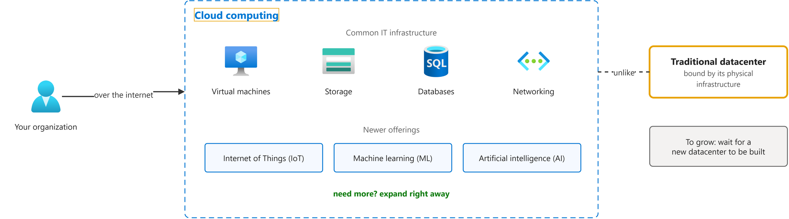
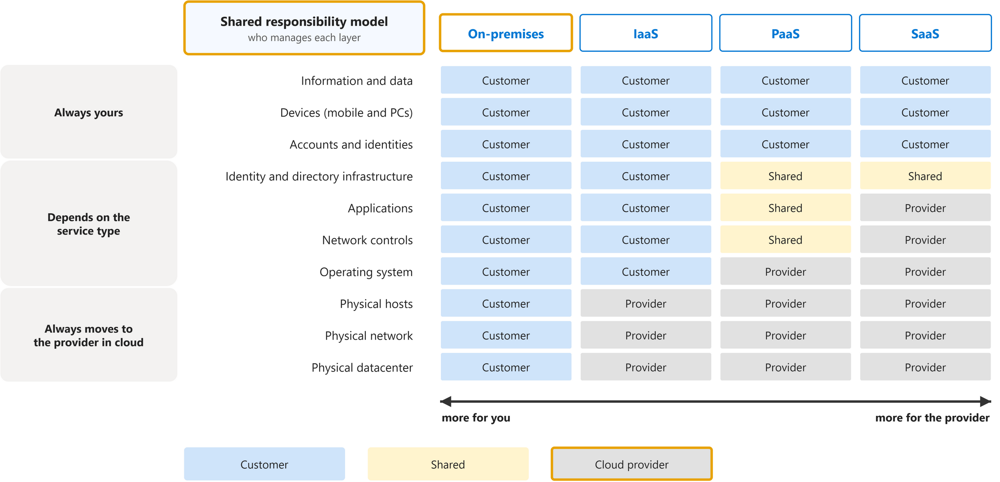
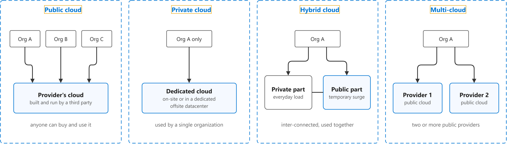
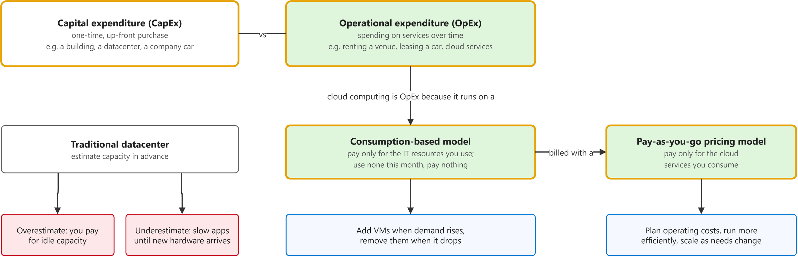

# Describe cloud computing

Study notes on [Microsoft Learn module (AZ-900)](https://learn.microsoft.com/en-us/training/modules/describe-cloud-compute/), which CST8913 Cloud Migration (Algonquin College, Fall 2026) uses in week 2. Each section follows one part of the source. Start from the figure: the framed terms are the ones to learn, and the table below it defines them in the same order, each with a citation linked to the passage.

## [What is cloud computing](https://web.archive.org/web/20250108132404/https://learn.microsoft.com/en-us/training/modules/describe-cloud-compute/3-what-cloud-compute)

| Term | Definition | 中文解释 | Source |
|---|---|---|---|
| **cloud computing** (云计算) | "Cloud computing is the delivery of computing services over the internet. Computing services include common IT infrastructure such as virtual machines, storage, databases, and networking." | 云计算就是通过互联网提供计算服务，比如虚拟机、存储、数据库和网络。需要更多资源时直接在云上加，不用等自己盖新机房。 | [Microsoft, n.d., para. 1](https://web.archive.org/web/20250108132404/https://learn.microsoft.com/en-us/training/modules/describe-cloud-compute/3-what-cloud-compute#:~:text=Cloud%20computing%20is%20the%20delivery%20of%20computing%20services%20over) |
| **datacenter** (数据中心) | "The physical infrastructure for Azure starts with datacenters. These datacenters are facilities with servers arranged in racks, with dedicated power, cooling, and networking infrastructure ..." | 数据中心就是放服务器的大楼，有专门的电力、制冷和网络；云的底层就是很多这样的机房。 | [Microsoft, n.d., "Physical infrastructure" section, para. 1](https://learn.microsoft.com/en-us/training/modules/describe-core-architectural-components-of-azure/5-describe-azure-physical-infrastructure#physical-infrastructure:~:text=The%20physical%20infrastructure%20for%20Azure%20starts%20with%20datacenters) |

## [Describe the shared responsibility model](https://web.archive.org/web/20250108163106/https://learn.microsoft.com/en-us/training/modules/describe-cloud-compute/4-describe-shared-responsibility-model)

| Term | Definition | 中文解释 | Source |
|---|---|---|---|
| **shared responsibility model** (责任共担模型) | "With the shared responsibility model, these responsibilities get shared between the cloud provider and the consumer." | 责任共担模型就是把运维和安全的工作分给云服务商和用户两边。用它来看清每种服务类型下哪一层归你管、哪一层归厂商管。 | [Microsoft, n.d., para. 3](https://web.archive.org/web/20250108163106/https://learn.microsoft.com/en-us/training/modules/describe-cloud-compute/4-describe-shared-responsibility-model#:~:text=With%20the%20shared%20responsibility%20model%2C%20these%20responsibilities%20get%20shared) |
| **on-premises** (本地部署) | "With an on-premises datacenter, you’re responsible for everything." | 本地部署就是服务器放在自己公司的机房里。场地、硬件、系统、数据全都由你自己负责。 | [Microsoft, n.d., para. 6](https://web.archive.org/web/20250108163106/https://learn.microsoft.com/en-us/training/modules/describe-cloud-compute/4-describe-shared-responsibility-model#:~:text=With%20an%20on%2Dpremises%20datacenter) |
| **cloud provider** (云服务商) | "Physical security, power, cooling, and network connectivity are the responsibility of the cloud provider." | 云服务商就是建好机房、把计算资源租给别人用的公司，比如 Microsoft。机房的物理安全、电力、制冷和网络始终由它负责。 | [Microsoft, n.d., para. 3](https://web.archive.org/web/20250108163106/https://learn.microsoft.com/en-us/training/modules/describe-cloud-compute/4-describe-shared-responsibility-model#:~:text=Physical%20security%2C%20power%2C%20cooling%2C%20and%20network%20connectivity%20are%20the) |

## [Define cloud models](https://web.archive.org/web/20250108133733/https://learn.microsoft.com/en-us/training/modules/describe-cloud-compute/5-define-cloud-models)

| Term | Definition | 中文解释 | Source |
|---|---|---|---|
| **public cloud** (公有云) | "A public cloud is built, controlled, and maintained by a third-party cloud provider. With a public cloud, anyone that wants to purchase cloud services can access and use resources." | 公有云就是由第三方云服务商建设和运营、谁都可以购买使用的云。不用自己买硬件，用多少付多少。 | [Microsoft, n.d., "Public cloud" section, para. 1](https://web.archive.org/web/20250108133733/https://learn.microsoft.com/en-us/training/modules/describe-cloud-compute/5-define-cloud-models#public-cloud:~:text=A%20public%20cloud%20is%20built%2C%20controlled%2C%20and%20maintained%20by) |
| **private cloud** (私有云) | "It’s a cloud (delivering IT services over the internet) that’s used by a single entity." | 私有云就是只给一个组织专用的云。控制力最强，但硬件要自己买、自己维护，成本更高。 | [Microsoft, n.d., "Private cloud" section, para. 1](https://web.archive.org/web/20250108133733/https://learn.microsoft.com/en-us/training/modules/describe-cloud-compute/5-define-cloud-models#private-cloud:~:text=delivering%20IT%20services%20over%20the%20internet) |
| **hybrid cloud** (混合云) | "A hybrid cloud is a computing environment that uses both public and private clouds in an inter-connected environment." | 混合云就是把公有云和私有云连起来一起用。私有云不够用时，可以临时借公有云的资源扩容。 | [Microsoft, n.d., "Hybrid cloud" section, para. 1](https://web.archive.org/web/20250108133733/https://learn.microsoft.com/en-us/training/modules/describe-cloud-compute/5-define-cloud-models#hybrid-cloud:~:text=A%20hybrid%20cloud%20is%20a%20computing%20environment%20that%20uses) |
| **multi-cloud** (多云) | "In a multi-cloud scenario, you use multiple public cloud providers." *Note: The current unit spells it "multicloud".* | 多云就是同时使用两家或更多公有云服务商。可以挑各家的长处，但每家的资源和安全都要分别管理。 | [Microsoft, n.d., "Multi-cloud" section, para. 1](https://web.archive.org/web/20250108133733/https://learn.microsoft.com/en-us/training/modules/describe-cloud-compute/5-define-cloud-models#multi-cloud:~:text=In%20a%20multi%2Dcloud%20scenario%2C%20you%20use%20multiple%20public%20cloud) |

## [Describe the consumption-based model](https://web.archive.org/web/20250108094515/https://learn.microsoft.com/en-us/training/modules/describe-cloud-compute/6-describe-consumption-based-model)

| Term | Definition | 中文解释 | Source |
|---|---|---|---|
| **capital expenditure (CapEx)** (资本支出) | "CapEx is typically a one-time, up-front expenditure to purchase or secure tangible resources." | 资本支出就是一次性先花一大笔钱买下实物资产，比如盖楼、建机房、买公司车。自建数据中心属于这种花法。 | [Microsoft, n.d., para. 2](https://web.archive.org/web/20250108094515/https://learn.microsoft.com/en-us/training/modules/describe-cloud-compute/6-describe-consumption-based-model#:~:text=CapEx%20is%20typically%20a%20one%2Dtime%2C%20up%2Dfront%20expenditure%20to%20purchase) |
| **operational expenditure (OpEx)** (运营支出) | "In contrast, OpEx is spending money on services or products over time." | 运营支出就是按时间持续地为服务或产品付钱，比如租场地、租车、订阅云服务。云计算属于这一类。 | [Microsoft, n.d., para. 3](https://web.archive.org/web/20250108094515/https://learn.microsoft.com/en-us/training/modules/describe-cloud-compute/6-describe-consumption-based-model#:~:text=In%20contrast%2C%20OpEx%20is%20spending%20money%20on%20services%20or) |
| **consumption-based model** (按用量计费模式) | "Cloud computing falls under OpEx because cloud computing operates on a consumption-based model." | 按用量计费模式就是只为实际用到的 IT 资源付钱。这个月一点没用，就一分钱不用付。 | [Microsoft, n.d., para. 4](https://web.archive.org/web/20250108094515/https://learn.microsoft.com/en-us/training/modules/describe-cloud-compute/6-describe-consumption-based-model#:~:text=Cloud%20computing%20falls%20under%20OpEx%20because%20cloud%20computing%20operates) |
| **pay-as-you-go pricing model** (按需付费定价模式) | "Cloud computing is the delivery of computing services over the internet by using a pay-as-you-go pricing model. You typically pay only for the cloud services you use" | 按需付费就是云服务的计价方式：用了哪些服务、用了多少，就按这些付费。这样更容易规划运营成本，也能随业务变化扩缩。 | [Microsoft, n.d., "Compare cloud pricing models" section, para. 1](https://web.archive.org/web/20250108094515/https://learn.microsoft.com/en-us/training/modules/describe-cloud-compute/6-describe-consumption-based-model#compare-cloud-pricing-models:~:text=by%20using%20a%20pay%2Das%2Dyou%2Dgo%20pricing%20model) |

## Also in the source

Points the source makes that are easy to miss, in my own words, each linked to its section.

- Besides virtual machines, storage, databases and networking, cloud services now include newer offerings such as the Internet of Things, machine learning and artificial intelligence. ([What is cloud computing](https://web.archive.org/web/20250108132404/https://learn.microsoft.com/en-us/training/modules/describe-cloud-compute/3-what-cloud-compute))
- Whatever the service type, you always stay responsible for the data you store in the cloud, the devices you allow to connect, and the accounts and identities in your organization. ([Describe the shared responsibility model](https://web.archive.org/web/20250108163106/https://learn.microsoft.com/en-us/training/modules/describe-cloud-compute/4-describe-shared-responsibility-model))
- Physical security, power, cooling and network connectivity always sit with the cloud provider, because the customer is not in the datacenter, while PaaS splits the work roughly evenly between the two. ([Describe the shared responsibility model](https://web.archive.org/web/20250108163106/https://learn.microsoft.com/en-us/training/modules/describe-cloud-compute/4-describe-shared-responsibility-model))
- Some duties depend on how you build: with a managed cloud SQL database the provider looks after the database, but if you install SQL on your own virtual machine, patching it is your job. ([Describe the shared responsibility model](https://web.archive.org/web/20250108163106/https://learn.microsoft.com/en-us/training/modules/describe-cloud-compute/4-describe-shared-responsibility-model))
- A private cloud gives much more control but costs more, and it can run in your own datacenter or in a dedicated offsite one, even one run by a third party. ([Private cloud](https://web.archive.org/web/20250108133733/https://learn.microsoft.com/en-us/training/modules/describe-cloud-compute/5-define-cloud-models#private-cloud))
- A hybrid cloud can add a layer of security, because you choose which services stay in the public cloud and which go to the private cloud. ([Hybrid cloud](https://web.archive.org/web/20250108133733/https://learn.microsoft.com/en-us/training/modules/describe-cloud-compute/5-define-cloud-models#hybrid-cloud))
- A comparison table sets the models side by side: public cloud needs no capital spending to scale but gives less control, private cloud means buying and maintaining hardware, and hybrid cloud is the most flexible. ([Hybrid cloud](https://web.archive.org/web/20250108133733/https://learn.microsoft.com/en-us/training/modules/describe-cloud-compute/5-define-cloud-models#hybrid-cloud))
- Multi-cloud also covers the case of moving from one public provider to another, and you manage resources and security in each provider's environment. ([Multi-cloud](https://web.archive.org/web/20250108133733/https://learn.microsoft.com/en-us/training/modules/describe-cloud-compute/5-define-cloud-models#multi-cloud))
- Azure Arc helps manage all of these setups: Azure alone, a private cloud in your datacenter, a hybrid setup or several providers at once. ([Azure Arc](https://web.archive.org/web/20250108133733/https://learn.microsoft.com/en-us/training/modules/describe-cloud-compute/5-define-cloud-models#azure-arc))
- Azure VMware Solution lets an organization that already runs VMware in a private cloud move those workloads to Azure. ([Azure VMware Solution](https://web.archive.org/web/20250108133733/https://learn.microsoft.com/en-us/training/modules/describe-cloud-compute/5-define-cloud-models#azure-vmware-solution))
- The model brings four benefits: no upfront costs, no expensive infrastructure that sits half used, more resources when you need them, and no more paying once you stop using them. ([Describe the consumption-based model](https://web.archive.org/web/20250108094515/https://learn.microsoft.com/en-us/training/modules/describe-cloud-compute/6-describe-consumption-based-model))
- With your own datacenter you must guess future needs: guess high and money is wasted, guess low and performance suffers until new hardware, power, cooling and networking are installed. ([Describe the consumption-based model](https://web.archive.org/web/20250108094515/https://learn.microsoft.com/en-us/training/modules/describe-cloud-compute/6-describe-consumption-based-model))
- Paying as you go helps you plan operating costs, run infrastructure more efficiently and scale as the business changes, and you hand the resources back when you are done. ([Compare cloud pricing models](https://web.archive.org/web/20250108094515/https://learn.microsoft.com/en-us/training/modules/describe-cloud-compute/6-describe-consumption-based-model#compare-cloud-pricing-models))

## Corrections

Where the course copy differs from the source, or the source has changed since, with the source's exact words.

- **Copied wrong.** The course copy explains fast growth by a lack of physical space and location limits. The source does not say the cloud has no physical space; it says the cloud is not held back by physical infrastructure the way your own datacenter is, so you do not have to wait for a new datacenter to be built. The source says: "it doesn’t have to be constrained by physical infrastructure the same way that a traditional datacenter is" ([source](https://web.archive.org/web/20250108132404/https://learn.microsoft.com/en-us/training/modules/describe-cloud-compute/3-what-cloud-compute))
- **Changed since.** The current unit replaces the ten-row responsibility diagram with seven layers, and the row that the older version calls identity and directory infrastructure is now called identity and access. The source says: "For example, identity and access is shared in PaaS and SaaS—you manage your own users, roles, and policies, while the provider runs the authentication platform (such as Microsoft Entra ID)." ([source](https://learn.microsoft.com/en-us/training/modules/describe-cloud-compute/4-describe-shared-responsibility-model#what-depends-on-the-service-type))
- **Changed since.** The current unit was rewritten: it defines CapEx and OpEx in one paragraph and drops the everyday examples (a building, a parking lot, a convention center, a company vehicle) that the older version and the course copy use. The source says: "CapEx refers to up-front spending on physical infrastructure like servers, network hardware, and datacenter space." ([source](https://learn.microsoft.com/en-us/training/modules/describe-cloud-compute/6-describe-consumption-based-model))
