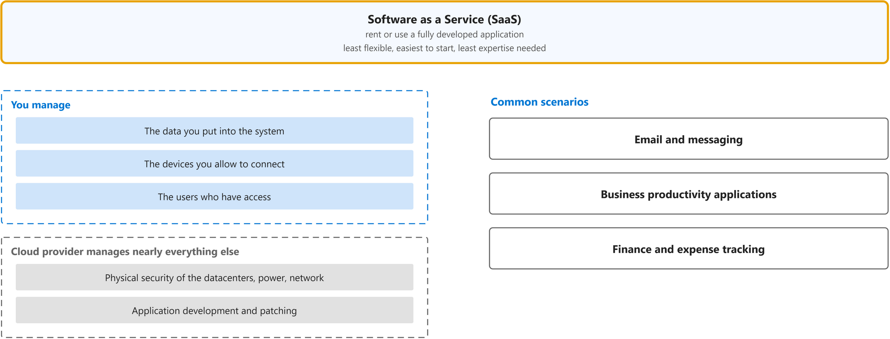

# Describe cloud service types

Study notes on [Microsoft Learn module (AZ-900)](https://learn.microsoft.com/en-us/training/modules/describe-cloud-service-types/), which CST8913 Cloud Migration (Algonquin College, Fall 2026) uses in weeks 2 and 3. Each section follows one part of the source. Start from the figure: the framed terms are the ones to learn, and the table below it defines them in the same order, each with a citation linked to the passage.

## [Describe Infrastructure as a Service](https://web.archive.org/web/20250108115137/https://learn.microsoft.com/en-us/training/modules/describe-cloud-service-types/2-describe-infrastructure-service)

| Term | Definition | 中文解释 | Source |
|---|---|---|---|
| **Infrastructure as a Service (IaaS)** (基础设施即服务) | "Infrastructure as a service (IaaS) is the most flexible category of cloud services, as it provides you the maximum amount of control for your cloud resources." | 基础设施即服务就是在云上租用硬件（如虚拟机），操作系统、网络配置和存储配置都由你自己管。最灵活、控制力最大，适合直接搬迁（lift-and-shift）和开发测试环境。 | [Microsoft, n.d., para. 1](https://web.archive.org/web/20250108115137/https://learn.microsoft.com/en-us/training/modules/describe-cloud-service-types/2-describe-infrastructure-service#:~:text=Infrastructure%20as%20a%20service%20%28IaaS%29%20is%20the%20most%20flexible) |

## [Describe Platform as a Service](https://web.archive.org/web/20250109030533/https://learn.microsoft.com/en-us/training/modules/describe-cloud-service-types/3-describe-platform-service)

| Term | Definition | 中文解释 | Source |
|---|---|---|---|
| **Platform as a Service (PaaS)** (平台即服务) | "Platform as a service (PaaS) is a middle ground between renting space in a datacenter (infrastructure as a service) and paying for a complete and deployed solution (software as a service)." | 平台即服务就是厂商管好硬件、操作系统、中间件和开发工具，你只管自己的应用和数据。不用操心系统授权和打补丁，适合直接开发应用。 | [Microsoft, n.d., para. 1](https://web.archive.org/web/20250109030533/https://learn.microsoft.com/en-us/training/modules/describe-cloud-service-types/3-describe-platform-service#:~:text=Platform%20as%20a%20service%20%28PaaS%29%20is%20a%20middle%20ground) |

## [Describe Software as a Service](https://web.archive.org/web/20250108145750/https://learn.microsoft.com/en-us/training/modules/describe-cloud-service-types/4-describe-software-service)

| Term | Definition | 中文解释 | Source |
|---|---|---|---|
| **Software as a Service (SaaS)** (软件即服务) | "With SaaS, you’re essentially renting or using a fully developed application." | 软件即服务就是直接使用别人做好的完整应用，比如邮箱、财务软件。最容易上手，但能改的最少。 | [Microsoft, n.d., para. 1](https://web.archive.org/web/20250108145750/https://learn.microsoft.com/en-us/training/modules/describe-cloud-service-types/4-describe-software-service#:~:text=renting%20or%20using%20a%20fully%20developed%20application) |
