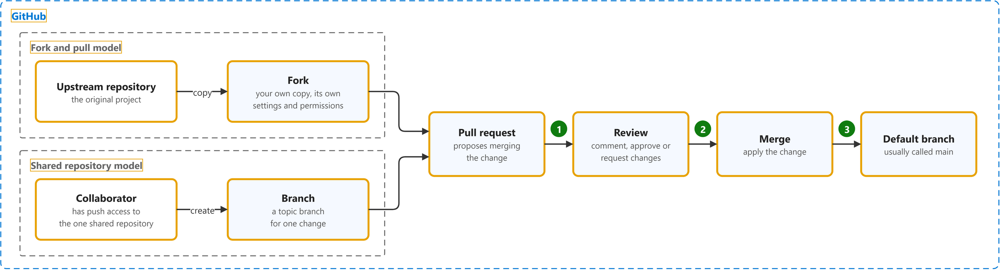

# GitHub Docs: collaborating with pull requests

Study notes on [GitHub Docs](https://docs.github.com/en/pull-requests), which CST8913 Cloud Migration (Algonquin College, Fall 2026) uses in week 1. Each section follows one part of the source. Start from the figure: the framed terms are the ones to learn, and the table below it defines them in the same order, each with a citation linked to the passage.

## [About pull requests and forks](https://docs.github.com/en/pull-requests/reference/pull-requests)

| Term | Definition | 中文解释 | Source |
|---|---|---|---|
| **GitHub** (GitHub 平台) | "GitHub is a platform that supports your entire software development process, from planning work to deploying and operating software." | GitHub 是在云上托管 Git 仓库的网站，并提供协作工具，比如拉取请求和代码审查。 | [GitHub, n.d., para. 1](https://docs.github.com/en/get-started/start-your-journey/what-is-github#:~:text=GitHub%20is%20a%20platform%20that%20supports%20your%20entire%20software) |
| **fork and pull model** (复刻加拉取请求模式) | "In the fork and pull model, anyone can fork an existing ("upstream") repository if they have read access and the owner of the upstream repository allows it." | 复刻加拉取请求模式是一种协作方式：每个人先把原仓库复刻一份，在自己的副本里改，再用拉取请求把改动提回原仓库。开源项目最常用。 | [GitHub, n.d., "Fork and pull model" section, para. 1](https://docs.github.com/en/pull-requests/reference/pull-requests#fork-and-pull-model:~:text=In%20the%20fork%20and%20pull%20model%2C%20anyone%20can%20fork) |
| **upstream repository** (上游仓库) | "Forks are repositories that start as copies of another repository, called the upstream repository." | 上游仓库就是被复刻的那个原始仓库。复刻里的改动最后通过拉取请求合并回这里。 | [GitHub, n.d., para. 1](https://docs.github.com/en/pull-requests/reference/forks#:~:text=Forks%20are%20repositories%20that%20start%20as%20copies%20of%20another) |
| **fork** (复刻（Fork）) | "A fork is a separate repository with its own settings and collaboration space." *Note: A fork stays connected to its upstream repository.* | 复刻是把别人的仓库复制一份到自己账号下，成为一个独立的仓库；你可以随便改，不影响原仓库。 | [GitHub, n.d., "What makes forks distinct from branches" section, para. 1](https://docs.github.com/en/pull-requests/reference/forks#what-makes-forks-distinct-from-branches:~:text=A%20fork%20is%20a%20separate%20repository%20with%20its%20own) |
| **shared repository model** (共享仓库模式) | "In the shared repository model, collaborators have push access to a single shared repository and create topic branches when they need to make changes." | 共享仓库模式是一种协作方式：团队成员都能直接推送到同一个仓库，每次改动开一个分支，再用拉取请求审查后合并。小团队常用。 | [GitHub, n.d., "Shared repository model" section, para. 1](https://docs.github.com/en/pull-requests/reference/pull-requests#shared-repository-model:~:text=In%20the%20shared%20repository%20model%2C%20collaborators%20have%20push%20access) |
| **collaborator** (协作者) | "A collaborator is a person with read and write access to a repository who has been invited to contribute by the repository owner." | 协作者是仓库主人邀请进来、能读也能写这个仓库的人。 | [GitHub, n.d., "collaborator" section, para. 1](https://docs.github.com/en/get-started/learning-about-github/github-glossary#collaborator:~:text=A%20collaborator%20is%20a%20person%20with%20read%20and%20write%20access) |
| **branch** (分支) | "A "branch" is a line of development. The most recent commit on a branch is referred to as the tip of that branch." | 分支是一条独立的开发线；在分支上改代码不会影响主线，做完再合并。 | [Git, n.d., "branch" entry](https://git-scm.com/docs/gitglossary#Documentation/gitglossary.txt-aiddefbranchabranch:~:text=A%20%22branch%22%20is%20a%20line%20of%20development.%20The%20most%20recent) |
| **pull request** (拉取请求（PR）) | "Pull requests are proposals to merge code changes into a project." | 拉取请求是在 GitHub 上提出“请把我的改动合并进来”的请求；别人先审查、讨论，再决定是否合并。 | [GitHub, n.d., para. 1](https://docs.github.com/en/pull-requests/reference/pull-requests#:~:text=Pull%20requests%20are%20proposals%20to%20merge%20code%20changes%20into) |
| **review** (代码审查) | "Pull request reviews let people comment on changes, suggest improvements, and approve or request changes before code is merged." | 审查就是别人在合并前看你的拉取请求，可以评论、批准或要求修改，保证代码质量。 | [GitHub, n.d., para. 2](https://docs.github.com/en/pull-requests/reference/pull-request-reviews#:~:text=Pull%20request%20reviews%20let%20people%20comment%20on%20changes%2C%20suggest) |
| **merge** (合并) | "Merging takes the changes from one branch (in the same repository or from a fork), and applies them into another." | 合并就是把一个分支的改动并入另一个分支；两边改了同一处时会出现冲突，要手动解决。 | [GitHub, n.d., "merge" section, para. 1](https://docs.github.com/en/get-started/learning-about-github/github-glossary#merge:~:text=Merging%20takes%20the%20changes%20from%20one%20branch%20%28in%20the%20same) |
| **default branch** (默认分支) | "The base branch for new pull requests and code commits in a repository. Each repository has at least one branch, which Git creates when you initialize the repository. The first branch is usually called main, and is often the default branch." | 默认分支是仓库的主线分支，通常叫 main。新的拉取请求默认合并到这里。 | [GitHub, n.d., "default branch" section, para. 1](https://docs.github.com/en/get-started/learning-about-github/github-glossary#default-branch:~:text=The%20base%20branch%20for%20new%20pull%20requests%20and%20code) |
