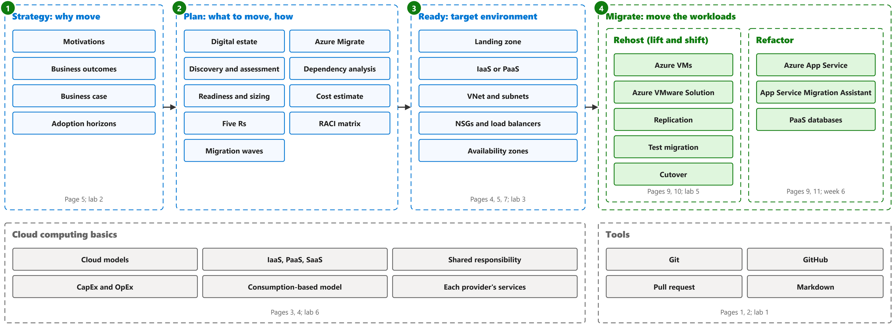

# Cloud migration

Study notes for CST8913 Cloud Migration (Algonquin College, Fall 2026), weeks 1 to 6 (the midterm). The lecture pages follow the official sources the slides copy, one page per source: one figure per part with the key terms framed, and a table that defines exactly those terms in the same order. The lab pages say what each lab practises and which concepts it needs.

## The map

Every week fits one stage of the Cloud Adoption Framework journey: strategy, plan, ready, migrate. Cloud computing basics are the ground under all of it, and Git and GitHub are the tools used all term. The table under the map lists the lecture sections and labs of each stage.

| Stage | Lecture sections | Labs |
|---|---|---|
| The whole journey | [5. Overview](lectures/cloud-adoption-framework-for-azure.md#overview) [5. Ongoing](lectures/cloud-adoption-framework-for-azure.md#ongoing) | None |
| 1. Strategy: why move | [5. Strategy](lectures/cloud-adoption-framework-for-azure.md#strategy) [5. Motivations](lectures/cloud-adoption-framework-for-azure.md#motivations) [5. Business outcomes](lectures/cloud-adoption-framework-for-azure.md#business-outcomes) [5. Financial considerations](lectures/cloud-adoption-framework-for-azure.md#financial-considerations) [5. Technical considerations](lectures/cloud-adoption-framework-for-azure.md#technical-considerations) [5. Timeline](lectures/cloud-adoption-framework-for-azure.md#timeline) [5. Business case](lectures/cloud-adoption-framework-for-azure.md#business-case) | [Levi Strauss & Co. migration case study (lab 2)](labs/levi-strauss-co-migration-case-study.md) |
| 2. Plan: what to move, how | [5. Plan](lectures/cloud-adoption-framework-for-azure.md#plan) [5. Rationalization](lectures/cloud-adoption-framework-for-azure.md#rationalization) [5. Migration strategies](lectures/cloud-adoption-framework-for-azure.md#migration-strategies) [5. Team responsibilities](lectures/cloud-adoption-framework-for-azure.md#team-responsibilities) [6. Decide, plan, execute](lectures/what-is-azure-migrate.md#decide-plan-execute) [8. Evaluate the digital estate](lectures/prepare-for-cloud-adoption-with-a-data-driven-plan.md#evaluate-the-digital-estate) [8. Readiness and suitability analysis](lectures/prepare-for-cloud-adoption-with-a-data-driven-plan.md#readiness-and-suitability-analysis) [8. Prioritize workloads and finalize the migration plan](lectures/prepare-for-cloud-adoption-with-a-data-driven-plan.md#prioritize-workloads-and-finalize-the-migration-plan) | [Levi Strauss & Co. migration case study (lab 2)](labs/levi-strauss-co-migration-case-study.md) [Discovery and assessment (lab 4)](labs/discovery-and-assessment.md) |
| 3. Ready: target environment | [5. Ready](lectures/cloud-adoption-framework-for-azure.md#ready) [5. Landing zones](lectures/cloud-adoption-framework-for-azure.md#landing-zones) [7. Architecture](lectures/windows-n-tier-application-on-azure.md#architecture) [7. Networking and load balancing](lectures/windows-n-tier-application-on-azure.md#networking-and-load-balancing) [7. Availability](lectures/windows-n-tier-application-on-azure.md#availability) | [IaaS and PaaS architecture (lab 3)](labs/iaas-and-paas-architecture.md) |
| 4. Migrate: rehost | [5. Adopt](lectures/cloud-adoption-framework-for-azure.md#adopt) [5. Migrate](lectures/cloud-adoption-framework-for-azure.md#migrate) [9. Rehost](lectures/overview-of-application-migration-examples-for-azure.md#rehost) [10. Private clouds, clusters and hosts](lectures/what-is-azure-vmware-solution.md#private-clouds-clusters-and-hosts) | [Rehosting to Azure (lab 5)](labs/rehosting-to-azure.md) |
| 4. Migrate: refactor | [9. Refactor](lectures/overview-of-application-migration-examples-for-azure.md#refactor) [11. Assess a web app with the Azure App Service Migration Assistant](lectures/migrate-an-on-premises-web-application-to-azure-app-service.md#assess-a-web-app-with-the-azure-app-service-migration-assistant) [11. Migrate a web app with the Azure App Service Migration Assistant](lectures/migrate-an-on-premises-web-application-to-azure-app-service.md#migrate-a-web-app-with-the-azure-app-service-migration-assistant) | None |
| Cloud computing basics | [3. What is cloud computing](lectures/describe-cloud-computing.md#what-is-cloud-computing) [3. Describe the shared responsibility model](lectures/describe-cloud-computing.md#describe-the-shared-responsibility-model) [3. Define cloud models](lectures/describe-cloud-computing.md#define-cloud-models) [3. Describe the consumption-based model](lectures/describe-cloud-computing.md#describe-the-consumption-based-model) [4. Describe Infrastructure as a Service](lectures/describe-cloud-service-types.md#describe-infrastructure-as-a-service) [4. Describe Platform as a Service](lectures/describe-cloud-service-types.md#describe-platform-as-a-service) [4. Describe Software as a Service](lectures/describe-cloud-service-types.md#describe-software-as-a-service) | [Cloud resource comparison (lab 6)](labs/cloud-resource-comparison.md) |
| Tools | [1. What is Git?](lectures/pro-git-getting-started.md#what-is-git) [2. About pull requests and forks](lectures/github-docs-collaborating.md#about-pull-requests-and-forks) | [Git, GitHub and Markdown (lab 1)](labs/git-github-and-markdown.md) |

## Lectures

| Week | Lecture pages |
|---|---|
| 1 | [1. Pro Git: getting started](lectures/pro-git-getting-started.md) [2. GitHub Docs: collaborating with pull requests](lectures/github-docs-collaborating.md) |
| 2 | [3. Describe cloud computing](lectures/describe-cloud-computing.md) [4. Describe cloud service types](lectures/describe-cloud-service-types.md) [5. Cloud Adoption Framework for Azure](lectures/cloud-adoption-framework-for-azure.md) [6. What is Azure Migrate?](lectures/what-is-azure-migrate.md) |
| 3 | [4. Describe cloud service types](lectures/describe-cloud-service-types.md) [5. Cloud Adoption Framework for Azure](lectures/cloud-adoption-framework-for-azure.md) [7. Windows N-tier application on Azure](lectures/windows-n-tier-application-on-azure.md) |
| 4 | [6. What is Azure Migrate?](lectures/what-is-azure-migrate.md) [8. Prepare for cloud adoption with a data-driven plan](lectures/prepare-for-cloud-adoption-with-a-data-driven-plan.md) |
| 5 | [9. Overview of application migration examples for Azure](lectures/overview-of-application-migration-examples-for-azure.md) [10. What is Azure VMware Solution?](lectures/what-is-azure-vmware-solution.md) |
| 6 | [9. Overview of application migration examples for Azure](lectures/overview-of-application-migration-examples-for-azure.md) [11. Migrate an on-premises web application to Azure App Service](lectures/migrate-an-on-premises-web-application-to-azure-app-service.md) |

## Labs

| Week | Lab | Concepts to understand |
|---|---|---|
| 1 | [Git, GitHub and Markdown](labs/git-github-and-markdown.md) | Git and GitHub, working tree and staging area, commit, Git commands, branch, push, pull request, merge, fork |
| 2 | [Levi Strauss & Co. migration case study](labs/levi-strauss-co-migration-case-study.md) | motivations, discovery questions, stakeholders and RACI matrix, the five Rs, migration schedule, decision criteria, cloud models, service types |
| 3 | [IaaS and PaaS architecture](labs/iaas-and-paas-architecture.md) | IaaS, shared responsibility, VNet, subnets, NSGs and load balancers, availability zone, PaaS, IaaS or PaaS, SaaS |
| 4 | [Discovery and assessment](labs/discovery-and-assessment.md) | digital estate, discovery and assessment, Azure Migrate appliance, dependency analysis, readiness, sizing, cost estimate, migration plan, rollback, test migration |
| 5 | [Rehosting to Azure](labs/rehosting-to-azure.md) | business drivers, rehost (lift and shift), rehost or replatform, Azure VMware Solution, migration phases, migration waves, test migration, cutover, replication |
| 6 | [Cloud resource comparison](labs/cloud-resource-comparison.md) | service models, each provider's name for the same service, similarities and differences, unique capabilities, naming conventions |
