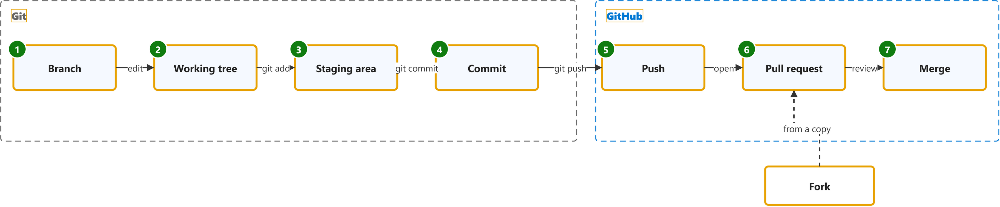
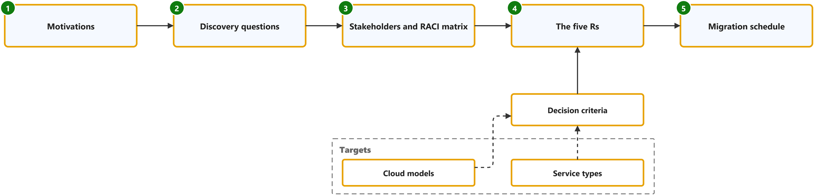
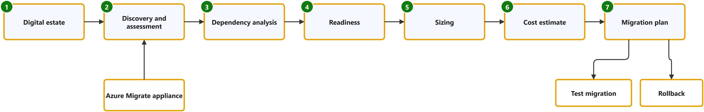
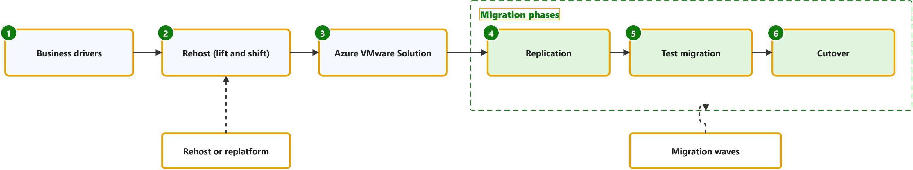
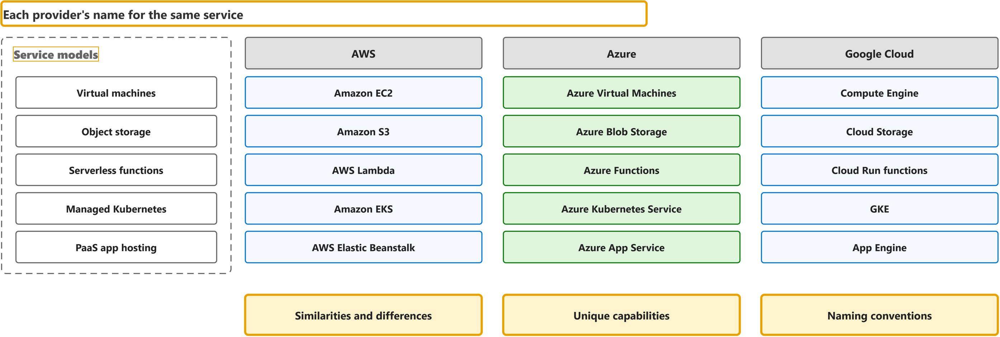

# Labs overview

One map per lab: the whole lab on one figure, in the order the lab uses its concepts. The framed boxes are the concepts each lab page explains.

## Lab 1: Git, GitHub and Markdown

[Git, GitHub and Markdown](git-github-and-markdown.md), week 1: create a private repository, work on a branch, commit, push, open a pull request and write Markdown.

## Lab 2: Levi Strauss & Co. migration case study

[Levi Strauss & Co. migration case study](levi-strauss-co-migration-case-study.md), week 2: explain why a company moves to the cloud, choose a migration approach per workload, and decide who is responsible for what.

## Lab 3: IaaS and PaaS architecture

[IaaS and PaaS architecture](iaas-and-paas-architecture.md), week 3: design the same application once on IaaS and once on PaaS, and say when each fits.

## Lab 4: Discovery and assessment

[Discovery and assessment](discovery-and-assessment.md), week 4: list the digital estate, choose how to discover it, map dependencies, check readiness, size and cost it, then prioritize and plan the migration.

## Lab 5: Rehosting to Azure

[Rehosting to Azure](rehosting-to-azure.md), week 5: state the business drivers and the migration strategy, draw the target architecture, and plan the migration and its validation.

## Lab 6: Cloud resource comparison

[Cloud resource comparison](cloud-resource-comparison.md), week 6: match the same kind of resource (compute, storage, databases, networking, identity, monitoring) across AWS, Azure and Google Cloud.

