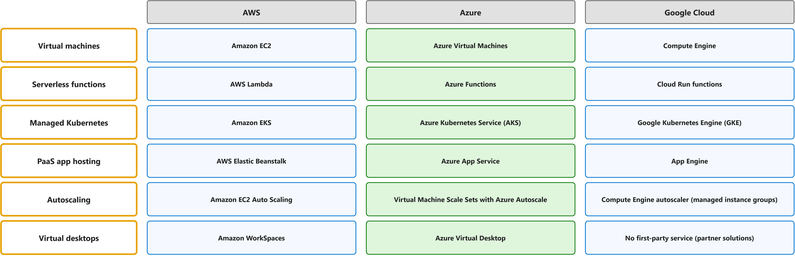
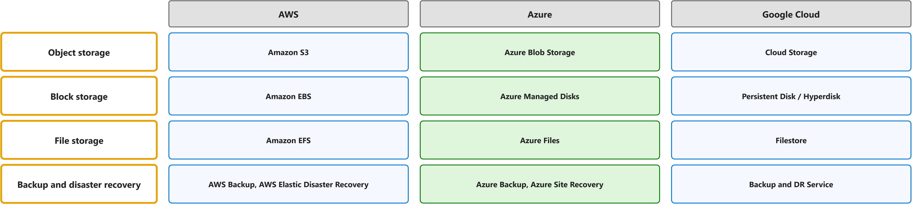
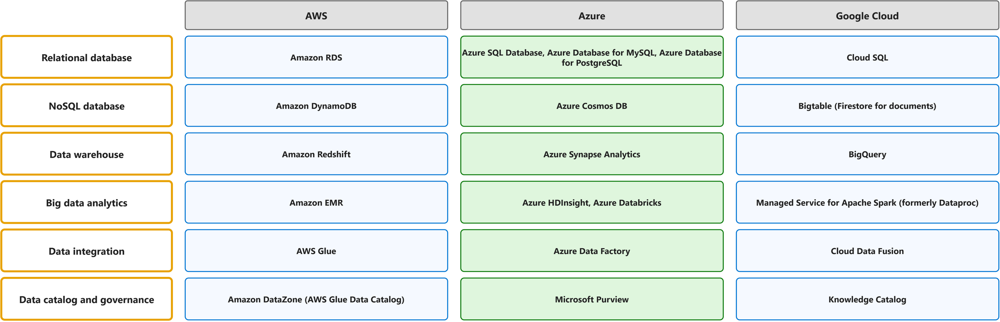
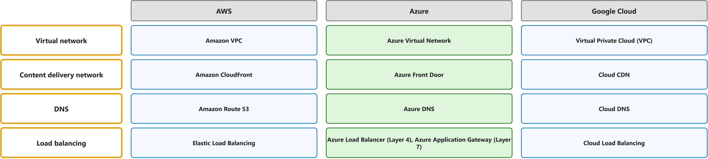
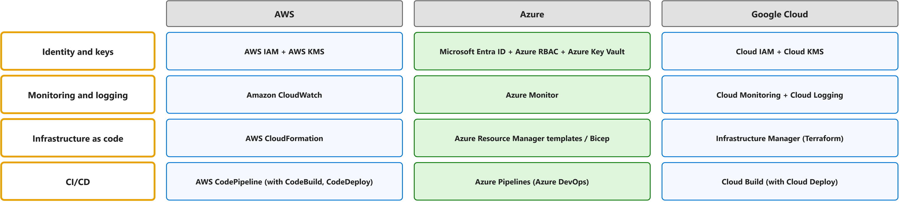
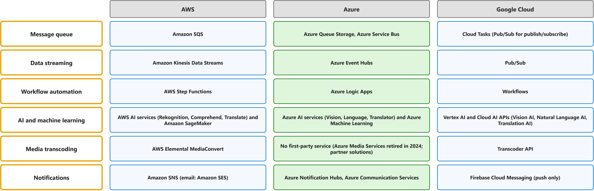

# Labs overview

One map per lab: the whole lab on one figure, in the order the lab uses its concepts; the framed boxes are the concepts each lab page explains. The table under each map defines the terms on it, in the same order: official definitions where a lecture page has one, otherwise in my own words (lab 6: the descriptions of its comparison table). Each has a Chinese translation whose key words have the same colour as in the English, and the main verb of each sentence has a red wavy underline.

## Lab 1: Git, GitHub and Markdown

[Git, GitHub and Markdown](git-github-and-markdown.md), week 1: create a private repository, work on a branch, commit, push, open a pull request and write Markdown.

| Term | Definition | 中文翻译 | Source |
|---|---|---|---|
| **Git** Git 版本控制 | "**Git** is a **free and open source** **distributed version control system** designed to handle everything from small to very large projects with **speed and efficiency**." | **Git** 是一个**免费且开源**的**分布式版本控制系统**，旨在处理从小型到超大型的各种项目，并做到**快速、高效**。 | [Git, n.d., para. 1](https://git-scm.com/#:~:text=Git%20is%20a%20free%20and%20open%20source%20distributed%20version) |
| **GitHub** GitHub 平台 | "**GitHub** is a **platform** that supports your **entire software development process**, from **planning work** to deploying and operating software." | **GitHub** 是一个**平台**，支持你的**整个软件开发流程**，从**规划工作**到部署和运营软件。 | [GitHub, n.d., para. 1](https://docs.github.com/en/get-started/start-your-journey/what-is-github#:~:text=GitHub%20is%20a%20platform%20that%20supports%20your%20entire%20software) |
| **branch** 分支 | "A "**branch**" is a **line of development**. The **most recent commit** on a branch is referred to as the **tip** of that branch." | “**分支**”是一条**开发线**。分支上**最近的一次提交**被称为该分支的**末端**（tip）。 | [Git, n.d., "branch" entry](https://git-scm.com/docs/gitglossary#Documentation/gitglossary.txt-aiddefbranchabranch:~:text=A%20%22branch%22%20is%20a%20line%20of%20development.%20The%20most%20recent) |
| **working tree** 工作区 | "The **working tree** is a **single checkout** of one version of the project. These files are pulled out of the **compressed database** in the Git directory and **placed on disk** for you to use or modify." | **工作区**是项目某一版本的**单次检出**。这些文件从 Git 目录中的**压缩数据库**中提取出来，**放在磁盘上**供你使用或修改。 | [Chacon, 2014, "The Three States" section, para. 3](https://git-scm.com/book/en/v2/Getting-Started-What-is-Git%3F#_the_three_states:~:text=The%20working%20tree%20is%20a%20single%20checkout%20of%20one%20version) |
| **staging area (index)** 暂存区 | "The **staging area** is a file, generally contained in your **Git directory**, that stores information about what will go into your **next commit**. Its technical name in Git parlance is the "**index**"..." | **暂存区**是一个文件，通常位于你的 **Git 目录**中，存储着有关**下一次提交**将包含哪些内容的信息。用 Git 的术语来说，它的技术名称是“**索引**”…… | [Chacon, 2014, "The Three States" section, para. 4](https://git-scm.com/book/en/v2/Getting-Started-What-is-Git%3F#_the_three_states:~:text=The%20staging%20area%20is%20a%20file%2C%20generally%20contained%20in%20your) |
| **commit** 提交 | "With Git, every time you **commit**, or **save the state** of your project, Git basically **takes a picture** of what all your files look like at that moment and stores a reference to that **snapshot**." | 在 Git 中，每当你**提交**，或者说**保存你的项目状态**时，Git 基本上会为你所有文件在那一刻的样子**拍一张照片**，并存储对该**快照**的一个引用。 | [Chacon, 2014, "Snapshots, Not Differences" section, para. 2](https://git-scm.com/book/en/v2/Getting-Started-What-is-Git%3F#_snapshots_not_differences:~:text=With%20Git%2C%20every%20time%20you%20commit%2C%20or%20save%20the) |
| **push** 推送 | "When you have **your project** at a point that you want to **share**, you have to **push it upstream**." | 当**你的项目**进展到你想要**分享**的程度时，你必须将它**推送到上游**。 | [Chacon, 2014, "Pushing to Your Remotes" section, para. 1](https://git-scm.com/book/en/v2/Git-Basics-Working-with-Remotes#_pushing_remotes:~:text=When%20you%20have%20your%20project%20at%20a%20point%20that) |
| **pull request** 拉取请求（PR） | "**Pull requests** are **proposals** to merge **code changes** into a **project**." | **拉取请求**是一种**提议**：将**代码更改**合并到一个**项目**中。 | [GitHub, n.d., para. 1](https://docs.github.com/en/pull-requests/reference/pull-requests#:~:text=Pull%20requests%20are%20proposals%20to%20merge%20code%20changes%20into) |
| **merge** 合并 | "**Merging** takes the changes from **one branch** (in the same repository or from a **fork**), and **applies them into another**." | **合并**会获取来自**一个分支**（位于同一仓库中或来自某个**复刻**）的更改，并将其**应用到另一个分支**中。 | [GitHub, n.d., "merge" section, para. 1](https://docs.github.com/en/get-started/learning-about-github/github-glossary#merge:~:text=Merging%20takes%20the%20changes%20from%20one%20branch%20%28in%20the%20same) |
| **fork** 复刻（Fork） | "A **fork** is a **separate repository** with its **own settings** and **collaboration space**." | **复刻**是一个**独立的仓库**，拥有**自己的设置**和**协作空间**。 | [GitHub, n.d., "What makes forks distinct from branches" section, para. 1](https://docs.github.com/en/pull-requests/reference/forks#what-makes-forks-distinct-from-branches:~:text=A%20fork%20is%20a%20separate%20repository%20with%20its%20own) |

## Lab 2: Levi Strauss & Co. migration case study

[Levi Strauss & Co. migration case study](levi-strauss-co-migration-case-study.md), week 2: explain why a company moves to the cloud, choose a migration approach per workload, and decide who is responsible for what.

| Term | Definition | 中文翻译 | Source |
|---|---|---|---|
| **motivation** 动机 | "Various **motivations** can drive **business transformations** that are supported by cloud adoption. Several motivations likely apply **at the same time**."  *In this lab:* Levi Strauss & Co. moved for its direct-to-consumer goal, technical debt from 160 applications and nine ERPs, datacenter cost, standardization and AI readiness. | 各种**动机**可以推动由云采用所支持的**业务转型**。可能**同时**有多个动机适用。  *本实验*：Levi Strauss & Co. 迁移的动机包括直面消费者（DTC）目标、160 个应用和九套 ERP 带来的技术债、数据中心成本、标准化以及 AI 就绪。 | [Microsoft, 2022, October 18, "Motivations" section, para. 1](https://github.com/MicrosoftDocs/cloud-adoption-framework/blob/a5351162040659171fbb4f5674ce36ac9259deb3/docs/strategy/motivations.md#motivations:~:text=Various%20motivations%20can%20drive%20business%20transformations%20that%20are) |
| **Discovery questions** 调研问题 | Discovery questions are questions you ask the **business and technical owners** to learn about **workloads**, goals and **constraints** before you plan a migration.  *In this lab:* Questions covered the ~160 applications, server usage, data in the nine ERPs, links across 110 countries, security, dependencies and acceptable downtime. | 调研问题是在规划迁移之前向**业务和技术负责人**提出的问题，用于了解**工作负载**、目标和**约束**。  *本实验*：问题涵盖约 160 个应用、服务器使用情况、九套 ERP 中的数据、110 个国家之间的网络连接、安全、依赖关系以及可接受的停机时间。 | My own words |
| **RACI matrix** RACI 责任分配矩阵 | "**Align responsibilities** by developing a **cross-team matrix** that identifies **responsible, accountable, consulted, and informed (RACI**) parties."  *In this lab:* The Chief Digital & Technology Officer is accountable for strategy and budget, while the infrastructure director is accountable for most migration activities. | **协调职责**：制定一个**跨团队矩阵**，用于确定**负责、批准、咨询和知情（RACI**）的各方。  *本实验*：首席数字与技术官对战略和预算负最终责任（A），而基础设施总监对大部分迁移活动负最终责任。 | [Microsoft, n.d., para. 1](https://learn.microsoft.com/en-us/azure/cloud-adoption-framework/organize/raci-alignment#:~:text=Align%20responsibilities%20by%20developing%20a%20cross%2Dteam%20matrix%20that) |
| **The five Rs** 五个 R（合理化策略） | The five Rs are the rationalization options in the Cloud Adoption Framework (**rehost**, refactor, rearchitect, rebuild and **replace**) for deciding how each **workload** moves to the cloud.  *In this lab:* Most servers were rehosted, databases and third-party apps refactored, the nine ERPs replaced by one global ERP, and unneeded apps retired. | 五个 R 是云采用框架中的合理化选项（**重新托管**、重构、重新架构、重建和**替换**），用于决定每个**工作负载**如何迁移到云。  *本实验*：大多数服务器采用重新托管，数据库和第三方应用进行重构，九套 ERP 被一个全球 ERP 替换，不再需要的应用被淘汰。 | My own words |
| **Migration schedule** 迁移时间表 | A migration schedule sets the **order and dates** in which workloads move to the cloud, usually grouped into **waves**.  *In this lab:* Six phases: discover and assess (months 1 to 2), landing zone, pilot (month 3), waves (months 4 to 8), cutover and exit, then optimize. | 迁移时间表规定工作负载迁移到云的**顺序和日期**，通常按**迁移波次**分组。  *本实验*：分为六个阶段：发现与评估（第 1 至 2 个月）、准备着陆区、试点（第 3 个月）、分批迁移（第 4 至 8 个月）、切换与退出数据中心，然后优化。 | My own words |
| **Decision criteria** 决策标准 | Decision criteria are the **business and technical factors** used to choose a **migration approach** for each workload.  *In this lab:* Business criteria were cost, speed of the datacenter exit, store continuity and DTC fit; technical ones were compatibility, security, performance, resilience and operability. | 决策标准是一组**业务和技术因素**，用来为每个工作负载选择**迁移方法**。  *本实验*：业务标准为成本、退出数据中心的速度、门店业务连续性和与 DTC 战略的契合；技术标准为兼容性、安全、性能、韧性和可运维性。 | My own words |
| **Cloud models** 云部署模型 | Cloud models are the ways to deploy cloud resources, such as **public cloud**, **private cloud** and **hybrid cloud**, based on where they run and who controls them.  *In this lab:* Levi's moved most workloads to Azure, a public cloud, and kept the remaining on-premises servers managed through Azure Arc, a hybrid setup. | 云模型是部署云资源的方式，例如**公有云**、**私有云**和**混合云**，取决于资源在哪里运行以及由谁控制。  *本实验*：Levi's 把大部分工作负载迁到公有云 Azure，剩余的本地服务器通过 Azure Arc 统一管理，形成混合云架构。 | My own words |
| **Service types** 云服务类型 | Service types are the cloud service models, **IaaS**, PaaS and **SaaS**, which differ in how much of the stack the **provider** manages for you.  *In this lab:* Rehosted servers run on IaaS VMs, databases move to PaaS Azure SQL Managed Instance, and some applications could be replaced with SaaS. | 服务类型是云服务模型，即 **IaaS**、PaaS 和 **SaaS**，它们的区别在于**提供商**替你管理多少技术栈。  *本实验*：重新托管的服务器运行在 IaaS 虚拟机上，数据库迁到 PaaS 的 Azure SQL Managed Instance，部分应用可以用 SaaS 替代。 | My own words |

## Lab 3: IaaS and PaaS architecture

[IaaS and PaaS architecture](iaas-and-paas-architecture.md), week 3: design the same application once on IaaS and once on PaaS, and say when each fits.

| Term | Definition | 中文翻译 | Source |
|---|---|---|---|
| **IaaS or PaaS** IaaS 还是 PaaS | IaaS or PaaS is the hosting choice between running the app on **virtual machines** you manage and running it on **managed platform services**.  *In this lab:* IaaS needs 14 VMs the team patches, scales and backs up; PaaS needs none, so PaaS was chosen for the React, Flask and PostgreSQL app. | IaaS 还是 PaaS 是一种托管选择：在你自己管理的**虚拟机**上运行应用，还是在**托管的平台服务**上运行应用。  *本实验*：IaaS 需要团队自己打补丁、扩缩和备份 14 台虚拟机；PaaS 一台也不需要，因此为这个 React、Flask 和 PostgreSQL 应用选择了 PaaS。 | My own words |
| **Infrastructure as a Service (IaaS)** 基础设施即服务 | "**Infrastructure as a service (IaaS**) is the **most flexible** category of cloud services, as it provides you the **maximum amount of control** for your cloud resources."  *In this lab:* The IaaS design runs every piece of the three-tier app on 14 VMs the team builds and maintains; Azure supplies only VMs, disks and network. | **基础设施即服务（IaaS**）是**最灵活**的云服务类别，因为它为你提供对云资源的**最大控制权**。  *本实验*：IaaS 设计把三层应用的每个部分都运行在团队自建自维护的 14 台虚拟机上；Azure 只提供虚拟机、磁盘和网络。 | [Microsoft, n.d., para. 1](https://web.archive.org/web/20250108115137/https://learn.microsoft.com/en-us/training/modules/describe-cloud-service-types/2-describe-infrastructure-service#:~:text=Infrastructure%20as%20a%20service%20%28IaaS%29%20is%20the%20most%20flexible) |
| **VNet, subnets, NSGs and load balancers** 虚拟网络、子网、网络安全组和负载均衡器 | These are the Azure networking pieces of an IaaS design: a **virtual network** with subnets, **network security groups** that filter traffic, and **load balancers** that spread requests across VMs.  *In this lab:* Each tier has its own subnet whose NSG admits only the tier in front, and HAProxy load balancer VMs spread traffic to web and Flask VMs. | 这些是 IaaS 设计中的 Azure 网络组件：带子网的**虚拟网络**、筛选流量的**网络安全组**，以及在虚拟机之间分配请求的**负载均衡器**。  *本实验*：每一层都有自己的子网，其 NSG 只允许来自前一层的流量，HAProxy 负载均衡虚拟机把流量分发到 Web 和 Flask 虚拟机。 | My own words |
| **availability zone** 可用区 | "Many Azure regions provide **availability zones**, which are **separated groups of datacenters** within a region. Each availability zone has **independent power, cooling, and networking infrastructure**..."  *In this lab:* Every tier in the IaaS design has two VMs placed in different availability zones, and App Service runs two instances in different zones. | 许多 Azure 区域都提供**可用区**，即区域内**彼此分隔的数据中心组**。每个可用区都有**独立的电源、冷却和网络基础结构**……  *本实验*：IaaS 设计中每一层都有两台位于不同可用区的虚拟机，App Service 也在不同可用区运行两个实例。 | [Microsoft, n.d., para. 1](https://learn.microsoft.com/en-us/azure/reliability/availability-zones-overview#:~:text=Many%20Azure%20regions%20provide%20availability%20zones%2C%20which%20are%20separated%20groups) |
| **Load balancer VM** 负载均衡虚拟机 | A load balancer VM is a virtual machine that receives **incoming requests** and spreads them across the **web servers** behind it.  *In this lab:* Two HAProxy plus keepalived VMs form the public entry point: the active one holds the public IP and the standby takes it over on failure. | 负载均衡虚拟机是一台接收**传入请求**并将其分发到后端 **Web 服务器**的虚拟机。  *本实验*：两台 HAProxy 加 keepalived 虚拟机构成公共入口：主机持有公网 IP，备机在其故障时接管该 IP。 | My own words |
| **Web VM** Web 虚拟机 | A web VM is a virtual machine in the **web tier** that serves the pages of the site and passes requests to the **app tier**.  *In this lab:* Two Nginx web VMs serve the React files and forward /api requests to the internal HAProxy load balancer. | Web 虚拟机是 **Web 层**中的一台虚拟机，负责提供网站页面并将请求转发到**应用层**。  *本实验*：两台 Nginx Web 虚拟机提供 React 文件，并把 /api 请求转发给内部 HAProxy 负载均衡器。 | My own words |
| **App VM** 应用虚拟机 | An app VM is a virtual machine in the **business tier** that runs the **application logic** between the web tier and the database.  *In this lab:* Two Flask plus Gunicorn VMs with private IPs only run the Flask API behind the internal load balancer. | 应用虚拟机是**业务层**中的一台虚拟机，在 Web 层和数据库之间运行**应用逻辑**。  *本实验*：两台只有私有 IP 的 Flask 加 Gunicorn 虚拟机在内部负载均衡器之后运行 Flask API。 | My own words |
| **Database VM** 数据库虚拟机 | A database VM is a virtual machine in the **data tier** that runs the **database server** and stores the data of the application.  *In this lab:* A PostgreSQL primary VM and a standby VM on managed disks are kept in sync by streaming replication. | 数据库虚拟机是**数据层**中的一台虚拟机，运行**数据库服务器**并存储应用的数据。  *本实验*：一台 PostgreSQL 主虚拟机和一台备用虚拟机运行在托管磁盘上，通过流复制保持同步。 | My own words |
| **shared responsibility model** 责任共担模型 | "With the **shared responsibility model**, these responsibilities get shared between the **cloud provider** and the **consumer**."  *In this lab:* On IaaS the team manages all software on the 14 VMs; on PaaS Azure runs the servers, patching, scaling and backups. | 在**责任共担模型**中，这些责任由**云提供商**和**使用者**共同承担。  *本实验*：在 IaaS 中团队管理 14 台虚拟机上的全部软件；在 PaaS 中由 Azure 负责服务器、打补丁、扩缩和备份。 | [Microsoft, n.d., para. 3](https://web.archive.org/web/20250108163106/https://learn.microsoft.com/en-us/training/modules/describe-cloud-compute/4-describe-shared-responsibility-model#:~:text=With%20the%20shared%20responsibility%20model%2C%20these%20responsibilities%20get%20shared) |
| **Platform as a Service (PaaS)** 平台即服务 | "**Platform as a service (PaaS**) is a **middle ground** between **renting space in a datacenter** (infrastructure as a service) and paying for a **complete and deployed solution** (software as a service)."  *In this lab:* The PaaS design replaces each tier with a managed service: Static Web Apps, App Service and PostgreSQL Flexible Server, so no VMs remain. | **平台即服务（PaaS**）是一种**折中方案**，介于**在数据中心租用空间**（基础设施即服务）与为**完整且已部署的解决方案**付费（软件即服务）之间。  *本实验*：PaaS 设计用托管服务替换每一层：Static Web Apps、App Service 和 PostgreSQL Flexible Server，因此不再有虚拟机。 | [Microsoft, n.d., para. 1](https://web.archive.org/web/20250109030533/https://learn.microsoft.com/en-us/training/modules/describe-cloud-service-types/3-describe-platform-service#:~:text=Platform%20as%20a%20service%20%28PaaS%29%20is%20a%20middle%20ground) |
| **Azure Static Web Apps** Azure 静态 Web 应用 | Azure Static Web Apps is a service that hosts **static web front ends**, such as HTML, CSS and JavaScript files, and builds and deploys them from a **code repository**.  *In this lab:* Static Web Apps (Standard) serves the React build from a global CDN and forwards /api requests to the linked App Service. | Azure 静态 Web 应用是一项服务，用于托管**静态 Web 前端**（例如 HTML、CSS 和 JavaScript 文件），并从**代码存储库**构建和部署它们。  *本实验*：Static Web Apps（Standard）从全球 CDN 提供 React 构建文件，并把 /api 请求转发给关联的 App Service。 | My own words |
| **Azure App Service** Azure 应用服务 | "**Azure App Service** is a **fully managed platform** for your web apps. You can use it to **run and scale** your web apps with minimal setup. Microsoft manages the **infrastructure**, operating system updates, load balancing, and scale-up/scale-down logic as needed."  *In this lab:* App Service (Premium v3) runs the Flask API on at least two instances in different zones, with a built-in load balancer and autoscale. | **Azure 应用服务**是适用于 Web 应用的**完全托管平台**。你可以使用它以最少的设置**运行和缩放** Web 应用。Microsoft 根据需要管理**基础结构**、操作系统更新、负载均衡以及纵向扩展/纵向缩减逻辑。  *本实验*：App Service（Premium v3）在不同可用区的至少两个实例上运行 Flask API，并自带负载均衡和自动扩缩。 | [Microsoft, 2022, "Why move a web application to Azure App Service?" section, para. 1](https://web.archive.org/web/20221202123525/https://learn.microsoft.com/en-us/training/modules/migrate-app-service-migration-assistant/3-understand-assessment#why-move-a-web-application-to-azure-app-service:~:text=Azure%20App%20Service%20is%20a%20fully%20managed%20platform%20for) |
| **Azure Database for PostgreSQL** Azure PostgreSQL 托管数据库 | Azure Database for PostgreSQL is a **managed database service** that runs PostgreSQL while Azure handles patching, **backups** and **high availability**.  *In this lab:* PostgreSQL Flexible Server (General Purpose) gives zone-redundant high availability and automatic backups, reachable only privately through VNet integration. | Azure Database for PostgreSQL 是一项**托管数据库服务**，运行 PostgreSQL，并由 Azure 负责修补、**备份**和**高可用性**。  *本实验*：PostgreSQL Flexible Server（General Purpose）提供区域冗余高可用和自动备份，只能通过 VNet 集成以私有方式访问。 | My own words |
| **Software as a Service (SaaS)** 软件即服务 | "With **SaaS**, you’re essentially **renting or using** a **fully developed application**."  *In this lab:* Neither design delivers the app as SaaS; only provider-run tools around it, such as the Azure portal, are used as finished services. | 借助 **SaaS**，你实质上是在**租用或使用**一个**完全开发好的应用程序**。  *本实验*：两种设计都没有把应用本身做成 SaaS；只有周边由提供商运行的工具（例如 Azure 门户）是作为成品服务直接使用的。 | [Microsoft, n.d., para. 1](https://web.archive.org/web/20250108145750/https://learn.microsoft.com/en-us/training/modules/describe-cloud-service-types/4-describe-software-service#:~:text=renting%20or%20using%20a%20fully%20developed%20application) |

## Lab 4: Discovery and assessment

[Discovery and assessment](discovery-and-assessment.md), week 4: list the digital estate, choose how to discover it, map dependencies, check readiness, size and cost it, then prioritize and plan the migration.

| Term | Definition | 中文翻译 | Source |
|---|---|---|---|
| **digital estate** 数字资产 | "For each of these outcomes, the first step starts with a **clear understanding** of the **assets** (applications, data, and VMs) you are responsible for today. Those assets collectively are referred to as your **digital estate**."  *In this lab:* Five servers: WEB-01, APP-01, DB-01, DC-01 and FILE-01, with their applications and data. | 对于上述每种结果，第一步都是**清楚了解**你目前负责的**资产**（应用程序、数据和虚拟机）。这些资产统称为你的**数字资产**。  *本实验*：五台服务器：WEB-01、APP-01、DB-01、DC-01 和 FILE-01，以及其上的应用和数据。 | [Microsoft, 2022, "Understand your digital estate" section, para. 1](https://web.archive.org/web/20220804114917/https://docs.microsoft.com/en-us/learn/modules/cloud-adoption-framework-plan/4-exercise-digital-estate-assessment#understand-your-digital-estate:~:text=For%20each%20of%20these%20outcomes%2C%20the%20first%20step%20starts) |
| **Discovery and assessment** 发现和评估 | Discovery and assessment is the Azure Migrate step that finds your **on-premises servers** and then checks their Azure **readiness**, right size and **monthly cost**.  *In this lab:* Discovery collects the five servers' configuration, usage, software and connections; assessment then judges each one's readiness, VM size and monthly cost. | 发现和评估是 Azure Migrate 中的一个步骤：先找出**本地服务器**，再检查它们的 Azure **就绪情况**、合适大小和**每月成本**。  *本实验*：发现收集五台服务器的配置、使用情况、软件和连接；评估再据此判断每台服务器的就绪度、虚拟机规格和月度成本。 | My own words |
| **dependency analysis** 依赖分析 | "**Dependency analysis**: Understand the **network dependencies** between servers in your datacenter so that you can make **high-confidence migration plans** without missing any **critical dependency**."  *In this lab:* It confirms APP-01 depends on DB-01 and all servers use DC-01 on ports 88, 389 or 53, so WEB-01, APP-01 and DB-01 move as group 1. | **依赖分析**：了解数据中心内服务器之间的**网络依赖关系**，以便制定**高可信度的迁移计划**，而不会遗漏任何**关键依赖关系**。  *本实验*：它确认 APP-01 依赖 DB-01，所有服务器通过端口 88、389 或 53 使用 DC-01，因此 WEB-01、APP-01 和 DB-01 作为第 1 组一起迁移。 | [Microsoft, n.d., "Plan" section, bullet 4](https://learn.microsoft.com/en-us/azure/migrate/migrate-services-overview#plan:~:text=Dependency%20analysis%3A%20Understand%20the%20network%20dependencies%20between%20servers) |
| **readiness** 就绪性（Azure 就绪度） | "**Azure readiness**: Assess whether **on-premises servers**, SQL servers, and **web apps** are **ready for migration** to Azure."  *In this lab:* WEB-01, APP-01 and DC-01 are Conditionally Ready, DB-01 is Insufficient Information, and FILE-01 on Windows Server 2012 R2 is Not Ready. | **Azure 就绪度**：评估**本地服务器**、SQL 服务器和 **Web 应用**是否已**准备好迁移**到 Azure。  *本实验*：WEB-01、APP-01 和 DC-01 为有条件就绪，DB-01 为信息不足，运行 Windows Server 2012 R2 的 FILE-01 为未就绪。 | [Microsoft, n.d., "Plan" section, bullet 1](https://learn.microsoft.com/en-us/azure/migrate/migrate-services-overview#plan:~:text=Azure%20readiness%3A%20Assess%20whether%20on%2Dpremises%20servers%2C%20SQL%20servers) |
| **sizing** 规格估算（合理定型） | "**Right-sizing**: Estimate the **size of Azure virtual machines (VMs**), the **Azure SQL configuration**, and the number of **Azure VMware Solution nodes** after migration."  *In this lab:* Performance-based sizing from about 30 days of usage data right-sizes the five VMs; as-is sizing would oversize most and may undersize DB-01. | **合理定型**：估算 **Azure 虚拟机（VM）的大小**、**Azure SQL 配置**，以及迁移后 **Azure VMware Solution 节点**的数量。  *本实验*：基于约 30 天使用数据的性能规格可以为五台虚拟机合理定型；按现状定型会让大多数偏大，并可能让 DB-01 偏小。 | [Microsoft, n.d., "Plan" section, bullet 2](https://learn.microsoft.com/en-us/azure/migrate/migrate-services-overview#plan:~:text=Right%2Dsizing%3A%20Estimate%20the%20size%20of%20Azure%20virtual%20machines) |
| **cost estimate** 成本估算 | "**Azure cost estimation**: Estimate costs for running **on-premises servers** in Azure."  *In this lab:* Monthly cost depends on VM size and disk type (DB-01 likely Premium SSD), Azure Hybrid Benefit licensing and reserved instances. | **Azure 成本估算**：估算在 Azure 中运行**本地服务器**的成本。  *本实验*：月度成本取决于虚拟机规格和磁盘类型（DB-01 可能需要 Premium SSD）、Azure 混合权益许可以及预留实例。 | [Microsoft, n.d., "Plan" section, bullet 3](https://learn.microsoft.com/en-us/azure/migrate/migrate-services-overview#plan:~:text=Azure%20cost%20estimation%3A%20Estimate%20costs%20for%20running%20on%2Dpremises%20servers) |
| **migration plan** 迁移计划 | "Create an effective **cloud migration plan** that includes detailed information about the applications you want to migrate, **application and database availability**, **downtime constraints**, and **migration milestones**."  *In this lab:* Order: a new DC in Azure, then FILE-01 with its OS upgrade, then group 1 (WEB-01, APP-01, DB-01) in one window, then retire DC-01. | 制定有效的**云迁移计划**，其中包括有关要迁移的应用程序的详细信息、**应用程序和数据库可用性**、**停机时间限制**以及**迁移里程碑**。  *本实验*：顺序：先在 Azure 中新建域控制器，然后迁移并升级 FILE-01 的操作系统，再在一个维护窗口内迁移第 1 组（WEB-01、APP-01、DB-01），最后退役 DC-01。 | [Microsoft, 2022, "Finalize the migration plan" section, para. 2](https://web.archive.org/web/20220804114917/https://docs.microsoft.com/en-us/learn/modules/cloud-adoption-framework-plan/4-exercise-digital-estate-assessment#finalize-the-migration-plan:~:text=Create%20an%20effective%20cloud%20migration%20plan%20that%20includes%20detailed) |
| **Azure Migrate appliance** Azure Migrate 设备（发现用虚拟机） | "The **Azure Migrate appliance** is a **virtual appliance** that can be deployed on a server in your datacenter. The appliance collects the **configuration and performance data** for your servers and **continually sends** it to the Azure Migrate service."  *In this lab:* An OVA-deployed VM on vCenter reads the five servers' data over port 443 with a read-only account, installing nothing on them. | **Azure Migrate 设备**是一种**虚拟设备**，可部署在你数据中心的服务器上。该设备收集服务器的**配置和性能数据**，并**持续将其发送**到 Azure Migrate 服务。  *本实验*：一台通过 OVA 部署在 vCenter 上的虚拟机用只读账户经 443 端口读取五台服务器的数据，不在它们上面安装任何东西。 | [Microsoft, n.d., "Decide" section, para. 2](https://learn.microsoft.com/en-us/azure/migrate/migrate-services-overview#decide:~:text=The%20Azure%20Migrate%20appliance%20is%20a%20virtual%20appliance%20that%20can) |
| **test migration** 测试迁移 | "**Test migration** **simulates the migration** by creating an Azure VM using **replicated data** (usually migrating to a **non-production VNet** in your Azure subscription)."  *In this lab:* Each server is copied into an isolated Azure network and checked while the original keeps running, then the copy is cleaned up. | **测试迁移**会**模拟迁移**，方法是使用**复制的数据**创建 Azure 虚拟机（通常迁移到你 Azure 订阅中的**非生产虚拟网络**）。  *本实验*：每台服务器被复制到隔离的 Azure 网络中进行检查，同时原服务器继续运行，检查完毕后清理该副本。 | [Microsoft, n.d., "Run a test migration" section, bullet 2](https://learn.microsoft.com/en-us/azure/migrate/tutorial-migrate-vmware#run-a-test-migration:~:text=Test%20migration%20simulates%20the%20migration%20by%20creating%20an%20Azure%20VM) |
| **Rollback** 回滚 | A rollback is the planned way to return a **workload** to its **original on-premises environment** if a migration fails or causes problems.  *In this lab:* If a check fails, such as APP-01 cannot reach DB-01, DNS points back on premises, the shut-down originals restart and Azure VMs stop. | 回滚是在迁移失败或引发问题时，将**工作负载**恢复到**原始本地环境**的预定方案。  *本实验*：如果检查失败（例如 APP-01 无法连接 DB-01），就把 DNS 指回本地，重启已关机的原服务器，并停止 Azure 虚拟机。 | My own words |

## Lab 5: Rehosting to Azure

[Rehosting to Azure](rehosting-to-azure.md), week 5: state the business drivers and the migration strategy, draw the target architecture, and plan the migration and its validation.

| Term | Definition | 中文翻译 | Source |
|---|---|---|---|
| **business driver** 业务驱动因素 | "A **business driver** defines why a **workload** needs to **change** in order to support a **specific business goal**."  *In this lab:* L&I had over 400 aging servers and 200 applications built up over 45 years, and a 2021 state law encouraged agencies to use the cloud. | **业务驱动因素**定义了**工作负载**为何需要**变更**，以支持**特定业务目标**。  *本实验*：L&I 有 45 年来积累的 400 多台老旧服务器和 200 个应用，而且 2021 年的州法律鼓励政府机构使用云。 | [Microsoft, n.d., "Determine business drivers before migration" section, para. 1](https://learn.microsoft.com/en-us/azure/cloud-adoption-framework/plan/select-cloud-migration-strategy#determine-business-drivers-before-migration:~:text=A%20business%20driver%20defines%20why%20a%20workload%20needs%20to%20change) |
| **Rehost** 重新托管 | "Also known as a **lift and shift migration**, a **rehost effort** moves a **current state asset** to the chosen cloud provider with **minimal change** to the overall architecture."  *In this lab:* L&I rehosted its VMware VMs to Azure VMware Solution without code changes, so 200 applications could leave the datacenters within nine months. | 也称为**直接迁移（lift and shift**）的**重新托管工作**，会将**当前状态的资产**迁移到所选的云提供商，并对整体架构做**最小的更改**。  *本实验*：L&I 把 VMware 虚拟机不改代码地重新托管到 Azure VMware Solution，使 200 个应用能在九个月内迁出数据中心。 | [Microsoft, 2023, March 1, "Rehost" section, para. 1](https://github.com/MicrosoftDocs/cloud-adoption-framework/blob/e29e30c4ebd52d8446d00f5dfdee5742328c2c11/docs/digital-estate/5-rs-of-rationalization.md#rehost:~:text=Also%20known%20as%20a%20lift%20and%20shift%20migration%2C%20a%20rehost%20effort) |
| **Azure VMware Solution (AVS)** Azure VMware 解决方案 | "**Azure VMware Solution** provides **private clouds** that contain **VMware vSphere clusters** built from **dedicated bare-metal Azure infrastructure**."  *In this lab:* An Azure VMware Solution private cloud runs vCenter, NSX and vSAN on dedicated bare-metal hosts, linked to on premises by ExpressRoute Global Reach. | **Azure VMware 解决方案**提供**私有云**，其中包含 **VMware vSphere 群集**，这些群集基于**专用裸机 Azure 基础结构**构建。  *本实验*：Azure VMware Solution 私有云在专用裸金属主机上运行 vCenter、NSX 和 vSAN，并通过 ExpressRoute Global Reach 与本地连接。 | [Microsoft, n.d., para. 1](https://learn.microsoft.com/en-us/azure/azure-vmware/introduction#:~:text=Azure%20VMware%20Solution%20provides%20private%20clouds%20that%20contain%20VMware%20vSphere) |
| **Migration phases** 迁移阶段 | Migration phases are the ordered stages of a migration, from **assessing** and **replicating** workloads to testing, **cutting over** and optimizing them in Azure.  *In this lab:* Prepare the private cloud and HCX, discover and group, a pilot of about 10 VMs, main waves of about 75 VMs, then stabilize and decommission. | 迁移阶段是迁移的有序步骤，从**评估**和**复制**工作负载，到测试、**切换**以及在 Azure 中优化它们。  *本实验*：准备私有云和 HCX，发现并分组，先试点约 10 台虚拟机，再按每批约 75 台进行主要迁移，最后稳定并退役本地环境。 | My own words |
| **replication** 复制 | "During **initial replication**, a **VM snapshot** is created. Disk data from the snapshot is replicated to **replica managed disks (seed disks**) in Azure. After initial replication finishes, **delta replication** begins."  *In this lab:* HCX copies each VM from the on-premises vSphere datacenter to the private cloud while it keeps running, so cutover only syncs the last changes. | 在**初始复制**期间，会创建**虚拟机快照**。快照中的磁盘数据会复制到 Azure 中的**副本托管磁盘（种子磁盘**）。初始复制完成后，**增量复制**开始。  *本实验*：HCX 在虚拟机继续运行的同时把它从本地 vSphere 数据中心复制到私有云，因此切换时只需同步最后的变更。 | [Microsoft, n.d., "Track migrations" section, bullet 2 ("Replication occurs as follows"), sub-bullet 2](https://learn.microsoft.com/en-us/azure/migrate/tutorial-migrate-vmware#track-migrations:~:text=During%20initial%20replication%2C%20a%20VM%20snapshot%20is%20created.%20Disk%20data) |
| **test migration** 测试迁移 | "**Test migration** **simulates the migration** by creating an Azure VM using **replicated data** (usually migrating to a **non-production VNet** in your Azure subscription)."  *In this lab:* Before cutover, each wave is test-migrated into an isolated network segment in the private cloud while production keeps running. | **测试迁移**会**模拟迁移**，方法是使用**复制的数据**创建 Azure 虚拟机（通常迁移到你 Azure 订阅中的**非生产虚拟网络**）。  *本实验*：切换前，每一批都会被测试迁移到私有云中的隔离网段，同时生产环境继续运行。 | [Microsoft, n.d., "Run a test migration" section, bullet 2](https://learn.microsoft.com/en-us/azure/migrate/tutorial-migrate-vmware#run-a-test-migration:~:text=Test%20migration%20simulates%20the%20migration%20by%20creating%20an%20Azure%20VM) |
| **cutover** 切换 | "You can perform **final migrations (Cutover**) for these servers. ... By default Azure Migrate **shuts down the source** (on-premises or AVS) VM, and runs an **on-demand replication** to **synchronize** any VM changes that occurred since the last replication occurred."  *In this lab:* After cutover, a wave proceeds only if smoke tests and owner sign-offs pass, performance stays within about 10% of baseline, and 48 hours stay quiet. | 你可以对这些服务器执行**最终迁移（切换**）。……默认情况下，Azure Migrate 会**关闭源**（本地或 AVS）虚拟机，并运行**按需复制**，以**同步**自上次复制以来发生的任何虚拟机更改。  *本实验*：切换后，只有冒烟测试和应用负责人签字通过、性能在基线约 10% 以内且 48 小时内无严重事件，这一批才算完成。 | [Microsoft, n.d., "Track migrations" section, bullet 3 ("Completion"), sub-bullet 1](https://learn.microsoft.com/en-us/azure/migrate/tutorial-migrate-vmware#track-migrations:~:text=You%20can%20perform%20final%20migrations%20%28Cutover%29%20for%20these%20servers) |
| **Rehost or replatform** 重新托管还是平台重构 | Rehost or replatform is the choice between moving a workload to Azure VMs **unchanged** and moving it with **small changes** so it can use **managed services**.  *In this lab:* L&I rehosted first for speed and replatforms afterwards, for example moving a SQL Server database to Azure SQL Managed Instance. | 重新托管还是平台重构是一种选择：将工作负载**原样**迁移到 Azure 虚拟机，还是做**少量修改**后迁移以使用**托管服务**。  *本实验*：L&I 为了速度先重新托管，之后再做平台重构，例如把 SQL Server 数据库迁到 Azure SQL Managed Instance。 | My own words |
| **migration wave** 迁移批次（波次） | "To improve your odds of success, plan a series of subsequent **waves of migrations**. Identify a **small set of prioritized workloads** to migrate, test, and release to production in a **two-week sprint**."  *In this lab:* Each wave holds an application with its web, application and database VMs, ordered from least to most critical, with AD DS and DNS moved last. | 为了提高成功几率，请规划一系列后续的**迁移波次**。确定**一小组优先工作负载**，在为期**两周的冲刺**中完成迁移、测试并发布到生产环境。  *本实验*：每一批包含一个应用及其 Web、应用和数据库虚拟机，按业务关键性从低到高排序，AD DS 和 DNS 最后迁移。 | [Microsoft, 2022, "Output of the exercise" section, para. 3](https://web.archive.org/web/20220804114917/https://docs.microsoft.com/en-us/learn/modules/cloud-adoption-framework-plan/4-exercise-digital-estate-assessment#output-of-the-exercise:~:text=To%20improve%20your%20odds%20of%20success%2C%20plan%20a%20series%20of) |

## Lab 6: Cloud resource comparison

[Cloud resource comparison](cloud-resource-comparison.md), week 6: match the same kind of resource (compute, storage, databases, networking, identity, monitoring) across AWS, Azure and Google Cloud.

### Compute

| Term | Definition | 中文翻译 | Source |
|---|---|---|---|
| **Virtual machines** 虚拟机 | A **compute service** that provides scalable **virtual machines** for running **applications**.  *In this lab:* AWS: Amazon EC2; Azure: Azure Virtual Machines; Google Cloud: Compute Engine. | 一种**计算服务**，提供可扩展的**虚拟机**，用于运行**应用程序**。  *本实验*：AWS：Amazon EC2；Azure：Azure Virtual Machines；Google Cloud：Compute Engine。 | Lab 6 comparison table, row 1 |
| **Serverless functions** 无服务器函数 | A **serverless** compute service that allows you to run **code** in response to **events** without provisioning or managing **servers**.  *In this lab:* AWS: AWS Lambda; Azure: Azure Functions; Google Cloud: Cloud Run functions. | 一种**无服务器**计算服务，让你可以运行**代码**来响应**事件**，无需预配或管理**服务器**。  *本实验*：AWS：AWS Lambda；Azure：Azure Functions；Google Cloud：Cloud Run functions。 | Lab 6 comparison table, row 4 |
| **Managed Kubernetes** 托管 Kubernetes | A managed **container orchestration** service based on **Kubernetes**.  *In this lab:* AWS: Amazon EKS; Azure: Azure Kubernetes Service (AKS); Google Cloud: Google Kubernetes Engine (GKE). | 一种托管的**容器编排**服务，基于 **Kubernetes**。  *本实验*：AWS：Amazon EKS；Azure：Azure Kubernetes Service (AKS)；Google Cloud：Google Kubernetes Engine (GKE)。 | Lab 6 comparison table, row 9 |
| **PaaS app hosting** PaaS 应用托管 | A platform that automates **application deployment** and **scaling** without needing to manage **infrastructure**.  *In this lab:* AWS: AWS Elastic Beanstalk; Azure: Azure App Service; Google Cloud: App Engine. | 一种平台，自动执行**应用程序部署**和**缩放**，无需管理**基础结构**。  *本实验*：AWS：AWS Elastic Beanstalk；Azure：Azure App Service；Google Cloud：App Engine。 | Lab 6 comparison table, row 11 |
| **Autoscaling** 自动缩放 | A service that automatically scales your **cloud infrastructure** based on demand, ensuring **resources** are available as needed.  *In this lab:* AWS: Amazon EC2 Auto Scaling; Azure: Virtual Machine Scale Sets with Azure Autoscale; Google Cloud: Compute Engine autoscaler (managed instance groups). | 一种服务，根据需求自动缩放你的**云基础结构**，确保**资源**在需要时可用。  *本实验*：AWS：Amazon EC2 Auto Scaling；Azure：Virtual Machine Scale Sets with Azure Autoscale；Google Cloud：Compute Engine autoscaler (managed instance groups)。 | Lab 6 comparison table, row 15 |
| **Virtual desktops** 虚拟桌面 | A **desktop as a service** (DaaS) offering that allows you to deploy **virtual desktops** in the **cloud** and access them remotely.  *In this lab:* AWS: Amazon WorkSpaces; Azure: Azure Virtual Desktop; Google Cloud: No first-party service (partner solutions). | 一种**桌面即服务**（DaaS）产品，让你可以将**虚拟桌面**部署在**云**中，并远程访问它们。  *本实验*：AWS：Amazon WorkSpaces；Azure：Azure Virtual Desktop；Google Cloud：No first-party service (partner solutions)。 | Lab 6 comparison table, row 25 |

### Storage

| Term | Definition | 中文翻译 | Source |
|---|---|---|---|
| **Object storage** 对象存储 | An **object storage** service used to store and retrieve **data**, commonly used for **backups** and **static website content**.  *In this lab:* AWS: Amazon S3; Azure: Azure Blob Storage; Google Cloud: Cloud Storage. | 一种**对象存储**服务，用于存储和检索**数据**，通常用于**备份**和**静态网站内容**。  *本实验*：AWS：Amazon S3；Azure：Azure Blob Storage；Google Cloud：Cloud Storage。 | Lab 6 comparison table, row 2 |
| **Block storage** 块存储 | A **block storage** service for use with **virtual machines**, offering **persistent storage** for data.  *In this lab:* AWS: Amazon EBS; Azure: Azure Managed Disks; Google Cloud: Persistent Disk / Hyperdisk. | 一种**块存储**服务，供**虚拟机**使用，为数据提供**持久性存储**。  *本实验*：AWS：Amazon EBS；Azure：Azure Managed Disks；Google Cloud：Persistent Disk / Hyperdisk。 | Lab 6 comparison table, row 8 |
| **File storage** 文件存储 | A **file storage** service for storing and sharing files with **users**, typically used in **shared file systems** across **applications**.  *In this lab:* AWS: Amazon EFS; Azure: Azure Files; Google Cloud: Filestore. | 一种**文件存储**服务，用于存储文件并与**用户**共享文件，通常用于**共享文件系统**，跨**应用程序**使用。  *本实验*：AWS：Amazon EFS；Azure：Azure Files；Google Cloud：Filestore。 | Lab 6 comparison table, row 28 |
| **Backup and disaster recovery** 备份和灾难恢复 | A backup and **disaster recovery** service that helps to protect your **data** by creating **backups** and **replicas** of your cloud resources.  *In this lab:* AWS: AWS Backup, AWS Elastic Disaster Recovery; Azure: Azure Backup, Azure Site Recovery; Google Cloud: Backup and DR Service. | 一种备份和**灾难恢复**服务，帮助保护你的**数据**，方式是创建云资源的**备份**和**副本**。  *本实验*：AWS：AWS Backup, AWS Elastic Disaster Recovery；Azure：Azure Backup, Azure Site Recovery；Google Cloud：Backup and DR Service。 | Lab 6 comparison table, row 26 |

### Data

| Term | Definition | 中文翻译 | Source |
|---|---|---|---|
| **Relational database** 关系数据库 | A managed **relational database** service that supports multiple **database engines** like **MySQL**, PostgreSQL, and SQL Server.  *In this lab:* AWS: Amazon RDS; Azure: Azure SQL Database, Azure Database for MySQL, Azure Database for PostgreSQL; Google Cloud: Cloud SQL. | 一种托管的**关系数据库**服务，支持多种**数据库引擎**，如 **MySQL**、PostgreSQL 和 SQL Server。  *本实验*：AWS：Amazon RDS；Azure：Azure SQL Database, Azure Database for MySQL, Azure Database for PostgreSQL；Google Cloud：Cloud SQL。 | Lab 6 comparison table, row 3 |
| **NoSQL database** NoSQL 数据库 | A managed **NoSQL database** service designed for **low-latency**, high-scale **applications**.  *In this lab:* AWS: Amazon DynamoDB; Azure: Azure Cosmos DB; Google Cloud: Bigtable (Firestore for documents). | 一种托管的 **NoSQL 数据库**服务，设计用于**低延迟**、高规模的**应用程序**。  *本实验*：AWS：Amazon DynamoDB；Azure：Azure Cosmos DB；Google Cloud：Bigtable (Firestore for documents)。 | Lab 6 comparison table, row 7 |
| **Data warehouse** 数据仓库 | A **fully managed**, highly scalable **data warehouse** service optimized for **analytics** and **large-scale queries**.  *In this lab:* AWS: Amazon Redshift; Azure: Azure Synapse Analytics; Google Cloud: BigQuery. | 一种**完全托管**、高度可扩展的**数据仓库**服务，针对**分析**和**大规模查询**进行了优化。  *本实验*：AWS：Amazon Redshift；Azure：Azure Synapse Analytics；Google Cloud：BigQuery。 | Lab 6 comparison table, row 18 |
| **Big data analytics** 大数据分析 | A service designed for **big data analytics**, allowing **organizations** to store, process, and analyze **large datasets** in real time.  *In this lab:* AWS: Amazon EMR; Azure: Azure HDInsight, Azure Databricks; Google Cloud: Managed Service for Apache Spark (formerly Dataproc). | 一种服务，设计用于**大数据分析**，让**组织**能够实时存储、处理和分析**大型数据集**。  *本实验*：AWS：Amazon EMR；Azure：Azure HDInsight, Azure Databricks；Google Cloud：Managed Service for Apache Spark (formerly Dataproc)。 | Lab 6 comparison table, row 27 |
| **Data integration** 数据集成 | A service that integrates multiple **data sources** and enables **data migration**, **transformation**, and movement across **platforms**.  *In this lab:* AWS: AWS Glue; Azure: Azure Data Factory; Google Cloud: Cloud Data Fusion. | 一种服务，集成多个**数据源**，并支持**数据迁移**、**转换**和跨**平台**移动。  *本实验*：AWS：AWS Glue；Azure：Azure Data Factory；Google Cloud：Cloud Data Fusion。 | Lab 6 comparison table, row 20 |
| **Data catalog and governance** 数据目录和治理 | A **data catalog** and governance service that helps manage **metadata** across your **data estate**, supporting **compliance** and security.  *In this lab:* AWS: Amazon DataZone (AWS Glue Data Catalog); Azure: Microsoft Purview; Google Cloud: Knowledge Catalog. | 一种**数据目录**和治理服务，帮助管理**元数据**，范围覆盖整个**数据资产**，并支持**合规性**和安全性。  *本实验*：AWS：Amazon DataZone (AWS Glue Data Catalog)；Azure：Microsoft Purview；Google Cloud：Knowledge Catalog。 | Lab 6 comparison table, row 21 |

### Networking

| Term | Definition | 中文翻译 | Source |
|---|---|---|---|
| **Virtual network** 虚拟网络 | A **virtual private network** service that allows you to create **isolated networks** within the **cloud provider**'s **infrastructure**.  *In this lab:* AWS: Amazon VPC; Azure: Azure Virtual Network; Google Cloud: Virtual Private Cloud (VPC). | 一种**虚拟专用网络**服务，让你可以创建**隔离的网络**，这些网络位于**云提供商**的**基础结构**内。  *本实验*：AWS：Amazon VPC；Azure：Azure Virtual Network；Google Cloud：Virtual Private Cloud (VPC)。 | Lab 6 comparison table, row 5 |
| **Content delivery network** 内容分发网络 | A **content delivery network** (CDN) service that delivers **data**, videos, applications, and APIs to **customers** around the world with **low latency**.  *In this lab:* AWS: Amazon CloudFront; Azure: Azure Front Door; Google Cloud: Cloud CDN. | 一种**内容分发网络**（CDN）服务，将**数据**、视频、应用程序和 API 分发给全球各地的**客户**，并具有**低延迟**。  *本实验*：AWS：Amazon CloudFront；Azure：Azure Front Door；Google Cloud：Cloud CDN。 | Lab 6 comparison table, row 6 |
| **DNS** 域名系统 | A **domain name system** (DNS) service that routes **traffic** globally and translates **domain names** to **IP addresses**.  *In this lab:* AWS: Amazon Route 53; Azure: Azure DNS; Google Cloud: Cloud DNS. | 一种**域名系统**（DNS）服务，在全球范围内路由**流量**，并将**域名**转换为 **IP 地址**。  *本实验*：AWS：Amazon Route 53；Azure：Azure DNS；Google Cloud：Cloud DNS。 | Lab 6 comparison table, row 13 |
| **Load balancing** 负载均衡 | A **load balancing** service that distributes incoming **network traffic** across **multiple targets**, improving **application availability**.  *In this lab:* AWS: Elastic Load Balancing; Azure: Azure Load Balancer (Layer 4), Azure Application Gateway (Layer 7); Google Cloud: Cloud Load Balancing. | 一种**负载均衡**服务，将传入的**网络流量**分配到**多个目标**，从而提高**应用程序可用性**。  *本实验*：AWS：Elastic Load Balancing；Azure：Azure Load Balancer (Layer 4), Azure Application Gateway (Layer 7)；Google Cloud：Cloud Load Balancing。 | Lab 6 comparison table, row 14 |

### Security, monitoring and DevOps

| Term | Definition | 中文翻译 | Source |
|---|---|---|---|
| **Identity and keys** 身份和密钥管理 | A service for managing **user access** and **encryption keys** to secure **cloud resources**.  *In this lab:* AWS: AWS IAM + AWS KMS; Azure: Microsoft Entra ID + Azure RBAC + Azure Key Vault; Google Cloud: Cloud IAM + Cloud KMS. | 一种用于管理**用户访问**和**加密密钥**的服务，以保护**云资源**。  *本实验*：AWS：AWS IAM + AWS KMS；Azure：Microsoft Entra ID + Azure RBAC + Azure Key Vault；Google Cloud：Cloud IAM + Cloud KMS。 | Lab 6 comparison table, row 10 |
| **Monitoring and logging** 监视和日志 | A service that provides **monitoring** and **logging** of applications and infrastructure, offering insights into **resource usage** and **performance**.  *In this lab:* AWS: Amazon CloudWatch; Azure: Azure Monitor; Google Cloud: Cloud Monitoring + Cloud Logging. | 一种服务，提供对应用程序和基础结构的**监视**和**日志记录**，并提供对**资源使用情况**和**性能**的见解。  *本实验*：AWS：Amazon CloudWatch；Azure：Azure Monitor；Google Cloud：Cloud Monitoring + Cloud Logging。 | Lab 6 comparison table, row 12 |
| **Infrastructure as code** 基础结构即代码 | A service that allows you to define and deploy **infrastructure** using code, automating the management of **cloud resources**.  *In this lab:* AWS: AWS CloudFormation; Azure: Azure Resource Manager templates / Bicep; Google Cloud: Infrastructure Manager (Terraform). | 一种服务，让你通过代码定义和部署**基础结构**，自动执行**云资源**的管理。  *本实验*：AWS：AWS CloudFormation；Azure：Azure Resource Manager templates / Bicep；Google Cloud：Infrastructure Manager (Terraform)。 | Lab 6 comparison table, row 23 |
| **CI/CD** 持续集成和持续交付 | A fully managed **CI/CD** service that automates the building, **testing**, and **deployment** of applications to **production environments**.  *In this lab:* AWS: AWS CodePipeline (with CodeBuild, CodeDeploy); Azure: Azure Pipelines (Azure DevOps); Google Cloud: Cloud Build (with Cloud Deploy). | 一种完全托管的 **CI/CD** 服务，自动执行构建、**测试**以及将应用程序**部署**到**生产环境**的过程。  *本实验*：AWS：AWS CodePipeline (with CodeBuild, CodeDeploy)；Azure：Azure Pipelines (Azure DevOps)；Google Cloud：Cloud Build (with Cloud Deploy)。 | Lab 6 comparison table, row 24 |

### Integration, AI and media

| Term | Definition | 中文翻译 | Source |
|---|---|---|---|
| **Message queue** 消息队列 | A **message queuing** service that enables **applications** to send and receive **messages** between **different components**.  *In this lab:* AWS: Amazon SQS; Azure: Azure Queue Storage, Azure Service Bus; Google Cloud: Cloud Tasks (Pub/Sub for publish/subscribe). | 一种**消息队列**服务，使**应用程序**能够发送和接收**消息**，这些消息在**不同组件**之间传递。  *本实验*：AWS：Amazon SQS；Azure：Azure Queue Storage, Azure Service Bus；Google Cloud：Cloud Tasks (Pub/Sub for publish/subscribe)。 | Lab 6 comparison table, row 16 |
| **Data streaming** 数据流 | A managed **real-time data streaming** service that collects and processes **large amounts of data** from **various sources**.  *In this lab:* AWS: Amazon Kinesis Data Streams; Azure: Azure Event Hubs; Google Cloud: Pub/Sub. | 一种托管的**实时数据流式处理**服务，收集并处理**大量数据**，这些数据来自**各种来源**。  *本实验*：AWS：Amazon Kinesis Data Streams；Azure：Azure Event Hubs；Google Cloud：Pub/Sub。 | Lab 6 comparison table, row 17 |
| **Workflow automation** 工作流自动化 | A service that automates the execution of **workflows** and allows the integration of different **cloud services** in a sequence of **steps**.  *In this lab:* AWS: AWS Step Functions; Azure: Azure Logic Apps; Google Cloud: Workflows. | 一种服务，自动执行**工作流**，并允许集成不同的**云服务**，按一系列**步骤**进行。  *本实验*：AWS：AWS Step Functions；Azure：Azure Logic Apps；Google Cloud：Workflows。 | Lab 6 comparison table, row 19 |
| **AI and machine learning** AI 和机器学习 | A set of **machine learning** and AI services that provide **pre-built models**, APIs, and tools for **developers** to easily implement AI in their **apps**.  *In this lab:* AWS: AWS AI services (Rekognition, Comprehend, Translate) and Amazon SageMaker; Azure: Azure AI services (Vision, Language, Translator) and Azure Machine Learning; Google Cloud: Vertex AI and Cloud AI APIs (Vision AI, Natural Language AI, Translation AI). | 一组**机器学习**和 AI 服务，提供**预构建模型**、API 和工具，让**开发人员**能够轻松地在其**应用**中实现 AI。  *本实验*：AWS：AWS AI services (Rekognition, Comprehend, Translate) and Amazon SageMaker；Azure：Azure AI services (Vision, Language, Translator) and Azure Machine Learning；Google Cloud：Vertex AI and Cloud AI APIs (Vision AI, Natural Language AI, Translation AI)。 | Lab 6 comparison table, row 22 |
| **Media transcoding** 媒体转码 | A service that helps you transcode, process, and stream **media content** such as **video** and **audio**.  *In this lab:* AWS: AWS Elemental MediaConvert; Azure: No first-party service (Azure Media Services retired in 2024; partner solutions); Google Cloud: Transcoder API. | 一种服务，帮助你转码、处理和流式传输**媒体内容**，例如**视频**和**音频**。  *本实验*：AWS：AWS Elemental MediaConvert；Azure：No first-party service (Azure Media Services retired in 2024; partner solutions)；Google Cloud：Transcoder API。 | Lab 6 comparison table, row 29 |
| **Notifications** 通知 | A **real-time communication** service used for sending **notifications**, emails, and **text messages** to users and **devices**.  *In this lab:* AWS: Amazon SNS (email: Amazon SES); Azure: Azure Notification Hubs, Azure Communication Services; Google Cloud: Firebase Cloud Messaging (push only). | 一种**实时通信**服务，用于发送**通知**、电子邮件和**短信**给用户和**设备**。  *本实验*：AWS：Amazon SNS (email: Amazon SES)；Azure：Azure Notification Hubs, Azure Communication Services；Google Cloud：Firebase Cloud Messaging (push only)。 | Lab 6 comparison table, row 30 |

### Comparing the providers

| Term | Definition | 中文翻译 | Source |
|---|---|---|---|
| **Each provider's name for the same service** 各提供商对同一服务的命名 | Each **cloud provider** gives its **own product name** to services that do the same job, such as running virtual machines or storing objects.  *In this lab:* A 30-row table names each service three ways, for example Amazon EC2, Azure Virtual Machines and Compute Engine for virtual machines. | 每个**云提供商**都会为功能相同的服务起**自己的产品名称**，例如运行虚拟机或存储对象的服务。  *本实验*：一张 30 行的表格列出每种服务的三个名称，例如虚拟机分别是 Amazon EC2、Azure Virtual Machines 和 Compute Engine。 | My own words |
| **Service models** 服务模型 | Service models are the **IaaS**, PaaS and **SaaS** levels of cloud service, which differ in how much of the stack you manage and how much the **provider** manages.  *In this lab:* AWS, Azure and Google Cloud all offer virtual machines, PaaS app hosting, serverless functions and managed Kubernetes (rows 1, 11, 4 and 9). | 服务模型是 **IaaS**、PaaS 和 **SaaS** 这几个云服务层级，区别在于你管理多少技术栈、**提供商**管理多少。  *本实验*：AWS、Azure 和 Google Cloud 都提供虚拟机、PaaS 应用托管、无服务器函数和托管 Kubernetes（第 1、11、4 和 9 行）。 | My own words |
| **Similarities and differences** 相同点和不同点 | Similarities and differences are the points where **equivalent services** from different providers match or diverge, such as features, **pricing** and **limits**.  *In this lab:* Most services match one to one, but Azure has a separate database service per engine and splits load balancing and backup into several services. | 相同点和不同点是指不同提供商的**对等服务**在哪些方面一致或不同，例如功能、**定价**和**限制**。  *本实验*：大多数服务一一对应，但 Azure 每种数据库引擎都有单独的服务，并把负载均衡和备份拆分为多个服务。 | My own words |
| **Unique capabilities** 独有功能 | Unique capabilities are features that **only one provider** offers and that can make it the better fit for a **workload**.  *In this lab:* Azure Event Hubs is Kafka-compatible, AWS Step Functions calls over 9,000 API actions, and Amazon WorkSpaces offers Personal and Pools modes. | 独有功能是**只有一个提供商**提供的功能，可能使它更适合某个**工作负载**。  *本实验*：Azure Event Hubs 兼容 Kafka，AWS Step Functions 可调用 9,000 多个 API 操作，Amazon WorkSpaces 提供 Personal 和 Pools 两种模式。 | My own words |
| **Naming conventions** 命名约定 | Naming conventions are the **patterns** each provider uses to name its products, such as the **Azure prefix** or the Amazon and AWS prefixes.  *In this lab:* AWS uses brand names like EC2 and S3, Azure uses "Azure" plus the function, and Google Cloud often uses "Cloud" plus the function. | 命名约定是各提供商为其产品命名时使用的**模式**，例如 **Azure 前缀**，或 Amazon 和 AWS 前缀。  *本实验*：AWS 使用 EC2、S3 这类品牌名，Azure 使用“Azure”加功能，Google Cloud 常用“Cloud”加功能。 | My own words |
