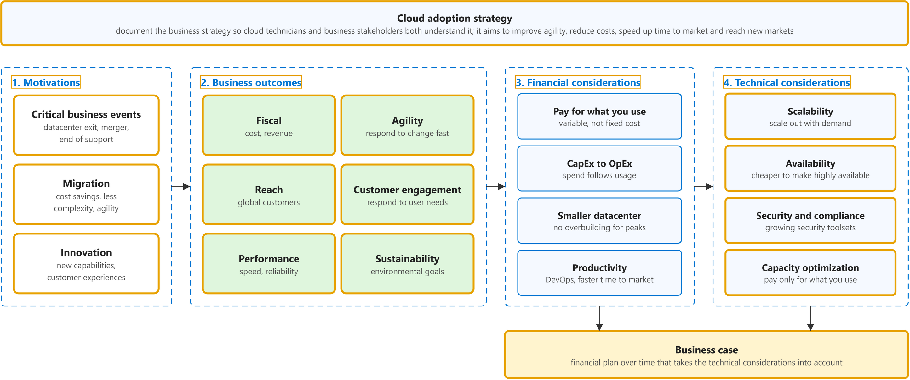
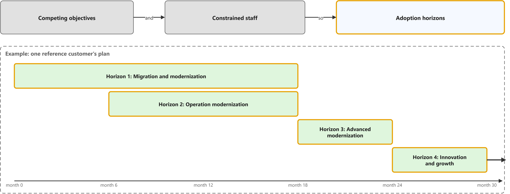
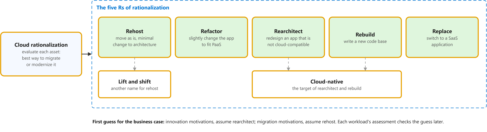
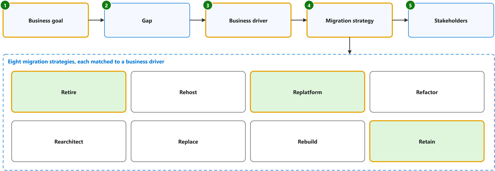
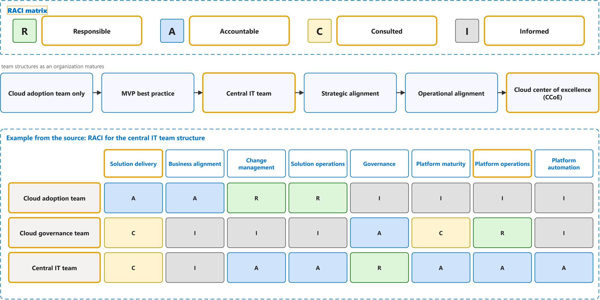

# Cloud Adoption Framework for Azure

Study notes on [Microsoft Learn documentation set](https://learn.microsoft.com/en-us/azure/cloud-adoption-framework/), which CST8913 Cloud Migration (Algonquin College, Fall 2026) uses in weeks 2 and 3. Each section follows one part of the source. Start from the figure: the framed terms are the ones to learn, and the table below it defines them in the same order, each with a citation linked to the passage and a Chinese translation in which each key word has the same colour as in the English. The verb of each sentence is in a red box, in the English and in the Chinese.

## [Cloud Adoption Framework overview](https://learn.microsoft.com/en-us/azure/cloud-adoption-framework/overview)

| Term | Definition | 中文翻译 | Source |
|---|---|---|---|
| **Cloud Adoption Framework (CAF)** 云采用框架 | "The Microsoft **Cloud Adoption Framework (CAF**) helps **decision makers** make better decisions, faster. It provides **proven guidance** to **reduce risk**, accelerate adoption, and create a foundation that supports current and future workloads." | Microsoft **云采用框架（CAF**）可帮助**决策者**更快地做出更好的决策。它提供**经过验证的指导**，以**降低风险**、加速采用，并建立支持当前和未来工作负载的基础。 | [Microsoft, n.d., para. 1](https://learn.microsoft.com/en-us/azure/cloud-adoption-framework/overview#:~:text=The%20Microsoft%20Cloud%20Adoption%20Framework%20%28CAF%29%20helps%20decision%20makers%20make) |
| **Strategy** 策略阶段 | "1. **Strategy**: What should our **Azure adoption** look like?" | 1. **策略阶段**：我们的 **Azure 采用**应该是什么样子？ | [Microsoft, n.d., "How the Cloud Adoption Framework works" section, table, row 1](https://learn.microsoft.com/en-us/azure/cloud-adoption-framework/overview#how-the-cloud-adoption-framework-works:~:text=What%20should%20our%20Azure%20adoption%20look%20like) |
| **Plan** 计划 | "Successful cloud adoption ... requires a **cloud adoption plan**. A cloud adoption plan converts your **cloud strategy** into an **actionable plan** that's specific to your goals." | 成功的云采用……需要一份**云采用计划**。云采用计划会将你的**云策略**转化为针对你的目标的**可执行计划**。 | [Microsoft, n.d., para. 1](https://learn.microsoft.com/en-us/azure/cloud-adoption-framework/plan/prepare-organization-for-cloud#:~:text=Successful%20cloud%20adoption) |
| **Ready** 就绪 | "The **Ready phase** of the Cloud Adoption Framework helps you design your **Azure landing zone** to meet your organization's **requirements**." | 云采用框架的**就绪阶段**可帮助你设计 **Azure 落地区**，以满足组织的**要求**。 | [Microsoft, n.d., para. 1](https://learn.microsoft.com/en-us/azure/cloud-adoption-framework/ready/landing-zone/#:~:text=The%20Ready%20phase%20of%20the%20Cloud%20Adoption%20Framework%20helps%20you) |
| **CAF Adopt phase** CAF 采用阶段 | "4. **Adopt**: How will we **migrate**, **modernize**, and **build workloads**?" | 4. **采用**：我们将如何**迁移**、**现代化**和**构建工作负载**？ | [Microsoft, n.d., "How the Cloud Adoption Framework works" section, table, row 4](https://learn.microsoft.com/en-us/azure/cloud-adoption-framework/overview#how-the-cloud-adoption-framework-works:~:text=How%20will%20we%20migrate%2C%20modernize%2C%20and%20build%20workloads) |
| **Migrate (CAF)** 迁移（CAF 阶段） | "**Migration** changes **where or how** a workload runs. **Modernization** changes the workload to achieve a better outcome. An **initiative** can do both." | **迁移**会改变工作负载的**运行位置或运行方式**。**现代化**会改变工作负载，以获得更好的结果。一项**举措**可以同时做到这两点。 | [Microsoft, n.d., "1.3 Modernization versus migration" section, para. 1](https://learn.microsoft.com/en-us/azure/cloud-adoption-framework/modernize/prepare-organization-cloud-modernization#13-modernization-versus-migration:~:text=Migration%20changes%20where%20or%20how%20a%20workload%20runs.%20Modernization%20changes) |
| **Modernize** 现代化 | "**Modernization** improves an **existing workload or workload component** to better meet current or future **business requirements**. It can change different parts of a workload, such as its **platform, application, data, or operating model**." | **现代化**会改进**现有工作负载或工作负载组件**，以更好地满足当前或未来的**业务需求**。它可以改变工作负载的不同部分，例如其**平台、应用程序、数据或运营模式**。 | [Microsoft, n.d., "1. What is modernization?" section, para. 1](https://learn.microsoft.com/en-us/azure/cloud-adoption-framework/modernize/prepare-organization-cloud-modernization#1-what-is-modernization:~:text=Modernization%20improves%20an%20existing%20workload%20or%20workload%20component%20to%20better) |
| **Innovate** 创新（现称云原生） | "A **cloud-native solution** creates **business value** by **building new workloads** or enhancing existing ones. Whether you're developing a new application or adding new features to an existing system, **cloud-native development** is a journey through planning, building, deploying, and optimizing your workloads." | **云原生解决方案**创造**业务价值**，方式是**构建新工作负载**或增强现有工作负载。无论你是在开发新应用程序，还是在为现有系统添加新功能，**云原生开发**都是一段贯穿规划、构建、部署和优化工作负载的旅程。 | [Microsoft, n.d., para. 1](https://learn.microsoft.com/en-us/azure/cloud-adoption-framework/cloud-native/plan-cloud-native-solutions#:~:text=A%20cloud%2Dnative%20solution%20creates%20business%20value%20by%20building%20new%20workloads) |
| **Govern** 治理 | "**Cloud governance** is how an organization **controls its use of cloud services** by establishing **guardrails**. These guardrails are a set of **policies, procedures, and tools** that define acceptable and unacceptable cloud activities." | **云治理**是组织**控制其云服务使用**的方式，具体做法是建立**护栏**。这些护栏是一组**策略、过程和工具**，用于定义可接受和不可接受的云活动。 | [Microsoft, n.d., para. 1](https://learn.microsoft.com/en-us/azure/cloud-adoption-framework/govern/build-cloud-governance-team#:~:text=Cloud%20governance%20is%20how%20an%20organization%20controls%20its%20use%20of) |
| **CAF Secure phase** CAF 安全阶段 | "The **Cloud Adoption Framework** for Azure **Secure methodology** provides a **structured approach** for securing your **Azure cloud estate**." | Azure **云采用框架**的**安全方法**提供了一种**结构化方式**，用于保护你的 **Azure 云资产**。 | [Microsoft, n.d., para. 1](https://learn.microsoft.com/en-us/azure/cloud-adoption-framework/secure/overview#:~:text=The%20Cloud%20Adoption%20Framework%20for%20Azure%20Secure%20methodology%20provides) |
| **Manage** 管理 | "Managing your **Azure environment** isn't just about **keeping the lights on**. It's about maintaining **governance and security** while ensuring your cloud stays aligned with **business goals** over time." | 管理你的 **Azure 环境**不仅仅是**维持系统正常运转**。它关乎在保持**治理和安全**的同时，确保你的云随着时间推移始终与**业务目标**保持一致。 | [Microsoft, n.d., para. 1](https://learn.microsoft.com/en-us/azure/cloud-adoption-framework/manage/ready-cloud-operations#:~:text=Managing%20your%20Azure%20environment%20isn%27t%20just%20about%20keeping%20the%20lights) |
| **Azure Architecture Center** Azure 架构中心 | "The **Azure Architecture Center** is a **catalog** of solution ideas, example workloads, **reference architectures**, technology decision guides, and architecture guides that help **cloud architects and engineers** build workloads ..." | **Azure 架构中心**是一个**目录**，其中包含解决方案构想、示例工作负载、**参考架构**、技术决策指南和架构指南，可帮助**云架构师和工程师**构建工作负载…… | [Microsoft, n.d., para. 1](https://learn.microsoft.com/en-us/azure/architecture/#:~:text=Design%20solutions%20on%20Azure%20by%20using%20established%20patterns) |
| **Azure Well-Architected Framework** Azure 良好架构框架 | "The **Azure Well-Architected Framework** is a **design framework** that can improve the **quality of a workload** by helping it to: Be **resilient, available, and recoverable**. Be as secure as you need it to be." | **Azure 良好架构框架**是一个**设计框架**，可以提高**工作负载的质量**，方法是帮助它做到：**具有复原能力、可用且可恢复**。按你的需要达到相应的安全程度。 | [Microsoft, n.d., para. 1](https://learn.microsoft.com/en-us/azure/well-architected/what-is-well-architected-framework#:~:text=The%20Azure%20Well%2DArchitected%20Framework%20is%20a%20design%20framework) |

## [Develop a cloud adoption strategy](https://github.com/MicrosoftDocs/cloud-adoption-framework/blob/a5351162040659171fbb4f5674ce36ac9259deb3/docs/strategy/index.md)

| Term | Definition | 中文翻译 | Source |
|---|---|---|---|
| **cloud adoption strategy** 云采用策略 | "A **cloud adoption strategy** directs how your business adopts cloud technology. It connects **executive intent** to **measurable outcomes** and sets the **standards** that every workload team operates within." | **云采用策略**指导你的企业如何采用云技术。它将**高管意图**与**可衡量的成果**联系起来，并设定每个工作负载团队在其中运作的**标准**。 | [Microsoft, n.d., para. 1](https://learn.microsoft.com/en-us/azure/cloud-adoption-framework/strategy/#:~:text=A%20cloud%20adoption%20strategy%20directs%20how%20your%20business%20adopts) |
| **motivation** 动机 | "Various **motivations** can drive **business transformations** that are supported by cloud adoption. Several motivations likely apply **at the same time**." | 各种**动机**可以推动由云采用所支持的**业务转型**。可能**同时**有多个动机适用。 | [Microsoft, 2022, October 18, "Motivations" section, para. 1](https://github.com/MicrosoftDocs/cloud-adoption-framework/blob/a5351162040659171fbb4f5674ce36ac9259deb3/docs/strategy/motivations.md#motivations:~:text=Various%20motivations%20can%20drive%20business%20transformations%20that%20are) |
| **critical business event** 关键业务事件 | "When responding to **critical business events** is the **highest priority**, it's important to get started with **migration** early, often in parallel with **strategy and planning efforts**." | 当应对**关键业务事件**是**最高优先级**时，务必尽早开始**迁移**，并且通常与**策略和规划工作**并行进行。 | [Microsoft, 2022, October 18, "Classify your motivations" section, para. 2](https://github.com/MicrosoftDocs/cloud-adoption-framework/blob/a5351162040659171fbb4f5674ce36ac9259deb3/docs/strategy/motivations.md#classify-your-motivations:~:text=When%20responding%20to%20critical%20business%20events%20is%20the%20highest) |
| **migration motivation** 迁移动机 | "The **migration motivations** listed near the top of the **motivations table** are the **most common reasons** for adopting the cloud but not necessarily the **most significant**." | **迁移动机**列于**动机表**的顶部附近，它们是采用云的**最常见原因**，但不一定是**最重要**的原因。 | [Microsoft, 2022, October 18, "Migration" section, para. 1](https://github.com/MicrosoftDocs/cloud-adoption-framework/blob/a5351162040659171fbb4f5674ce36ac9259deb3/docs/strategy/motivations.md#migration:~:text=The%20migration%20motivations%20listed%20near%20the%20top%20of%20the) |
| **innovation motivation** 创新动机 | "Data is the **new commodity**, and **modern applications** are the **supply chain** driving that data into various experiences. In today's business market, it's hard to find a **transformative product or service** that isn't built on top of data, insights, and customer experiences." | 数据是**新的商品**，而**现代应用程序**是将这些数据输送到各种体验中的**供应链**。在当今的商业市场中，很难找到不是建立在数据、见解和客户体验之上的**变革性产品或服务**。 | [Microsoft, 2022, October 18, "Innovation" section, para. 1](https://github.com/MicrosoftDocs/cloud-adoption-framework/blob/a5351162040659171fbb4f5674ce36ac9259deb3/docs/strategy/motivations.md#innovation:~:text=Data%20is%20the%20new%20commodity%2C%20and%20modern%20applications%20are) |
| **business outcome** 业务成果 | "This article series is designed to help customers identify **business outcomes** that are **concise, defined**, and drive **observable results** or change in business performance, supported by a **specific measure**." | 本系列文章旨在帮助客户确定**业务成果**，这些成果应**简洁、明确**，并能推动**可观察的结果**或业务绩效的变化，且有**具体的衡量指标**作为支撑。 | [Microsoft, 2022, October 18, para. 1](https://github.com/MicrosoftDocs/cloud-adoption-framework/blob/a5351162040659171fbb4f5674ce36ac9259deb3/docs/strategy/business-outcomes/index.md#:~:text=This%20article%20series%20is%20designed%20to%20help%20customers%20identify) |
| **fiscal outcome** 财务成果 | "**Financial or fiscal performance** is the **cleanest business outcome** for many business leaders, but **not the only one**." | 对于许多业务领导者来说，**财务或财政绩效**是**最清晰的业务成果**，但并**不是唯一的**成果。 | [Microsoft, 2022, October 18, "Fiscal outcomes" section, para. 1](https://github.com/MicrosoftDocs/cloud-adoption-framework/blob/a5351162040659171fbb4f5674ce36ac9259deb3/docs/strategy/business-outcomes/index.md#fiscal-outcomes:~:text=Financial%20or%20fiscal%20performance%20is%20the%20cleanest%20business%20outcome) |
| **agility outcome** 敏捷成果 | "Today's **fast-changing business environment** places a **premium on time**. The ability to respond to and **drive market change** quickly is the fundamental measure of **business agility**." | 当今**快速变化的商业环境**非常**重视时间**。快速响应并**推动市场变化**的能力，是衡量**业务敏捷性**的基本指标。 | [Microsoft, 2022, October 18, "Agility outcomes" section, para. 1](https://github.com/MicrosoftDocs/cloud-adoption-framework/blob/a5351162040659171fbb4f5674ce36ac9259deb3/docs/strategy/business-outcomes/index.md#agility-outcomes:~:text=Today%27s%20fast%2Dchanging%20business%20environment%20places%20a%20premium%20on%20time) |
| **reach outcome** 覆盖范围成果 | "In a constantly **shrinking market**, **global reach** (ability to support global customers and users) can be measured by **compliance** in geographies that are relevant to the business." | 在不断**缩小的市场**中，**全球覆盖范围**（支持全球客户和用户的能力）可以通过在与业务相关的地理区域中的**合规性**来衡量。 | [Microsoft, 2022, October 18, "Reach outcomes" section, para. 1](https://github.com/MicrosoftDocs/cloud-adoption-framework/blob/a5351162040659171fbb4f5674ce36ac9259deb3/docs/strategy/business-outcomes/index.md#reach-outcomes:~:text=In%20a%20constantly%20shrinking%20market%2C%20global%20reach) |
| **customer engagement outcome** 客户互动成果 | "**Social marketplaces** are redefining **winners and losers** at an unheard-of pace. Responding to **user needs** is a key measure of **customer engagement**." | **社交市场**正以前所未有的速度重新定义**赢家和输家**。响应**用户需求**是衡量**客户互动**的关键指标。 | [Microsoft, 2022, October 18, "Customer engagement outcomes" section, para. 1](https://github.com/MicrosoftDocs/cloud-adoption-framework/blob/a5351162040659171fbb4f5674ce36ac9259deb3/docs/strategy/business-outcomes/index.md#customer-engagement-outcomes:~:text=Social%20marketplaces%20are%20redefining%20winners%20and%20losers%20at%20an) |
| **performance outcome** 性能成果 | "**Performance and reliability** are **assumed**. When either falters, **reputation damage** can be painful and **long-lasting**." | **性能和可靠性**被视为**理所当然**。当其中任何一个出现问题时，**声誉损害**可能是痛苦且**长期**的。 | [Microsoft, 2022, October 18, "Performance outcomes" section, para. 1](https://github.com/MicrosoftDocs/cloud-adoption-framework/blob/a5351162040659171fbb4f5674ce36ac9259deb3/docs/strategy/business-outcomes/index.md#performance-outcomes:~:text=Performance%20and%20reliability%20are%20assumed) |
| **sustainability outcome** 可持续性成果 | "**Environmental sustainability** is quickly moving from a "nice to have" function of **Corporate Social Responsibility (CSR**) to a **centerpiece of business strategy**, increasingly **embedded** into everything a company does." | **环境可持续性**正迅速从**企业社会责任（CSR**）中的“锦上添花”功能，转变为**业务战略的核心**，并日益**融入**公司所做的一切。 | [Microsoft, 2022, October 18, "Sustainability outcomes" section, para. 1](https://github.com/MicrosoftDocs/cloud-adoption-framework/blob/a5351162040659171fbb4f5674ce36ac9259deb3/docs/strategy/business-outcomes/index.md#sustainability-outcomes:~:text=Environmental%20sustainability%20is%20quickly%20moving%20from%20a) |
| **financial considerations** 财务考量 | "A **digital transformation** goes hand-in-hand with a **financial transformation**. When you're making the shift to the cloud, there are **financial considerations** around how the cloud will impact your **financial position**, accounting KPIs, and processes..." | **数字化转型**与**财务转型**相辅相成。当你向云转变时，存在一些**财务考量**，涉及云将如何影响你的**财务状况**、会计 KPI 和流程…… | [Microsoft, 2022, October 18, para. 1](https://github.com/MicrosoftDocs/cloud-adoption-framework/blob/a5351162040659171fbb4f5674ce36ac9259deb3/docs/strategy/financial-considerations/index.md#:~:text=A%20digital%20transformation%20goes%20hand%2Din%2Dhand%20with%20a%20financial%20transformation) |
| **technical considerations** 技术考量 | "When you're making the **shift to the cloud**, there are **technical considerations** around how it will help improve how you **manage and maintain** your cloud and workloads." | 当你**向云转变**时，存在一些**技术考量**，涉及它将如何帮助你改进对云和工作负载的**管理与维护**方式。 | [Microsoft, 2022, October 18, para. 1](https://github.com/MicrosoftDocs/cloud-adoption-framework/blob/a5351162040659171fbb4f5674ce36ac9259deb3/docs/strategy/technical-considerations/index.md#:~:text=When%20you%27re%20making%20the%20shift%20to%20the%20cloud%2C%20there) |
| **scalability** 可扩展性 | "**Scalability**, or the ability to **scale out your resources** depending on usage, utilization, and demand, is one of the **foremost technical benefits** of moving to the cloud." | **可扩展性**，即根据使用情况、利用率和需求**横向扩展你的资源**的能力，是迁移到云的**首要技术优势**之一。 | [Microsoft, 2022, October 18, "Scalability" section, para. 1](https://github.com/MicrosoftDocs/cloud-adoption-framework/blob/a5351162040659171fbb4f5674ce36ac9259deb3/docs/strategy/technical-considerations/index.md#scalability:~:text=Scalability%2C%20or%20the%20ability%20to%20scale%20out%20your%20resources%20depending) |
| **high availability** 高可用性 | "**On-premises**, it's more costly to build **highly available infrastructure**. It's **less costly** to architect highly available infrastructure in the cloud." | **在本地**，构建**高可用基础结构**的成本更高。在云中设计高可用基础结构的**成本更低**。 | [Microsoft, 2022, October 18, "Availability" section, para. 1](https://github.com/MicrosoftDocs/cloud-adoption-framework/blob/a5351162040659171fbb4f5674ce36ac9259deb3/docs/strategy/technical-considerations/index.md#availability:~:text=On%2Dpremises%2C%20it%27s%20more%20costly%20to%20build%20highly%20available%20infrastructure) |
| **security and compliance** 安全与合规 | "When it comes to **security and compliance**, Microsoft is continually expanding our **security infrastructure and toolsets** to **keep you on par** with what's transpiring with respect to **security threats on global networks**." | 在**安全与合规**方面，Microsoft 正在不断扩展我们的**安全基础结构和工具集**，让你能够**跟上**​**全球网络上安全威胁**的动态。 | [Microsoft, 2022, October 18, "Security and compliance" section, para. 1](https://github.com/MicrosoftDocs/cloud-adoption-framework/blob/a5351162040659171fbb4f5674ce36ac9259deb3/docs/strategy/technical-considerations/index.md#security-and-compliance:~:text=When%20it%20comes%20to%20security%20and%20compliance%2C%20Microsoft%20is) |
| **capacity optimization** 容量优化 | "**Capacity optimization**, where you **only pay** for the **resources you utilize** over time, is **another technical benefit** of the cloud." | **容量优化**，即你**只需**为一段时间内**实际使用的资源**付费，是云的**另一项技术优势**。 | [Microsoft, 2022, October 18, "Capacity optimization" section, para. 1](https://github.com/MicrosoftDocs/cloud-adoption-framework/blob/a5351162040659171fbb4f5674ce36ac9259deb3/docs/strategy/technical-considerations/index.md#capacity-optimization:~:text=Capacity%20optimization%2C%20where%20you%20only%20pay%20for%20the) |
| **business case** 商业论证 | "A **business case** provides a view of the **technical and financial timeline** of your environment. Developing a business case includes building a **financial plan** that takes technical considerations into account and aligns with **business outcomes**." | **商业论证**提供了你环境的**技术和财务时间线**视图。制定商业论证包括构建一份**财务计划**，该计划考虑技术考量并与**业务成果**保持一致。 | [Microsoft, 2022, August 5, para. 3](https://github.com/MicrosoftDocs/cloud-adoption-framework/blob/a5351162040659171fbb4f5674ce36ac9259deb3/docs/strategy/cloud-migration-business-case.md#:~:text=A%20business%20case%20provides%20a%20view%20of%20the%20technical) |

## [Build a digital transformation timeline](https://github.com/MicrosoftDocs/cloud-adoption-framework/blob/a5351162040659171fbb4f5674ce36ac9259deb3/docs/strategy/digital-transformation-timeline.md)

| Term | Definition | 中文翻译 | Source |
|---|---|---|---|
| **adoption horizons** 采用视野（分阶段推进） | "To create clarity and alignment, it's suggested that **complex digital transformation projects** align to an organization's **horizons** or **phased program delivery**. In this type of approach, the company commits to a **single motivation category** for a time-bound period." | 为了实现清晰性和一致性，建议**复杂的数字化转型项目**与组织的**视野**或**分阶段的项目交付**保持一致。在这种方法中，公司在限定的时间段内致力于**单一的动机类别**。 | [Microsoft, 2021, May 1, "De-risk with cloud adoption horizons" section, para. 3](https://github.com/MicrosoftDocs/cloud-adoption-framework/blob/a5351162040659171fbb4f5674ce36ac9259deb3/docs/strategy/digital-transformation-timeline.md#de-risk-with-cloud-adoption-horizons:~:text=To%20create%20clarity%20and%20alignment%2C%20it%27s%20suggested%20that%20complex) |
| **Horizon 1 migration and modernization** 视野 1：迁移与现代化 | "**Prioritize** the **datacenter exit** with a focus on modern **platform as a service (PaaS**) solutions over a basic **lift-and-shift migration**." | **优先考虑**​**退出数据中心**，重点关注现代的**平台即服务（PaaS**）解决方案，而不是基础的**平移迁移**。 | [Microsoft, 2021, May 1, "Example of a cloud adoption plan with four horizons" section, table, row 1, Objective](https://github.com/MicrosoftDocs/cloud-adoption-framework/blob/a5351162040659171fbb4f5674ce36ac9259deb3/docs/strategy/digital-transformation-timeline.md#example-of-a-cloud-adoption-plan-with-four-horizons:~:text=Prioritize%20the%20datacenter%20exit%20with%20a%20focus%20on%20modern%20platform) |
| **Horizon 2 operation modernization** 视野 2：运营现代化 | "Prioritize **operational improvements** built on **cloud-native governance**, **operations management**, security, and **compliance capabilities**." | 优先考虑**运营改进**，这些改进建立在**云原生的治理**、**运营管理**、安全和**合规功能**之上。 | [Microsoft, 2021, May 1, "Example of a cloud adoption plan with four horizons" section, table, row 2, Objective](https://github.com/MicrosoftDocs/cloud-adoption-framework/blob/a5351162040659171fbb4f5674ce36ac9259deb3/docs/strategy/digital-transformation-timeline.md#example-of-a-cloud-adoption-plan-with-four-horizons:~:text=Prioritize%20operational%20improvements%20built%20on%20cloud%2Dnative%20governance) |
| **Horizon 3 advanced modernization** 视野 3：深度现代化 | "With **post-migration** and **operational improvements**, the team will have **sufficient data and cloud skills** to perform **deeper modernization** of complex architectures." | 借助**迁移后**的改进和**运营改进**，团队将拥有**足够的数据和云技能**，对复杂架构执行**更深入的现代化**。 | [Microsoft, 2021, May 1, "Example of a cloud adoption plan with four horizons" section, table, row 3, Objective](https://github.com/MicrosoftDocs/cloud-adoption-framework/blob/a5351162040659171fbb4f5674ce36ac9259deb3/docs/strategy/digital-transformation-timeline.md#example-of-a-cloud-adoption-plan-with-four-horizons:~:text=With%20post%2Dmigration%20and%20operational%20improvements%2C%20the%20team%20will%20have) |
| **Horizon 4 innovation and growth** 视野 4：创新与增长 | "Redirect capital reduction from **datacenter exits** and **new skills** in central IT to focus on **accelerating continued innovation**." | 将**退出数据中心**带来的资本削减和中央 IT 部门的**新技能**重新调配，以专注于**加速持续创新**。 | [Microsoft, 2021, May 1, "Example of a cloud adoption plan with four horizons" section, table, row 4, Objective](https://github.com/MicrosoftDocs/cloud-adoption-framework/blob/a5351162040659171fbb4f5674ce36ac9259deb3/docs/strategy/digital-transformation-timeline.md#example-of-a-cloud-adoption-plan-with-four-horizons:~:text=Redirect%20capital%20reduction%20from%20datacenter%20exits%20and%20new%20skills%20in) |

## [Cloud rationalization](https://github.com/MicrosoftDocs/cloud-adoption-framework/blob/e29e30c4ebd52d8446d00f5dfdee5742328c2c11/docs/digital-estate/5-rs-of-rationalization.md)

| Term | Definition | 中文翻译 | Source |
|---|---|---|---|
| **cloud rationalization** 云合理化 | "**Cloud rationalization** is the process of **evaluating assets** to determine the **best way** to **migrate or modernize** each asset in the cloud." | **云合理化**是这样一个过程：**评估资产**，从而确定以**最佳方式**在云中**迁移或现代化**每项资产。 | [Microsoft, 2023, March 1, para. 1](https://github.com/MicrosoftDocs/cloud-adoption-framework/blob/e29e30c4ebd52d8446d00f5dfdee5742328c2c11/docs/digital-estate/5-rs-of-rationalization.md#:~:text=Cloud%20rationalization%20is%20the%20process%20of%20evaluating%20assets%20to%20determine) |
| **Rehost** 重新托管 | "Also known as a **lift and shift migration**, a **rehost effort** moves a **current state asset** to the chosen cloud provider with **minimal change** to the overall architecture." | 也称为**直接迁移（lift and shift**）的**重新托管工作**，会将**当前状态的资产**迁移到所选的云提供商，并对整体架构做**最小的更改**。 | [Microsoft, 2023, March 1, "Rehost" section, para. 1](https://github.com/MicrosoftDocs/cloud-adoption-framework/blob/e29e30c4ebd52d8446d00f5dfdee5742328c2c11/docs/digital-estate/5-rs-of-rationalization.md#rehost:~:text=Also%20known%20as%20a%20lift%20and%20shift%20migration%2C%20a%20rehost%20effort) |
| **lift and shift** 平移迁移 | "**Lift-and-shift migration**: You set up **cloud resources** similar to your **on-premises datacenter**, and then move your workloads to the **IaaS infrastructure**." | **平移迁移**：你设置**云资源**，使其与你的**本地数据中心**类似，然后将你的工作负载移到 **IaaS 基础结构**。 | [Microsoft, n.d., "Scenarios" section, bullet 1](https://learn.microsoft.com/en-us/training/modules/describe-cloud-service-types/2-describe-infrastructure-service#scenarios:~:text=Lift%2Dand%2Dshift%20migration) |
| **Refactor** 重构 | "**Platform as a service (PaaS**) options can reduce the **operational costs** that are associated with many applications. It's a good idea to **slightly refactor** an application to fit a **PaaS-based model**." | **平台即服务（PaaS**）选项可以降低与许多应用程序相关的**运营成本**。一个好主意是**稍微重构**应用程序，使其适应**基于 PaaS 的模型**。 | [Microsoft, 2023, March 1, "Refactor" section, para. 1](https://github.com/MicrosoftDocs/cloud-adoption-framework/blob/e29e30c4ebd52d8446d00f5dfdee5742328c2c11/docs/digital-estate/5-rs-of-rationalization.md#refactor:~:text=Platform%20as%20a%20service%20%28PaaS%29%20options%20can%20reduce%20the%20operational%20costs) |
| **Rearchitect** 重新架构 | "Some **aging applications** **aren't compatible** with cloud providers. This incompatibility is because of the **architectural decisions** that were made when the application was built. In these cases, the application might need to be **rearchitected** before transformation." | 一些**老旧的应用程序**与云提供商**不兼容**。这种不兼容是由于构建应用程序时所做的**架构决策**造成的。在这些情况下，应用程序可能需要先**重新架构**，然后再进行转型。 | [Microsoft, 2023, March 1, "Rearchitect" section, para. 1](https://github.com/MicrosoftDocs/cloud-adoption-framework/blob/e29e30c4ebd52d8446d00f5dfdee5742328c2c11/docs/digital-estate/5-rs-of-rationalization.md#rearchitect:~:text=Some%20aging%20applications%20aren%27t%20compatible%20with%20cloud%20providers) |
| **Rebuild** 重建 | "In some scenarios, the **delta** that must be overcome to carry an application forward can be too large to justify **further investment**. ... To resolve the issue, create a **new code base** to align with a **cloud-native approach**." | 在某些场景中，要推动应用程序继续前进所必须克服的**差距**可能过大，以致无法证明**进一步投资**是合理的。……为了解决这个问题，请创建**新的代码库**，以与**云原生方法**保持一致。 | [Microsoft, 2023, March 1, "Rebuild" section, para. 1](https://github.com/MicrosoftDocs/cloud-adoption-framework/blob/e29e30c4ebd52d8446d00f5dfdee5742328c2c11/docs/digital-estate/5-rs-of-rationalization.md#rebuild:~:text=In%20some%20scenarios%2C%20the%20delta%20that%20must%20be%20overcome%20to%20carry) |
| **cloud-native** 云原生 | "**Cloud-native** architecture and technologies are an approach to designing, constructing, and **operating workloads** that are **built in the cloud** and **take full advantage of the cloud computing model**." | **云原生**架构和技术是一种设计、构建和**运营工作负载**的方法，这些工作负载**在云中构建**，并**充分利用云计算模型**。 | [Microsoft, n.d., para. 3](https://learn.microsoft.com/en-us/dotnet/architecture/cloud-native/definition#:~:text=Cloud%2Dnative%20architecture%20and%20technologies%20are%20an%20approach%20to%20designing) |
| **Replace** 替换 | "Sometimes **software as a service (SaaS**) applications can provide all the **necessary functionality** for the hosted application. In these scenarios, a workload can be scheduled for **future replacement**, which removes it from the **transformation effort**." | 有时，**软件即服务（SaaS**）应用程序可以为托管的应用程序提供所有**必要的功能**。在这些场景中，可以将工作负载安排在**将来替换**，从而将其从**转型工作**中移除。 | [Microsoft, 2023, March 1, "Replace" section, para. 1](https://github.com/MicrosoftDocs/cloud-adoption-framework/blob/e29e30c4ebd52d8446d00f5dfdee5742328c2c11/docs/digital-estate/5-rs-of-rationalization.md#replace:~:text=Sometimes%20software%20as%20a%20service%20%28SaaS%29%20applications%20can%20provide%20all) |

## [Select your cloud migration strategies](https://learn.microsoft.com/en-us/azure/cloud-adoption-framework/plan/select-cloud-migration-strategy)

| Term | Definition | 中文翻译 | Source |
|---|---|---|---|
| **business goal** 业务目标 | "**Business goals** are high-level outcomes the **organization** wants to achieve from **cloud adoption**, such as adopting AI, increasing agility, accelerating innovation, **reducing costs**, and improving resilience." | **业务目标**是**组织**希望通过**云采用**实现的高层级成果，例如采用 AI、提高敏捷性、加速创新、**降低成本**和提升复原能力。 | [Microsoft, n.d., "Determine business drivers before migration" section, step 1](https://learn.microsoft.com/en-us/azure/cloud-adoption-framework/plan/select-cloud-migration-strategy#determine-business-drivers-before-migration:~:text=Business%20goals%20are%20high%2Dlevel%20outcomes%20the%20organization%20wants%20to%20achieve) |
| **business driver** 业务驱动因素 | "A **business driver** defines why a **workload** needs to **change** in order to support a **specific business goal**." | **业务驱动因素**定义了**工作负载**为何需要**变更**，以支持**特定业务目标**。 | [Microsoft, n.d., "Determine business drivers before migration" section, para. 1](https://learn.microsoft.com/en-us/azure/cloud-adoption-framework/plan/select-cloud-migration-strategy#determine-business-drivers-before-migration:~:text=A%20business%20driver%20defines%20why%20a%20workload%20needs%20to%20change) |
| **migration strategy** 迁移策略 | "A **migration strategy** defines how **each workload** transitions to **Azure** based on its **business driver**." | **迁移策略**定义**每个工作负载**如何过渡到 **Azure**，依据是其**业务驱动因素**。 | [Microsoft, n.d., "Select the right migration strategy" section, para. 1](https://learn.microsoft.com/en-us/azure/cloud-adoption-framework/plan/select-cloud-migration-strategy#select-the-right-migration-strategy:~:text=A%20migration%20strategy%20defines%20how%20each%20workload%20transitions%20to%20Azure) |
| **Retire** 停用 | "**Retire** **decommissions workloads** that **no longer provide business value**." | **停用**会**让工作负载退役**，这些工作负载**不再提供业务价值**。 | [Microsoft, n.d., "1. Retire (decommission)" section, para. 1](https://learn.microsoft.com/en-us/azure/cloud-adoption-framework/plan/select-cloud-migration-strategy#1-retire-decommission:~:text=Retire%20decommissions%20workloads%20that%20no%20longer%20provide%20business%20value) |
| **Replatform** 更换平台 | "**Replatforming** moves workloads to a **modern hosting environment** with **minimal code changes**." | **更换平台**会将工作负载迁移到**现代托管环境**，同时只需**最少的代码更改**。 | [Microsoft, n.d., "3. Replatform (modernize hosting environment)" section, para. 1](https://learn.microsoft.com/en-us/azure/cloud-adoption-framework/plan/select-cloud-migration-strategy#3-replatform-modernize-hosting-environment:~:text=Replatforming%20moves%20workloads%20to%20a%20modern%20hosting%20environment%20with%20minimal) |
| **Retain** 保留 | "A **retain strategy** keeps workloads in their **current environment** when they're **stable, compliant**, and meet all current and future business needs with **no near-term driver to move**." | **保留策略**会将工作负载保留在其**当前环境**中，前提是它们**稳定、合规**，满足所有当前和未来的业务需求，并且**近期没有迁移的驱动因素**。 | [Microsoft, n.d., "8. Retain (keep as is)" section, para. 1](https://learn.microsoft.com/en-us/azure/cloud-adoption-framework/plan/select-cloud-migration-strategy#8-retain-keep-as-is:~:text=A%20retain%20strategy%20keeps%20workloads%20in%20their%20current%20environment%20when) |

## [Align responsibilities across teams](https://learn.microsoft.com/en-us/azure/cloud-adoption-framework/organize/raci-alignment)

| Term | Definition | 中文翻译 | Source |
|---|---|---|---|
| **RACI matrix** RACI 责任分配矩阵 | "**Align responsibilities** by developing a **cross-team matrix** that identifies **responsible, accountable, consulted, and informed (RACI**) parties." | **协调职责**：制定一个**跨团队矩阵**，用于确定**负责、批准、咨询和知情（RACI**）的各方。 | [Microsoft, n.d., para. 1](https://learn.microsoft.com/en-us/azure/cloud-adoption-framework/organize/raci-alignment#:~:text=Align%20responsibilities%20by%20developing%20a%20cross%2Dteam%20matrix%20that) |
| **Responsible** 负责执行（R） | "The teams that are **responsible** for the **outcomes**." | **负责**产出**结果**的团队。 | [Microsoft, n.d., "Align responsibilities across teams" section, bullet 8](https://learn.microsoft.com/en-us/azure/cloud-adoption-framework/organize/raci-alignment#align-responsibilities-across-teams:~:text=The%20teams%20that%20are%20responsible%20for%20the%20outcomes) |
| **Accountable** 最终负责（A） | "The **one team** that is **accountable** for a function." | **唯一一个团队**，对某项职能**最终负责**。 | [Microsoft, n.d., "Align responsibilities across teams" section, bullet 7](https://learn.microsoft.com/en-us/azure/cloud-adoption-framework/organize/raci-alignment#align-responsibilities-across-teams:~:text=The%20one%20team%20that%20is%20accountable%20for%20a%20function) |
| **Consulted** 咨询（C） | "The teams that should be **consulted** during **planning**." | 应被**咨询**的团队，在**规划**期间。 | [Microsoft, n.d., "Align responsibilities across teams" section, bullet 9](https://learn.microsoft.com/en-us/azure/cloud-adoption-framework/organize/raci-alignment#align-responsibilities-across-teams:~:text=The%20teams%20that%20should%20be%20consulted%20during%20planning) |
| **Informed** 知会（I） | "The teams that should be **informed** when **work is completed**." | 应被**告知**的团队，在**工作完成**时。 | [Microsoft, n.d., "Align responsibilities across teams" section, bullet 10](https://learn.microsoft.com/en-us/azure/cloud-adoption-framework/organize/raci-alignment#align-responsibilities-across-teams:~:text=The%20teams%20that%20should%20be%20informed%20when%20work%20is%20completed) |
| **central IT team** 中央 IT 团队 | "As adoption scales, the **cloud governance team** might struggle to keep pace with the flow of innovation from **multiple cloud adoption teams**... At this stage, it's common for companies to shift **cloud responsibilities** to an existing **central IT team**." | 随着采用规模扩大，**云治理团队**可能难以跟上来自**多个云采用团队**的创新步伐……在此阶段，公司通常会将**云职责**转移给现有的**中央 IT 团队**。 | [Microsoft, n.d., "Central IT team" section, para. 1](https://learn.microsoft.com/en-us/azure/cloud-adoption-framework/organize/organization-structures#central-it-team:~:text=As%20adoption%20scales%2C%20the%20cloud%20governance%20team%20might%20struggle) |
| **cloud center of excellence (CCoE)** 云卓越中心 | "At the highest state of **maturity**, a **cloud center of excellence** aligns teams around a modern **cloud-first operating model**. This approach provides **centralized IT functions** like governance, security, platform, and automation." | 在最高**成熟度**状态下，**云卓越中心**围绕现代的**云优先运营模式**协调各团队。这种方法提供**集中式 IT 职能**，例如治理、安全、平台和自动化。 | [Microsoft, n.d., "Cloud center of excellence" section, para. 1](https://learn.microsoft.com/en-us/azure/cloud-adoption-framework/organize/organization-structures#cloud-center-of-excellence:~:text=At%20the%20highest%20state%20of%20maturity%2C%20a%20cloud%20center%20of%20excellence) |
| **solution delivery** 方案交付 | "**Cloud adoption functions** enable the **implementation** of **technical solutions** in the cloud." | **云采用职能**支持在云中**实施**​**技术解决方案**。 | [Microsoft, 2020, May 15, "Cloud adoption functions" section, para. 1](https://github.com/MicrosoftDocs/cloud-adoption-framework/blob/a5351162040659171fbb4f5674ce36ac9259deb3/docs/organize/cloud-adoption.md#cloud-adoption-functions:~:text=Cloud%20adoption%20functions%20enable%20the%20implementation%20of%20technical%20solutions) |
| **platform operations** 平台运维 | "**Operate** and **manage** the **cloud platform**." | **运行**并**管理**​**云平台**。 | [Microsoft, 2022, August 31, "Technical tasks" section, bullet 3](https://github.com/MicrosoftDocs/cloud-adoption-framework/blob/a5351162040659171fbb4f5674ce36ac9259deb3/docs/organize/central-it.md#technical-tasks:~:text=Operate%20and%20manage%20the%20cloud%20platform) |
| **cloud adoption team** 云采用团队 | "The nucleus of all **cloud adoption efforts** is the **cloud adoption team**. This team drives the **technical changes** that enable adoption." | 所有**云采用工作**的核心是**云采用团队**。该团队推动实现采用的**技术变革**。 | [Microsoft, n.d., "Cloud adoption team only" section, para. 1](https://learn.microsoft.com/en-us/azure/cloud-adoption-framework/organize/organization-structures#cloud-adoption-team-only:~:text=The%20nucleus%20of%20all%20cloud%20adoption%20efforts%20is%20the) |
| **cloud governance team** 云治理团队 | "...a **cloud governance team** is dedicated to ensuring **excellence** in the solutions that are adopted. The cloud governance team is **accountable** for **platform maturity**, platform operations, governance, and automation." | ……**云治理团队**致力于确保所采用解决方案的**卓越**品质。云治理团队**负责**​**平台成熟度**、平台运维、治理和自动化。 | [Microsoft, n.d., "Best practice: minimum viable product (MVP)" section, bullet 2](https://learn.microsoft.com/en-us/azure/cloud-adoption-framework/organize/organization-structures#best-practice-minimum-viable-product-mvp:~:text=Cloud%20governance%20team%3A%20To%20balance%20the%20cloud%20adoption%20team) |

## [Azure landing zones](https://learn.microsoft.com/en-us/azure/cloud-adoption-framework/ready/landing-zone/)

| Term | Definition | 中文翻译 | Source |
|---|---|---|---|
| **landing zone** 落地区 | "An **Azure landing zone** is a proven and flexible **architecture** for governing, securing, and scaling a **multi-subscription Azure environment**." | **Azure 落地区**是一种经过验证且灵活的**架构**，用于治理、保护和扩展**多订阅 Azure 环境**。 | [Microsoft, n.d., para. 1, sentence 2](https://learn.microsoft.com/en-us/azure/cloud-adoption-framework/ready/landing-zone/#:~:text=An%20Azure%20landing%20zone%20is%20a%20proven%20and%20flexible%20architecture) |
| **platform landing zone** 平台落地区 | "The **centralized foundation** that establishes **governance**, security, and **shared resources** for all your Azure workloads." | **集中式基础**，为所有 Azure 工作负载建立**治理**、安全和**共享资源**。 | [Microsoft, n.d., bullet 1](https://learn.microsoft.com/en-us/azure/cloud-adoption-framework/ready/landing-zone/#:~:text=The%20centralized%20foundation%20that%20establishes%20governance%2C%20security%2C%20and%20shared) |
| **management group hierarchy** 管理组层级 | "The **management group hierarchy** provides the **governance structure** for the Azure environment. It organizes all of your **Azure subscriptions** and applies **governance standards** to those subscriptions." | **管理组层级**为 Azure 环境提供**治理结构**。它组织你的所有 **Azure 订阅**，并对这些订阅应用**治理标准**。 | [Microsoft, n.d., "Platform landing zone" section, bullet 1](https://learn.microsoft.com/en-us/azure/cloud-adoption-framework/ready/landing-zone/#platform-landing-zone:~:text=The%20management%20group%20hierarchy%20provides%20the%20governance%20structure%20for%20the) |
| **workload landing zone** 工作负载落地区 | "The environments where **workload teams** **deploy and operate** **workload resources** within the guardrails of the **platform landing zone**." | **工作负载团队**在其中**部署和运营**​**工作负载资源**的环境，位于**平台落地区**的护栏之内。 | [Microsoft, n.d., bullet 2](https://learn.microsoft.com/en-us/azure/cloud-adoption-framework/ready/landing-zone/#:~:text=The%20environments%20where%20workload%20teams%20deploy%20and%20operate%20workload%20resources) |
| **subscription** 订阅 | "In Azure, **subscriptions** are a **unit of management, billing, and scale**. Subscriptions let you organize **resource groups** and **control billing separately from access**." | 在 Azure 中，**订阅**是**管理、计费和缩放的单位**。订阅让你能够组织**资源组**，并**将计费与访问分开控制**。 | [Microsoft, n.d., "Azure subscriptions" section, para. 1](https://learn.microsoft.com/en-us/training/modules/describe-core-architectural-components-of-azure/6-describe-azure-management-infrastructure#azure-subscriptions:~:text=In%20Azure%2C%20subscriptions%20are%20a%20unit%20of%20management%2C%20billing) |
| **management** 管理（运维） | "This **design area** establishes a **foundation for operations management** across your Azure, hybrid, or **multicloud environments**." | 此**设计领域**​**为运营管理奠定基础**，范围涵盖你的 Azure、混合或**多云环境**。 | [Microsoft, n.d., para. 1](https://learn.microsoft.com/en-us/azure/cloud-adoption-framework/ready/landing-zone/design-area/management#:~:text=This%20design%20area%20establishes%20a%20foundation%20for%20operations%20management) |
| **governance** 治理 | "Use **Azure governance** to establish the **tooling** that you need to support cloud governance, **compliance auditing**, and **automated guardrails**." | 使用 **Azure 治理**来建立所需的**工具**，以支持云治理、**合规性审核**和**自动化防护措施**。 | [Microsoft, n.d., para. 1](https://learn.microsoft.com/en-us/azure/cloud-adoption-framework/ready/landing-zone/design-area/governance#:~:text=Use%20Azure%20governance%20to%20establish%20the%20tooling%20that%20you) |
| **accelerator** 加速器 | "Microsoft-provided **accelerators** for both **platform landing zone** and workload landing zone scenarios use **infrastructure as code** to deploy **Azure environments** based on recommended practices." | Microsoft 提供的**加速器**适用于**平台落地区**和工作负载落地区两种场景，它们使用**基础结构即代码**来部署 **Azure 环境**，所依据的是建议做法。 | [Microsoft, n.d., bullet 3](https://learn.microsoft.com/en-us/azure/cloud-adoption-framework/ready/landing-zone/#:~:text=Microsoft%2Dprovided%20accelerators%20for%20both%20platform%20landing%20zone%20and%20workload) |
