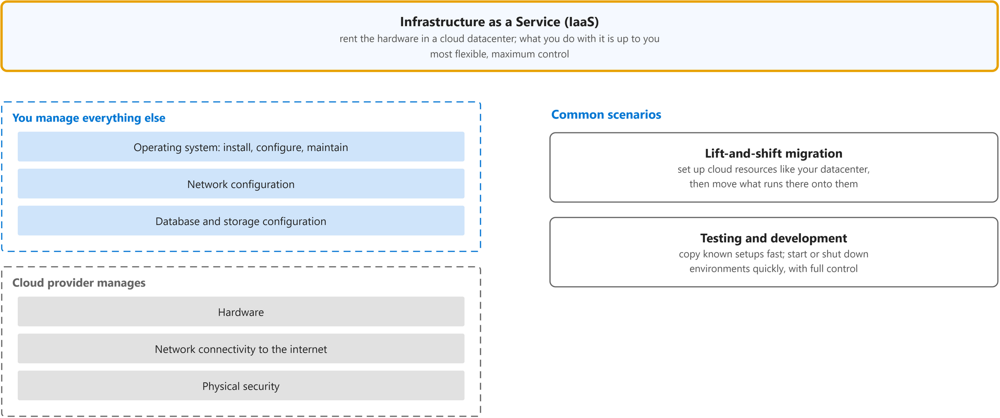
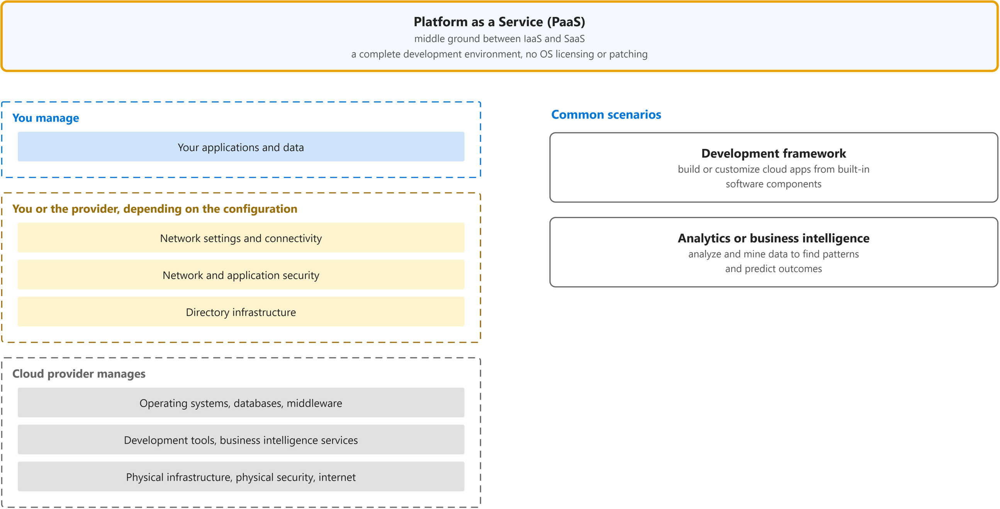

# Describe cloud service types

Study notes on [Microsoft Learn module (AZ-900)](https://learn.microsoft.com/en-us/training/modules/describe-cloud-service-types/), which CST8913 Cloud Migration (Algonquin College, Fall 2026) uses in weeks 2 and 3. Each section follows one part of the source. Start from the figure: the framed terms are the ones to learn, and the table below it defines them in the same order, each with a citation linked to the passage and a Chinese translation in which each key word has the same colour as in the English. The verb of each sentence has a red wavy underline, in the English and in the Chinese.

## [Describe Infrastructure as a Service](https://web.archive.org/web/20250108115137/https://learn.microsoft.com/en-us/training/modules/describe-cloud-service-types/2-describe-infrastructure-service)

| Term | Definition | 中文翻译 | Source |
|---|---|---|---|
| **Infrastructure as a Service (IaaS)** 基础设施即服务 | "**Infrastructure as a service (IaaS**) is the **most flexible** category of cloud services, as it provides you the **maximum amount of control** for your cloud resources." | **基础设施即服务（IaaS**）是**最灵活**的云服务类别，因为它为你提供对云资源的**最大控制权**。 | [Microsoft, n.d., para. 1](https://web.archive.org/web/20250108115137/https://learn.microsoft.com/en-us/training/modules/describe-cloud-service-types/2-describe-infrastructure-service#:~:text=Infrastructure%20as%20a%20service%20%28IaaS%29%20is%20the%20most%20flexible) |

## [Describe Platform as a Service](https://web.archive.org/web/20250109030533/https://learn.microsoft.com/en-us/training/modules/describe-cloud-service-types/3-describe-platform-service)

| Term | Definition | 中文翻译 | Source |
|---|---|---|---|
| **Platform as a Service (PaaS)** 平台即服务 | "**Platform as a service (PaaS**) is a **middle ground** between **renting space in a datacenter** (infrastructure as a service) and paying for a **complete and deployed solution** (software as a service)." | **平台即服务（PaaS**）是一种**折中方案**，介于**在数据中心租用空间**（基础设施即服务）与为**完整且已部署的解决方案**付费（软件即服务）之间。 | [Microsoft, n.d., para. 1](https://web.archive.org/web/20250109030533/https://learn.microsoft.com/en-us/training/modules/describe-cloud-service-types/3-describe-platform-service#:~:text=Platform%20as%20a%20service%20%28PaaS%29%20is%20a%20middle%20ground) |

## [Describe Software as a Service](https://web.archive.org/web/20250108145750/https://learn.microsoft.com/en-us/training/modules/describe-cloud-service-types/4-describe-software-service)

| Term | Definition | 中文翻译 | Source |
|---|---|---|---|
| **Software as a Service (SaaS)** 软件即服务 | "With **SaaS**, you’re essentially **renting or using** a **fully developed application**." | 借助 **SaaS**，你实质上是在**租用或使用**一个**完全开发好的应用程序**。 | [Microsoft, n.d., para. 1](https://web.archive.org/web/20250108145750/https://learn.microsoft.com/en-us/training/modules/describe-cloud-service-types/4-describe-software-service#:~:text=renting%20or%20using%20a%20fully%20developed%20application) |
