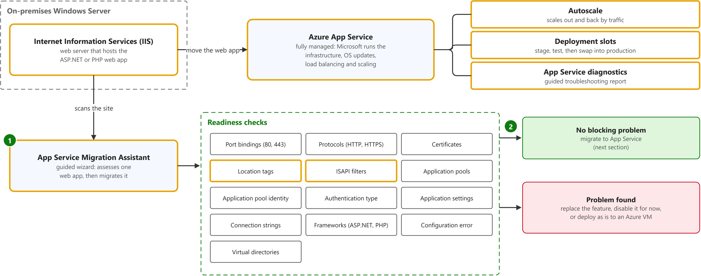
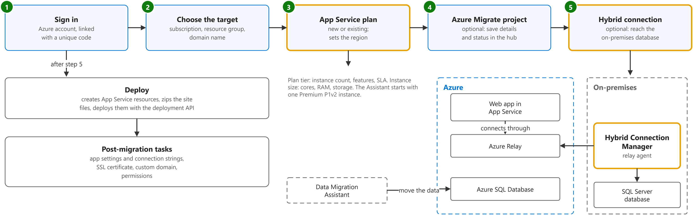

# Migrate an on-premises web application to Azure App Service

Study notes on [Microsoft Learn module (retired)](https://web.archive.org/web/20221202123525/https://learn.microsoft.com/en-us/training/modules/migrate-app-service-migration-assistant/3-understand-assessment), which CST8913 Cloud Migration (Algonquin College, Fall 2026) uses in week 6. Each section follows one part of the source. Start from the figure: the framed terms are the ones to learn, and the table below it defines them in the same order, each with a citation linked to the passage.

## [Assess a web app with the Azure App Service Migration Assistant](https://web.archive.org/web/20221202123525/https://learn.microsoft.com/en-us/training/modules/migrate-app-service-migration-assistant/3-understand-assessment)

| Term | Definition | 中文解释 | Source |
|---|---|---|---|
| **Internet Information Services (IIS)** (IIS 网站服务器) | "Internet Information Services (IIS) 7 and later provide a request-processing architecture which includes: ... A Web server engine that can be customized by adding or removing modules." *Note: Learn has no one-line definition of IIS; joined from the introduction.* | IIS 是 Windows Server 自带的网站服务器，用来托管 ASP.NET 等网站；迁移时常搬到 App Service。 | [Microsoft, n.d., "Introduction" section, para. 1](https://learn.microsoft.com/en-us/iis/get-started/introduction-to-iis/introduction-to-iis-architecture#introduction:~:text=Internet%20Information%20Services) |
| **Azure App Service** (Azure 应用服务) | "Azure App Service is a fully managed platform for your web apps. You can use it to run and scale your web apps with minimal setup. Microsoft manages the infrastructure, operating system updates, load balancing, and scale-up/scale-down logic as needed." | Azure 应用服务是微软全托管的网站运行平台（PaaS）：服务器、系统补丁、负载均衡和扩缩容都由微软管。把网站搬到这里后，你只管应用本身。 | [Microsoft, 2022, "Why move a web application to Azure App Service?" section, para. 1](https://web.archive.org/web/20221202123525/https://learn.microsoft.com/en-us/training/modules/migrate-app-service-migration-assistant/3-understand-assessment#why-move-a-web-application-to-azure-app-service:~:text=Azure%20App%20Service%20is%20a%20fully%20managed%20platform%20for) |
| **autoscale** (自动缩放) | "The autoscale feature allows an administrator to set the maximum number of instances that the web app should be allowed to scale to, as well as the traffic thresholds." | 自动缩放就是按访问量自动增加或减少运行网站的实例数。管理员只设最多几个实例和流量阈值，其余由 App Service 决定。 | [Microsoft, 2022, "Why move a web application to Azure App Service?" section, para. 4](https://web.archive.org/web/20221202123525/https://learn.microsoft.com/en-us/training/modules/migrate-app-service-migration-assistant/3-understand-assessment#why-move-a-web-application-to-azure-app-service:~:text=The%20autoscale%20feature%20allows%20an%20administrator%20to%20set%20the) |
| **deployment slots** (部署槽位) | "Deployment slots allow operations or DevOps to deploy a new version of the web application to a live testing or staging environment, where manual or automated integration tests can be performed." | 部署槽位就是同一个网站旁边的预备环境：新版本先部署到这里测试，没问题再和生产环境对调；出了问题可以再对调回来。 | [Microsoft, 2022, "Why move a web application to Azure App Service?" section, para. 5](https://web.archive.org/web/20221202123525/https://learn.microsoft.com/en-us/training/modules/migrate-app-service-migration-assistant/3-understand-assessment#why-move-a-web-application-to-azure-app-service:~:text=Deployment%20slots%20allow%20operations%20or%20DevOps%20to%20deploy%20a) |
| **App Service diagnostics** (App Service 诊断) | "App Service diagnostics provide an interactive interface where the troubleshooter can answer a few questions. The interface produces a full diagnostic report that's specific to the type of problem that your application is encountering." | App Service 诊断是一个问答式的排错界面：回答几个问题，它就针对你的问题生成一份诊断报告。网站出故障时用它找原因。 | [Microsoft, 2022, "Why move a web application to Azure App Service?" section, para. 6](https://web.archive.org/web/20221202123525/https://learn.microsoft.com/en-us/training/modules/migrate-app-service-migration-assistant/3-understand-assessment#why-move-a-web-application-to-azure-app-service:~:text=App%20Service%20diagnostics%20provide%20an%20interactive%20interface%20where%20the) |
| **App Service Migration Assistant** (应用服务迁移助手) | "The Azure App Service Migration Assistant is part of a larger suite of applications that help organizations with their transition to the cloud. The Migration Assistant provides a guided wizard-like user experience that performs two tasks:" *Note: The two tasks are an assessment of the web app and, if it passes, the migration.* | 应用服务迁移助手是微软的一个向导式小工具：先检查 Windows Server 上的某个网站能不能直接搬到 App Service，能的话再帮你把它搬过去。 | [Microsoft, 2022, "What is the Azure App Service Migration Assistant?" section, para. 1](https://web.archive.org/web/20221202123525/https://learn.microsoft.com/en-us/training/modules/migrate-app-service-migration-assistant/3-understand-assessment#what-is-the-azure-app-service-migration-assistant:~:text=The%20Azure%20App%20Service%20Migration%20Assistant%20is%20part%20of%20a) |
| **location tag** (位置标签) | "Location tags allow you to keep configuration for all web apps hosted on a server in a single file rather than hosted in individual web.config files for each web app." | 位置标签是 IIS 的一种写法：把一台服务器上所有网站的配置写在同一个文件里。App Service 不支持它，迁移前要把配置拆回各网站自己的 web.config。 | [Microsoft, 2022, "What types of problems does the assessment check for?" section, table 1, row 4 (Location tags), Explanation](https://web.archive.org/web/20221202123525/https://learn.microsoft.com/en-us/training/modules/migrate-app-service-migration-assistant/3-understand-assessment#what-types-of-problems-does-the-assessment-check-for:~:text=Location%20tags%20allow%20you%20to%20keep%20configuration%20for%20all) |
| **ISAPI filter** (ISAPI 筛选器) | "For example, some developers built features like monitoring, logging, and security on top of ISAPI filters. The filters provided access to incoming requests before they were passed to the ASP.NET application." | ISAPI 筛选器是挂在 IIS 上的底层插件，能在请求交给 ASP.NET 之前先拦下来处理。依赖它的网站，迁移助手不会自动迁，要先去掉再迁。 | [Microsoft, 2022, "Why perform an assessment?" section, para. 1, sentences 2 and 3](https://web.archive.org/web/20221202123525/https://learn.microsoft.com/en-us/training/modules/migrate-app-service-migration-assistant/3-understand-assessment#why-perform-an-assessment:~:text=For%20example%2C%20some%20developers%20built%20features%20like%20monitoring%2C%20logging) |

## [Migrate a web app with the Azure App Service Migration Assistant](https://web.archive.org/web/20221207041943/https://learn.microsoft.com/en-us/training/modules/migrate-app-service-migration-assistant/5-understand-migration)

| Term | Definition | 中文解释 | Source |
|---|---|---|---|
| **App Service plan** (App Service 计划) | "An Azure App Service plan defines a set of compute resources for a web app to run." *Note: The archived unit adds that the plan's tier sets the number of VM instances, features such as autoscale, and the SLA.* | App Service 计划就是网站运行用的一组计算资源：选哪个档位决定了实例数量、功能和 SLA，也决定网站放在哪个区域。几个网站可以共用一个计划。 | [Microsoft, n.d., para. 1](https://learn.microsoft.com/en-us/azure/app-service/overview-hosting-plans#:~:text=An%20Azure%20App%20Service%20plan%20defines%20a%20set%20of%20compute) |
| **hybrid connection** (混合连接) | "Within App Service, Hybrid Connections can be used to access application resources in any network that can make outbound calls to Azure over port 443." | 让搬到 App Service 的应用，经 443 端口安全访问还留在本地的数据库或服务。 | [Microsoft, n.d., para. 2](https://learn.microsoft.com/en-us/azure/app-service/app-service-hybrid-connections#:~:text=Within%20App%20Service%2C%20Hybrid%20Connections%20can%20be%20used%20to%20access) |
| **Hybrid Connection Manager** (混合连接管理器) | "Hybrid Connection Manager connects your web app running in Azure App Service to Azure Service Bus Relay to facilitate a connection with your on-premises database endpoint." | 混合连接管理器是装在本地服务器上的一个中继小程序：它向外连到 Azure Relay，让云上的网站能访问本地的数据库。 | [Microsoft, 2022, "Database migration" section, para. 3](https://web.archive.org/web/20221207041943/https://learn.microsoft.com/en-us/training/modules/migrate-app-service-migration-assistant/5-understand-migration#database-migration:~:text=Hybrid%20Connection%20Manager%20connects%20your%20web%20app%20running%20in) |
