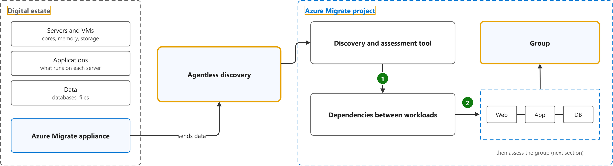
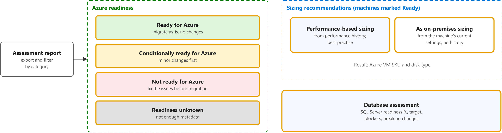
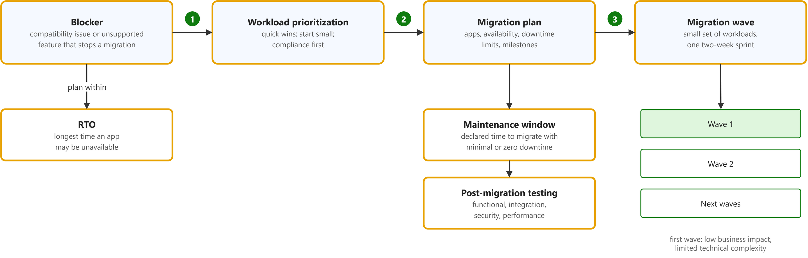

# Prepare for cloud adoption with a data-driven plan

Study notes on [Microsoft Learn module (retired)](https://web.archive.org/web/20220804114917/https://docs.microsoft.com/en-us/learn/modules/cloud-adoption-framework-plan/4-exercise-digital-estate-assessment), which CST8913 Cloud Migration (Algonquin College, Fall 2026) uses in week 4. Each section follows one part of the source. Start from the figure: the framed terms are the ones to learn, and the table below it defines them in the same order, each with a citation linked to the passage and a Chinese translation in which each key word has the same colour as in the English. In the English, the verb of each sentence is underlined.

## [Evaluate the digital estate](https://web.archive.org/web/20220804114917/https://docs.microsoft.com/en-us/learn/modules/cloud-adoption-framework-plan/4-exercise-digital-estate-assessment#evaluate-the-digital-estate)

| Term | Definition | 中文翻译 | Source |
|---|---|---|---|
| **digital estate** 数字资产 | "For each of these outcomes, the first step starts with a **clear understanding** of the **assets** (applications, data, and VMs) you are responsible for today. Those assets collectively are referred to as your **digital estate**." | 对于上述每种结果，第一步都是**清楚了解**你目前负责的**资产**（应用程序、数据和虚拟机）。这些资产统称为你的**数字资产**。 | [Microsoft, 2022, "Understand your digital estate" section, para. 1](https://web.archive.org/web/20220804114917/https://docs.microsoft.com/en-us/learn/modules/cloud-adoption-framework-plan/4-exercise-digital-estate-assessment#understand-your-digital-estate:~:text=For%20each%20of%20these%20outcomes%2C%20the%20first%20step%20starts) |
| **Azure Migrate appliance** Azure Migrate 设备（发现用虚拟机） | Defined on [What is Azure Migrate?](what-is-azure-migrate.md#decide-plan-execute). | 定义见该页。 | See that page |
| **agentless discovery** 无代理发现 | "Azure Migrate uses a lightweight **Azure Migrate appliance** to perform **agentless discovery** of on-premises VMware VMs, Hyper-V VMs, other virtualized machines, and **physical servers**. **Continuous discovery** collects machine configuration information, and performance metadata, as well as application data." | Azure Migrate 使用轻量级的 **Azure Migrate 设备**执行**无代理发现**，对象是本地 VMware VM、Hyper-V VM、其他虚拟化计算机和**物理服务器**。**持续发现**会收集计算机配置信息和性能元数据以及应用程序数据。 | [Microsoft, 2022, "Workloads in use" section, para. 1](https://web.archive.org/web/20220804114917/https://docs.microsoft.com/en-us/learn/modules/cloud-adoption-framework-plan/4-exercise-digital-estate-assessment#workloads-in-use:~:text=Azure%20Migrate%20uses%20a%20lightweight%20Azure%20Migrate%20appliance%20to) |
| **Azure Migrate project** Azure Migrate 项目 | "A **project** is used to store **discovery, assessment, and migration metadata** collected from the **environment** you're assessing or migrating." | **项目**用于存储**发现、评估和迁移元数据**，这些元数据收集自你正在评估或迁移的**环境**。 | [Microsoft, n.d., para. 2](https://learn.microsoft.com/en-us/azure/migrate/quickstart-create-project?view=migrate#:~:text=A%20project%20is%20used%20to%20store%20discovery%2C%20assessment%2C%20and) |
| **group (Azure Migrate)** 分组（服务器组） | "With your **application inventory** and **dependency analysis** done, you can create **high-confidence groups of servers** and start **assessing** them." | 完成**应用程序清单**和**依赖分析**后，你可以创建**高可信度的服务器组**，并开始对其进行**评估**。 | [Microsoft, 2022, "Dependencies between workloads" section, para. 1, sentence 5](https://web.archive.org/web/20220804114917/https://docs.microsoft.com/en-us/learn/modules/cloud-adoption-framework-plan/4-exercise-digital-estate-assessment#dependencies-between-workloads:~:text=With%20your%20application%20inventory%20and%20dependency%20analysis%20done%2C%20you) |

## [Readiness and suitability analysis](https://web.archive.org/web/20220804114917/https://docs.microsoft.com/en-us/learn/modules/cloud-adoption-framework-plan/4-exercise-digital-estate-assessment#readiness-and-suitability-analysis)

| Term | Definition | 中文翻译 | Source |
|---|---|---|---|
| **Ready for Azure** 可迁移（Azure 就绪） | "**Ready for Azure**: Machines can be migrated **as-is** to Azure, **without any changes**." | **Azure 就绪**：计算机可以**按原样**迁移到 Azure，**无需任何更改**。 | [Microsoft, 2022, "Readiness and suitability analysis" section, bullet 1](https://web.archive.org/web/20220804114917/https://docs.microsoft.com/en-us/learn/modules/cloud-adoption-framework-plan/4-exercise-digital-estate-assessment#readiness-and-suitability-analysis:~:text=Ready%20for%20Azure%3A%20Machines%20can%20be%20migrated%20as%2Dis%20to%20Azure) |
| **Conditionally ready for Azure** 有条件可迁移 | "**Conditionally ready for Azure**: Machines can be migrated to Azure, but need **minor changes** in accordance with the **remediation guidance** provided in the assessment." | **有条件地为 Azure 就绪**：计算机可以迁移到 Azure，但需要进行**少量更改**，更改须遵循评估中提供的**修正指南**。 | [Microsoft, 2022, "Readiness and suitability analysis" section, bullet 2](https://web.archive.org/web/20220804114917/https://docs.microsoft.com/en-us/learn/modules/cloud-adoption-framework-plan/4-exercise-digital-estate-assessment#readiness-and-suitability-analysis:~:text=Conditionally%20ready%20for%20Azure%3A%20Machines%20can%20be%20migrated%20to) |
| **Not ready for Azure** 不可迁移（未就绪） | "**Not ready for Azure**: Machines **can't be migrated to Azure as-is**. Issues must be fixed in accordance with **remediation guidance** before migration." | **未为 Azure 就绪**：计算机**无法按原样迁移到 Azure**。迁移前必须按照**修正指南**修复问题。 | [Microsoft, 2022, "Readiness and suitability analysis" section, bullet 3](https://web.archive.org/web/20220804114917/https://docs.microsoft.com/en-us/learn/modules/cloud-adoption-framework-plan/4-exercise-digital-estate-assessment#readiness-and-suitability-analysis:~:text=Not%20ready%20for%20Azure%3A%20Machines%20can%27t%20be%20migrated%20to) |
| **Readiness unknown** 就绪性未知 | "**Readiness unknown**: Azure Migrate **can't determine machine readiness**, because of **insufficient metadata**." | **就绪性未知**：Azure Migrate **无法确定计算机的就绪性**，原因是**元数据不足**。 | [Microsoft, 2022, "Readiness and suitability analysis" section, bullet 4](https://web.archive.org/web/20220804114917/https://docs.microsoft.com/en-us/learn/modules/cloud-adoption-framework-plan/4-exercise-digital-estate-assessment#readiness-and-suitability-analysis:~:text=Readiness%20unknown%3A%20Azure%20Migrate%20can%27t%20determine%20machine%20readiness) |
| **performance-based sizing** 按性能定规格 | "The **performance-based sizing** option in Azure Migrate assessments helps you to **right-size VMs**, and should be used as a **best practice** for optimizing workloads in Azure." | Azure Migrate 评估中的**按性能定规格**选项可帮助你**合理调整虚拟机规格**，并且应作为在 Azure 中优化工作负载的**最佳做法**加以使用。 | [Microsoft, 2022, "Get compute costs" section, para. 1](https://web.archive.org/web/20220804114917/https://docs.microsoft.com/en-us/learn/modules/cloud-adoption-framework-plan/4-exercise-digital-estate-assessment#get-compute-costs:~:text=The%20performance%2Dbased%20sizing%20option%20in%20Azure%20Migrate%20assessments%20helps) |
| **as on-premises (as-is) sizing** 按本地配置定规格 | "You can get **sizing recommendations** based on **performance history** (to optimize resources as you migrate), or based on **on-premises machine settings** without performance history." | 你可以获取**规格建议**，依据可以是**性能历史记录**（以便在迁移时优化资源），也可以是不含性能历史记录的**本地计算机设置**。 | [Microsoft, 2022, "Sizing recommendations" section, para. 1, sentence 2](https://web.archive.org/web/20220804114917/https://docs.microsoft.com/en-us/learn/modules/cloud-adoption-framework-plan/4-exercise-digital-estate-assessment#sizing-recommendations:~:text=You%20can%20get%20sizing%20recommendations%20based%20on%20performance%20history) |
| **database assessment** 数据库评估 | "Using **database assessments**, you can assess the readiness of your **SQL Server data estate** for migration to **Azure SQL Database**, or **Azure SQL Managed Instance**." | 使用**数据库评估**，你可以评估 **SQL Server 数据资产**迁移到 **Azure SQL 数据库**或 **Azure SQL 托管实例**的就绪情况。 | [Microsoft, 2022, "Readiness and suitability analysis" section, para. 2](https://web.archive.org/web/20220804114917/https://docs.microsoft.com/en-us/learn/modules/cloud-adoption-framework-plan/4-exercise-digital-estate-assessment#readiness-and-suitability-analysis:~:text=Using%20database%20assessments%2C%20you%20can%20assess%20the%20readiness%20of) |

## [Prioritize workloads and finalize the migration plan](https://web.archive.org/web/20220804114917/https://docs.microsoft.com/en-us/learn/modules/cloud-adoption-framework-plan/4-exercise-digital-estate-assessment#prioritize-workloads)

| Term | Definition | 中文翻译 | Source |
|---|---|---|---|
| **blocker** 阻碍项 | "Before you migrate, **review and mitigate** any **compatibility issues** or **unsupported features** that might **block the migration**." | 在迁移之前，请**检查并缓解**任何**兼容性问题**或**不受支持的功能**，它们可能会**阻碍迁移**。 | [Microsoft, 2022, "Evaluate gaps and blockers" section, para. 1, sentence 3](https://web.archive.org/web/20220804114917/https://docs.microsoft.com/en-us/learn/modules/cloud-adoption-framework-plan/4-exercise-digital-estate-assessment#evaluate-gaps-and-blockers:~:text=Before%20you%20migrate%2C%20review%20and%20mitigate%20any%20compatibility%20issues) |
| **workload prioritization** 工作负载优先级排序 | "After you've collected information about your **inventory**, you can identify **which applications and workloads to migrate first**. ... To **prioritize migration order**, consider factors such as complexity, time-to-migrate, **business urgency**, production considerations, compliance, security requirements, and application knowledge." | 收集有关**清单**的信息后，你可以确定**首先迁移哪些应用程序和工作负载**。……若要**确定迁移顺序的优先级**，请考虑复杂性、迁移所需时间、**业务紧迫性**、生产注意事项、合规性、安全要求和应用程序知识等因素。 | [Microsoft, 2022, "Prioritize workloads" section, paras. 1 and 2](https://web.archive.org/web/20220804114917/https://docs.microsoft.com/en-us/learn/modules/cloud-adoption-framework-plan/4-exercise-digital-estate-assessment#prioritize-workloads:~:text=After%20you%27ve%20collected%20information%20about%20your%20inventory%2C%20you%20can) |
| **migration plan** 迁移计划 | "Create an effective **cloud migration plan** that includes detailed information about the applications you want to migrate, **application and database availability**, **downtime constraints**, and **migration milestones**." | 制定有效的**云迁移计划**，其中包括有关要迁移的应用程序的详细信息、**应用程序和数据库可用性**、**停机时间限制**以及**迁移里程碑**。 | [Microsoft, 2022, "Finalize the migration plan" section, para. 2](https://web.archive.org/web/20220804114917/https://docs.microsoft.com/en-us/learn/modules/cloud-adoption-framework-plan/4-exercise-digital-estate-assessment#finalize-the-migration-plan:~:text=Create%20an%20effective%20cloud%20migration%20plan%20that%20includes%20detailed) |
| **migration wave** 迁移批次（波次） | "To improve your odds of success, plan a series of subsequent **waves of migrations**. Identify a **small set of prioritized workloads** to migrate, test, and release to production in a **two-week sprint**." | 为了提高成功几率，请规划一系列后续的**迁移波次**。确定**一小组优先工作负载**，在为期**两周的冲刺**中完成迁移、测试并发布到生产环境。 | [Microsoft, 2022, "Output of the exercise" section, para. 3](https://web.archive.org/web/20220804114917/https://docs.microsoft.com/en-us/learn/modules/cloud-adoption-framework-plan/4-exercise-digital-estate-assessment#output-of-the-exercise:~:text=To%20improve%20your%20odds%20of%20success%2C%20plan%20a%20series%20of) |
| **recovery time objective (RTO)** 恢复时间目标 | "**Recovery time objective (RTO**): The **maximum acceptable time** that an application can be unavailable after an incident." *Note: Quoted from a table row (cells joined). This page names RTO under "Evaluate gaps and blockers" but does not define it.* | **恢复时间目标（RTO**）：应用程序在发生事件后可以不可用的**最长可接受时间**。 | [Microsoft, n.d., table 2 (Term, Definition), row 6](https://learn.microsoft.com/en-us/azure/well-architected/reliability/metrics#:~:text=The%20maximum%20acceptable%20time%20that%20an%20application%20can%20be%20unavailable) |
| **maintenance window** 维护窗口 | "Build a **migration roadmap**. Declare a **maintenance window** to migrate your applications and databases with **minimal to zero downtime**, and to limit the potential operational and **business impact** during migration." | 制定**迁移路线图**。声明一个**维护窗口**，以便在**停机时间极短甚至为零**的情况下迁移应用程序和数据库，并限制迁移期间可能产生的运营和**业务影响**。 | [Microsoft, 2022, "Finalize the migration plan" section, para. 4](https://web.archive.org/web/20220804114917/https://docs.microsoft.com/en-us/learn/modules/cloud-adoption-framework-plan/4-exercise-digital-estate-assessment#finalize-the-migration-plan:~:text=Build%20a%20migration%20roadmap.%20Declare%20a%20maintenance%20window%20to) |
| **post-migration testing** 迁移后测试 | "A **post-migration testing plan** should include **functional, integration, security, and performance testing** and **use cases**." | **迁移后测试计划**应包括**功能测试、集成测试、安全测试和性能测试**以及**用例**。 | [Microsoft, 2022, "Finalize the migration plan" section, para. 3](https://web.archive.org/web/20220804114917/https://docs.microsoft.com/en-us/learn/modules/cloud-adoption-framework-plan/4-exercise-digital-estate-assessment#finalize-the-migration-plan:~:text=A%20post%2Dmigration%20testing%20plan%20should%20include%20functional%2C%20integration) |
