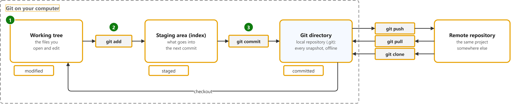

# Pro Git: getting started

Study notes on [Scott Chacon and Ben Straub, Pro Git, 2nd edition](https://git-scm.com/book/en/v2), which CST8913 Cloud Migration (Algonquin College, Fall 2026) uses in week 1. Each section follows one part of the source. Start from the figure: the framed terms are the ones to learn, and the table below it defines them in the same order, each with a citation linked to the passage and a Chinese translation in which each key word has the same colour as in the English. The verb of each sentence has a red wavy underline, in the English and in the Chinese.

## [What is Git?](https://git-scm.com/book/en/v2/Getting-Started-What-is-Git%3F)

| Term | Definition | 中文翻译 | Source |
|---|---|---|---|
| **Git** Git 版本控制 | "**Git** is a **free and open source** **distributed version control system** designed to handle everything from small to very large projects with **speed and efficiency**." | **Git** 是一个**免费且开源**的**分布式版本控制系统**，旨在处理从小型到超大型的各种项目，并做到**快速、高效**。 | [Git, n.d., para. 1](https://git-scm.com/#:~:text=Git%20is%20a%20free%20and%20open%20source%20distributed%20version) |
| **working tree** 工作区 | "The **working tree** is a **single checkout** of one version of the project. These files are pulled out of the **compressed database** in the Git directory and **placed on disk** for you to use or modify." | **工作区**是项目某一版本的**单次检出**。这些文件从 Git 目录中的**压缩数据库**中提取出来，**放在磁盘上**供你使用或修改。 | [Chacon, 2014, "The Three States" section, para. 3](https://git-scm.com/book/en/v2/Getting-Started-What-is-Git%3F#_the_three_states:~:text=The%20working%20tree%20is%20a%20single%20checkout%20of%20one%20version) |
| **modified** 已修改 | "**Modified** means that you have **changed the file** but have **not committed** it to your **database** yet." | **已修改**表示你**已更改文件**，但**尚未将其提交**到**数据库**。 | [Chacon, 2014, "The Three States" section, bullet 1](https://git-scm.com/book/en/v2/Getting-Started-What-is-Git%3F#_the_three_states:~:text=Modified%20means%20that%20you%20have%20changed%20the%20file%20but) |
| **git add** git add 暂存 | "Add contents of **new or changed files** to the **index**. The "index" (also known as the "**staging area**") is what you use to prepare the contents of the **next commit**." | 将**新文件或已更改文件**的内容添加到**索引**中。“索引”（也称为“**暂存区**”）是你用来准备**下一次提交**内容的地方。 | [Git, n.d., "DESCRIPTION" section, para. 1](https://git-scm.com/docs/git-add#_description:~:text=Add%20contents%20of%20new%20or%20changed%20files%20to%20the%20index) |
| **staging area (index)** 暂存区 | "The **staging area** is a file, generally contained in your **Git directory**, that stores information about what will go into your **next commit**. Its technical name in Git parlance is the "**index**"..." | **暂存区**是一个文件，通常位于你的 **Git 目录**中，存储着有关**下一次提交**将包含哪些内容的信息。用 Git 的术语来说，它的技术名称是“**索引**”…… | [Chacon, 2014, "The Three States" section, para. 4](https://git-scm.com/book/en/v2/Getting-Started-What-is-Git%3F#_the_three_states:~:text=The%20staging%20area%20is%20a%20file%2C%20generally%20contained%20in%20your) |
| **staged** 已暂存 | "**Staged** means that you have marked a **modified file** in its **current version** to go into your **next commit snapshot**." | **已暂存**表示你已将**修改过的文件**的**当前版本**标记为要放入**下一次提交快照**中。 | [Chacon, 2014, "The Three States" section, bullet 2](https://git-scm.com/book/en/v2/Getting-Started-What-is-Git%3F#_the_three_states:~:text=Staged%20means%20that%20you%20have%20marked%20a%20modified%20file) |
| **commit** 提交 | "With Git, every time you **commit**, or **save the state** of your project, Git basically **takes a picture** of what all your files look like at that moment and stores a reference to that **snapshot**." | 在 Git 中，每当你**提交**，或者说**保存你的项目状态**时，Git 基本上会为你所有文件在那一刻的样子**拍一张照片**，并存储对该**快照**的一个引用。 | [Chacon, 2014, "Snapshots, Not Differences" section, para. 2](https://git-scm.com/book/en/v2/Getting-Started-What-is-Git%3F#_snapshots_not_differences:~:text=With%20Git%2C%20every%20time%20you%20commit%2C%20or%20save%20the) |
| **Git directory** Git 目录（本地仓库） | "The **Git directory** is where Git stores the **metadata** and **object database** for your project. This is the most important part of Git, and it is what is copied when you **clone a repository** from another computer." | **Git 目录**是 Git 存储项目**元数据**和**对象数据库**的地方。这是 Git 最重要的部分，也是你从另一台计算机**克隆仓库**时所复制的内容。 | [Chacon, 2014, "The Three States" section, para. 5](https://git-scm.com/book/en/v2/Getting-Started-What-is-Git%3F#_the_three_states:~:text=The%20Git%20directory%20is%20where%20Git%20stores%20the%20metadata) |
| **committed** 已提交 | "**Committed** means that the data is **safely stored** in your **local database**." | **已提交**表示数据已**安全地存储**在**本地数据库**中。 | [Chacon, 2014, "The Three States" section, bullet 3](https://git-scm.com/book/en/v2/Getting-Started-What-is-Git%3F#_the_three_states:~:text=Committed%20means%20that%20the%20data%20is%20safely%20stored%20in) |
| **remote repository** 远程仓库 | "A repository which is used to **track the same project** but **resides somewhere else**. To communicate with **remotes**, see fetch or push." | 一个用于**跟踪同一项目**、但**位于其他位置**的仓库。要与**远程仓库**通信，请参阅 fetch 或 push。 | [Git, n.d., "remote repository" entry](https://git-scm.com/docs/gitglossary#Documentation/gitglossary.txt-aiddefremotearemoterepository:~:text=A%20repository%20which%20is%20used%20to%20track%20the%20same%20project) |
| **push** 推送 | "When you have **your project** at a point that you want to **share**, you have to **push it upstream**." | 当**你的项目**进展到你想要**分享**的程度时，你必须将它**推送到上游**。 | [Chacon, 2014, "Pushing to Your Remotes" section, para. 1](https://git-scm.com/book/en/v2/Git-Basics-Working-with-Remotes#_pushing_remotes:~:text=When%20you%20have%20your%20project%20at%20a%20point%20that) |
| **pull** 拉取 | "**Pulling** a **branch** means to **fetch** it and **merge** it." | **拉取**一个**分支**意味着**获取**它并**合并**它。 | [Git, n.d., "pull" entry](https://git-scm.com/docs/gitglossary#Documentation/gitglossary.txt-aiddefpullapull:~:text=Pulling%20a%20branch%20means%20to%20fetch%20it%20and%20merge%20it) |
| **clone** 克隆 | "If you want to get a copy of an **existing Git repository** — for example, a project you’d like to **contribute** to — the command you need is **git clone**." | 如果你想获取一个**现有 Git 仓库**的副本——例如，一个你想**参与贡献**的项目——你需要的命令是 **git clone**。 | [Chacon, 2014, "Cloning an Existing Repository" section, para. 1](https://git-scm.com/book/en/v2/Git-Basics-Getting-a-Git-Repository#_git_cloning:~:text=If%20you%20want%20to%20get%20a%20copy%20of%20an%20existing) |
