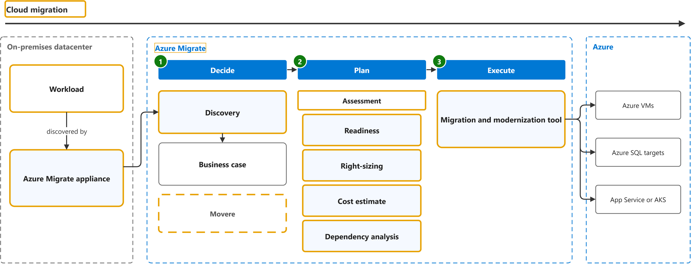

# What is Azure Migrate?

Study notes on [Azure Migrate documentation](https://learn.microsoft.com/en-us/azure/migrate/migrate-services-overview), which CST8913 Cloud Migration (Algonquin College, Fall 2026) uses in weeks 2 and 4. Each section follows one part of the source. Start from the figure: the framed terms are the ones to learn, and the table below it defines them in the same order, each with a citation linked to the passage and a Chinese translation in which each key word has the same colour as in the English. The verb of each sentence is in a red box, in the English and in the Chinese.

## [Decide, plan, execute](https://learn.microsoft.com/en-us/azure/migrate/migrate-services-overview#migration-phases)

| Term | Definition | 中文翻译 | Source |
|---|---|---|---|
| **cloud migration** 云迁移 | "**Cloud migration** is the process of moving **applications and data** from one location—often a company's private, **on-premises servers**—to a **public cloud provider's servers**, but it can also entail moving resources between different clouds." | **云迁移**是将**应用程序和数据**从一个位置（通常是公司私有的**本地服务器**）迁移到**公有云提供商的服务器**的过程，但它也可能涉及在不同云之间迁移资源。 | [Microsoft, n.d., "Cloud migration definition" section, para. 1](https://azure.microsoft.com/en-us/resources/cloud-computing-dictionary/what-is-cloud-migration#:~:text=Cloud%20migration%20is%20the%20process%20of%20moving%20applications%20and%20data) |
| **workload** 工作负载 | "A **workload** is a collection of **IT components**, such as servers, **virtual machines** (VMs), cloud services, applications, code, data, or appliances, that support one or more **business processes**." | **工作负载**是一组 **IT 组件**，例如服务器、**虚拟机**（VM）、云服务、应用程序、代码、数据或设备，这些组件支持一个或多个**业务流程**。 | [Microsoft, n.d., "Discover workload inventory" section, bullet 1](https://learn.microsoft.com/en-us/azure/cloud-adoption-framework/plan/discover-existing-workload-inventory#discover-workload-inventory:~:text=A%20workload%20is%20a%20collection%20of%20IT%20components%2C%20such) |
| **Azure Migrate appliance** Azure Migrate 设备（发现用虚拟机） | "The **Azure Migrate appliance** is a **virtual appliance** that can be deployed on a server in your datacenter. The appliance collects the **configuration and performance data** for your servers and **continually sends** it to the Azure Migrate service." | **Azure Migrate 设备**是一种**虚拟设备**，可部署在你数据中心的服务器上。该设备收集服务器的**配置和性能数据**，并**持续将其发送**到 Azure Migrate 服务。 | [Microsoft, n.d., "Decide" section, para. 2](https://learn.microsoft.com/en-us/azure/migrate/migrate-services-overview#decide:~:text=The%20Azure%20Migrate%20appliance%20is%20a%20virtual%20appliance%20that%20can) |
| **Azure Migrate** Azure Migrate 迁移中心 | "**Azure Migrate** is a service that helps you **decide on, plan, and execute** your migration to Azure. Azure Migrate helps you find the **best migration path**, assess for Azure readiness and cost of hosting workloads on Azure, and perform the migration with **minimal downtime and risk**." | **Azure Migrate** 是一项服务，可帮助你**决定、规划和执行**到 Azure 的迁移。Azure Migrate 可帮助你找到**最佳迁移路径**，评估 Azure 就绪性以及在 Azure 上托管工作负载的成本，并以**最短的停机时间和最低的风险**执行迁移。 | [Microsoft, n.d., para. 1](https://learn.microsoft.com/en-us/azure/migrate/migrate-services-overview#:~:text=Azure%20Migrate%20is%20a%20service%20that%20helps%20you%20decide%20on) |
| **discovery** 发现 | "The first step in a **migration journey** is to **identify your workloads**. This process of identification is called **discovery**." | **迁移之旅**的第一步是**识别你的工作负载**。这一识别过程称为**发现**。 | [Microsoft, n.d., "Decide" section, para. 1](https://learn.microsoft.com/en-us/azure/migrate/migrate-services-overview#decide:~:text=The%20first%20step%20in%20a%20migration%20journey%20is%20to) |
| **Movere** Movere（已退役的发现评估工具） | "Movere: The **Movere service** **retired** on March 1, 2024. Users should use **Azure Migrate** for the **discovery and assessment** of on-premises workloads." | Movere：**Movere 服务**已于 2024 年 3 月 1 日**停用**。用户应使用 **Azure Migrate** 来**发现和评估**本地工作负载。 | [Microsoft, n.d., "Update (April 2024)" section, bullet 1](https://learn.microsoft.com/en-us/azure/migrate/whats-new?view=migrate#update-april-2024:~:text=Movere%3A%20The%20Movere%20service%20retired%20on%20March%201) |
| **assessment** 评估报告 | "An **assessment** with the **Discovery and assessment tool** measures the **readiness** and estimates the **effect** of migrating on-premises servers to Azure." | **评估**（使用**发现和评估工具**进行）会衡量**就绪情况**，并估算将本地服务器迁移到 Azure 的**影响**。 | [Microsoft, n.d., "What's an assessment?" section, para. 1](https://learn.microsoft.com/en-us/azure/migrate/concepts-assessment-calculation?view=migrate-classic#whats-an-assessment:~:text=An%20assessment%20with%20the%20Discovery%20and%20assessment%20tool%20measures%20the) |
| **readiness** 就绪性（Azure 就绪度） | "**Azure readiness**: Assess whether **on-premises servers**, SQL servers, and **web apps** are **ready for migration** to Azure." | **Azure 就绪度**：评估**本地服务器**、SQL 服务器和 **Web 应用**是否已**准备好迁移**到 Azure。 | [Microsoft, n.d., "Plan" section, bullet 1](https://learn.microsoft.com/en-us/azure/migrate/migrate-services-overview#plan:~:text=Azure%20readiness%3A%20Assess%20whether%20on%2Dpremises%20servers%2C%20SQL%20servers) |
| **sizing** 规格估算（合理定型） | "**Right-sizing**: Estimate the **size of Azure virtual machines (VMs**), the **Azure SQL configuration**, and the number of **Azure VMware Solution nodes** after migration." | **合理定型**：估算 **Azure 虚拟机（VM）的大小**、**Azure SQL 配置**，以及迁移后 **Azure VMware Solution 节点**的数量。 | [Microsoft, n.d., "Plan" section, bullet 2](https://learn.microsoft.com/en-us/azure/migrate/migrate-services-overview#plan:~:text=Right%2Dsizing%3A%20Estimate%20the%20size%20of%20Azure%20virtual%20machines) |
| **cost estimate** 成本估算 | "**Azure cost estimation**: Estimate costs for running **on-premises servers** in Azure." | **Azure 成本估算**：估算在 Azure 中运行**本地服务器**的成本。 | [Microsoft, n.d., "Plan" section, bullet 3](https://learn.microsoft.com/en-us/azure/migrate/migrate-services-overview#plan:~:text=Azure%20cost%20estimation%3A%20Estimate%20costs%20for%20running%20on%2Dpremises%20servers) |
| **dependency analysis** 依赖分析 | "**Dependency analysis**: Understand the **network dependencies** between servers in your datacenter so that you can make **high-confidence migration plans** without missing any **critical dependency**." | **依赖分析**：了解数据中心内服务器之间的**网络依赖关系**，以便制定**高可信度的迁移计划**，而不会遗漏任何**关键依赖关系**。 | [Microsoft, n.d., "Plan" section, bullet 4](https://learn.microsoft.com/en-us/azure/migrate/migrate-services-overview#plan:~:text=Dependency%20analysis%3A%20Understand%20the%20network%20dependencies%20between%20servers) |
| **Migration and modernization tool** 迁移和现代化工具 | "The **Migration and modernization tool** is **purpose-built** for **server migration** to Azure. It's **optimized for migration**." | **迁移和现代化工具**​**专为**​**服务器迁移**到 Azure 而构建。它**针对迁移进行了优化**。 | [Microsoft, n.d., "What's the difference between Azure Migrate and Azure Site Recovery?" section, bullet 2](https://learn.microsoft.com/en-us/azure/migrate/resources-faq#whats-the-difference-between-azure-migrate-and-azure-site-recovery:~:text=The%20Migration%20and%20modernization%20tool%20is%20purpose%2Dbuilt%20for%20server%20migration) |
