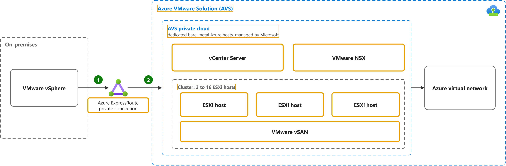

# What is Azure VMware Solution?

Study notes on [Azure VMware Solution documentation](https://learn.microsoft.com/en-us/azure/azure-vmware/introduction), which CST8913 Cloud Migration (Algonquin College, Fall 2026) uses in week 5. Each section follows one part of the source. Start from the figure: the framed terms are the ones to learn, and the table below it defines them in the same order, each with a citation linked to the passage and a Chinese translation in which each key word has the same colour as in the English. The verb of each sentence is in a red box, in the English and in the Chinese.

## [Private clouds, clusters and hosts](https://learn.microsoft.com/en-us/azure/azure-vmware/introduction#hosts-clusters-and-private-clouds)

| Term | Definition | 中文翻译 | Source |
|---|---|---|---|
| **Azure ExpressRoute** ExpressRoute 专线 | "**ExpressRoute** lets you extend your **on-premises networks** into the **Microsoft cloud** over a **private connection** with the help of a connectivity provider." | **ExpressRoute** 让你可以将**本地网络**扩展到 **Microsoft 云**，方式是通过**专用连接**，并借助连接服务提供商的帮助。 | [Microsoft, n.d., para. 1](https://learn.microsoft.com/en-us/azure/expressroute/expressroute-introduction#:~:text=ExpressRoute%20lets%20you%20extend%20your%20on%2Dpremises%20networks%20into%20the) |
| **Azure VMware Solution (AVS)** Azure VMware 解决方案 | "**Azure VMware Solution** provides **private clouds** that contain **VMware vSphere clusters** built from **dedicated bare-metal Azure infrastructure**." | **Azure VMware 解决方案**提供**私有云**，其中包含 **VMware vSphere 群集**，这些群集基于**专用裸机 Azure 基础结构**构建。 | [Microsoft, n.d., para. 1](https://learn.microsoft.com/en-us/azure/azure-vmware/introduction#:~:text=Azure%20VMware%20Solution%20provides%20private%20clouds%20that%20contain%20VMware%20vSphere) |
| **Azure VMware Solution private cloud** AVS 私有云 | "**Azure VMware Solution private cloud**: Offers compute, networking, and storage resources by using **VMware software**, including **vCenter Server**, NSX software-defined networking, vSAN software-defined storage, and **Azure bare-metal ESXi hosts**." | **Azure VMware Solution 私有云**：使用 **VMware 软件**提供计算、网络和存储资源，包括 **vCenter Server**、NSX 软件定义网络、vSAN 软件定义存储和 **Azure 裸机 ESXi 主机**。 | [Microsoft, n.d., second list, bullet 4](https://learn.microsoft.com/en-us/azure/azure-vmware/architecture-private-clouds#:~:text=Offers%20compute%2C%20networking%2C%20and%20storage%20resources%20by%20using%20VMware%20software) |
| **vCenter Server** vCenter 服务器 | "**VMware vCenter Server** for **managing ESXi and vSAN**." | **VMware vCenter Server**，用于**管理 ESXi 和 vSAN**。 | [Microsoft, n.d., bullet 2](https://learn.microsoft.com/en-us/azure/azure-vmware/architecture-private-clouds#:~:text=VMware%20vCenter%20Server%20for%20managing%20ESXi%20and%20vSAN) |
| **VMware NSX** NSX 网络 | "**VMware NSX** **software-defined networking** for **vSphere workload virtual machines (VMs**)." | **VMware NSX** **软件定义网络**，用于 **vSphere 工作负载虚拟机 (VM**)。 | [Microsoft, n.d., bullet 3](https://learn.microsoft.com/en-us/azure/azure-vmware/architecture-private-clouds#:~:text=VMware%20NSX%20software%2Ddefined%20networking%20for%20vSphere%20workload%20virtual%20machines) |
| **cluster** 集群 | "**Azure VMware Solution clusters** are based on a **hyperconverged infrastructure**. ... An Azure VMware Solution cluster requires a **minimum number of three hosts**." | **Azure VMware Solution 集群**基于**超融合基础结构**。……Azure VMware Solution 集群**至少需要三台主机**。 | [Microsoft, n.d., "Hosts, clusters, and private clouds" section, para. 1 and para. 2](https://learn.microsoft.com/en-us/azure/azure-vmware/introduction#hosts-clusters-and-private-clouds:~:text=Azure%20VMware%20Solution%20clusters%20are%20based%20on%20a%20hyperconverged%20infrastructure) |
| **ESXi host** ESXi 主机 | "**Dedicated** **bare-metal server hosts** provisioned with **VMware vSphere Hypervisor (ESXi**)." | **专用**​**裸机服务器主机**，预配了 **VMware vSphere Hypervisor (ESXi**)。 | [Microsoft, n.d., bullet 1](https://learn.microsoft.com/en-us/azure/azure-vmware/architecture-private-clouds#:~:text=Dedicated%20bare%2Dmetal%20server%20hosts%20provisioned%20with%20VMware%20vSphere%20Hypervisor) |
| **VMware vSAN** vSAN 存储 | "**VMware vSAN** **datastore** for **vSphere workload VMs**." | **VMware vSAN** **数据存储**，供 **vSphere 工作负载虚拟机**使用。 | [Microsoft, n.d., bullet 4](https://learn.microsoft.com/en-us/azure/azure-vmware/architecture-private-clouds#:~:text=VMware%20vSAN%20datastore%20for%20vSphere%20workload%20VMs) |
