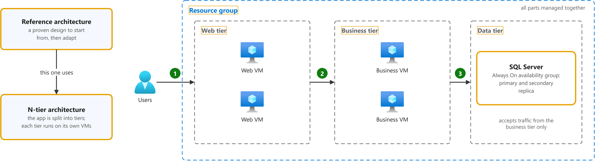
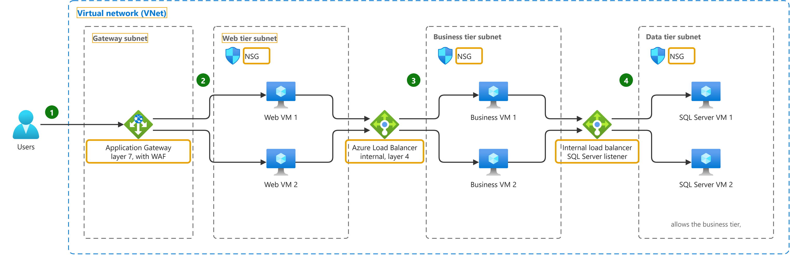
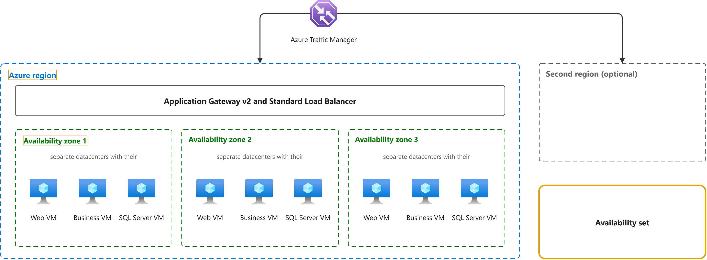

# Windows N-tier application on Azure

Study notes on [Azure Architecture Center (retired October 2023)](https://github.com/MicrosoftDocs/architecture-center/blob/b739942a2cf3c49b448970e9dc5c0783cc028dca/docs/reference-architectures/n-tier/n-tier-sql-server-content.md), which CST8913 Cloud Migration (Algonquin College, Fall 2026) uses in week 3. Each section follows one part of the source. Start from the figure: the framed terms are the ones to learn, and the table below it defines them in the same order, each with a citation linked to the passage and a Chinese translation in which each key word has the same colour as in the English. In the English, the subject is underlined twice, the verb once and the object or complement with a wavy line.

## [Architecture](https://github.com/MicrosoftDocs/architecture-center/blob/b739942a2cf3c49b448970e9dc5c0783cc028dca/docs/reference-architectures/n-tier/n-tier-sql-server-content.md#architecture)

| Term | Definition | 中文翻译 | Source |
|---|---|---|---|
| **reference architecture** 参考架构 | "Before inventing an architecture from scratch, review **validated reference architectures** and fundamentals from the Azure Architecture Center. Explore validated reference architectures for **common workloads**. These architectures help **accelerate design decisions** and **reduce risk**." *Note: No formal one-line definition on Learn; closest official wording.* | 在从零开始发明一种架构之前，请先查看 Azure 体系结构中心提供的**经过验证的参考架构**和基础知识。探索针对**常见工作负载**的经过验证的参考架构。这些架构有助于**加快设计决策**并**降低风险**。 | [Microsoft, n.d., "Explore validated cloud-native architectures" section, bullet 1](https://learn.microsoft.com/en-us/azure/cloud-adoption-framework/cloud-native/plan-cloud-native-solutions#explore-validated-cloud-native-architectures:~:text=Before%20inventing%20an%20architecture%20from%20scratch%2C%20review%20validated%20reference%20architectures) |
| **N-tier architecture** N 层架构 | "An **N-tier architecture** divides an application into **logical layers** and **physical tiers**. ... A traditional **three-tier application** has a presentation tier, an optional middle tier, and a database tier." | **N 层架构**将应用程序划分为**逻辑层**和**物理层**。……传统的**三层应用程序**具有表示层、可选的中间层和数据库层。 | [Microsoft, n.d., para. 1](https://learn.microsoft.com/en-us/azure/architecture/guide/architecture-styles/n-tier#:~:text=An%20N%2Dtier%20architecture%20divides%20an%20application%20into%20logical%20layers%20and) |
| **resource group** 资源组 | "A **resource group** is a **container** that you use to manage **related resources** for an Azure solution. ... When you delete a resource group, **all resources** in the resource group are also deleted." | **资源组**是一个**容器**，用于管理 Azure 解决方案的**相关资源**。……删除资源组时，资源组中的**所有资源**也会被删除。 | [Microsoft, n.d., "What is a resource group?" section, para. 1](https://learn.microsoft.com/en-us/azure/azure-resource-manager/management/overview#resource-groups:~:text=A%20resource%20group%20is%20a%20container%20that%20you%20use%20to) |
| **web tier** Web 层（展示层） | "The **presentation tier** is labeled **Web tier**. ... The web and business tiers are **stateless**. **Any VM** can handle any request for that tier." | **表示层**标记为 **Web 层**。……Web 层和业务层是**无状态**的。**任何虚拟机**都可以处理该层的任何请求。 | [Microsoft, n.d., "N-tier architecture on VMs" section, para. 10](https://learn.microsoft.com/en-us/azure/architecture/guide/architecture-styles/n-tier#n-tier-architecture-on-vms:~:text=The%20presentation%20tier%20is%20labeled%20Web%20tier) |
| **business tier** 业务层（中间层） | "The layer labeled **Business tier** in the reference diagram refers to the **business logic tier**. ... The web and business tiers are **stateless**. **Any VM** can handle any request for that tier." *Note: Also called the middle tier.* | 参考关系图中标记为**业务层**的层是指**业务逻辑层**。……Web 层和业务层是**无状态**的。**任何虚拟机**都可以处理该层的任何请求。 | [Microsoft, n.d., "N-tier architecture on VMs" section, para. 10](https://learn.microsoft.com/en-us/azure/architecture/guide/architecture-styles/n-tier#n-tier-architecture-on-vms:~:text=The%20layer%20labeled%20Business%20tier%20in%20the%20reference%20diagram%20refers) |
| **data tier** 数据层 | "The **data tier** should consist of a **replicated database**. ... Restrict access to the data tier by allowing requests from a **middle tier** only." | **数据层**应由**复制的数据库**组成。……通过仅允许来自**中间层**的请求来限制对数据层的访问。 | [Microsoft, n.d., "N-tier architecture on VMs" section, para. 7](https://learn.microsoft.com/en-us/azure/architecture/guide/architecture-styles/n-tier#n-tier-architecture-on-vms:~:text=The%20data%20tier%20should%20consist%20of%20a%20replicated%20database) |
| **SQL Server** SQL Server 数据库 | "**Microsoft SQL Server** is a **relational database management system (RDBMS**). Applications and tools connect to a **SQL Server instance** or database, and communicate using **Transact-SQL (T-SQL**)." | **Microsoft SQL Server** 是一种**关系数据库管理系统（RDBMS**）。应用程序和工具连接到 **SQL Server 实例**或数据库，并使用 **Transact-SQL（T-SQL**）进行通信。 | [Microsoft, n.d., para. 2](https://learn.microsoft.com/en-us/sql/sql-server/what-is-sql-server?view=sql-server-ver17#:~:text=Microsoft%20SQL%20Server%20is%20a%20relational%20database%20management%20system) |

## [Networking and load balancing](https://github.com/MicrosoftDocs/architecture-center/blob/b739942a2cf3c49b448970e9dc5c0783cc028dca/docs/reference-architectures/n-tier/n-tier-sql-server-content.md#networking-and-load-balancing)

| Term | Definition | 中文翻译 | Source |
|---|---|---|---|
| **virtual network (VNet)** 虚拟网络 | "**Azure Virtual Network** provides the fundamental building block for your **private network** in Azure. This service enables Azure resources like virtual machines (VMs) to **securely communicate** with each other, the internet, and **on-premises networks**." | **Azure 虚拟网络**为你在 Azure 中的**专用网络**提供基本构建块。此服务使虚拟机（VM）等 Azure 资源能够**安全地相互通信**、与 Internet 通信以及与**本地网络**通信。 | [Microsoft, n.d., para. 1](https://learn.microsoft.com/en-us/azure/virtual-network/virtual-networks-overview#:~:text=Azure%20Virtual%20Network%20provides%20the%20fundamental%20building%20block%20for%20your) |
| **gateway subnet** 网关子网 | "An **application gateway** is a **dedicated deployment** in your **virtual network**. Within your virtual network, a **dedicated subnet** is required for the application gateway." *Note: Microsoft calls it the Application Gateway's dedicated subnet; not the same as GatewaySubnet for VPN gateways.* | **应用程序网关**是一个**专用部署**，位于你的**虚拟网络**中。在你的虚拟网络中，应用程序网关需要一个**专用子网**。 | [Microsoft, n.d., "Virtual network and dedicated subnet" section, para. 1](https://learn.microsoft.com/en-us/azure/application-gateway/configuration-infrastructure#virtual-network-and-dedicated-subnet:~:text=An%20application%20gateway%20is%20a%20dedicated%20deployment%20in%20your) |
| **Azure Application Gateway** Azure 应用程序网关 | "**Azure Application Gateway** is a **web traffic load balancer** that helps you manage traffic to your web applications. ... Application Gateway makes **intelligent routing decisions** based on **HTTP request attributes** like URL paths and host headers." | **Azure 应用程序网关**是一种 **Web 流量负载均衡器**，可帮助你管理流向 Web 应用程序的流量。……应用程序网关会做出**智能路由决策**，依据是 **HTTP 请求属性**，例如 URL 路径和主机标头。 | [Microsoft, n.d., para. 1](https://learn.microsoft.com/en-us/azure/application-gateway/overview#:~:text=Azure%20Application%20Gateway%20is%20a%20web%20traffic%20load%20balancer%20that) |
| **subnet** 子网 | "Azure **virtual network subnets** are **essential containers** where all Azure resources are **deployed** within a virtual network." | Azure **虚拟网络子网**是**必不可少的容器**，虚拟网络中的所有 Azure 资源都**部署**在其中。 | [Microsoft, n.d., para. 1](https://learn.microsoft.com/en-us/azure/virtual-network/virtual-network-manage-subnet#:~:text=Azure%20virtual%20network%20subnets%20are%20essential%20containers%20where%20all%20Azure) |
| **network security group (NSG)** 网络安全组 | "You can use an Azure **network security group** to **filter network traffic** between Azure resources in Azure virtual networks. A network security group contains **security rules** that **allow or deny** inbound network traffic to, or outbound network traffic from, several types of Azure resources." | 你可以使用 Azure **网络安全组**来**筛选** Azure 虚拟网络中 Azure 资源之间的网络流量。网络安全组包含**安全规则**，这些规则**允许或拒绝**流向多种类型 Azure 资源的入站网络流量，或来自这些资源的出站网络流量。 | [Microsoft, n.d., para. 1](https://learn.microsoft.com/en-us/azure/virtual-network/network-security-groups-overview#:~:text=You%20can%20use%20an%20Azure%20network%20security%20group%20to%20filter) |
| **Azure Load Balancer** Azure 负载均衡器 | "**Azure Load Balancer** is a cloud service that distributes **incoming network traffic** across **backend virtual machines** (VMs) or virtual machine scale sets (VMSS). ... Azure Load Balancer operates at **layer 4** of the Open Systems Interconnection (OSI) model." | **Azure 负载均衡器**是一种云服务，可将**传入的网络流量**分配到**后端虚拟机**（VM）或虚拟机规模集（VMSS）。……Azure 负载均衡器在开放式系统互连（OSI）模型的**第 4 层**运行。 | [Microsoft, n.d., para. 3](https://learn.microsoft.com/en-us/azure/load-balancer/load-balancer-overview#:~:text=Azure%20Load%20Balancer%20is%20a%20cloud%20service%20that%20distributes%20incoming) |
| **internal load balancer** 内部负载均衡器 | "**Alternatively**, an **internal (or private) load balancer** is used to load balance traffic inside a **virtual network**." | **或者**，**内部（或专用）负载均衡器**用于对**虚拟网络**内部的流量进行负载均衡。 | [Microsoft, n.d., "How Azure Load Balancer distributes Layer 4 traffic" section, para. 3](https://learn.microsoft.com/en-us/azure/load-balancer/load-balancer-overview#how-azure-load-balancer-distributes-layer-4-traffic:~:text=Alternatively%2C%20an%20internal) |

## [Availability](https://github.com/MicrosoftDocs/architecture-center/blob/b739942a2cf3c49b448970e9dc5c0783cc028dca/docs/reference-architectures/n-tier/n-tier-sql-server-content.md#availability)

| Term | Definition | 中文翻译 | Source |
|---|---|---|---|
| **Azure region** Azure 区域 | "Each **region** is a set of **physical facilities** that include **datacenters** and **networking infrastructure**." | 每个**区域**都是一组**物理设施**，其中包括**数据中心**和**网络基础结构**。 | [Microsoft, n.d., para. 1](https://learn.microsoft.com/en-us/azure/reliability/regions-overview#:~:text=Each%20region%20is%20a%20set%20of%20physical%20facilities%20that) |
| **availability zone** 可用区 | "Many Azure regions provide **availability zones**, which are **separated groups of datacenters** within a region. Each availability zone has **independent power, cooling, and networking infrastructure**..." | 许多 Azure 区域都提供**可用区**，即区域内**彼此分隔的数据中心组**。每个可用区都有**独立的电源、冷却和网络基础结构**…… | [Microsoft, n.d., para. 1](https://learn.microsoft.com/en-us/azure/reliability/availability-zones-overview#:~:text=Many%20Azure%20regions%20provide%20availability%20zones%2C%20which%20are%20separated%20groups) |
| **availability set** 可用性集 | "VMs within the same **availability set** are deployed across **multiple physical servers**, compute racks, storage units, and **network switches** for **redundancy**." | 同一**可用性集**中的虚拟机部署在**多个物理服务器**、计算机架、存储单元和**网络交换机**上，以实现**冗余**。 | [Microsoft, 2023, "Availability" section, para. 3](https://github.com/MicrosoftDocs/architecture-center/blob/b739942a2cf3c49b448970e9dc5c0783cc028dca/docs/reference-architectures/n-tier/n-tier-sql-server-content.md#availability:~:text=VMs%20within%20the%20same%20availability%20set%20are%20deployed%20across) |
