# CST8913 midterm review

This page reviews the core concepts of CST8913 Cloud Migration (Algonquin College, Fall 2026) in 7 themes and 22 sub-topics. Each sub-topic opens with a diagram, followed by key points and a glossary of the terms shown in the diagram, listed in the order they appear. Each term is defined once, at its first occurrence. Each citation names the section and paragraph and links to that passage.

## 1. Cloud computing basics

### 1.1 Service types and the shared responsibility model

*Note.* From [*Describe the shared responsibility model*](https://learn.microsoft.com/en-us/training/modules/describe-cloud-compute/4-describe-shared-responsibility-model#responsibility-by-service-model), by Microsoft, n.d., Microsoft Learn. CC BY 4.0.

**Key points**

- "Testing and development: You need to rapidly replicate established configurations for development and test environments. You can start up or shut down different environments rapidly with an IaaS structure while maintaining complete control." ([Microsoft, n.d., "Scenarios" section, bullet 2](https://learn.microsoft.com/en-us/training/modules/describe-cloud-service-types/2-describe-infrastructure-service#scenarios:~:text=Testing%20and%20development%3A%20You%20need%20to%20rapidly%20replicate%20established))

  IaaS 的典型用途之一：开发和测试环境。需要反复搭同样的环境时，用 IaaS 很快就能开出一套、用完就关，配置仍然完全由你控制。

- "Development framework: PaaS provides a framework that developers can build upon to develop or customize cloud-based applications. Developers can create applications using built-in software components. Cloud features such as scalability, high availability, and multitenant capability are included, reducing the amount of coding that developers must do." ([Microsoft, n.d., "Scenarios" section, bullet 1](https://learn.microsoft.com/en-us/training/modules/describe-cloud-service-types/3-describe-platform-service#scenarios:~:text=Development%20framework%3A%20PaaS%20provides%20a%20framework%20that%20developers))

  PaaS 的典型用途之一：开发框架。平台提供现成组件，开发者直接在上面搭应用；扩展、高可用、多租户这些能力平台自带，少写很多代码。

- "Analytics or business intelligence: Tools provided as a service with PaaS allow teams to analyze and mine their data, find insights and patterns, and predict outcomes to improve planning and operational decisions." ([Microsoft, n.d., "Scenarios" section, bullet 2](https://learn.microsoft.com/en-us/training/modules/describe-cloud-service-types/3-describe-platform-service#scenarios:~:text=Analytics%20or%20business%20intelligence%3A%20Tools%20provided%20as%20a%20service))

  PaaS 的另一用途：数据分析和商业智能。平台自带分析工具，帮团队从数据里找规律、做预测，辅助规划和运营决策。

- "Email and messaging. Productivity applications. Finance and expense tracking." ([Microsoft, n.d., "Scenarios" section, bullets 1–3](https://learn.microsoft.com/en-us/training/modules/describe-cloud-service-types/4-describe-software-service#scenarios:~:text=Email%20and%20messaging.))

  SaaS 的典型用途：邮件和即时通讯、办公软件、财务和报销系统，都是拿来就用的现成软件。

| Term | Definition | 中文解释 | Source |
|---|---|---|---|
| **shared responsibility model** (责任共担模型) | "With the shared responsibility model, these responsibilities get shared between the cloud provider and the consumer. Physical security, power, cooling, and network connectivity are the responsibility of the cloud provider." | 云厂商和用户分工负责安全和运维：机房、硬件归厂商，数据、账号、设备永远归你；服务类型不同，分工也不同。 | [Microsoft, n.d., "How responsibilities shift in cloud" section, para. 2](https://learn.microsoft.com/en-us/training/modules/describe-cloud-compute/4-describe-shared-responsibility-model#how-responsibilities-shift-in-cloud:~:text=With%20the%20shared%20responsibility%20model%2C%20these%20responsibilities%20get%20shared%20between) |
| **on-premises** (本地部署) | "Start with a traditional on-premises datacenter. Your team is responsible for maintaining the physical space, ensuring security, and maintaining or replacing the servers if anything happens." | 本地部署就是服务器放在公司自己的机房里；场地、安全、硬件维护全由自己负责。 | [Microsoft, n.d., "How responsibilities shift in cloud" section, para. 1](https://learn.microsoft.com/en-us/training/modules/describe-cloud-compute/4-describe-shared-responsibility-model#how-responsibilities-shift-in-cloud:~:text=Start%20with%20a%20traditional%20on%2Dpremises%20datacenter) |
| **Infrastructure as a Service (IaaS)** (基础设施即服务) | "Infrastructure as a service (IaaS) is the most flexible category of cloud services. It provides the maximum amount of control for your cloud resources... With IaaS, you're essentially renting the hardware in a cloud datacenter." | 租用云上的虚拟硬件（如虚拟机），操作系统和上面的软件都自己管；最灵活，但要管的最多。 | [Microsoft, n.d., para. 1](https://learn.microsoft.com/en-us/training/modules/describe-cloud-service-types/2-describe-infrastructure-service#:~:text=Infrastructure%20as%20a%20service%20%28IaaS%29%20is%20the%20most%20flexible%20category) |
| **Platform as a Service (PaaS)** (平台即服务) | "In a PaaS environment, the cloud provider maintains the physical infrastructure, physical security, and connection to the internet. They also maintain the operating systems, middleware, development tools, and analytics services that make up a cloud solution." | 厂商管好服务器、操作系统和运行环境，你只管自己的代码和数据；不用打补丁，省运维。 | [Microsoft, n.d., para. 1](https://learn.microsoft.com/en-us/training/modules/describe-cloud-service-types/3-describe-platform-service#:~:text=In%20a%20PaaS%20environment%2C%20the%20cloud%20provider%20maintains%20the%20physical) |
| **Software as a Service (SaaS)** (软件即服务) | "Software as a service (SaaS) is the most complete cloud service model from a product perspective. With SaaS, you're essentially renting or using a fully developed application." | 直接用别人做好的完整软件（如邮箱、办公软件）；最省事，但能改的最少。 | [Microsoft, n.d., para. 1](https://learn.microsoft.com/en-us/training/modules/describe-cloud-service-types/4-describe-software-service#:~:text=Software%20as%20a%20service%20%28SaaS%29%20is%20the%20most%20complete%20cloud) |
| **cloud provider** (云服务商) | "With the shared responsibility model, these responsibilities get shared between the cloud provider and the consumer. Physical security, power, cooling, and network connectivity are the responsibility of the cloud provider." | 云服务商是出租云资源的公司（如 Microsoft Azure）；机房的物理安全、电力、制冷和网络都由它负责。 | [Microsoft, n.d., "How responsibilities shift in cloud" section, para. 2](https://learn.microsoft.com/en-us/training/modules/describe-cloud-compute/4-describe-shared-responsibility-model#how-responsibilities-shift-in-cloud:~:text=With%20the%20shared%20responsibility%20model%2C%20these%20responsibilities%20get) |
| **identity and access** (身份与访问管理) | "Identity and access management is a primary security boundary in the public cloud. It's the foundation for any secure and fully compliant architecture." | 身份与访问管理决定谁能登录、能做什么；它是公有云里最主要的安全边界。 | [Microsoft, n.d., "Environment design areas" section, table, row 2](https://learn.microsoft.com/en-us/azure/cloud-adoption-framework/ready/landing-zone/design-areas#environment-design-areas:~:text=Identity%20and%20access%20management%20is%20a%20primary%20security%20boundary) |
| **datacenter** (数据中心) | "The physical infrastructure for Azure starts with datacenters. These datacenters are facilities with servers arranged in racks, with dedicated power, cooling, and networking infrastructure ..." | 数据中心就是放服务器的大楼，有专门的电力、制冷和网络；云的底层就是很多这样的机房。 | [Microsoft, n.d., "Physical infrastructure" section, para. 1](https://learn.microsoft.com/en-us/training/modules/describe-core-architectural-components-of-azure/5-describe-azure-physical-infrastructure#physical-infrastructure:~:text=The%20physical%20infrastructure%20for%20Azure%20starts%20with%20datacenters) |
| **cloud computing** (云计算) | "Cloud computing is the delivery of computing services over the internet. Computing services include common IT infrastructure such as virtual machines, storage, databases, and networking." | 通过互联网按需使用别人的服务器、存储、数据库和网络；不用自己建机房，扩容很快。 | [Microsoft, n.d., para. 1](https://learn.microsoft.com/en-us/training/modules/describe-cloud-compute/3-what-cloud-compute#:~:text=Cloud%20computing%20is%20the%20delivery%20of%20computing%20services%20over%20the) |

### 1.2 Deployment models

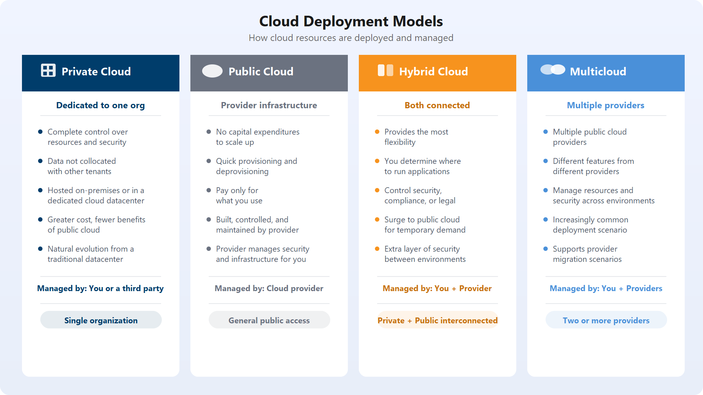

*Note.* From [*Define cloud models*](https://learn.microsoft.com/en-us/training/modules/describe-cloud-compute/5-define-cloud-models), by Microsoft, n.d., Microsoft Learn. CC BY 4.0.

| Term | Definition | 中文解释 | Source |
|---|---|---|---|
| **private cloud** (私有云) | "A private cloud is a cloud environment used by a single entity." | 只给一个组织专用的云，可以放在自己机房或专用的外部机房；控制力强，但成本高。 | [Microsoft, n.d., "Private cloud" section, para. 1](https://learn.microsoft.com/en-us/training/modules/describe-cloud-compute/5-define-cloud-models#private-cloud:~:text=A%20private%20cloud%20is%20a%20cloud%20environment%20used%20by%20a) |
| **public cloud** (公有云) | "A public cloud is built, controlled, and maintained by a third-party cloud provider. With a public cloud, anyone that wants to purchase cloud services can access and use resources." | 由第三方云厂商建设和运营、谁都能购买使用的云，如 Azure；按用量付费，不用买硬件。 | [Microsoft, n.d., "Public cloud" section, para. 1](https://learn.microsoft.com/en-us/training/modules/describe-cloud-compute/5-define-cloud-models#public-cloud:~:text=A%20public%20cloud%20is%20built%2C%20controlled%2C%20and%20maintained%20by%20a) |
| **hybrid cloud** (混合云) | "A hybrid cloud is a computing environment that uses both public and private clouds in an inter-connected environment." | 把公有云和私有云连在一起用；自己决定哪些放公有云、哪些留在私有云，最灵活。 | [Microsoft, n.d., "Hybrid cloud" section, para. 1](https://learn.microsoft.com/en-us/training/modules/describe-cloud-compute/5-define-cloud-models#hybrid-cloud:~:text=A%20hybrid%20cloud%20is%20a%20computing%20environment%20that%20uses%20both) |
| **multi-cloud** (多云) | "In a multicloud scenario, you use multiple public cloud providers... in a multicloud environment you deal with two (or more) public cloud providers and manage resources and security in both environments." *Note: Learn spells it "multicloud".* | 同时用两家或更多公有云厂商；可以挑各家的长处，但要分别管理资源和安全。 | [Microsoft, n.d., "Multicloud" section, para. 1](https://learn.microsoft.com/en-us/training/modules/describe-cloud-compute/5-define-cloud-models#multicloud:~:text=In%20a%20multicloud%20scenario%2C%20you%20use%20multiple%20public%20cloud%20providers) |

### 1.3 CapEx vs OpEx

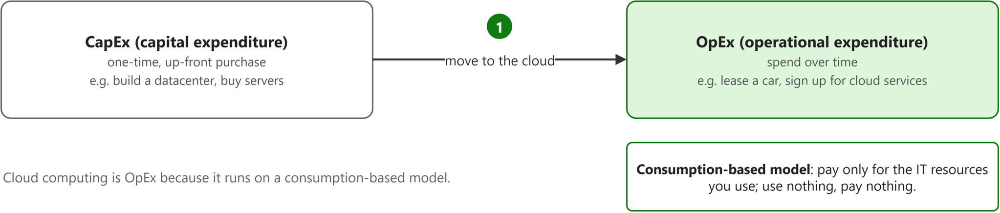

| Term | Definition | 中文解释 | Source |
|---|---|---|---|
| **capital expenditure (CapEx)** (资本支出) | "CapEx refers to up-front spending on physical infrastructure like servers, network hardware, and datacenter space." | 一次性先花大钱买服务器、网络设备和机房；传统自建机房就是这种花法。 | [Microsoft, n.d., para. 2](https://learn.microsoft.com/en-us/training/modules/describe-cloud-compute/6-describe-consumption-based-model#:~:text=CapEx%20refers%20to%20up%2Dfront%20spending%20on%20physical%20infrastructure%20like%20servers) |
| **operational expenditure (OpEx)** (运营支出) | "OpEx refers to ongoing spending on services over time. Because you pay for cloud services as you consume them, cloud computing is classified as an operational expense." | 按时间持续支付服务费用，用多少付多少；云计算的花费属于这一类。 | [Microsoft, n.d., para. 2](https://learn.microsoft.com/en-us/training/modules/describe-cloud-compute/6-describe-consumption-based-model#:~:text=OpEx%20refers%20to%20ongoing%20spending%20on%20services%20over%20time.%20Because) |
| **consumption-based model** (按用量计费模式) | "Cloud computing operates on a consumption-based model. You pay for the IT resources you use, and nothing more." | 按实际用量付费的模式：需要时加资源，不用时释放，不为闲置容量花钱。 | [Microsoft, n.d., para. 1](https://learn.microsoft.com/en-us/training/modules/describe-cloud-compute/6-describe-consumption-based-model#:~:text=Cloud%20computing%20operates%20on%20a%20consumption%2Dbased%20model.%20You%20pay%20for) |

## 2. Migration strategy: the Rs

### 2.1 The migration process

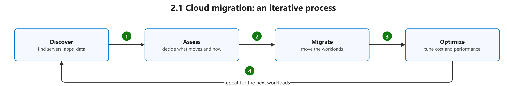

| Term | Definition | 中文解释 | Source |
|---|---|---|---|
| **cloud migration** (云迁移) | "Cloud migration is the process of moving applications and data from one location—often a company's private, on-premises servers—to a public cloud provider's servers, but it can also entail moving resources between different clouds." *Note: From Microsoft's Azure cloud computing dictionary; Learn has no one-line definition.* | 把应用和数据从原来的地方（通常是自己的机房）搬到公有云上，也可以在不同云之间搬。 | [Microsoft, n.d., "Cloud migration definition" section, para. 1](https://azure.microsoft.com/en-us/resources/cloud-computing-dictionary/what-is-cloud-migration#:~:text=Cloud%20migration%20is%20the%20process%20of%20moving%20applications%20and%20data) |
| **Discover** (发现) | "The first step in a migration journey is to identify your workloads. This process of identification is called discovery." | 迁移第一步：找出并盘点现有的服务器、数据库和应用，收集配置和性能数据。 | [Microsoft, n.d., "Decide" section, para. 1](https://learn.microsoft.com/en-us/azure/migrate/migrate-services-overview#decide:~:text=The%20first%20step%20in%20a%20migration%20journey%20is%20to%20identify) |
| **Assess** (评估) | "An assessment evaluates workloads hosted on on-premises or other public cloud for migration to Azure..." | 评估盘点出的工作负载能不能上云、该用多大规格、每月要花多少钱。 | [Microsoft, n.d., para. 1](https://learn.microsoft.com/en-us/azure/migrate/concepts-assessment-overview#:~:text=An%20assessment%20evaluates%20workloads%20hosted%20on%20on%2Dpremises%20or%20other%20public) |
| **Migrate** (迁移) | "In the execution phase, you perform the migration or modernization of your workloads to move to Azure." | 真正动手把工作负载搬到 Azure 上，尽量少停机、少风险。 | [Microsoft, n.d., "Execute" section, para. 1](https://learn.microsoft.com/en-us/azure/migrate/migrate-services-overview#execute:~:text=In%20the%20execution%20phase%2C%20you%20perform%20the%20migration%20or%20modernization) |
| **Optimize** (优化) | "Post-migration optimization ensures workloads operate efficiently, securely, and cost-effectively in Azure." | 搬上云之后继续调优性能、成本和安全；迁移不是切换完就结束。 | [Microsoft, n.d., para. 1](https://learn.microsoft.com/en-us/azure/cloud-adoption-framework/migrate/optimize-workloads-after-migration#:~:text=Post%2Dmigration%20optimization%20ensures%20workloads%20operate%20efficiently%2C%20securely%2C%20and%20cost%2Deffectively%20in) |
| **workload** (工作负载) | "A workload is a collection of IT components, such as servers, virtual machines (VMs), cloud services, applications, code, data, or appliances, that support one or more business processes." | 工作负载是一起支撑某项业务的一组 IT 部件（服务器、应用、数据等）；迁移时按工作负载来划分和排序。 | [Microsoft, n.d., "Discover workload inventory" section, bullet 1](https://learn.microsoft.com/en-us/azure/cloud-adoption-framework/plan/discover-existing-workload-inventory#discover-workload-inventory:~:text=A%20workload%20is%20a%20collection%20of%20IT%20components%2C%20such) |

### 2.2 The 5 Rs and the extra Rs in CAF

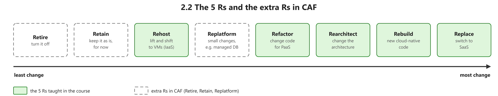

| Term | Definition | 中文解释 | Source |
|---|---|---|---|
| **Retire** (停用) | "Retire decommissions workloads that no longer provide business value." | 把已经没用、没价值的系统直接下线，不搬；省掉迁移成本。 | [Microsoft, n.d., "1. Retire (decommission)" section, para. 1](https://learn.microsoft.com/en-us/azure/cloud-adoption-framework/plan/select-cloud-migration-strategy#1-retire-decommission:~:text=Retire%20decommissions%20workloads%20that%20no%20longer%20provide%20business%20value) |
| **Retain** (保留) | "A retain strategy keeps workloads in their current environment when they're stable, compliant, and meet all current and future business needs with no near-term driver to move." | 暂时保持原样不迁移，比如受法规或技术依赖限制的系统；以后条件变了再考虑。 | [Microsoft, n.d., "8. Retain (keep as is)" section, para. 1](https://learn.microsoft.com/en-us/azure/cloud-adoption-framework/plan/select-cloud-migration-strategy#8-retain-keep-as-is:~:text=A%20retain%20strategy%20keeps%20workloads%20in%20their%20current%20environment%20when) |
| **Rehost** (重新托管（直接搬迁）) | "A rehost strategy enables fast and low-risk migration by moving workloads to Azure with minimal changes. A rehost is a like-for-like migration..." | 几乎原样搬上云（lift and shift），如本地服务器变成 Azure 虚拟机；快、风险低。 | [Microsoft, n.d., "2. Rehost (like-for-like migration)" section, para. 1](https://learn.microsoft.com/en-us/azure/cloud-adoption-framework/plan/select-cloud-migration-strategy#2-rehost-like-for-like-migration:~:text=A%20rehost%20strategy%20enables%20fast%20and%20low%2Drisk%20migration%20by%20moving) |
| **lift and shift** (平移迁移) | "Lift-and-shift migration: You set up cloud resources similar to your on-premises datacenter, and then move your workloads to the IaaS infrastructure." | 平移就是在云上搭一套和本地差不多的环境，把系统原样搬过去，基本不改代码。 | [Microsoft, n.d., "Scenarios" section, bullet 1](https://learn.microsoft.com/en-us/training/modules/describe-cloud-service-types/2-describe-infrastructure-service#scenarios:~:text=Lift%2Dand%2Dshift%20migration) |
| **Replatform** (更换平台) | "Replatforming moves workloads to a modern hosting environment with minimal code changes." | 少量改动，把应用换到更现代的托管平台（如从虚拟机换到 App Service）；省掉系统维护。 | [Microsoft, n.d., "3. Replatform (modernize hosting environment)" section, para. 1](https://learn.microsoft.com/en-us/azure/cloud-adoption-framework/plan/select-cloud-migration-strategy#3-replatform-modernize-hosting-environment:~:text=Replatforming%20moves%20workloads%20to%20a%20modern%20hosting%20environment%20with%20minimal) |
| **Refactor** (重构代码) | "Refactoring improves the internal structure of code without adding new features." *Note: Older CAF material used "Refactor" for the small PaaS change that current CAF calls Replatform.* | 不加新功能，只改进代码内部结构；减少技术债，让代码更适合云。 | [Microsoft, n.d., "4. Refactor (modernize code)" section, para. 1](https://learn.microsoft.com/en-us/azure/cloud-adoption-framework/plan/select-cloud-migration-strategy#4-refactor-modernize-code:~:text=Refactoring%20improves%20the%20internal%20structure%20of%20code%20without%20adding%20new) |
| **Rearchitect** (重新架构) | "A rearchitect strategy redesigns the workload's architecture to improve scalability, agility, and service orientation." | 重新设计应用架构，比如把单体应用拆成微服务；为了用上云原生能力和按组件扩容。 | [Microsoft, n.d., "5. Rearchitect (modernize architecture and code)" section, para. 1](https://learn.microsoft.com/en-us/azure/cloud-adoption-framework/plan/select-cloud-migration-strategy#5-rearchitect-modernize-architecture-and-code:~:text=A%20rearchitect%20strategy%20redesigns%20the%20workload%27s%20architecture%20to%20improve%20scalability) |
| **Rebuild** (重建) | "A rebuild strategy is a full redevelopment of a workload using cloud-native solutions." | 用云原生技术从头重新开发；适合老系统太旧、改不动的情况。 | [Microsoft, n.d., "7. Rebuild (build cloud-native)" section, para. 1](https://learn.microsoft.com/en-us/azure/cloud-adoption-framework/plan/select-cloud-migration-strategy#7-rebuild-build-cloud-native:~:text=A%20rebuild%20strategy%20is%20a%20full%20redevelopment%20of%20a%20workload) |
| **cloud-native** (云原生) | "Cloud-native architecture and technologies are an approach to designing, constructing, and operating workloads that are built in the cloud and take full advantage of the cloud computing model." | 云原生是指一开始就为云设计和运行的系统，充分利用云的弹性和托管服务。 | [Microsoft, n.d., para. 3](https://learn.microsoft.com/en-us/dotnet/architecture/cloud-native/definition#:~:text=Cloud%2Dnative%20architecture%20and%20technologies%20are%20an%20approach%20to%20designing) |
| **Replace** (替换（改用 SaaS）) | "A replace strategy uses commercial SaaS solutions to eliminate the need for custom development and ongoing maintenance." | 不再自己开发维护，直接换成现成的 SaaS 产品，如 CRM、HR 系统。 | [Microsoft, n.d., "6. Replace (use SaaS alternative)" section, para. 1](https://learn.microsoft.com/en-us/azure/cloud-adoption-framework/plan/select-cloud-migration-strategy#6-replace-use-saas-alternative:~:text=A%20replace%20strategy%20uses%20commercial%20SaaS%20solutions%20to%20eliminate%20the) |

### 2.3 Stakeholders and the RACI matrix

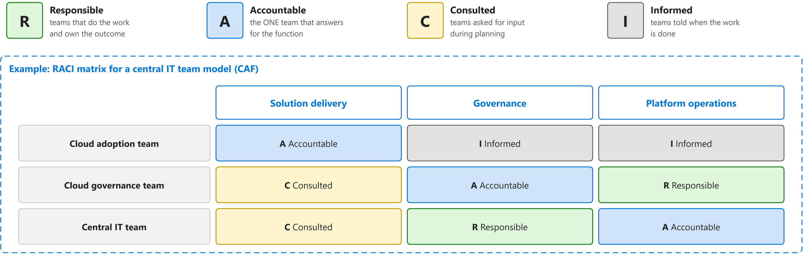

| Term | Definition | 中文解释 | Source |
|---|---|---|---|
| **RACI matrix** (RACI 责任分配矩阵) | "Align responsibilities by developing a cross-team matrix that identifies responsible, accountable, consulted, and informed (RACI) parties." | RACI 矩阵是一张表，写清每件事谁动手做（R）、谁最终担责（A）、要征求谁的意见（C）、做完通知谁（I）。 | [Microsoft, n.d., para. 1](https://learn.microsoft.com/en-us/azure/cloud-adoption-framework/organize/raci-alignment#:~:text=Align%20responsibilities%20by%20developing%20a%20cross%2Dteam%20matrix%20that) |
| **Responsible** (负责执行（R）) | "The teams that are responsible for the outcomes." | R 是真正动手干活、对结果负责执行的团队；可以有多个。 | [Microsoft, n.d., "Align responsibilities across teams" section, bullet 8](https://learn.microsoft.com/en-us/azure/cloud-adoption-framework/organize/raci-alignment#align-responsibilities-across-teams:~:text=The%20teams%20that%20are%20responsible%20for%20the%20outcomes) |
| **Accountable** (最终负责（A）) | "The one team that is accountable for a function." | A 是对某项职能最终拍板、出问题要担责的团队；每项只能有一个。 | [Microsoft, n.d., "Align responsibilities across teams" section, bullet 7](https://learn.microsoft.com/en-us/azure/cloud-adoption-framework/organize/raci-alignment#align-responsibilities-across-teams:~:text=The%20one%20team%20that%20is%20accountable%20for%20a%20function) |
| **Consulted** (咨询（C）) | "The teams that should be consulted during planning." | C 是在规划时要先问意见的团队；他们提建议，但不拍板。 | [Microsoft, n.d., "Align responsibilities across teams" section, bullet 9](https://learn.microsoft.com/en-us/azure/cloud-adoption-framework/organize/raci-alignment#align-responsibilities-across-teams:~:text=The%20teams%20that%20should%20be%20consulted%20during%20planning) |
| **Informed** (知会（I）) | "The teams that should be informed when work is completed." | I 是工作完成后要被通知结果的团队；只需知道，不用参与。 | [Microsoft, n.d., "Align responsibilities across teams" section, bullet 10](https://learn.microsoft.com/en-us/azure/cloud-adoption-framework/organize/raci-alignment#align-responsibilities-across-teams:~:text=The%20teams%20that%20should%20be%20informed%20when%20work%20is%20completed) |
| **solution delivery** (方案交付) | "Cloud adoption functions enable the implementation of technical solutions in the cloud." *Note: No page defines this column name; quoted from the archived CAF "Cloud adoption" capability page that the RACI table linked to.* | 方案交付就是把技术方案真正在云上实施落地；这件事主要由云采用团队负责。 | [Microsoft, 2020, May 15, "Cloud adoption functions" section, para. 1](https://github.com/MicrosoftDocs/cloud-adoption-framework/blob/a5351162040659171fbb4f5674ce36ac9259deb3/docs/organize/cloud-adoption.md#cloud-adoption-functions:~:text=Cloud%20adoption%20functions%20enable%20the%20implementation%20of%20technical%20solutions) |
| **governance** (治理) | "Use Azure governance to establish the tooling that you need to support cloud governance, compliance auditing, and automated guardrails." | 治理就是用 Azure Policy 等工具定规则、查合规、自动拦住违规操作。 | [Microsoft, n.d., para. 1](https://learn.microsoft.com/en-us/azure/cloud-adoption-framework/ready/landing-zone/design-area/governance#:~:text=Use%20Azure%20governance%20to%20establish%20the%20tooling%20that%20you) |
| **platform operations** (平台运维) | "Operate and manage the cloud platform." *Note: No page defines this column name; quoted from the archived CAF central IT page the RACI table linked to.* | 平台运维就是日常运行和管理整个云平台（落地区、共享服务）；在中央 IT 结构里由中央 IT 团队最终负责。 | [Microsoft, 2022, August 31, "Technical tasks" section, bullet 3](https://github.com/MicrosoftDocs/cloud-adoption-framework/blob/a5351162040659171fbb4f5674ce36ac9259deb3/docs/organize/central-it.md#technical-tasks:~:text=Operate%20and%20manage%20the%20cloud%20platform) |
| **cloud adoption team** (云采用团队) | "The nucleus of all cloud adoption efforts is the cloud adoption team. This team drives the technical changes that enable adoption." | 云采用团队是上云工作的核心，负责做具体的技术改动，把应用搬上云。 | [Microsoft, n.d., "Cloud adoption team only" section, para. 1](https://learn.microsoft.com/en-us/azure/cloud-adoption-framework/organize/organization-structures#cloud-adoption-team-only:~:text=The%20nucleus%20of%20all%20cloud%20adoption%20efforts%20is%20the) |
| **cloud governance team** (云治理团队) | "...a cloud governance team is dedicated to ensuring excellence in the solutions that are adopted. The cloud governance team is accountable for platform maturity, platform operations, governance, and automation." | 云治理团队用来平衡云采用团队，保证上云的方案质量好；它对平台成熟度、平台运维、治理和自动化最终负责。 | [Microsoft, n.d., "Best practice: minimum viable product (MVP)" section, bullet 2](https://learn.microsoft.com/en-us/azure/cloud-adoption-framework/organize/organization-structures#best-practice-minimum-viable-product-mvp:~:text=Cloud%20governance%20team%3A%20To%20balance%20the%20cloud%20adoption%20team) |
| **central IT team** (中央 IT 团队) | "As adoption scales, the cloud governance team might struggle to keep pace with the flow of innovation from multiple cloud adoption teams... At this stage, it's common for companies to shift cloud responsibilities to an existing central IT team." *Note: Not a strict definition: the page says companies shift cloud work to an existing central IT team as adoption grows.* | 上云规模变大、治理团队忙不过来时，公司常把云的职责交给原有的中央 IT 团队；它要有成长心态，否则会拖慢上云。 | [Microsoft, n.d., "Central IT team" section, para. 1](https://learn.microsoft.com/en-us/azure/cloud-adoption-framework/organize/organization-structures#central-it-team:~:text=As%20adoption%20scales%2C%20the%20cloud%20governance%20team%20might%20struggle) |

## 3. Cloud Adoption Framework, CAF

### 3.1 CAF phases

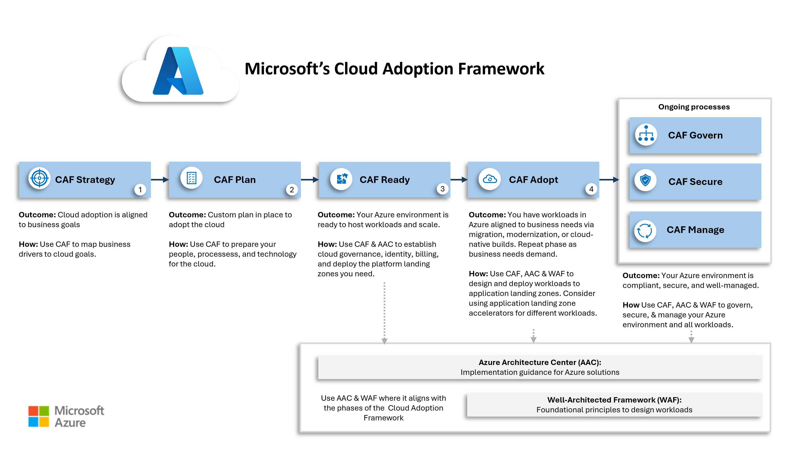

*Note.* From [*What is the Cloud Adoption Framework?*](https://learn.microsoft.com/en-us/azure/cloud-adoption-framework/overview), by Microsoft, n.d., Microsoft Learn. CC BY 4.0.

| Term | Definition | 中文解释 | Source |
|---|---|---|---|
| **Cloud Adoption Framework (CAF)** (云采用框架) | "The Microsoft Cloud Adoption Framework (CAF) helps decision makers make better decisions, faster. It provides proven guidance to reduce risk, accelerate adoption, and create a foundation that supports current and future workloads." *Note: CAF now lists Strategy, Plan, Ready, Adopt, Govern, Secure, Manage; Migrate, Modernize and Cloud-native sit under Adopt.* | 微软官方的上云指南，按阶段告诉企业怎么一步步上 Azure；它让决策更快、风险更小。 | [Microsoft, n.d., para. 1](https://learn.microsoft.com/en-us/azure/cloud-adoption-framework/overview#:~:text=The%20Microsoft%20Cloud%20Adoption%20Framework%20%28CAF%29%20helps%20decision%20makers%20make) |
| **Strategy** (策略) | "A cloud adoption strategy directs how your business adopts cloud technology. It connects executive intent to measurable outcomes and sets the standards that every workload team operates within." | CAF 第一步：先想清楚为什么上云、要达到什么业务目标；后面所有工作都以它为方向。 | [Microsoft, n.d., para. 1](https://learn.microsoft.com/en-us/azure/cloud-adoption-framework/strategy/#:~:text=A%20cloud%20adoption%20strategy%20directs%20how%20your%20business%20adopts%20cloud) |
| **Plan** (计划) | "Successful cloud adoption ... requires a cloud adoption plan. A cloud adoption plan converts your cloud strategy into an actionable plan that's specific to your goals." | CAF 第二步：把上云策略变成能执行的具体计划，比如先迁哪些系统、谁负责。 | [Microsoft, n.d., para. 1](https://learn.microsoft.com/en-us/azure/cloud-adoption-framework/plan/prepare-organization-for-cloud#:~:text=Successful%20cloud%20adoption) |
| **Ready** (就绪) | "The Ready phase of the Cloud Adoption Framework helps you design your Azure landing zone to meet your organization's requirements." | CAF 第三步：在搬系统之前先把 Azure 环境搭好（也就是落地区）；地基好了，后面的工作负载才有地方放。 | [Microsoft, n.d., para. 1](https://learn.microsoft.com/en-us/azure/cloud-adoption-framework/ready/landing-zone/#:~:text=The%20Ready%20phase%20of%20the%20Cloud%20Adoption%20Framework%20helps%20you) |
| **CAF Adopt phase** (CAF 采用阶段) | "4. Adopt: How will we migrate, modernize, and build workloads?" *Note: The /adopt/ page now redirects; quoted from the phase table on the CAF overview.* | 采用阶段是 CAF 第 4 步，真正动手迁移、现代化或新建工作负载。 | [Microsoft, n.d., "How the Cloud Adoption Framework works" section, table, row 4](https://learn.microsoft.com/en-us/azure/cloud-adoption-framework/overview#how-the-cloud-adoption-framework-works:~:text=How%20will%20we%20migrate%2C%20modernize%2C%20and%20build%20workloads) |
| **Migrate (CAF)** (迁移（CAF 阶段）) | "Migration changes where or how a workload runs. Modernization changes the workload to achieve a better outcome. An initiative can do both." | 把现有系统从本地或别的云搬到 Azure，重点是换个地方运行；它和现代化（改造系统本身）不一样。 | [Microsoft, n.d., "1.3 Modernization versus migration" section, para. 1](https://learn.microsoft.com/en-us/azure/cloud-adoption-framework/modernize/prepare-organization-cloud-modernization#13-modernization-versus-migration:~:text=Migration%20changes%20where%20or%20how%20a%20workload%20runs.%20Modernization%20changes) |
| **Modernize** (现代化) | "Modernization improves an existing workload or workload component to better meet current or future business requirements. It can change different parts of a workload, such as its platform, application, data, or operating model." | 改造已有的系统（平台、代码、数据或运维方式），让它更好地满足业务需要；不一定要改到最新，够用就行。 | [Microsoft, n.d., "1. What is modernization?" section, para. 1](https://learn.microsoft.com/en-us/azure/cloud-adoption-framework/modernize/prepare-organization-cloud-modernization#1-what-is-modernization:~:text=Modernization%20improves%20an%20existing%20workload%20or%20workload%20component%20to%20better) |
| **Innovate** (创新（现称云原生）) | "A cloud-native solution creates business value by building new workloads or enhancing existing ones. Whether you're developing a new application or adding new features to an existing system, cloud-native development is a journey through planning, building, deploying, and optimizing your workloads." *Note: CAF now calls this phase Cloud-native; the old Innovate page redirects here.* | 在云上直接开发新应用或新功能，给业务带来新价值；不是搬旧系统，而是造新东西。 | [Microsoft, n.d., para. 1](https://learn.microsoft.com/en-us/azure/cloud-adoption-framework/cloud-native/plan-cloud-native-solutions#:~:text=A%20cloud%2Dnative%20solution%20creates%20business%20value%20by%20building%20new%20workloads) |
| **Govern** (治理) | "Cloud governance is how an organization controls its use of cloud services by establishing guardrails. These guardrails are a set of policies, procedures, and tools that define acceptable and unacceptable cloud activities." | 给云的使用定规矩（策略、流程、工具），明确哪些能做、哪些不能做；这样可以控制风险、成本和合规。 | [Microsoft, n.d., para. 1](https://learn.microsoft.com/en-us/azure/cloud-adoption-framework/govern/build-cloud-governance-team#:~:text=Cloud%20governance%20is%20how%20an%20organization%20controls%20its%20use%20of) |
| **CAF Secure phase** (CAF 安全阶段) | "The Cloud Adoption Framework for Azure Secure methodology provides a structured approach for securing your Azure cloud estate." | 安全阶段讲怎样保护整个 Azure 环境；它贯穿 CAF 的每个阶段。 | [Microsoft, n.d., para. 1](https://learn.microsoft.com/en-us/azure/cloud-adoption-framework/secure/overview#:~:text=The%20Cloud%20Adoption%20Framework%20for%20Azure%20Secure%20methodology%20provides) |
| **Manage** (管理) | "Managing your Azure environment isn't just about keeping the lights on. It's about maintaining governance and security while ensuring your cloud stays aligned with business goals over time." | 上云以后的日常运维：监控、保护、持续优化；目的是让云环境长期稳定，并且一直符合业务目标。 | [Microsoft, n.d., para. 1](https://learn.microsoft.com/en-us/azure/cloud-adoption-framework/manage/ready-cloud-operations#:~:text=Managing%20your%20Azure%20environment%20isn%27t%20just%20about%20keeping%20the%20lights) |
| **landing zone** (着陆区) | "An Azure landing zone is a proven and flexible architecture for governing, securing, and scaling a multi-subscription Azure environment." | 提前搭好的 Azure 基础环境，里面已经定好治理、安全和网络规则；工作负载迁进来就能直接用。 | [Microsoft, n.d., para. 1](https://learn.microsoft.com/en-us/azure/cloud-adoption-framework/ready/landing-zone/#:~:text=An%20Azure%20landing%20zone%20is%20a%20proven%20and%20flexible%20architecture) |
| **Azure Architecture Center** (Azure 架构中心) | "The Azure Architecture Center is a catalog of solution ideas, example workloads, reference architectures, technology decision guides, and architecture guides that help cloud architects and engineers build workloads ..." | Azure 架构中心是微软的架构资料库，有参考架构和设计指南，帮你设计云上的系统。 | [Microsoft, n.d., para. 1](https://learn.microsoft.com/en-us/azure/architecture/#:~:text=Design%20solutions%20on%20Azure%20by%20using%20established%20patterns) |
| **Azure Well-Architected Framework** (Azure 良好架构框架) | "The Azure Well-Architected Framework is a design framework that can improve the quality of a workload by helping it to: Be resilient, available, and recoverable. Be as secure as you need it to be." | 良好架构框架是检查单个工作负载设计质量的框架，分可靠性、安全、成本、运维、性能五大支柱。 | [Microsoft, n.d., para. 1](https://learn.microsoft.com/en-us/azure/well-architected/what-is-well-architected-framework#:~:text=The%20Azure%20Well%2DArchitected%20Framework%20is%20a%20design%20framework) |

### 3.2 Cloud adoption strategy

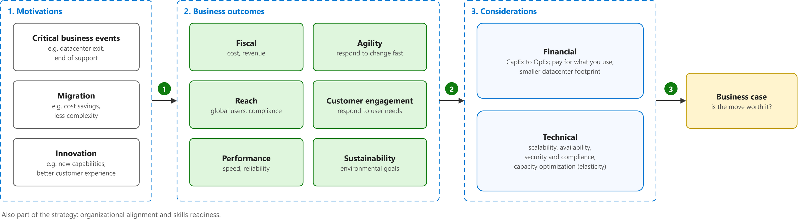

**Key points**

- To build a cloud adoption strategy, first find out why the business wants to move to the cloud and write down the business results it expects. Next, look at the financial side and the technical side. Then plan how teams will work together and how people will learn the new skills they need. Finally, bring all of this together in a business case.

  制定云采用策略的步骤：先找出上云的动机，写下想要的业务成果；再看财务和技术两方面；然后规划团队如何协作、员工如何学会新技能；最后整理成商业论证。

| Term | Definition | 中文解释 | Source |
|---|---|---|---|
| **cloud adoption strategy** (云采用策略) | "A cloud adoption strategy directs how your business adopts cloud technology. It connects executive intent to measurable outcomes and sets the standards that every workload team operates within." *Note: The 2022 CAF listed different steps. Current CAF steps: motivations, mission and objectives; strategy team; prepare the organization; inform your strategy.* | 云采用策略说明企业为什么上云、怎么上云；它把高层目标变成可衡量的结果。 | [Microsoft, n.d., para. 1](https://learn.microsoft.com/en-us/azure/cloud-adoption-framework/strategy/#:~:text=A%20cloud%20adoption%20strategy%20directs%20how%20your%20business%20adopts) |
| **motivation** (动机) | "Various motivations can drive business transformations that are supported by cloud adoption. Several motivations likely apply at the same time." *Note: Quoted from the 2022 CAF page (archived on GitHub). Current CAF groups motivations as reduce business risk, accelerate innovation, and enhance agility and efficiency.* | 动机就是企业上云的理由；通常同时有好几个，先说清楚才能定策略。 | [Microsoft, 2022, October 18, "Motivations" section, para. 1](https://github.com/MicrosoftDocs/cloud-adoption-framework/blob/a5351162040659171fbb4f5674ce36ac9259deb3/docs/strategy/motivations.md#motivations:~:text=Various%20motivations%20can%20drive%20business%20transformations%20that%20are) |
| **critical business event** (关键业务事件) | "When responding to critical business events is the highest priority, it's important to get started with migration early, often in parallel with strategy and planning efforts." | 关键业务事件是逼着企业马上行动的事，比如数据中心到期、并购、技术停止支持；这时要尽早开始迁移。 | [Microsoft, 2022, October 18, "Classify your motivations" section, para. 2](https://github.com/MicrosoftDocs/cloud-adoption-framework/blob/a5351162040659171fbb4f5674ce36ac9259deb3/docs/strategy/motivations.md#classify-your-motivations:~:text=When%20responding%20to%20critical%20business%20events%20is%20the%20highest) |
| **migration motivation** (迁移动机) | "The migration motivations listed near the top of the motivations table are the most common reasons for adopting the cloud but not necessarily the most significant." | 迁移动机是把现有系统搬上云的理由，比如省钱、简化运维；最常见，但不一定最重要。 | [Microsoft, 2022, October 18, "Migration" section, para. 1](https://github.com/MicrosoftDocs/cloud-adoption-framework/blob/a5351162040659171fbb4f5674ce36ac9259deb3/docs/strategy/motivations.md#migration:~:text=The%20migration%20motivations%20listed%20near%20the%20top%20of%20the) |
| **innovation motivation** (创新动机) | "Data is the new commodity, and modern applications are the supply chain driving that data into various experiences. In today's business market, it's hard to find a transformative product or service that isn't built on top of data, insights, and customer experiences." | 创新动机是想用云做出新产品、新体验的理由；重点不是搬家，而是靠数据和新应用创造价值。 | [Microsoft, 2022, October 18, "Innovation" section, para. 1](https://github.com/MicrosoftDocs/cloud-adoption-framework/blob/a5351162040659171fbb4f5674ce36ac9259deb3/docs/strategy/motivations.md#innovation:~:text=Data%20is%20the%20new%20commodity%2C%20and%20modern%20applications%20are) |
| **business outcome** (业务成果) | "This article series is designed to help customers identify business outcomes that are concise, defined, and drive observable results or change in business performance, supported by a specific measure." *Note: Quoted from the 2022 CAF page (archived on GitHub). Current CAF uses mission, objectives and key results (OKRs) instead.* | 业务成果是上云后业务上能看到、能量化的变化；用业务语言讲结果，各部门才容易达成一致。 | [Microsoft, 2022, October 18, para. 1](https://github.com/MicrosoftDocs/cloud-adoption-framework/blob/a5351162040659171fbb4f5674ce36ac9259deb3/docs/strategy/business-outcomes/index.md#:~:text=This%20article%20series%20is%20designed%20to%20help%20customers%20identify) |
| **fiscal outcome** (财务成果) | "Financial or fiscal performance is the cleanest business outcome for many business leaders, but not the only one." | 财务成果就是钱方面的变化，比如降本、增收；最直观，但不是唯一的成果。 | [Microsoft, 2022, October 18, "Fiscal outcomes" section, para. 1](https://github.com/MicrosoftDocs/cloud-adoption-framework/blob/a5351162040659171fbb4f5674ce36ac9259deb3/docs/strategy/business-outcomes/index.md#fiscal-outcomes:~:text=Financial%20or%20fiscal%20performance%20is%20the%20cleanest%20business%20outcome) |
| **agility outcome** (敏捷成果) | "Today's fast-changing business environment places a premium on time. The ability to respond to and drive market change quickly is the fundamental measure of business agility." | 敏捷成果看的是速度：能多快应对或推动市场变化。 | [Microsoft, 2022, October 18, "Agility outcomes" section, para. 1](https://github.com/MicrosoftDocs/cloud-adoption-framework/blob/a5351162040659171fbb4f5674ce36ac9259deb3/docs/strategy/business-outcomes/index.md#agility-outcomes:~:text=Today%27s%20fast%2Dchanging%20business%20environment%20places%20a%20premium%20on%20time) |
| **reach outcome** (覆盖范围成果) | "In a constantly shrinking market, global reach (ability to support global customers and users) can be measured by compliance in geographies that are relevant to the business." | 覆盖范围成果看的是能否服务全球客户；用在相关地区是否合规来衡量。 | [Microsoft, 2022, October 18, "Reach outcomes" section, para. 1](https://github.com/MicrosoftDocs/cloud-adoption-framework/blob/a5351162040659171fbb4f5674ce36ac9259deb3/docs/strategy/business-outcomes/index.md#reach-outcomes:~:text=In%20a%20constantly%20shrinking%20market%2C%20global%20reach) |
| **customer engagement outcome** (客户互动成果) | "Social marketplaces are redefining winners and losers at an unheard-of pace. Responding to user needs is a key measure of customer engagement." | 客户互动成果看的是对用户需求响应得好不好；响应得好，客户才留得住。 | [Microsoft, 2022, October 18, "Customer engagement outcomes" section, para. 1](https://github.com/MicrosoftDocs/cloud-adoption-framework/blob/a5351162040659171fbb4f5674ce36ac9259deb3/docs/strategy/business-outcomes/index.md#customer-engagement-outcomes:~:text=Social%20marketplaces%20are%20redefining%20winners%20and%20losers%20at%20an) |
| **performance outcome** (性能成果) | "Performance and reliability are assumed. When either falters, reputation damage can be painful and long-lasting." | 性能成果看的是系统快不快、稳不稳；一出问题，声誉损失很大。 | [Microsoft, 2022, October 18, "Performance outcomes" section, para. 1](https://github.com/MicrosoftDocs/cloud-adoption-framework/blob/a5351162040659171fbb4f5674ce36ac9259deb3/docs/strategy/business-outcomes/index.md#performance-outcomes:~:text=Performance%20and%20reliability%20are%20assumed) |
| **sustainability outcome** (可持续性成果) | "Environmental sustainability is quickly moving from a "nice to have" function of Corporate Social Responsibility (CSR) to a centerpiece of business strategy, increasingly embedded into everything a company does." | 可持续性成果看的是环保目标，比如减少碳排放；它正从“加分项”变成企业战略的核心。 | [Microsoft, 2022, October 18, "Sustainability outcomes" section, para. 1](https://github.com/MicrosoftDocs/cloud-adoption-framework/blob/a5351162040659171fbb4f5674ce36ac9259deb3/docs/strategy/business-outcomes/index.md#sustainability-outcomes:~:text=Environmental%20sustainability%20is%20quickly%20moving%20from%20a) |
| **financial considerations** (财务考量) | "A digital transformation goes hand-in-hand with a financial transformation. When you're making the shift to the cloud, there are financial considerations around how the cloud will impact your financial position, accounting KPIs, and processes..." | 财务考量是上云对公司财务的影响，比如从一次性买设备（CapEx）变成按用量付费（OpEx）；财务团队必须看懂。 | [Microsoft, 2022, October 18, para. 1](https://github.com/MicrosoftDocs/cloud-adoption-framework/blob/a5351162040659171fbb4f5674ce36ac9259deb3/docs/strategy/financial-considerations/index.md#:~:text=A%20digital%20transformation%20goes%20hand%2Din%2Dhand%20with%20a%20financial%20transformation) |
| **technical considerations** (技术考量) | "When you're making the shift to the cloud, there are technical considerations around how it will help improve how you manage and maintain your cloud and workloads." | 技术考量是上云在技术上带来的好处，比如可扩展、高可用、安全合规、按需使用容量。 | [Microsoft, 2022, October 18, para. 1](https://github.com/MicrosoftDocs/cloud-adoption-framework/blob/a5351162040659171fbb4f5674ce36ac9259deb3/docs/strategy/technical-considerations/index.md#:~:text=When%20you%27re%20making%20the%20shift%20to%20the%20cloud%2C%20there) |
| **scalability** (可扩展性) | "Scalability refers to the ability to adjust resources to meet demand. If you suddenly experience peak traffic and your systems are overwhelmed, the ability to scale means you can add more resources to better handle the increased demand." | 可扩展性就是按需求增减资源；流量高时加资源，低时减资源省钱。 | [Microsoft, n.d., "Scalability" section, para. 1](https://learn.microsoft.com/en-us/training/modules/describe-benefits-use-cloud-services/2-high-availability-scalability-cloud#scalability:~:text=Scalability%20refers%20to%20the%20ability%20to%20adjust%20resources) |
| **high availability** (高可用性) | "High availability focuses on ensuring maximum availability, regardless of disruptions or events that may occur." | 高可用性就是出了故障服务也尽量不中断；在云上做比自建机房便宜。 | [Microsoft, n.d., "High availability" section, para. 1](https://learn.microsoft.com/en-us/training/modules/describe-benefits-use-cloud-services/2-high-availability-scalability-cloud#high-availability:~:text=High%20availability%20focuses%20on%20ensuring%20maximum%20availability%2C%20regardless) |
| **security and compliance** (安全与合规) | "When it comes to security and compliance, Microsoft is continually expanding our security infrastructure and toolsets to keep you on par with what's transpiring with respect to security threats on global networks." *Note: Quoted from the 2022 CAF source (archived on GitHub).* | 安全与合规指云厂商持续加强安全设施和工具，帮你跟上安全威胁并满足法规。 | [Microsoft, 2022, October 18, "Security and compliance" section, para. 1](https://github.com/MicrosoftDocs/cloud-adoption-framework/blob/a5351162040659171fbb4f5674ce36ac9259deb3/docs/strategy/technical-considerations/index.md#security-and-compliance:~:text=When%20it%20comes%20to%20security%20and%20compliance%2C%20Microsoft%20is) |
| **capacity optimization** (容量优化) | "Capacity optimization, where you only pay for the resources you utilize over time, is another technical benefit of the cloud." *Note: Quoted from the 2022 CAF source (archived on GitHub).* | 容量优化就是只为实际用到的资源付费，用弹性随时加减资源。 | [Microsoft, 2022, October 18, "Capacity optimization" section, para. 1](https://github.com/MicrosoftDocs/cloud-adoption-framework/blob/a5351162040659171fbb4f5674ce36ac9259deb3/docs/strategy/technical-considerations/index.md#capacity-optimization:~:text=Capacity%20optimization%2C%20where%20you%20only%20pay%20for%20the) |
| **elasticity** (弹性) | "Cloud elasticity is the ability of your infrastructure to automatically adjust computing resources based on real-time demand. When traffic increases, the system provisions additional resources. When demand drops, it scales back down." *Note: From Microsoft's Azure cloud computing dictionary; the AZ-900 unit does not define it.* | 弹性就是系统按实时需求自动加减资源，不用人工干预。 | [Microsoft, n.d., "Understanding cloud elasticity" section, para. 2](https://azure.microsoft.com/en-us/resources/cloud-computing-dictionary/what-is-elastic-computing#:~:text=Cloud%20elasticity%20is%20the%20ability%20of%20your%20infrastructure) |
| **business case** (商业论证) | "A business case provides a view of the technical and financial timeline of your environment. Developing a business case includes building a financial plan that takes technical considerations into account and aligns with business outcomes." | 商业论证用数字说明上云值不值；它把技术和财务放在同一条时间线上，用来争取财务和管理层支持。 | [Microsoft, 2022, August 5, para. 3](https://github.com/MicrosoftDocs/cloud-adoption-framework/blob/a5351162040659171fbb4f5674ce36ac9259deb3/docs/strategy/cloud-migration-business-case.md#:~:text=A%20business%20case%20provides%20a%20view%20of%20the%20technical) |
| **organizational alignment** (组织协同) | "Cloud adoption can't happen without well-organized people. Successful cloud adoption comes from skilled people doing appropriate types of work. This work is in alignment with clearly defined business goals in a well-managed environment." *Note: Quoted from the 2022 CAF source (archived on GitHub).* | 组织协同就是安排好人和团队，让合适的人做合适的事，并且对准业务目标。 | [Microsoft, 2022, January 7, "Manage organizational alignment" section, para. 1](https://github.com/MicrosoftDocs/cloud-adoption-framework/blob/a5351162040659171fbb4f5674ce36ac9259deb3/docs/organize/index.md#manage-organizational-alignment:~:text=Cloud%20adoption%20can%27t%20happen%20without%20well%2Dorganized%20people) |
| **skills readiness** (技能准备) | "Cloud technologies require a different set of skills. However, learning these new skills doesn't have to be hard. With the right training, you can gain the expertise and confidence to help your organization understand and embrace the changing technology landscape." *Note: Quoted from the 2022 CAF source (archived on GitHub).* | 技能准备就是提前培训员工掌握云技能，让团队有能力支撑上云。 | [Microsoft, 2023, March 3, "Get started on a skills readiness path" section, para. 1](https://github.com/MicrosoftDocs/cloud-adoption-framework/blob/a5351162040659171fbb4f5674ce36ac9259deb3/docs/plan/suggested-skills.md#get-started-on-a-skills-readiness-path:~:text=As%20more%20organizations%20embrace%20cloud%20solutions%2C%20IT%20professionals) |

### 3.3 Adoption horizons

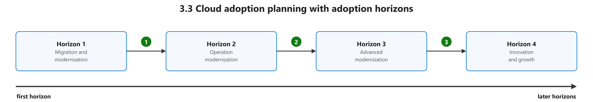

| Term | Definition | 中文解释 | Source |
|---|---|---|---|
| **adoption horizons** (采用视野（四个阶段）) | Adoption horizons split cloud adoption planning into four stages that build on each other. An organization first migrates and modernizes its workloads, then modernizes how it operates them, then takes on deeper modernization, and finally uses the cloud to innovate and grow. | 采用视野把上云规划分成先后四步：先迁移和现代化，再现代化运维，再做更深入的现代化，最后靠云来创新和增长。 | My own words |
| **Horizon 1 migration and modernization** (地平线 1：迁移与现代化) | The first horizon is about moving workloads to the cloud and making basic improvements to them along the way. | 第一个视野：迁移与现代化，先把系统搬上云，顺便做些基本的改进。 | My own words |
| **Horizon 2 operation modernization** (地平线 2：运营现代化) | The second horizon is about modernizing how the organization runs its workloads in the cloud, such as how it manages and monitors them. | 第二个视野：运营现代化，改进上云后的管理、监控和日常运维方式。 | My own words |
| **Horizon 3 advanced modernization** (地平线 3：深度现代化) | The third horizon is about deeper changes to the workloads themselves so that they make fuller use of cloud services. | 第三个视野：深度现代化，进一步改造系统本身，更充分地利用云服务。 | My own words |
| **Horizon 4 innovation and growth** (地平线 4：创新与增长) | The fourth horizon is about using the cloud to create new products and services and to grow the business. | 第四个视野：创新与增长，用云来做新产品、新服务，推动业务增长。 | My own words |

### 3.4 Ready and the landing zone

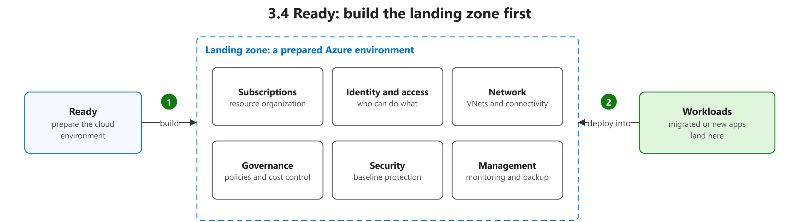

| Term | Definition | 中文解释 | Source |
|---|---|---|---|
| **subscription** (订阅) | "In Azure, subscriptions are a unit of management, billing, and scale. Subscriptions let you organize resource groups and control billing separately from access." | 订阅是 Azure 里管理、计费和规模的单位；资源组放在订阅里，账单按订阅出。 | [Microsoft, n.d., "Azure subscriptions" section, para. 1](https://learn.microsoft.com/en-us/training/modules/describe-core-architectural-components-of-azure/6-describe-azure-management-infrastructure#azure-subscriptions:~:text=In%20Azure%2C%20subscriptions%20are%20a%20unit%20of%20management%2C%20billing) |
| **virtual network (VNet)** (虚拟网络) | "Azure Virtual Network provides the fundamental building block for your private network in Azure. This service enables Azure resources like virtual machines (VMs) to securely communicate with each other, the internet, and on-premises networks." | 你在 Azure 里的私有网络，让虚拟机等资源之间、和互联网、和本地机房安全地通信；它是云上网络的基础。 | [Microsoft, n.d., para. 1](https://learn.microsoft.com/en-us/azure/virtual-network/virtual-networks-overview#:~:text=Azure%20Virtual%20Network%20provides%20the%20fundamental%20building%20block%20for%20your) |
| **management** (管理（运维）) | "This design area establishes a foundation for operations management across your Azure, hybrid, or multicloud environments." | 管理就是日常运维：监控、合规运行、备份恢复，让云环境稳定运行。 | [Microsoft, n.d., para. 1](https://learn.microsoft.com/en-us/azure/cloud-adoption-framework/ready/landing-zone/design-area/management#:~:text=This%20design%20area%20establishes%20a%20foundation%20for%20operations%20management) |

## 4. Target cloud architecture

### 4.1 Same app on IaaS and on PaaS

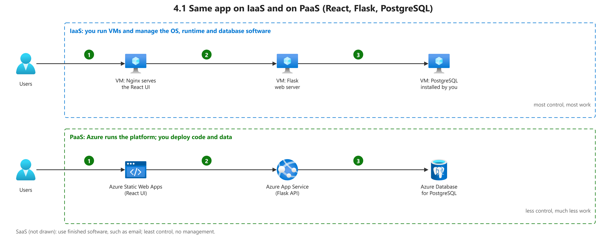

**Key points**

- The three service models trade control for convenience. IaaS gives you the most control and flexibility, but it also leaves you the most to manage and needs the most technical skill. PaaS sits in the middle: you keep some control and do some management. SaaS gives you the least control, but it is the easiest to use, because the provider manages almost everything for you.

  三种服务模式的取舍：IaaS 控制最多、要管的也最多；PaaS 在控制和省事之间取中间；SaaS 控制最少，但最省事，几乎都由服务商管。

| Term | Definition | 中文解释 | Source |
|---|---|---|---|
| **IaaS architecture** (IaaS 架构) | "Use VMs to host an N-tier architecture if you plan to migrate an existing application to Azure with minimal refactoring." | 把网页层、业务层、数据库层都放在自己管理的虚拟机上；改动最少，适合直接搬家，但系统和补丁要自己管。 | [Microsoft, n.d., "N-tier architecture on VMs" section, Note box](https://learn.microsoft.com/en-us/azure/architecture/guide/architecture-styles/n-tier#n-tier-architecture-on-vms:~:text=Use%20VMs%20to%20host%20an%20N%2Dtier%20architecture%20if) |
| **Azure Virtual Machines** (Azure 虚拟机) | "Azure virtual machines (VMs) are one of several types of on-demand, scalable computing resources that Azure offers. Typically, you choose a virtual machine when you need more control over the computing environment than the other choices offer." | Azure 上的云服务器（IaaS），控制权最大但系统补丁要自己管；重新托管（rehost）最常见的目标。 | [Microsoft, n.d., para. 2](https://learn.microsoft.com/en-us/azure/virtual-machines/overview#:~:text=Azure%20virtual%20machines%20%28VMs%29%20are%20one%20of%20several%20types%20of) |
| **PaaS architecture** (PaaS 架构) | "Otherwise, consider using managed services to implement the architecture, such as Azure App Service or Azure Container Apps." | 同样的分层应用改用托管服务来跑，平台替你管服务器和系统，你只管代码和数据。 | [Microsoft, n.d., "N-tier architecture on VMs" section, Note box](https://learn.microsoft.com/en-us/azure/architecture/guide/architecture-styles/n-tier#n-tier-architecture-on-vms:~:text=Otherwise%2C%20consider%20using%20managed%20services%20to%20implement%20the%20architecture) |
| **Azure Static Web Apps** (Azure 静态网站应用) | "Azure Static Web Apps is a service that automatically deploys full stack web apps to Azure from a code repository." | 把前端（比如 React）代码仓库连上去，它会自动构建并发布网站。 | [Microsoft, n.d., para. 1](https://learn.microsoft.com/en-us/azure/static-web-apps/overview#:~:text=Azure%20Static%20Web%20Apps%20is%20a%20service%20that%20automatically%20deploys) |
| **Azure App Service** (Azure 应用服务) | "Azure App Service is a platform that lets you run web applications, mobile back ends, and RESTful APIs without worrying about managing the underlying infrastructure." | 托管网站和 API 的平台（PaaS），不用管服务器；网站迁到这里就不用再打系统补丁。 | [Microsoft, n.d., para. 1](https://learn.microsoft.com/en-us/azure/app-service/overview#:~:text=Azure%20App%20Service%20is%20a%20platform%20that%20lets%20you%20run) |
| **Azure Database for PostgreSQL** (Azure PostgreSQL 灵活服务器) | "Azure Database for PostgreSQL is a fully managed database service that gives you granular control and flexibility over database management functions and configuration settings." | 微软托管的 PostgreSQL 数据库，备份、补丁由平台做，你仍可调配置。 | [Microsoft, n.d., para. 2](https://learn.microsoft.com/en-us/azure/postgresql/overview#:~:text=Azure%20Database%20for%20PostgreSQL%20is%20a%20fully%20managed%20database%20service) |
| **Azure Kubernetes Service (AKS)** (Azure Kubernetes 服务) | "Azure Kubernetes Service (AKS) is a managed Kubernetes service for deploying and managing containerized applications. AKS offloads the complexity and operational overhead of managing Kubernetes to Azure." | 微软托管的 Kubernetes，用来跑容器化应用；集群的管理负担交给 Azure。 | [Microsoft, n.d., para. 1](https://learn.microsoft.com/en-us/azure/aks/what-is-aks#:~:text=Azure%20Kubernetes%20Service%20%28AKS%29%20is%20a%20managed%20Kubernetes%20service) |

### 4.2 N-tier architecture

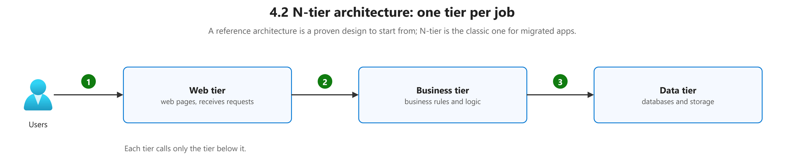

| Term | Definition | 中文解释 | Source |
|---|---|---|---|
| **reference architecture** (参考架构) | "Before inventing an architecture from scratch, review validated reference architectures and fundamentals from the Azure Architecture Center. Explore validated reference architectures for common workloads. These architectures help accelerate design decisions and reduce risk." *Note: No formal one-line definition on Learn; closest official wording.* | 微软已经验证过的常见系统架构样板；照着它来设计，速度更快、风险更小，不用从零开始。 | [Microsoft, n.d., "Explore validated cloud-native architectures" section, bullet 1](https://learn.microsoft.com/en-us/azure/cloud-adoption-framework/cloud-native/plan-cloud-native-solutions#explore-validated-cloud-native-architectures:~:text=Before%20inventing%20an%20architecture%20from%20scratch%2C%20review%20validated%20reference%20architectures) |
| **N-tier architecture** (N 层架构) | "An N-tier architecture divides an application into logical layers and physical tiers. ... A traditional three-tier application has a presentation tier, an optional middle tier, and a database tier." | 把应用分成几层（常见是网页层、业务层、数据层），每层放在不同的机器上；这样更容易扩展，也更安全。 | [Microsoft, n.d., para. 1](https://learn.microsoft.com/en-us/azure/architecture/guide/architecture-styles/n-tier#:~:text=An%20N%2Dtier%20architecture%20divides%20an%20application%20into%20logical%20layers%20and) |
| **web tier** (Web 层（展示层）) | "The presentation tier is labeled Web tier. ... The web and business tiers are stateless. Any VM can handle any request for that tier." | N 层架构里最前面的一层，负责接收用户请求、显示页面；它不保存状态，所以可以随便加机器。 | [Microsoft, n.d., "N-tier architecture on VMs" section, para. 10](https://learn.microsoft.com/en-us/azure/architecture/guide/architecture-styles/n-tier#n-tier-architecture-on-vms:~:text=The%20presentation%20tier%20is%20labeled%20Web%20tier) |
| **business tier** (业务层（中间层）) | "The layer labeled Business tier in the reference diagram refers to the business logic tier. ... The web and business tiers are stateless. Any VM can handle any request for that tier." *Note: Also called the middle tier.* | N 层架构的中间层，放业务逻辑（比如计算价格、处理订单）；它在网页层和数据层之间。 | [Microsoft, n.d., "N-tier architecture on VMs" section, para. 10](https://learn.microsoft.com/en-us/azure/architecture/guide/architecture-styles/n-tier#n-tier-architecture-on-vms:~:text=The%20layer%20labeled%20Business%20tier%20in%20the%20reference%20diagram%20refers) |
| **data tier** (数据层) | "The data tier should consist of a replicated database. ... Restrict access to the data tier by allowing requests from a middle tier only." | N 层架构最后面的一层，存放数据库；只允许业务层访问它，这样数据更安全。 | [Microsoft, n.d., "N-tier architecture on VMs" section, para. 7](https://learn.microsoft.com/en-us/azure/architecture/guide/architecture-styles/n-tier#n-tier-architecture-on-vms:~:text=The%20data%20tier%20should%20consist%20of%20a%20replicated%20database) |

### 4.3 Network: VNet, subnets, NSGs, load balancers

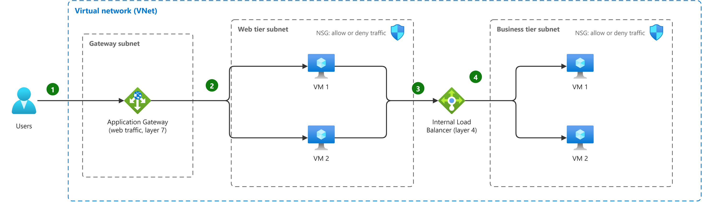

| Term | Definition | 中文解释 | Source |
|---|---|---|---|
| **gateway subnet** (网关子网) | "An application gateway is a dedicated deployment in your virtual network. Within your virtual network, a dedicated subnet is required for the application gateway." *Note: Microsoft calls it the Application Gateway's dedicated subnet; not the same as GatewaySubnet for VPN gateways.* | Application Gateway 必须放在自己专用的子网里；这个子网里不能再放别的资源。 | [Microsoft, n.d., "Virtual network and dedicated subnet" section, para. 1](https://learn.microsoft.com/en-us/azure/application-gateway/configuration-infrastructure#virtual-network-and-dedicated-subnet:~:text=An%20application%20gateway%20is%20a%20dedicated%20deployment%20in%20your) |
| **Azure Application Gateway** (Azure 应用程序网关) | "Azure Application Gateway is a web traffic load balancer that helps you manage traffic to your web applications. ... Application Gateway makes intelligent routing decisions based on HTTP request attributes like URL paths and host headers." | Azure 的网页流量负载均衡器，能看懂 HTTP 请求（比如网址路径），按内容把请求分给不同服务器；工作在第 7 层。 | [Microsoft, n.d., para. 1](https://learn.microsoft.com/en-us/azure/application-gateway/overview#:~:text=Azure%20Application%20Gateway%20is%20a%20web%20traffic%20load%20balancer%20that) |
| **subnet** (子网) | "Azure virtual network subnets are essential containers where all Azure resources are deployed within a virtual network." | 把虚拟网络再切成的小网段，资源就放在子网里；N 层架构里每一层放一个子网，方便分别设安全规则。 | [Microsoft, n.d., para. 1](https://learn.microsoft.com/en-us/azure/virtual-network/virtual-network-manage-subnet#:~:text=Azure%20virtual%20network%20subnets%20are%20essential%20containers%20where%20all%20Azure) |
| **network security group (NSG)** (网络安全组) | "You can use an Azure network security group to filter network traffic between Azure resources in Azure virtual networks. A network security group contains security rules that allow or deny inbound network traffic to, or outbound network traffic from, several types of Azure resources." | Azure 里的一组防火墙规则，决定哪些进出流量允许、哪些拒绝；可以挂在子网或网卡上。 | [Microsoft, n.d., para. 1](https://learn.microsoft.com/en-us/azure/virtual-network/network-security-groups-overview#:~:text=You%20can%20use%20an%20Azure%20network%20security%20group%20to%20filter) |
| **internal load balancer** (内部负载均衡器) | "Alternatively, an internal (or private) load balancer is used to load balance traffic inside a virtual network." | 只在虚拟网络内部分发流量的负载均衡器，没有公网入口；常放在 Web 层和后端层之间。 | [Microsoft, n.d., "How Azure Load Balancer distributes Layer 4 traffic" section, para. 3](https://learn.microsoft.com/en-us/azure/load-balancer/load-balancer-overview#how-azure-load-balancer-distributes-layer-4-traffic:~:text=Alternatively%2C%20an%20internal) |
| **Azure Load Balancer** (Azure 负载均衡器) | "Azure Load Balancer is a cloud service that distributes incoming network traffic across backend virtual machines (VMs) or virtual machine scale sets (VMSS). ... Azure Load Balancer operates at layer 4 of the Open Systems Interconnection (OSI) model." | 把进来的网络流量平均分给后面的多台虚拟机；只看 IP 和端口，工作在第 4 层，一台坏了也不影响服务。 | [Microsoft, n.d., para. 3](https://learn.microsoft.com/en-us/azure/load-balancer/load-balancer-overview#:~:text=Azure%20Load%20Balancer%20is%20a%20cloud%20service%20that%20distributes%20incoming) |

### 4.4 Availability zones and resource groups

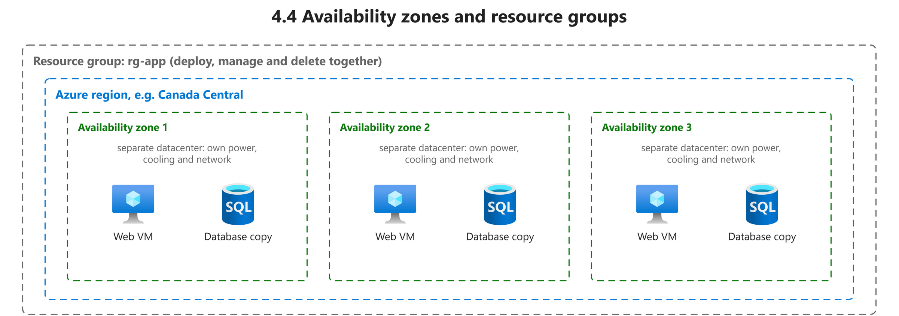

| Term | Definition | 中文解释 | Source |
|---|---|---|---|
| **resource group** (资源组) | "A resource group is a container that you use to manage related resources for an Azure solution. ... When you delete a resource group, all resources in the resource group are also deleted." | Azure 里装相关资源的文件夹，可以一起管理、一起删除；实验做完删掉资源组，就不会继续扣费。 | [Microsoft, n.d., "What is a resource group?" section, para. 1](https://learn.microsoft.com/en-us/azure/azure-resource-manager/management/overview#resource-groups:~:text=A%20resource%20group%20is%20a%20container%20that%20you%20use%20to) |
| **Azure region** (Azure 区域) | "Each region is a set of physical facilities that include datacenters and networking infrastructure." | 区域就是 Azure 在某个地理位置的一组数据中心；选区域会影响延迟、数据存放地和可用服务。 | [Microsoft, n.d., para. 1](https://learn.microsoft.com/en-us/azure/reliability/regions-overview#:~:text=Each%20region%20is%20a%20set%20of%20physical%20facilities%20that) |
| **availability zone** (可用区) | "Many Azure regions provide availability zones, which are separated groups of datacenters within a region. Each availability zone has independent power, cooling, and networking infrastructure..." | 同一个区域里互相独立的几组数据中心，各自有电源、冷却和网络；一个区出故障，其他区还能继续服务。 | [Microsoft, n.d., para. 1](https://learn.microsoft.com/en-us/azure/reliability/availability-zones-overview#:~:text=Many%20Azure%20regions%20provide%20availability%20zones%2C%20which%20are%20separated%20groups) |
| **Azure SQL Database** (Azure SQL 数据库) | "Azure SQL Database, a fully managed platform as a service (PaaS) database engine that handles most of the database management functions such as upgrading, patching, backups, and monitoring without user involvement." | 全托管的云数据库（PaaS），升级、补丁、备份都由微软负责；适合新应用或改动较多的迁移。 | [Microsoft, n.d., para. 2](https://learn.microsoft.com/en-us/azure/azure-sql/database/sql-database-paas-overview#:~:text=Azure%20SQL%20Database%2C%20a%20fully%20managed%20platform%20as%20a%20service) |

## 5. Migration assessment

### 5.1 Discovery

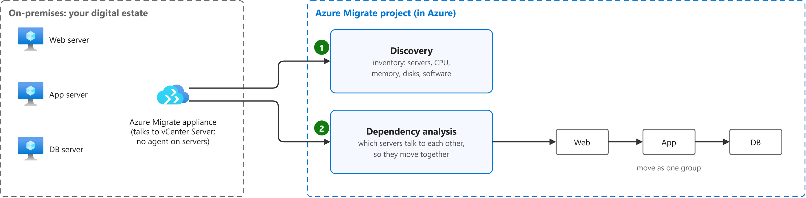

**Key points**

- Discovery and assessment means taking stock of your current on-premises environment before you migrate, and Azure Migrate is the main Microsoft tool for this work. The process should uncover four things: how the code depends on other components, how much load the systems must handle, how identity and access are set up, and what the core infrastructure looks like.

  发现和评估就是迁移前先摸清本地环境，主要用 Azure Migrate。要摸清四件事：代码之间的依赖、负载需求、身份和访问、核心基础设施。

- "The visualization helps to understand whether certain servers are in use, or if they can be decommissioned, instead of being migrated. Analyzing dependencies helps ensure that nothing is left behind, and to surprise outages during migration. With your application inventory and dependency analysis done, you can create high-confidence groups of servers, and start assessing them." ([Microsoft, n.d., "Dependencies between workloads" section, para. 1](https://learn.microsoft.com/en-us/azure/migrate/concepts-migration-planning?view=migrate-classic#dependencies-between-workloads:~:text=The%20visualization%20helps%20to%20understand%20whether%20certain%20servers))

  依赖分析的用处：看出哪些服务器其实没人用、可以直接下线；确保搬迁时不落下东西、不意外宕机；还能把互相依赖的服务器分成组，一起评估。

| Term | Definition | 中文解释 | Source |
|---|---|---|---|
| **digital estate** (数字资产) | "Much like a physical estate, a digital estate is an abstract reference to a collection of tangible owned assets. In a digital estate, those assets include virtual machines (VMs), servers, applications, data, and so on. Essentially, a digital estate is the collection of IT assets that power business processes and supporting operations." *Note: Current CAF talks about a "workload inventory" instead.* | 数字资产就是企业拥有的全部 IT 资产，比如虚拟机、服务器、应用和数据；迁移前先把它们清点清楚。 | [Microsoft, 2018, December 10, "What is a digital estate?" section, para. 1](https://github.com/MicrosoftDocs/cloud-adoption-framework/blob/a5351162040659171fbb4f5674ce36ac9259deb3/docs/digital-estate/index.md#what-is-a-digital-estate:~:text=Much%20like%20a%20physical%20estate%2C%20a%20digital%20estate%20is) |
| **Azure Migrate appliance** (Azure Migrate 设备（发现用虚拟机）) | "The Azure Migrate appliance is a virtual appliance that can be deployed on a server in your datacenter. The appliance collects the configuration and performance data for your servers and continually sends it to the Azure Migrate service." | 装在本地机房的一台轻量虚拟机，负责收集服务器的配置和性能数据并持续发给 Azure Migrate；评估的数据都靠它。 | [Microsoft, n.d., "Decide" section, para. 2](https://learn.microsoft.com/en-us/azure/migrate/migrate-services-overview#decide:~:text=The%20Azure%20Migrate%20appliance%20is%20a%20virtual%20appliance%20that%20can) |
| **vCenter Server** (vCenter 服务器) | "The appliance must connect to vCenter Server to discover the configuration and performance data of the servers" | VMware 的集中管理服务器；Azure Migrate 设备连上它，才能发现并收集各台虚拟机的配置和性能数据。 | [Microsoft, n.d., "Provide vCenter Server details" section, para. 1](https://learn.microsoft.com/en-us/azure/migrate/tutorial-discover-vmware?view=migrate#provide-vcenter-server-details:~:text=The%20appliance%20must%20connect%20to%20vCenter%20Server%20to%20discover) |
| **agentless discovery** (无代理发现) | "Azure Migrate uses a lightweight Azure Migrate appliance to perform agentless discovery of on-premises VMware VMs, Hyper-V VMs, other virtualized servers, and physical servers. Continuous discovery collects server configuration information, and performance metadata, and application data." | 不用在每台服务器上装代理软件，只靠一台 appliance 远程收集信息；部署快、对生产机器影响小。 | [Microsoft, n.d., "Workloads in use" section, para. 1](https://learn.microsoft.com/en-us/azure/migrate/concepts-migration-planning?view=migrate-classic#workloads-in-use:~:text=Azure%20Migrate%20uses%20a%20lightweight%20Azure%20Migrate%20appliance%20to%20perform) |
| **Azure Migrate project** (Azure Migrate 项目) | "A project is used to store discovery, assessment, and migration metadata collected from the environment you're assessing or migrating." | 项目是 Azure Migrate 的工作容器，存放发现、评估和迁移的数据；所有迁移工作都从建项目开始。 | [Microsoft, n.d., para. 2](https://learn.microsoft.com/en-us/azure/migrate/quickstart-create-project?view=migrate#:~:text=A%20project%20is%20used%20to%20store%20discovery%2C%20assessment%2C%20and) |
| **discovery** (发现) | "The first step in a migration journey is to identify your workloads. This process of identification is called discovery." | 发现就是先摸清本地有哪些服务器和工作负载，通常用 Azure Migrate 设备自动收集清单。 | [Microsoft, n.d., "Decide" section, para. 1](https://learn.microsoft.com/en-us/azure/migrate/migrate-services-overview#decide:~:text=The%20first%20step%20in%20a%20migration%20journey%20is%20to) |
| **data the appliance collects** (设备收集的数据) | "You deploy the appliance as a server running in your vCenter Server instance, to continuously discover servers and their performance metadata, applications that are running on servers, server dependencies, web apps, and SQL Server instances and databases." | 设备持续收集：服务器配置、性能数据、装了哪些应用、服务器之间的依赖，以及网页应用和 SQL 数据库。 | [Microsoft, n.d., para. 2](https://learn.microsoft.com/en-us/azure/migrate/tutorial-discover-vmware?view=migrate#:~:text=This%20tutorial%20shows%20you%20how%20to%20discover%20the%20servers) |
| **dependency analysis** (依赖分析) | "Dependency analysis identifies dependencies between discovered on-premises running in VMware, Hyper-V, physical servers or servers running on other public clouds. ... You can identify servers that must be migrated together." | 找出服务器之间谁连着谁，好把互相依赖的机器放在同一批迁移；避免漏掉某台机器导致上云后服务中断。 | [Microsoft, n.d., para. 1](https://learn.microsoft.com/en-us/azure/migrate/concepts-dependency-visualization#:~:text=Dependency%20analysis%20identifies%20dependencies%20between%20discovered%20on%2Dpremises%20running%20in%20VMware) |
| **group (Azure Migrate)** (组（一起评估的服务器）) | "After the appliance begins server discovery, you can gather servers you want to assess into a group and run an assessment for the group with assessment type Azure VM." | 把要一起评估的服务器放进一个组，再对这个组跑评估；通常按应用或依赖关系分组。 | [Microsoft, n.d., "How do I assess with the appliance?" section, para. 2](https://learn.microsoft.com/en-us/azure/migrate/concepts-assessment-calculation?view=migrate-classic#how-do-i-assess-with-the-appliance:~:text=After%20the%20appliance%20begins%20server%20discovery%2C%20you%20can%20gather%20servers) |
| **Azure Migrate** (Azure Migrate 迁移中心) | "Azure Migrate is a service that helps you decide on, plan, and execute your migration to Azure. Azure Migrate helps you find the best migration path, assess for Azure readiness and cost of hosting workloads on Azure, and perform the migration with minimal downtime and risk." | 微软上云的总入口服务，从发现、评估到迁移都在一个地方完成；而且本身免费。 | [Microsoft, n.d., para. 1](https://learn.microsoft.com/en-us/azure/migrate/migrate-services-overview#:~:text=Azure%20Migrate%20is%20a%20service%20that%20helps%20you%20decide%20on) |
| **Movere** (Movere（已退役的发现评估工具）) | "Movere: The Movere service retired on March 1, 2024. Users should use Azure Migrate for the discovery and assessment of on-premises workloads." | 微软以前的发现和评估工具，2024 年 3 月 1 日已退役；现在改用 Azure Migrate。 | [Microsoft, n.d., "Update (April 2024)" section, bullet 1](https://learn.microsoft.com/en-us/azure/migrate/whats-new?view=migrate#update-april-2024:~:text=Movere%3A%20The%20Movere%20service%20retired%20on%20March%201) |

### 5.2 Assessment results

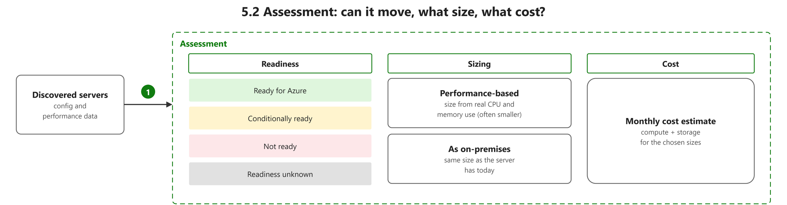

**Key points**

- "Conditionally ready for Azure: Servers can be migrated to Azure, but need minor changes, in accordance with the remediation guidance provided in the assessment." ([Microsoft, n.d., "Readiness/suitability analysis" section, bullet 2](https://learn.microsoft.com/en-us/azure/migrate/concepts-migration-planning?view=migrate-classic#readinesssuitability-analysis:~:text=Conditionally%20ready%20for%20Azure%3A%20Servers%20can%20be%20migrated%20to))

  “有条件可迁移”：服务器能迁到 Azure，但要先按评估报告里的修复建议做些小改动。另一篇官方文档的说法是：服务器可能能在 Azure 启动，但不一定得到完整支持。

| Term | Definition | 中文解释 | Source |
|---|---|---|---|
| **assessment** (评估报告) | "An assessment with the Discovery and assessment tool measures the readiness and estimates the effect of migrating on-premises servers to Azure." | 对本地服务器做一次体检：能不能上云、上云用多大规格、每月花多少钱。 | [Microsoft, n.d., "What's an assessment?" section, para. 1](https://learn.microsoft.com/en-us/azure/migrate/concepts-assessment-calculation?view=migrate-classic#whats-an-assessment:~:text=An%20assessment%20with%20the%20Discovery%20and%20assessment%20tool%20measures%20the) |
| **readiness** (就绪性) | "Identifying Azure readiness: Assess whether workloads are suitable for migration to Azure." | 就绪性回答“这台服务器能不能搬到 Azure”；不就绪的服务器不会再算规格和成本。 | [Microsoft, n.d., "How are assessments calculated?" section, para. 2](https://learn.microsoft.com/en-us/azure/migrate/concepts-assessment-overview#how-are-assessments-calculated:~:text=Identifying%20Azure%20readiness%3A%20Assess%20whether%20workloads%20are%20suitable%20for) |
| **Ready for Azure** (可以迁移到 Azure) | "Ready for Azure: The server can be migrated as-is to Azure without any changes. It will start in Azure with full Azure support." | 评估结果最好的一档：不用改就能直接搬上 Azure，并且有完整支持。 | [Microsoft, n.d., "Calculate readiness" section, bullet 1](https://learn.microsoft.com/en-us/azure/migrate/concepts-assessment-calculation?view=migrate-classic#calculate-readiness:~:text=Ready%20for%20Azure%3A%20The%20server%20can%20be%20migrated%20as%2Dis%20to) |
| **Conditionally ready for Azure** (有条件可迁移) | "Conditionally ready for Azure: The server might start in Azure but might not have full Azure support. For example, Azure doesn't support a server that's running an old version of Windows Server." | 能在 Azure 上跑起来，但不一定有完整支持（比如系统太旧）；迁移前要按建议先修好。 | [Microsoft, n.d., "Calculate readiness" section, bullet 2](https://learn.microsoft.com/en-us/azure/migrate/concepts-assessment-calculation?view=migrate-classic#calculate-readiness:~:text=Conditionally%20ready%20for%20Azure%3A%20The%20server%20might%20start%20in%20Azure) |
| **Not ready for Azure** (不能迁移) | "Not ready for Azure: The server won't start in Azure. For example, if an on-premises server's disk stores more than 64 TB, Azure can't host the server. Follow the remediation guidance to fix the problem before migration." | 这台服务器在 Azure 上根本启动不了（比如磁盘超过 64 TB）；必须先解决问题才能迁。 | [Microsoft, n.d., "Calculate readiness" section, bullet 3](https://learn.microsoft.com/en-us/azure/migrate/concepts-assessment-calculation?view=migrate-classic#calculate-readiness:~:text=Not%20ready%20for%20Azure%3A%20The%20server%20won%27t%20start%20in%20Azure) |
| **Readiness unknown** (就绪状态未知) | "Readiness unknown: Azure Migrate can't determine the readiness of the server because of insufficient metadata." | 收集到的数据不够，Azure Migrate 判断不出能不能迁；要补齐数据再评估。 | [Microsoft, n.d., "Calculate readiness" section, bullet 4](https://learn.microsoft.com/en-us/azure/migrate/concepts-assessment-calculation?view=migrate-classic#calculate-readiness:~:text=Readiness%20unknown%3A%20Azure%20Migrate%20can%27t%20determine%20the%20readiness%20of%20the) |
| **sizing** (规格估算) | "Calculate right-sizing recommendations: Estimate compute, storage, and network sizing and recommend customers right-sized Azure target services to migrate." | 规格估算是给每台服务器推荐合适大小的 Azure 资源，可按现有配置或按实际性能数据来算。 | [Microsoft, n.d., "How are assessments calculated?" section, para. 3](https://learn.microsoft.com/en-us/azure/migrate/concepts-assessment-overview#how-are-assessments-calculated:~:text=Calculate%20right%2Dsizing%20recommendations%3A%20Estimate%20compute%2C%20storage%2C%20and%20network%20sizing) |
| **performance-based sizing** (按性能数据定规格) | "Performance-based: Assessments that make recommendations based on collected performance data. The VM size recommendation is based on CPU and RAM-utilization data." | 按服务器实际用了多少 CPU 和内存来选 Azure 规格；原来配多了的机器可以选小一点，省钱。 | [Microsoft, n.d., "Types of assessments" section, table, row 1](https://learn.microsoft.com/en-us/azure/migrate/concepts-assessment-calculation?view=migrate-classic#types-of-assessments:~:text=Assessments%20that%20make%20recommendations%20based%20on%20collected%20performance%20data) |
| **as on-premises (as-is) sizing** (按本地现有规格定规格) | "As-is on-premises: Assessments that don't use performance data to make recommendations. The VM size recommendation is based on the on-premises server size." *Note: Microsoft calls it "as-is on-premises" sizing.* | 不看实际使用量，本地配多大，Azure 上就选多大；简单但可能多花钱。 | [Microsoft, n.d., "Types of assessments" section, table, row 2](https://learn.microsoft.com/en-us/azure/migrate/concepts-assessment-calculation?view=migrate-classic#types-of-assessments:~:text=Assessments%20that%20don%27t%20use%20performance%20data%20to%20make%20recommendations) |
| **cost estimate** (成本估算) | "Calculate monthly costs: Calculate the estimated monthly compute, storage, and security costs for running the servers in Azure after migration." | 评估的最后一步：估算服务器搬到 Azure 后每月要花多少钱；帮助做预算和决策。 | [Microsoft, n.d., "How are Azure VM assessments calculated?" section, bullet 3](https://learn.microsoft.com/en-us/azure/migrate/concepts-assessment-calculation?view=migrate-classic#how-are-azure-vm-assessments-calculated:~:text=Calculate%20monthly%20costs%3A%20Calculate%20the%20estimated%20monthly%20compute%2C%20storage%2C%20and) |

### 5.3 From assessment to the migration plan

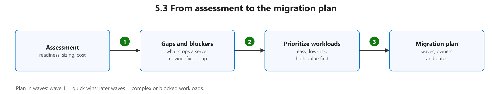

**Key points**

- "As you figure out the apps and workloads you want to migrate, identify downtime constraints for them, and look for any operational dependencies between your apps and the underlying infrastructure. This analysis helps you to plan migrations that meet your recovery time objective (RTO), and ensure minimal to zero data loss. Before you migrate, we recommend that you review and mitigate any compatibility issues, or unsupported features that may block server/SQL database migration." ([Microsoft, n.d., "Evaluate gaps/blockers" section, para. 1](https://learn.microsoft.com/en-us/azure/migrate/concepts-migration-planning?view=migrate-classic#evaluate-gapsblockers:~:text=As%20you%20figure%20out%20the%20apps%20and%20workloads%20you))

  找差距和阻碍：弄清每个应用能停机多久、和底层设施有什么依赖，让迁移满足 RTO、尽量不丢数据；迁移前先解决兼容性问题和不支持的功能。

- "Develop an “apply and learn” approach to migrate apps in a systematic and controllable way, so that you can iron out any flaws before starting a full-scale migration. To prioritize migration order, you can use strategic factors such as complexity, time-to-migrate, business urgency, production/non-production considerations, compliance, security requirements, application knowledge, etc." ([Microsoft, n.d., "Prioritize workloads" section, paras. 1–2](https://learn.microsoft.com/en-us/azure/migrate/concepts-migration-planning?view=migrate-classic#prioritize-workloads:~:text=Develop%20an%20%E2%80%9Capply%20and%20learn%E2%80%9D%20approach%20to%20migrate%20apps))

  排优先级：先小范围试迁、边做边学，把问题解决了再全面铺开；排序时看复杂度、迁移耗时、业务紧急程度、是否生产系统、合规、安全要求和团队对应用的熟悉程度。

- "Create an effective cloud migration plan that includes detailed information about the apps you want to migrate, app/database availability, downtime constraints, and migration milestones. The plan considers how long the data copy takes, and include a realistic buffer for post-migration testing, and cut-over activities. A post-migration testing plan should include functional, integration, security, and performance testing and use cases... Build a migration roadmap, and declare a maintenance window to migrate your apps and databases with minimal to zero downtime, and limit the potential operational and business impact during migration." ([Microsoft, n.d., "Finalize the migration plan" section, paras. 2–4](https://learn.microsoft.com/en-us/azure/migrate/concepts-migration-planning?view=migrate-classic#finalize-the-migration-plan:~:text=Create%20an%20effective%20cloud%20migration%20plan%20that%20includes%20detailed))

  迁移计划要写清：迁哪些应用、可用性和停机限制、里程碑、数据拷贝要多久，并给测试和切换留出缓冲；迁移后要做功能、集成、安全、性能测试；定好路线图和维护窗口，把对业务的影响降到最低。

| Term | Definition | 中文解释 | Source |
|---|---|---|---|
| **blocker** (阻碍项) | "Before you migrate, we recommend that you review and mitigate any compatibility issues, or unsupported features that may block server/SQL database migration. The Azure Migrate Discovery and assessment report, and Azure Migrate Database Assessment, can help with this." *Note: Sentence under the heading "Evaluate gaps/blockers".* | 会挡住迁移的问题，比如不兼容或不支持的功能；评估报告会列出来，要在迁移前处理掉。 | [Microsoft, n.d., "Evaluate gaps/blockers" section, para. 1](https://learn.microsoft.com/en-us/azure/migrate/concepts-migration-planning?view=migrate-classic#evaluate-gapsblockers:~:text=Before%20you%20migrate%2C%20we%20recommend%20that%20you%20review%20and%20mitigate) |
| **workload prioritization** (工作负载优先级排序) | "After you've collected information about your inventory, you can identify which apps and workloads to migrate first. ... To prioritize migration order, you can use strategic factors such as complexity, time-to-migrate, business urgency, production/non-production considerations, compliance, security requirements, application knowledge, etc." | 决定哪些应用先迁、哪些后迁；通常先迁简单、风险低的，积累经验后再迁关键系统。 | [Microsoft, n.d., "Prioritize workloads" section, para. 1](https://learn.microsoft.com/en-us/azure/migrate/concepts-migration-planning?view=migrate-classic#prioritize-workloads:~:text=After%20you%27ve%20collected%20information%20about%20your%20inventory%2C%20you%20can%20identify) |
| **migration plan** (迁移计划) | "A migration plan defines the specific order, timing, and approach for migrating workloads to Azure. This plan translates high-level migration strategies into actionable deployment sequences." | 把上云策略落到具体安排：先迁谁、什么时候迁、用什么方法迁；让迁移有序可控。 | [Microsoft, n.d., para. 1](https://learn.microsoft.com/en-us/azure/cloud-adoption-framework/migrate/plan-migration#:~:text=A%20migration%20plan%20defines%20the%20specific%20order%2C%20timing%2C%20and%20approach) |
| **migration wave** (迁移批次（波次）) | "Migration wave planning divides large migration projects into smaller, manageable groups of workloads that can be migrated together. This approach reduces risk and complexity..." *Note: Current CAF ranks workloads by business value against effort.* | 把一大堆系统分成几批，一批一批搬；先搬简单的积累经验，降低风险。 | [Microsoft, n.d., para. 1](https://learn.microsoft.com/en-us/azure/cloud-adoption-framework/migrate/migration-wave-planning#:~:text=Migration%20wave%20planning%20divides%20large%20migration%20projects%20into%20smaller) |
| **recovery time objective (RTO)** (恢复时间目标) | "Recovery time objective (RTO): The maximum acceptable time that an application can be unavailable after an incident." *Note: Quoted from a table row (cells joined).* | 出事后应用最多能停多久；迁移计划要保证停机不超过它。 | [Microsoft, n.d., table 2 (Term, Definition), row 6](https://learn.microsoft.com/en-us/azure/well-architected/reliability/metrics#:~:text=The%20maximum%20acceptable%20time%20that%20an%20application%20can%20be%20unavailable) |
| **downtime migration and maintenance window** (停机时间、维护窗口) | "Choose downtime migration for workloads that tolerate planned outages. ... This method works well for noncritical workloads such as development environments, test systems, or applications with scheduled maintenance windows." | 停机迁移要先约好一段计划内的停机时间（维护窗口），在用户少的时候切换，影响最小。 | [Microsoft, n.d., "Choose the migration method for each workload" section, bullet 1](https://learn.microsoft.com/en-us/azure/cloud-adoption-framework/migrate/plan-migration#choose-the-migration-method-for-each-workload:~:text=Choose%20downtime%20migration%20for%20workloads%20that%20tolerate%20planned%20outages) |
| **post-migration testing** (迁移后测试) | "Functional and performance testing ensures the workload meets business requirements and performs reliably under expected conditions before going live." *Note: CAF covers security testing under "Validate authentication flows".* | 搬过去以后要测：功能对不对、和其他系统接得上没有、安全和性能够不够，确认没问题才正式上线。 | [Microsoft, n.d., "Conduct functional and performance testing" section, para. 1](https://learn.microsoft.com/en-us/azure/cloud-adoption-framework/migrate/prepare-workloads-cloud#conduct-functional-and-performance-testing:~:text=Functional%20and%20performance%20testing%20ensures%20the%20workload%20meets%20business%20requirements) |

## 6. Migration execution

### 6.1 Rehost

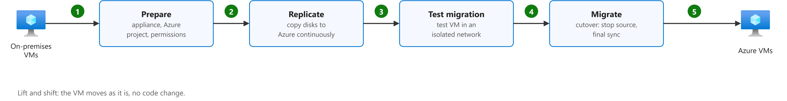

**Key points**

- "Lift-and-shift migration: You set up cloud resources similar to your on-premises datacenter, and then move your workloads to the IaaS infrastructure." ([Microsoft, n.d., "Scenarios" section, bullet 1](https://learn.microsoft.com/en-us/training/modules/describe-cloud-service-types/2-describe-infrastructure-service#scenarios:~:text=Lift%2Dand%2Dshift%20migration%3A%20You%20set%20up%20cloud%20resources%20similar))

  直接搬迁（lift and shift）：在云上搭一套和本地机房差不多的资源，再把工作负载原样搬到 IaaS 上，也就是 Rehost。

- "When you need to move applications quickly to the cloud; When you want to move an application without modifying it; When your applications are designed to take advantage of Azure infrastructure as a service (IaaS) scalability after migration. When applications are important to your business, but you don't need to immediately change application capabilities." ([Microsoft, 2022, March 4, "Migration patterns" section, table 1, row 1 (Rehost), When to use, bullets 1–4](https://github.com/MicrosoftDocs/cloud-adoption-framework/blob/a5351162040659171fbb4f5674ce36ac9259deb3/docs/migrate/azure-best-practices/contoso-migration-overview.md#migration-patterns:~:text=When%20you%20need%20to%20move%20applications%20quickly%20to%20the))

  什么时候用 Rehost：要快速上云；不想改应用；应用搬上去后能用上 IaaS 的扩展能力；应用很重要，但暂时不需要加新功能。

- "Step 1: Prepare Azure for Azure Migrate: Server Migration. They add the server migration tool to their Azure Migrate project. Step 2: Replicate on-premises VMs. They set up replication and start replicating VMs to Azure Storage. Step 3: Migrate the VMs with Azure Migrate: Server Migration. They run a test migration to make sure everything's working, and then run a full migration to move the VMs to Azure." ([Microsoft, 2020, July 30, "Scenario steps" section, bullets 1–3](https://github.com/MicrosoftDocs/cloud-adoption-framework/blob/a5351162040659171fbb4f5674ce36ac9259deb3/docs/migrate/azure-best-practices/contoso-migration-rehost-vm.md#scenario-steps:~:text=Step%201%3A%20Prepare%20Azure%20for%20Azure%20Migrate%3A%20Server%20Migration.))

  Rehost 的步骤：先在 Azure 里准备好服务器迁移工具，再把本地虚拟机复制到 Azure，最后先做测试迁移、再正式迁移。这个工具现在叫 Migration and modernization。

| Term | Definition | 中文解释 | Source |
|---|---|---|---|
| **Migration and modernization tool** (迁移和现代化工具) | "The Migration and modernization tool is purpose-built for server migration to Azure. It's optimized for migration." *Note: Earlier versions of Azure Migrate called this tool "Server Migration".* | Azure Migrate 里专门负责把服务器搬上 Azure 的工具，负责复制、测试迁移和正式迁移。 | [Microsoft, n.d., "What's the difference between Azure Migrate and Azure Site Recovery?" section, bullet 2](https://learn.microsoft.com/en-us/azure/migrate/resources-faq#whats-the-difference-between-azure-migrate-and-azure-site-recovery:~:text=The%20Migration%20and%20modernization%20tool%20is%20purpose%2Dbuilt%20for%20server%20migration) |
| **prepare on-premises VMs** (准备本地虚拟机) | "Before you migrate your on-premises VM to Azure, you may require a few changes to make the VM ready for Azure. These changes are important to ensure that the migrated VM can boot successfully in Azure..." | 迁移前要给本地虚拟机做些调整（驱动、启动和网络设置），保证搬到 Azure 后能开机、能连上。 | [Microsoft, n.d., para. 2](https://learn.microsoft.com/en-us/azure/migrate/prepare-for-agentless-migration?view=migrate#:~:text=Before%20you%20migrate%20your%20on%2Dpremises%20VM%20to%20Azure) |
| **replication** (复制) | "During initial replication, a VM snapshot is created. Disk data from the snapshot is replicated to replica managed disks (seed disks) in Azure. After initial replication finishes, delta replication begins." | 把本地虚拟机的磁盘数据先整体复制到 Azure，再不断同步新的改动；源机器在这期间照常运行。 | [Microsoft, n.d., "Track migrations" section, bullet 2 ("Replication occurs as follows"), sub-bullet 2](https://learn.microsoft.com/en-us/azure/migrate/tutorial-migrate-vmware#track-migrations:~:text=During%20initial%20replication%2C%20a%20VM%20snapshot%20is%20created.%20Disk%20data) |
| **test migration** (测试迁移) | "Test migration simulates the migration by creating an Azure VM using replicated data (usually migrating to a non-production VNet in your Azure subscription)." | 正式迁移前的演练：用复制好的数据在隔离网络里建一台测试 VM 来验证；不影响源机器。 | [Microsoft, n.d., "Run a test migration" section, bullet 2](https://learn.microsoft.com/en-us/azure/migrate/tutorial-migrate-vmware#run-a-test-migration:~:text=Test%20migration%20simulates%20the%20migration%20by%20creating%20an%20Azure%20VM) |
| **cutover** (切换) | "You can perform final migrations (Cutover) for these servers. ... By default Azure Migrate shuts down the source (on-premises or AVS) VM, and runs an on-demand replication to synchronize any VM changes that occurred since the last replication occurred." | 正式切换：关掉源机器、同步最后的改动，让 Azure 上的新 VM 接手业务；这一步之后用户就用云上的系统了。 | [Microsoft, n.d., "Track migrations" section, bullet 3 ("Completion"), sub-bullet 1](https://learn.microsoft.com/en-us/azure/migrate/tutorial-migrate-vmware#track-migrations:~:text=You%20can%20perform%20final%20migrations%20%28Cutover%29%20for%20these%20servers) |
| **when to use rehosting** (什么时候用重新托管) | "Need minimal business disruption and no modernization in near future. Workload is stable; Workload is compatible with Azure; Low-risk migration; Short-term cloud adoption goals; No immediate need for modernization" *Note: Quoted from the CAF table row (cells joined).* | 想快速、低风险地搬，业务不能受影响，近期也不打算改造应用时，就用重新托管。 | [Microsoft, n.d., "2. Rehost (like-for-like migration)" section, table 1, row 1](https://learn.microsoft.com/en-us/azure/cloud-adoption-framework/plan/select-cloud-migration-strategy#2-rehost-like-for-like-migration:~:text=Need%20minimal%20business%20disruption%20and%20no%20modernization%20in%20near%20future) |

### 6.2 Azure VMware Solution

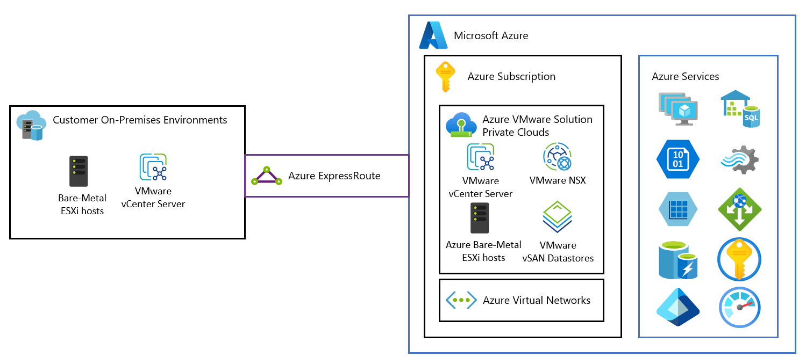

*Note.* From [*What is Azure VMware Solution?*](https://learn.microsoft.com/en-us/azure/azure-vmware/introduction), by Microsoft, n.d., Microsoft Learn. CC BY 4.0.

| Term | Definition | 中文解释 | Source |
|---|---|---|---|
| **ESXi host** (ESXi 主机) | "Dedicated bare-metal server hosts provisioned with VMware vSphere Hypervisor (ESXi)." | ESXi 是装在物理服务器上的 VMware 虚拟化软件；AVS 私有云由这些专用裸金属主机组成。 | [Microsoft, n.d., bullet 1](https://learn.microsoft.com/en-us/azure/azure-vmware/architecture-private-clouds#:~:text=Dedicated%20bare%2Dmetal%20server%20hosts%20provisioned%20with%20VMware%20vSphere%20Hypervisor) |
| **Azure ExpressRoute** (ExpressRoute 专线) | "ExpressRoute lets you extend your on-premises networks into the Microsoft cloud over a private connection with the help of a connectivity provider." | ExpressRoute 是本地机房到 Azure 的私有专线，不走公网，更稳、更快、更安全。 | [Microsoft, n.d., para. 1](https://learn.microsoft.com/en-us/azure/expressroute/expressroute-introduction#:~:text=ExpressRoute%20lets%20you%20extend%20your%20on%2Dpremises%20networks%20into%20the) |
| **Azure VMware Solution (AVS)** (Azure VMware 解决方案) | "Azure VMware Solution provides private clouds that contain VMware vSphere clusters built from dedicated bare-metal Azure infrastructure." | 在 Azure 的专用物理机上跑 VMware 环境；VMware 虚拟机可以原样搬过去，不用改格式。 | [Microsoft, n.d., para. 1](https://learn.microsoft.com/en-us/azure/azure-vmware/introduction#:~:text=Azure%20VMware%20Solution%20provides%20private%20clouds%20that%20contain%20VMware%20vSphere) |
| **VMware NSX** (NSX 网络) | "VMware NSX software-defined networking for vSphere workload virtual machines (VMs)." | NSX 是 VMware 的软件定义网络，用软件给虚拟机建网段、路由和防火墙。 | [Microsoft, n.d., bullet 3](https://learn.microsoft.com/en-us/azure/azure-vmware/architecture-private-clouds#:~:text=VMware%20NSX%20software%2Ddefined%20networking%20for%20vSphere%20workload%20virtual%20machines) |
| **VMware vSAN** (vSAN 存储) | "VMware vSAN datastore for vSphere workload VMs." | vSAN 把各主机的本地硬盘合成一个共享存储，给虚拟机用。 | [Microsoft, n.d., bullet 4](https://learn.microsoft.com/en-us/azure/azure-vmware/architecture-private-clouds#:~:text=VMware%20vSAN%20datastore%20for%20vSphere%20workload%20VMs) |

### 6.3 Refactor

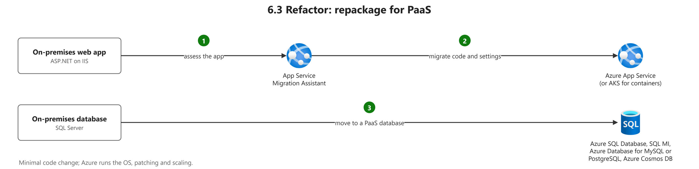

**Key points**

- "Often referred to as a "repackaging," refactoring requires minimal changes to applications so that they can connect to Azure platform as a service (PaaS) and use cloud offerings. For example, you could migrate existing applications to Azure App Service or Azure Kubernetes Service (AKS). Or, you could refactor relational and nonrelational databases into options such as Azure SQL Managed Instance, Azure Database for MySQL, Azure Database for PostgreSQL, and Azure Cosmos DB." ([Microsoft, 2022, March 4, "Migration patterns" section, table 1, row 2 (Refactor), Definition](https://github.com/MicrosoftDocs/cloud-adoption-framework/blob/a5351162040659171fbb4f5674ce36ac9259deb3/docs/migrate/azure-best-practices/contoso-migration-overview.md#migration-patterns:~:text=Often%20referred%20to%20as%20a%20%22repackaging%2C%22%20refactoring%20requires))

  Refactor（又叫 repackaging）：应用只做少量修改，就能接上 Azure 的 PaaS，比如搬到 App Service 或 AKS；数据库可以换成 SQL 托管实例、MySQL、PostgreSQL 或 Cosmos DB。现行 CAF 把这种做法叫 Replatform。

- "If your application can easily be repackaged to work in Azure; If you want to apply innovative DevOps practices provided by Azure, or if you're thinking about DevOps using a container strategy for workloads; For refactoring, you need to think about the portability of your existing code base and available development skills." ([Microsoft, 2022, March 4, "Migration patterns" section, table 1, row 2 (Refactor), When to use, bullets 1–3](https://github.com/MicrosoftDocs/cloud-adoption-framework/blob/a5351162040659171fbb4f5674ce36ac9259deb3/docs/migrate/azure-best-practices/contoso-migration-overview.md#migration-patterns:~:text=If%20your%20application%20can%20easily%20be%20repackaged%20to%20work))

  什么时候用 Refactor：应用容易重新打包到 Azure 上运行时；想用 Azure 的 DevOps 做法或容器化时；同时要看现有代码好不好迁、团队有没有相应的开发技能。

- "Azure App Service is a fully managed platform for your web apps. You can use it to run and scale your web apps with minimal setup. Microsoft manages the infrastructure, operating system updates, load balancing, and scale-up/scale-down logic as needed." ([Microsoft, n.d., "Why move a web application to Azure App Service?" section, para. 1](https://web.archive.org/web/20221202123525/https://learn.microsoft.com/en-us/training/modules/migrate-app-service-migration-assistant/3-understand-assessment#why-move-a-web-application-to-azure-app-service:~:text=Azure%20App%20Service%20is%20a%20fully%20managed%20platform%20for))

  App Service 是全托管的网站平台：基础设施、系统更新、负载均衡和扩缩容都由微软管，你只管应用。

- "The Migration Assistant provides a guided wizard-like user experience that performs two tasks: It performs an assessment of a specific web app installed on Windows Server. It evaluates the dependencies of the web app to determine whether a migration to Azure App Service is possible without modification to the web app. If the assessment proves that the web app can be migrated, the Migration Assistant performs the migration." ([Microsoft, n.d., "What is the Azure App Service Migration Assistant?" section, para. 1 and bullets 1–2](https://web.archive.org/web/20221202123525/https://learn.microsoft.com/en-us/training/modules/migrate-app-service-migration-assistant/3-understand-assessment#what-is-the-azure-app-service-migration-assistant:~:text=The%20Migration%20Assistant%20provides%20a%20guided%20wizard%2Dlike%20user%20experience))

  迁移助手做两件事：先评估 Windows Server 上的网站，看不改代码能不能搬到 App Service；评估通过，再帮你完成迁移。

- "It creates the needed App Service resources in the selected region and resource group. It zips up the web app's source files and uses the App Service deployment API to deploy them. Finally, it performs optional migration steps, like helping you set up a hybrid connection." ([Microsoft, n.d., "How the Migration Assistant migrates your web app" section, para. 3](https://web.archive.org/web/20221207041943/https://learn.microsoft.com/en-us/training/modules/migrate-app-service-migration-assistant/5-understand-migration#how-the-migration-assistant-migrates-your-web-app:~:text=It%20creates%20the%20needed%20App%20Service%20resources%20in%20the))

  迁移这一步具体做的：在选定的区域和资源组里建好 App Service，把网站文件打包后用部署接口发上去，最后可选地帮你设置混合连接。

| Term | Definition | 中文解释 | Source |
|---|---|---|---|
| **repackaging** (重新打包) | "Often referred to as a "repackaging," refactoring requires minimal changes to applications so that they can connect to Azure platform as a service (PaaS) and use cloud offerings." *Note: Current CAF puts repackaging under Replatform, not Refactor.* | 稍微改一下应用，让它能用 Azure 的 PaaS 服务（如 App Service）；旧版 CAF 把它当作“重构”的别名。 | [Microsoft, 2022, March 4, "Migration patterns" section, table 1, row 2 (Refactor), Definition](https://github.com/MicrosoftDocs/cloud-adoption-framework/blob/a5351162040659171fbb4f5674ce36ac9259deb3/docs/migrate/azure-best-practices/contoso-migration-overview.md#migration-patterns:~:text=Often%20referred%20to%20as%20a%20%22repackaging%2C%22%20refactoring%20requires) |
| **Internet Information Services (IIS)** (IIS 网站服务器) | "Internet Information Services (IIS) 7 and later provide a request-processing architecture which includes: ... A Web server engine that can be customized by adding or removing modules." *Note: Learn has no one-line definition of IIS; joined from the introduction.* | IIS 是 Windows Server 自带的网站服务器，用来托管 ASP.NET 等网站；迁移时常搬到 App Service。 | [Microsoft, n.d., "Introduction" section, para. 1](https://learn.microsoft.com/en-us/iis/get-started/introduction-to-iis/introduction-to-iis-architecture#introduction:~:text=Internet%20Information%20Services) |
| **App Service Migration Assistant** (应用服务迁移助手) | "Using App Service Migration Assistant, you can migrate your standalone on-premises ASP.NET web app onto Azure App Service. App Service Migration Assistant is designed to simplify your journey to the cloud through a free, simple, and fast solution to migrate applications from on-premises to the cloud." | 微软的免费小工具，检查本地 .NET 网站能不能上 App Service，并帮你把它搬过去。 | [Microsoft, n.d., "ASP.NET web app migration" section, para. 1](https://learn.microsoft.com/en-us/azure/app-service/app-service-asp-net-migration#aspnet-web-app-migration:~:text=Using%20App%20Service%20Migration%20Assistant%2C%20you%20can%20migrate%20your%20standalone) |
| **Migration Assistant: assess** (迁移助手：评估步骤) | "Once a site is selected, the helper .exe is called to create an anonymized representation of the site configuration ... This anonymized configuration is sent to the assessment API to check for unsupported configuration patterns and a report of those results is returned." *Note: Source is the tool's GitHub wiki, linked from Learn; the tool stops working by November 2026.* | 先选一个 IIS 网站，助手读取它的配置并检查有没有 App Service 不支持的地方，给出报告。 | [Microsoft, n.d., "Overview of how the Assistant works" section, para. 3](https://github.com/Azure/App-Service-Migration-Assistant/wiki/How-the-Assistant-Works#overview-of-how-the-assistant-works:~:text=Once%20a%20site%20is%20selected%2C%20the%20helper) |
| **Migration Assistant: migrate** (迁移助手：迁移步骤) | "When a deployment is started, the app creates an ARM template based on the selected options and starts a deployment to Azure ... uses the helper .exe to create a .zip of the site content, and publishes the site content .zip to the Azure site." *Note: Source is the tool's GitHub wiki, linked from Learn; the tool stops working by November 2026.* | 评估通过并登录 Azure 后，助手创建 App Service 资源，把网站打包成 zip 发布上去。 | [Microsoft, n.d., "Overview of how the Assistant works" section, para. 5](https://github.com/Azure/App-Service-Migration-Assistant/wiki/How-the-Assistant-Works#overview-of-how-the-assistant-works:~:text=Once%20the%20login%20is%20complete%2C%20the%20application%20queries%20ARM%20APIs) |
| **SQL Server** (SQL Server 数据库) | "Microsoft SQL Server is a relational database management system (RDBMS). Applications and tools connect to a SQL Server instance or database, and communicate using Transact-SQL (T-SQL)." | SQL Server 是微软的关系型数据库，装在自己的服务器上；迁移时可搬到 Azure SQL 或 SQL 托管实例。 | [Microsoft, n.d., para. 2](https://learn.microsoft.com/en-us/sql/sql-server/what-is-sql-server?view=sql-server-ver17#:~:text=Microsoft%20SQL%20Server%20is%20a%20relational%20database%20management%20system) |
| **Azure SQL Managed Instance** (Azure SQL 托管实例) | "Azure SQL Managed Instance is a PaaS service that has near 100% compatibility with the latest Enterprise Edition SQL Server Database Engine. ... SQL Managed Instance enables existing SQL Server customers to lift and shift their on-premises applications to the cloud with minimal application and database changes." | 和本地 SQL Server 几乎完全兼容的托管数据库；整个实例搬上云时改动最少。 | [Microsoft, n.d., "Overview" section, para. 1](https://learn.microsoft.com/en-us/azure/azure-sql/managed-instance/sql-managed-instance-paas-overview#overview:~:text=Azure%20SQL%20Managed%20Instance%20is%20a%20PaaS%20service%20that%20has) |
| **Azure Database for MySQL** (Azure MySQL 数据库) | "Azure Database for MySQL flexible server is a fully managed, production-ready relational database service in the Microsoft Cloud." | 微软托管的 MySQL 数据库，重构时可把自建 MySQL 换成它。 | [Microsoft, n.d., para. 1](https://learn.microsoft.com/en-us/azure/mysql/flexible-server/overview#:~:text=Azure%20Database%20for%20MySQL%20flexible%20server%20is%20a%20fully%20managed) |
| **Azure Cosmos DB** (Azure Cosmos DB（非关系数据库）) | "Azure Cosmos DB is a fully managed NoSQL and vector database. It offers single-digit millisecond response times, automatic and instant scalability, along with guaranteed speed at any scale." | 微软托管的 NoSQL 数据库，速度快、能自动扩展；非关系型数据可以迁到它。 | [Microsoft, n.d., "...for free" section, para. 1](https://learn.microsoft.com/en-us/azure/cosmos-db/overview#for-free:~:text=Azure%20Cosmos%20DB%20is%20a%20fully%20managed%20NoSQL%20and%20vector%20database) |
| **what App Service manages for you** (App Service 替你管什么) | "App Service is a Platform-as-a-Service (PaaS), so Azure manages the OS and application stack for you. You manage only your application and its data." *Note: An older Microsoft Learn module also lists load balancing and scaling.* | 操作系统和运行环境由 Azure 打补丁、维护；你只管自己的代码和数据。 | [Microsoft, n.d., para. 2](https://learn.microsoft.com/en-us/azure/app-service/overview-patch-os-runtime#:~:text=App%20Service%20is%20a%20Platform%2Das%2Da%2DService) |
| **hybrid connection** (混合连接) | "Within App Service, Hybrid Connections can be used to access application resources in any network that can make outbound calls to Azure over port 443." | 让搬到 App Service 的应用，经 443 端口安全访问还留在本地的数据库或服务。 | [Microsoft, n.d., para. 2](https://learn.microsoft.com/en-us/azure/app-service/app-service-hybrid-connections#:~:text=Within%20App%20Service%2C%20Hybrid%20Connections%20can%20be%20used%20to%20access) |

## 7. Tools: Git, GitHub, Markdown

### 7.1 Git: from your files to GitHub

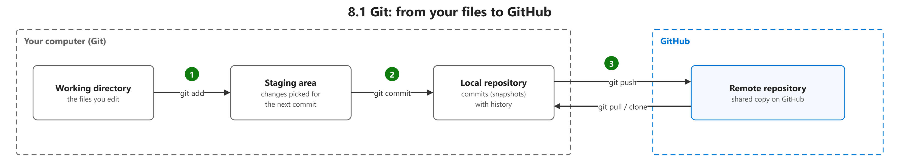

| Term | Definition | 中文解释 | Source |
|---|---|---|---|
| **Git** (Git 版本控制) | "Git is a free and open source distributed version control system designed to handle everything from small to very large projects with speed and efficiency." | Git 是记录文件改动历史的工具，每个人本地都有完整副本；可以回退、分支、合并。 | [Git, n.d., para. 1](https://git-scm.com/#:~:text=Git%20is%20a%20free%20and%20open%20source%20distributed%20version) |
| **working directory (working tree)** (工作目录（工作区）) | "The working tree is a single checkout of one version of the project. These files are pulled out of the compressed database in the Git directory and placed on disk for you to use or modify." | 工作区就是你电脑上能直接打开、修改的项目文件。改动先发生在这里，还没被 Git 记录。 | [Chacon, 2014, "The Three States" section, para. 3](https://git-scm.com/book/en/v2/Getting-Started-What-is-Git%3F#_the_three_states:~:text=The%20working%20tree%20is%20a%20single%20checkout%20of%20one%20version) |
| **git add** (git add 暂存) | "Add contents of new or changed files to the index. The "index" (also known as the "staging area") is what you use to prepare the contents of the next commit." | git add 把改动放进暂存区，准备下一次提交；没有 add 的改动不会进入 commit。 | [Git, n.d., "DESCRIPTION" section, para. 1](https://git-scm.com/docs/git-add#_description:~:text=Add%20contents%20of%20new%20or%20changed%20files%20to%20the%20index) |
| **staging area (index)** (暂存区) | "The staging area is a file, generally contained in your Git directory, that stores information about what will go into your next commit. Its technical name in Git parlance is the "index"..." | 暂存区是提交前的“候选清单”，用 git add 把改动放进来，下一次 commit 只记录这里的内容。 | [Chacon, 2014, "The Three States" section, para. 4](https://git-scm.com/book/en/v2/Getting-Started-What-is-Git%3F#_the_three_states:~:text=The%20staging%20area%20is%20a%20file%2C%20generally%20contained%20in%20your) |
| **commit** (提交) | "The action of storing a new snapshot of the project's state in the Git history, by creating a new commit representing the current state of the index and advancing HEAD to point at the new commit." | 提交就是给项目拍一张快照存进历史；以后可以查看或回到这个版本。 | [Git, n.d., "commit" entry](https://git-scm.com/docs/gitglossary#Documentation/gitglossary.txt-aiddefcommitacommit:~:text=The%20action%20of%20storing%20a%20new%20snapshot%20of%20the%20project%E2%80%99s) |
| **local repository** (本地仓库) | "The Git directory is where Git stores the metadata and object database for your project. This is the most important part of Git, and it is what is copied when you clone a repository from another computer." *Note: Pro Git calls it the Git directory (.git).* | 本地仓库是你电脑上的 .git 目录，保存全部提交历史；不联网也能提交和查看历史。 | [Chacon, 2014, "The Three States" section, para. 5](https://git-scm.com/book/en/v2/Getting-Started-What-is-Git%3F#_the_three_states:~:text=The%20Git%20directory%20is%20where%20Git%20stores%20the%20metadata%20and) |
| **GitHub** (GitHub 平台) | "GitHub is a platform that supports your entire software development process, from planning work to deploying and operating software." | GitHub 是在云上托管 Git 仓库的网站，并提供协作工具，比如拉取请求和代码审查。 | [GitHub, n.d., para. 1](https://docs.github.com/en/get-started/start-your-journey/what-is-github#:~:text=GitHub%20is%20a%20platform%20that%20supports%20your%20entire%20software) |
| **remote repository** (远程仓库) | "A repository which is used to track the same project but resides somewhere else. To communicate with remotes, see fetch or push." | 远程仓库是放在别处（例如 GitHub）的同一个项目仓库，用来和别人共享代码、做备份。 | [Git, n.d., "remote repository" entry](https://git-scm.com/docs/gitglossary#Documentation/gitglossary.txt-aiddefremotearemoterepository:~:text=A%20repository%20which%20is%20used%20to%20track%20the%20same%20project) |
| **push** (推送) | "To push means to send your committed changes to a remote repository on GitHub.com." | 推送就是把本地已经提交的改动上传到远程仓库，别人才能看到。 | [GitHub, n.d., "push" section, para. 1](https://docs.github.com/en/get-started/learning-about-github/github-glossary#push:~:text=To%20push%20means%20to%20send%20your%20committed%20changes%20to%20a) |
| **pull** (拉取) | "Pulling a branch means to fetch it and merge it." | 拉取就是从远程仓库下载新改动并合并到本地分支，让本地保持最新。 | [Git, n.d., "pull" entry](https://git-scm.com/docs/gitglossary#Documentation/gitglossary.txt-aiddefpullapull:~:text=Pulling%20a%20branch%20means%20to%20fetch%20it%20and%20merge%20it) |
| **clone** (克隆) | "A clone is a copy of a repository that lives on your computer instead of on a website's server somewhere, or the act of making that copy." | 克隆就是把远程仓库完整复制一份到自己电脑上，包括全部历史。 | [GitHub, n.d., "clone" section, para. 1](https://docs.github.com/en/get-started/learning-about-github/github-glossary#clone:~:text=A%20clone%20is%20a%20copy%20of%20a%20repository%20that%20lives) |

### 7.2 GitHub teamwork

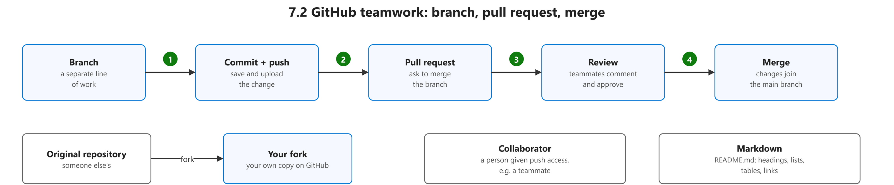

| Term | Definition | 中文解释 | Source |
|---|---|---|---|
| **branch** (分支) | "A "branch" is a line of development. The most recent commit on a branch is referred to as the tip of that branch." | 分支是一条独立的开发线；在分支上改代码不会影响主线，做完再合并。 | [Git, n.d., "branch" entry](https://git-scm.com/docs/gitglossary#Documentation/gitglossary.txt-aiddefbranchabranch:~:text=A%20%22branch%22%20is%20a%20line%20of%20development.%20The%20most%20recent) |
| **pull request** (拉取请求（PR）) | "Pull requests are proposed changes to a repository submitted by a user and accepted or rejected by a repository's collaborators." | 拉取请求（PR）是在 GitHub 上提出“请把我的改动合并进来”，别人审查讨论后决定接受或拒绝。 | [GitHub, n.d., "pull request" section, para. 1](https://docs.github.com/en/get-started/learning-about-github/github-glossary#pull-request:~:text=Pull%20requests%20are%20proposed%20changes%20to%20a%20repository%20submitted%20by) |
| **review** (代码审查) | "Pull request reviews let people comment on changes, suggest improvements, and approve or request changes before code is merged." | 审查就是别人在合并前看你的拉取请求，可以评论、批准或要求修改，保证代码质量。 | [GitHub, n.d., para. 2](https://docs.github.com/en/pull-requests/reference/pull-request-reviews#:~:text=Pull%20request%20reviews%20let%20people%20comment%20on%20changes%2C%20suggest) |
| **merge** (合并) | "Merging takes the changes from one branch (in the same repository or from a fork), and applies them into another." | 合并就是把一个分支的改动并入另一个分支；两边改了同一处时会出现冲突，要手动解决。 | [GitHub, n.d., "merge" section, para. 1](https://docs.github.com/en/get-started/learning-about-github/github-glossary#merge:~:text=Merging%20takes%20the%20changes%20from%20one%20branch%20%28in%20the%20same) |
| **default branch / main branch** (默认分支) | "The base branch for new pull requests and code commits in a repository. ... The first branch is usually called main, and is often the default branch." | 默认分支是仓库的主线，通常叫 main；拉取请求默认合并到这里。 | [GitHub, n.d., "default branch" section, para. 1](https://docs.github.com/en/get-started/learning-about-github/github-glossary#default-branch:~:text=The%20base%20branch%20for%20new%20pull%20requests%20and%20code%20commits) |
| **fork** (复刻（Fork）) | "A fork is a personal copy of another user's repository that lives on your account. Forks allow you to freely make changes to a project without affecting the original upstream repository." | 复刻（fork）是把别人的仓库复制一份到自己的 GitHub 账号下，可以随便改而不影响原仓库。 | [GitHub, n.d., "fork" section, para. 1](https://docs.github.com/en/get-started/learning-about-github/github-glossary#fork:~:text=A%20fork%20is%20a%20personal%20copy%20of%20another%20user%27s%20repository) |
| **collaborator** (协作者) | "A collaborator is a person with read and write access to a repository who has been invited to contribute by the repository owner." | 协作者是仓库主人邀请进来、能读也能写这个仓库的人。 | [GitHub, n.d., "collaborator" section, para. 1](https://docs.github.com/en/get-started/learning-about-github/github-glossary#collaborator:~:text=A%20collaborator%20is%20a%20person%20with%20read%20and%20write%20access) |
| **Markdown** (Markdown 标记语言) | "Markdown is an easy-to-read, easy-to-write language for formatting plain text." | Markdown 是用简单符号（如 # 标题、- 列表）给纯文本排版的写法；GitHub 的 README 就用它。 | [GitHub, n.d., para. 1](https://docs.github.com/en/get-started/writing-on-github/getting-started-with-writing-and-formatting-on-github/about-writing-and-formatting-on-github#:~:text=Markdown%20is%20an%20easy%2Dto%2Dread%2C%20easy%2Dto%2Dwrite%20language%20for%20formatting%20plain%20text) |
