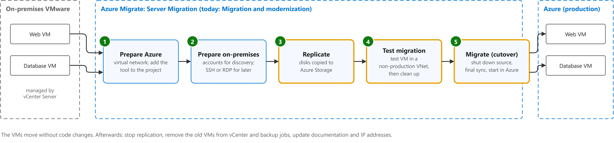
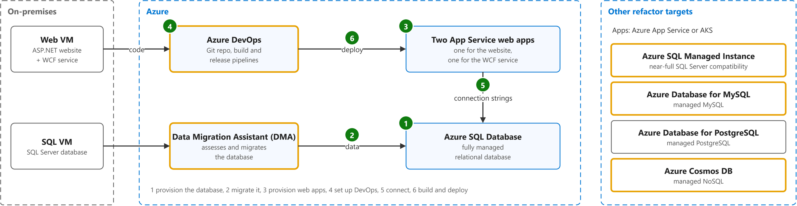

# Overview of application migration examples for Azure

Study notes on [Cloud Adoption Framework, migration examples (retired)](https://github.com/MicrosoftDocs/cloud-adoption-framework/blob/cb2149769f66/docs/migrate/azure-best-practices/contoso-migration-overview.md), which CST8913 Cloud Migration (Algonquin College, Fall 2026) uses in weeks 5 and 6. Each section follows one part of the source. Start from the figure: the framed terms are the ones to learn, and the table below it defines them in the same order, each with a citation linked to the passage.

## [Rehost](https://github.com/MicrosoftDocs/cloud-adoption-framework/blob/cb2149769f66/docs/migrate/azure-best-practices/contoso-migration-overview.md#migration-patterns)

| Term | Definition | 中文解释 | Source |
|---|---|---|---|
| **replication** (复制) | "During initial replication, a VM snapshot is created. Disk data from the snapshot is replicated to replica managed disks (seed disks) in Azure. After initial replication finishes, delta replication begins." | 把本地虚拟机的磁盘数据先整体复制到 Azure，再不断同步新的改动；源机器在这期间照常运行。 | [Microsoft, n.d., "Track migrations" section, bullet 2 ("Replication occurs as follows"), sub-bullet 2](https://learn.microsoft.com/en-us/azure/migrate/tutorial-migrate-vmware#track-migrations:~:text=During%20initial%20replication%2C%20a%20VM%20snapshot%20is%20created.%20Disk%20data) |
| **test migration** (测试迁移) | "Test migration simulates the migration by creating an Azure VM using replicated data (usually migrating to a non-production VNet in your Azure subscription)." | 正式迁移前的演练：用复制好的数据在隔离网络里建一台测试 VM 来验证；不影响源机器。 | [Microsoft, n.d., "Run a test migration" section, bullet 2](https://learn.microsoft.com/en-us/azure/migrate/tutorial-migrate-vmware#run-a-test-migration:~:text=Test%20migration%20simulates%20the%20migration%20by%20creating%20an%20Azure%20VM) |
| **cutover** (切换) | "You can perform final migrations (Cutover) for these servers. ... By default Azure Migrate shuts down the source (on-premises or AVS) VM, and runs an on-demand replication to synchronize any VM changes that occurred since the last replication occurred." | 正式切换：关掉源机器、同步最后的改动，让 Azure 上的新 VM 接手业务；这一步之后用户就用云上的系统了。 | [Microsoft, n.d., "Track migrations" section, bullet 3 ("Completion"), sub-bullet 1](https://learn.microsoft.com/en-us/azure/migrate/tutorial-migrate-vmware#track-migrations:~:text=You%20can%20perform%20final%20migrations%20%28Cutover%29%20for%20these%20servers) |

## [Refactor](https://github.com/MicrosoftDocs/cloud-adoption-framework/blob/cb2149769f66/docs/migrate/azure-best-practices/contoso-migration-overview.md#migration-patterns)

| Term | Definition | 中文解释 | Source |
|---|---|---|---|
| **Azure DevOps** (Azure DevOps) | "Provides a continuous integration and continuous deployment (CI/CD) pipeline for app development. The pipeline starts with a Git repository for managing app code, a build system for producing packages and other build artifacts, and a Release Management system to deploy changes in dev, test, and production environments." | Azure DevOps 是微软的一套开发协作服务：放代码的 Git 仓库、自动构建和自动发布。重构例子里用它把代码自动部署到 App Service。 | [Microsoft, 2019, "Azure services" section, table 1, row 4 (Azure DevOps), Description](https://github.com/MicrosoftDocs/cloud-adoption-framework/blob/cb2149769f66/docs/migrate/azure-best-practices/contoso-migration-refactor-web-app-sql.md#azure-services:~:text=Provides%20a%20continuous%20integration%20and%20continuous%20deployment%20%28CI%2FCD%29%20pipeline) |
| **Data Migration Assistant (DMA)** (数据迁移助手) | "Data Migration Assistant is a standalone tool to assess SQL servers. It helps pinpoint potential problems that block migration. It finds unsupported features, new features that can benefit you after migration, and the right path for database migration." | 数据迁移助手是一个单独安装的小工具，用来检查 SQL Server 数据库能不能搬到 Azure，并可以把数据库搬过去。重构例子里用它把数据库迁到 Azure SQL Database。 | [Microsoft, n.d., "Integrated tools and features" section, table 1, row 3 (Data Migration Assistant), Details](https://learn.microsoft.com/en-us/azure/migrate/migrate-services-overview#integrated-tools-and-features:~:text=Data%20Migration%20Assistant%20is%20a%20standalone%20tool%20to%20assess) |
| **Azure SQL Managed Instance** (Azure SQL 托管实例) | "Azure SQL Managed Instance is a PaaS service that has near 100% compatibility with the latest Enterprise Edition SQL Server Database Engine. ... SQL Managed Instance enables existing SQL Server customers to lift and shift their on-premises applications to the cloud with minimal application and database changes." *Note: The 2019 source calls it Azure SQL Database Managed Instance.* | Azure SQL 托管实例是微软托管的数据库服务，和本地 SQL Server 几乎完全兼容。整个数据库实例搬上云时，改动最少。 | [Microsoft, n.d., "Overview" section, para. 1](https://learn.microsoft.com/en-us/azure/azure-sql/managed-instance/sql-managed-instance-paas-overview#overview:~:text=Azure%20SQL%20Managed%20Instance%20is%20a%20PaaS%20service%20that%20has) |
| **Azure Database for MySQL** (Azure MySQL 数据库) | "Azure Database for MySQL flexible server is a fully managed, production-ready relational database service in the Microsoft Cloud." | 微软托管的 MySQL 数据库，重构时可把自建 MySQL 换成它。 | [Microsoft, n.d., para. 1](https://learn.microsoft.com/en-us/azure/mysql/flexible-server/overview#:~:text=Azure%20Database%20for%20MySQL%20flexible%20server%20is%20a%20fully%20managed) |
| **Azure Cosmos DB** (Azure Cosmos DB（非关系数据库）) | "Azure Cosmos DB is a fully managed NoSQL and vector database. It offers single-digit millisecond response times, automatic and instant scalability, along with guaranteed speed at any scale." | 微软托管的 NoSQL 数据库，速度快、能自动扩展；非关系型数据可以迁到它。 | [Microsoft, n.d., "...for free" section, para. 1](https://learn.microsoft.com/en-us/azure/cosmos-db/overview#for-free:~:text=Azure%20Cosmos%20DB%20is%20a%20fully%20managed%20NoSQL%20and%20vector%20database) |

## Also in the source

Points the source makes that are easy to miss, in my own words, each linked to its section.

- Migration strategies fall into four broad patterns (rehost, refactor, rearchitect, rebuild), chosen by business drivers and goals, and one organization can use several patterns at once. ([Migration patterns](https://github.com/MicrosoftDocs/cloud-adoption-framework/blob/cb2149769f66/docs/migrate/azure-best-practices/contoso-migration-overview.md#migration-patterns))
- The rehost figure follows the source's example article "Rehost an on-premises Linux application to Azure VMs": a web VM and a database VM move unchanged to the production virtual network, and the on-premises VMs are decommissioned afterwards. ([Solution design](https://github.com/MicrosoftDocs/cloud-adoption-framework/blob/a5351162040659171fbb4f5674ce36ac9259deb3/docs/migrate/azure-best-practices/contoso-migration-rehost-linux-vm.md#solution-design))
- Preparing on-premises VMware means preparing accounts for VM discovery and preparing to connect to the Azure VMs after migration (SSH for Linux, RDP for Windows). ([Scenario steps](https://github.com/MicrosoftDocs/cloud-adoption-framework/blob/a5351162040659171fbb4f5674ce36ac9259deb3/docs/migrate/azure-best-practices/contoso-migration-rehost-linux-vm.md))
- Replication must be set up and enabled before migration; VMs replicate to Azure Storage, and you can apply the VM size and disk type recommended by an earlier assessment. ([Step 3: Replicate the on-premises VMs](https://github.com/MicrosoftDocs/cloud-adoption-framework/blob/a5351162040659171fbb4f5674ce36ac9259deb3/docs/migrate/azure-best-practices/contoso-migration-rehost-linux-vm.md))
- You run a test migration first (ideally into a nonproduction virtual network) and clean it up, and only then run the real migration. ([Step 4: Migrate the VMs](https://github.com/MicrosoftDocs/cloud-adoption-framework/blob/a5351162040659171fbb4f5674ce36ac9259deb3/docs/migrate/azure-best-practices/contoso-migration-rehost-linux-vm.md))
- By default Azure Migrate shuts down the on-premises VM and runs a final replication so that no data is lost. ([Step 4: Migrate the VMs > Migrate the VMs](https://github.com/MicrosoftDocs/cloud-adoption-framework/blob/a5351162040659171fbb4f5674ce36ac9259deb3/docs/migrate/azure-best-practices/contoso-migration-rehost-linux-vm.md))
- After migration you remove the on-premises VMs from the vCenter inventory and backup jobs and update documentation, IP addresses and dependent settings. ([Clean up after migration](https://github.com/MicrosoftDocs/cloud-adoption-framework/blob/a5351162040659171fbb4f5674ce36ac9259deb3/docs/migrate/azure-best-practices/contoso-migration-rehost-linux-vm.md))
- A rehost keeps the web and data tiers as single points of failure and keeps you running VMs instead of managed services, which is the trade-off for a simple, change-free move. ([Solution review](https://github.com/MicrosoftDocs/cloud-adoption-framework/blob/a5351162040659171fbb4f5674ce36ac9259deb3/docs/migrate/azure-best-practices/contoso-migration-rehost-linux-vm.md#solution-review))
- After a rehost the new VMs still need securing (NSGs, disk encryption), backup and disaster recovery (Azure Backup, Site Recovery), and cost management. ([Review the deployment](https://github.com/MicrosoftDocs/cloud-adoption-framework/blob/a5351162040659171fbb4f5674ce36ac9259deb3/docs/migrate/azure-best-practices/contoso-migration-rehost-linux-vm.md))
- Rearchitect, unlike refactor, changes the code base to optimize for cloud scalability, for example breaking a monolith into microservices. ([Migration patterns (table row Rearchitect)](https://github.com/MicrosoftDocs/cloud-adoption-framework/blob/cb2149769f66/docs/migrate/azure-best-practices/contoso-migration-overview.md#migration-patterns))
- The refactor figure follows the source's example article "Refactor an app in an Azure web app and Azure SQL Database" (a two-tier ASP.NET app with a WCF service and a SQL Server database). ([Migration example articles > ASP.NET / PHP / Java apps](https://github.com/MicrosoftDocs/cloud-adoption-framework/blob/cb2149769f66/docs/migrate/azure-best-practices/contoso-migration-overview.md#aspnet--php--java-apps))
- In that example App Service allows one app deployment per web app, so the website and the WCF service need two web apps; and using Data Migration Assistant rather than Azure Database Migration Service leaves no ready setup for migrating databases at scale. ([Solution review](https://github.com/MicrosoftDocs/cloud-adoption-framework/blob/cb2149769f66/docs/migrate/azure-best-practices/contoso-migration-refactor-web-app-sql.md#solution-review))
- The example chose Azure SQL Database for near-zero administration and built-in fault tolerance, and could use the Azure Hybrid Benefit for SQL Server to save up to 30% with Software Assurance. ([Proposed solution](https://github.com/MicrosoftDocs/cloud-adoption-framework/blob/cb2149769f66/docs/migrate/azure-best-practices/contoso-migration-refactor-web-app-sql.md#proposed-solution))

## Corrections

Where the course copy differs from the source, or the source has changed since, with the source's exact words.

- **Copied wrong.** The course copy runs this sentence on from the refactor definition, as if it were part of it, and then leaves it out of its list of when to refactor. In the source it is the first "When to use" condition for Refactor. The source says: "If your app can easily be repackaged to work in Azure." ([source](https://github.com/MicrosoftDocs/cloud-adoption-framework/blob/cb2149769f66/docs/migrate/azure-best-practices/contoso-migration-overview.md#migration-patterns))
