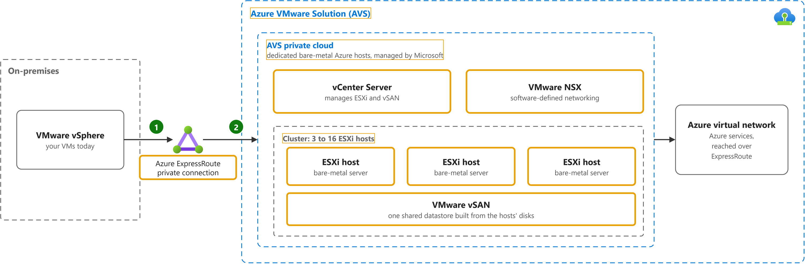

# What is Azure VMware Solution?

Study notes on [Azure VMware Solution documentation](https://learn.microsoft.com/en-us/azure/azure-vmware/introduction), which CST8913 Cloud Migration (Algonquin College, Fall 2026) uses in week 5. Each section follows one part of the source. Start from the figure: the framed terms are the ones to learn, and the table below it defines them in the same order, each with a citation linked to the passage.

## [Private clouds, clusters and hosts](https://learn.microsoft.com/en-us/azure/azure-vmware/introduction#hosts-clusters-and-private-clouds)

| Term | Definition | 中文解释 | Source |
|---|---|---|---|
| **Azure ExpressRoute** (ExpressRoute 专线) | "ExpressRoute lets you extend your on-premises networks into the Microsoft cloud over a private connection with the help of a connectivity provider." | ExpressRoute 是本地机房到 Azure 的私有专线，不走公网，更稳、更快、更安全。 | [Microsoft, n.d., para. 1](https://learn.microsoft.com/en-us/azure/expressroute/expressroute-introduction#:~:text=ExpressRoute%20lets%20you%20extend%20your%20on%2Dpremises%20networks%20into%20the) |
| **Azure VMware Solution (AVS)** (Azure VMware 解决方案) | "Azure VMware Solution provides private clouds that contain VMware vSphere clusters built from dedicated bare-metal Azure infrastructure." | 在 Azure 的专用物理机上跑 VMware 环境；VMware 虚拟机可以原样搬过去，不用改格式。 | [Microsoft, n.d., para. 1](https://learn.microsoft.com/en-us/azure/azure-vmware/introduction#:~:text=Azure%20VMware%20Solution%20provides%20private%20clouds%20that%20contain%20VMware%20vSphere) |
| **Azure VMware Solution private cloud** (AVS 私有云) | "Azure VMware Solution private cloud: Offers compute, networking, and storage resources by using VMware software, including vCenter Server, NSX software-defined networking, vSAN software-defined storage, and Azure bare-metal ESXi hosts." *Note: The general term private cloud is defined on the Describe cloud computing page.* | AVS 私有云是微软在 Azure 专用物理机上替你搭好的一整套 VMware 环境（vCenter、NSX、vSAN、ESXi 主机）；本地的 VMware 虚拟机可以直接搬进去运行。 | [Microsoft, n.d., second list, bullet 4](https://learn.microsoft.com/en-us/azure/azure-vmware/architecture-private-clouds#:~:text=Offers%20compute%2C%20networking%2C%20and%20storage%20resources%20by%20using%20VMware%20software) |
| **vCenter Server** (vCenter 服务器) | "VMware vCenter Server for managing ESXi and vSAN." | vCenter Server 是 VMware 的集中管理平台，用来管理所有 ESXi 主机和 vSAN 存储；在 AVS 私有云里它已经装好，你照旧用它管虚拟机。 | [Microsoft, n.d., bullet 2](https://learn.microsoft.com/en-us/azure/azure-vmware/architecture-private-clouds#:~:text=VMware%20vCenter%20Server%20for%20managing%20ESXi%20and%20vSAN) |
| **VMware NSX** (NSX 网络) | "VMware NSX software-defined networking for vSphere workload virtual machines (VMs)." | NSX 是 VMware 的软件定义网络，用软件给虚拟机建网段、路由和防火墙。 | [Microsoft, n.d., bullet 3](https://learn.microsoft.com/en-us/azure/azure-vmware/architecture-private-clouds#:~:text=VMware%20NSX%20software%2Ddefined%20networking%20for%20vSphere%20workload%20virtual%20machines) |
| **cluster** (集群) | "Azure VMware Solution clusters are based on a hyperconverged infrastructure. ... An Azure VMware Solution cluster requires a minimum number of three hosts." *Note: The same page gives the maximum: 16 hosts per cluster.* | 集群是一组 ESXi 主机，它们的计算、内存和硬盘合在一起使用（超融合）；AVS 的每个集群至少 3 台、最多 16 台主机，主机多了就能放更多虚拟机。 | [Microsoft, n.d., "Hosts, clusters, and private clouds" section, para. 1 and para. 2](https://learn.microsoft.com/en-us/azure/azure-vmware/introduction#hosts-clusters-and-private-clouds:~:text=Azure%20VMware%20Solution%20clusters%20are%20based%20on%20a%20hyperconverged%20infrastructure) |
| **ESXi host** (ESXi 主机) | "Dedicated bare-metal server hosts provisioned with VMware vSphere Hypervisor (ESXi)." | ESXi 是装在物理服务器上的 VMware 虚拟化软件；AVS 私有云由这些专用裸金属主机组成。 | [Microsoft, n.d., bullet 1](https://learn.microsoft.com/en-us/azure/azure-vmware/architecture-private-clouds#:~:text=Dedicated%20bare%2Dmetal%20server%20hosts%20provisioned%20with%20VMware%20vSphere%20Hypervisor) |
| **VMware vSAN** (vSAN 存储) | "VMware vSAN datastore for vSphere workload VMs." | vSAN 把各主机的本地硬盘合成一个共享存储，给虚拟机用。 | [Microsoft, n.d., bullet 4](https://learn.microsoft.com/en-us/azure/azure-vmware/architecture-private-clouds#:~:text=VMware%20vSAN%20datastore%20for%20vSphere%20workload%20VMs) |

## Also in the source

Points the source makes that are easy to miss, in my own words, each linked to its section.

- Microsoft manages and maintains the private cloud hardware and VMware software, so the customer can focus on running workloads; the solution is validated by VMware. ([What is Azure VMware Solution?](https://learn.microsoft.com/en-us/azure/azure-vmware/introduction))
- There are two generations: Generation 1 links the hosts to Azure virtual networks through Microsoft-managed ExpressRoute circuits, while Generation 2 attaches the hosts directly to Azure virtual networks and runs only on the AV64 host type. ([Azure VMware Solution private cloud types](https://learn.microsoft.com/en-us/azure/azure-vmware/introduction#azure-vmware-solution-private-cloud-types))
- Several host types exist (AV36, AV36P, AV48, AV52 and AV64) with different CPU, memory and vSAN disk sizes; one private cloud uses hosts of a single type, and hosts come from an isolated pool that was tested and securely wiped. ([Hosts, clusters, and private clouds](https://learn.microsoft.com/en-us/azure/azure-vmware/introduction#hosts-clusters-and-private-clouds))
- Three hosts is the minimum cluster size, but Microsoft recommends at least four ESXi hosts so that vSAN keeps working when one host is in maintenance. ([Cluster size recommendation](https://learn.microsoft.com/en-us/azure/azure-vmware/introduction#cluster-size-recommendation))
- Datastore space can grow beyond vSAN by adding Azure storage services, without adding hosts to the cluster. ([Storage](https://learn.microsoft.com/en-us/azure/azure-vmware/introduction#storage))
- The private cloud is reached from on-premises sites and Azure through ExpressRoute, VPN or Azure Virtual WAN; ExpressRoute Global Reach links the on-premises circuit to the private cloud, and internet access is off by default for new private clouds. ([Networking](https://learn.microsoft.com/en-us/azure/azure-vmware/introduction#networking))
- Access uses vSphere role-based access control that can be tied to Microsoft Entra ID, and vSAN encrypts data at rest by default. ([Access and security](https://learn.microsoft.com/en-us/azure/azure-vmware/introduction#access-and-security))

## Corrections

Where the course copy differs from the source, or the source has changed since, with the source's exact words.

- None found.
