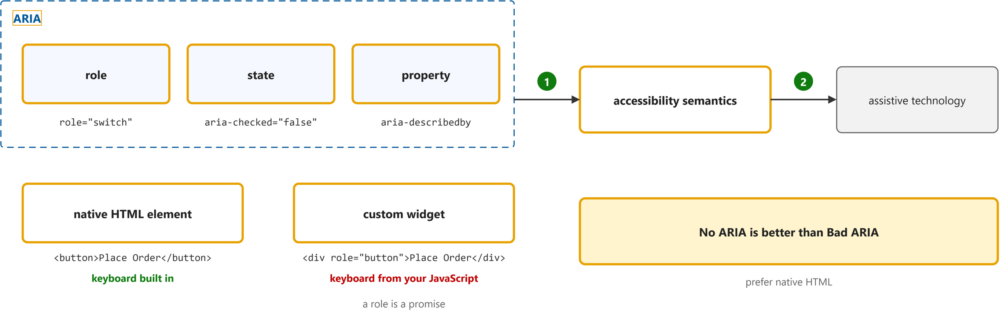
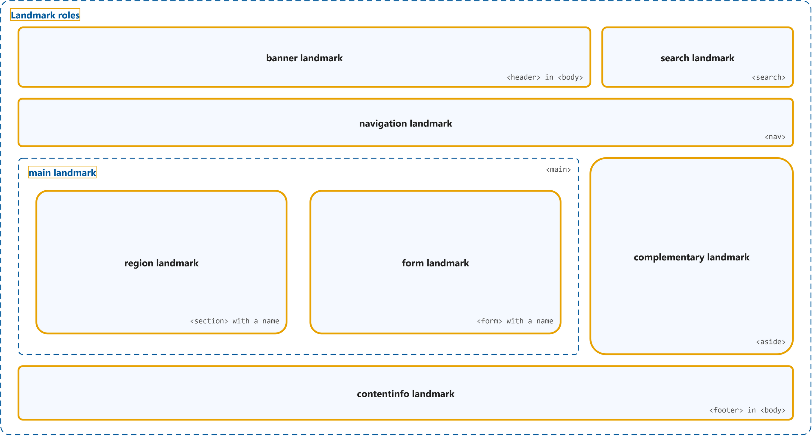
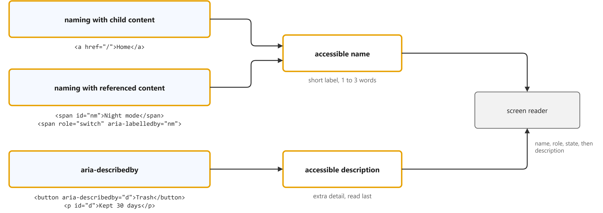
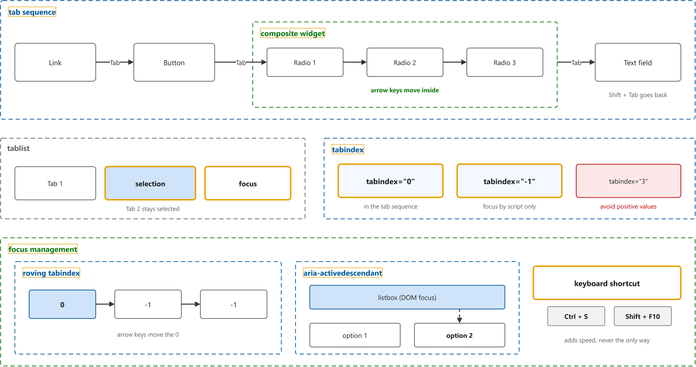
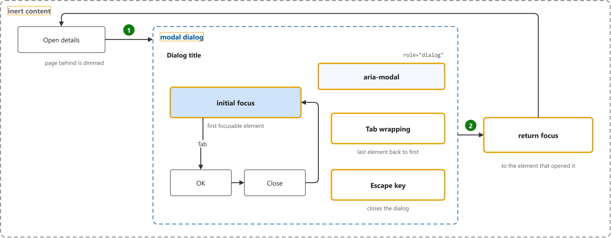

# ARIA Authoring Practices Guide

Study notes on [W3C WAI (APG)](https://www.w3.org/WAI/ARIA/apg/), which CST8914 Accessible by Design (Algonquin College, Fall 2026) uses in week 7. Each section follows one part of the source. Start from the figure: the framed terms are the ones to learn, and the table below it defines them in the same order, each with a citation linked to the passage.

## [Read Me First](https://www.w3.org/WAI/ARIA/apg/practices/read-me-first/)

| Term | Definition | 中文解释 | Source |
|---|---|---|---|
| **Accessible Rich Internet Applications (ARIA)** (无障碍富互联网应用 (ARIA)) | "WAI-ARIA, the Accessible Rich Internet Applications Suite, defines a way to make web content and web applications more accessible to people with disabilities." *Note: The Read Me First part assumes ARIA is known; this sentence is from the WAI-ARIA Overview page.* | ARIA 是 W3C 定的一套 HTML 属性（role 和 aria-* 属性），用来告诉辅助技术一个元素是什么、处于什么状态。它只改变屏幕阅读器“听到”的信息，不改变页面的外观和键盘行为。 | [Nurthen et al., 2025, "Introduction" section, para. 1](https://www.w3.org/WAI/standards-guidelines/aria/#introduction:~:text=WAI%2DARIA%2C%20the%20Accessible%20Rich%20Internet%20Applications%20Suite%2C%20defines%20a%20way) |
| **role** (角色 (role)) | "Main indicator of type. This semantic association allows tools to present and support interaction with the object in a manner that is consistent with user expectations about other objects of that type." | role 是告诉辅助技术“这个元素是什么类型”的属性，例如 role="button"、role="switch"。屏幕阅读器会把它读出来，比如“Place Order, button”。 | [Diggs et al., Eds., "2. Important Terms" section, term Role](https://www.w3.org/TR/wai-aria-1.2/#dfn-role:~:text=Main%20indicator%20of%20type.%20This%20semantic%20association%20allows%20tools) |
| **state** (状态 (state)) | "A state is a dynamic property expressing characteristics of an object that may change in response to user action or automated processes. States do not affect the essential nature of the object, but represent data associated with the object or user interaction possibilities." | state 是会随用户操作而变化的 ARIA 属性，例如 aria-checked、aria-pressed、aria-expanded。脚本要在状态变化时同步更新它，屏幕阅读器才会读出“已选中”“已按下”等。 | [Diggs et al., Eds., "2. Important Terms" section, term State](https://www.w3.org/TR/wai-aria-1.2/#dfn-state:~:text=A%20state%20is%20a%20dynamic%20property%20expressing%20characteristics%20of%20an%20object) |
| **property** (属性 (property)) | "Attributes that are essential to the nature of a given object, or that represent a data value associated with the object. A change of a property may significantly impact the meaning or presentation of an object." *Note: The spec adds that the line between states and properties is not strict: aria-activedescendant is a property that changes often.* | property 是描述元素本身特征或关系的 ARIA 属性，一般不常变化，例如 aria-label、aria-describedby、aria-labelledby。它们给元素提供名称、说明或与其他元素的关系。 | [Diggs et al., Eds., "2. Important Terms" section, term Property](https://www.w3.org/TR/wai-aria-1.2/#dfn-property:~:text=Attributes%20that%20are%20essential%20to%20the%20nature%20of%20a%20given%20object) |
| **accessibility semantics** (无障碍语义) | "The information assistive technologies need about the meaning and purpose of user interface elements is called accessibility semantics." | 无障碍语义是辅助技术需要知道的、关于界面元素“是什么、做什么”的信息（类型、名称、状态）。浏览器把它交给屏幕阅读器，用户才能听懂页面。 | [W3C Web Accessibility Initiative (WAI), n.d., "Principle 2: ARIA Can Both Cloak and Enhance, Creating Both Power and Danger" section, para. 1](https://www.w3.org/WAI/ARIA/apg/practices/read-me-first/#no_aria_better_bad_aria:~:text=The%20information%20assistive%20technologies%20need%20about%20the%20meaning%20and%20purpose) |
| **native HTML element** (原生 HTML 元素) | "Unlike HTML input elements, ARIA roles do not cause browsers to provide keyboard behaviors or styling." *Note: No official sentence defines the phrase itself; the quote states what native elements give that ARIA roles do not.* | 原生 HTML 元素是浏览器自带含义和行为的标签，例如 &lt;button>、&lt;a href>、&lt;input>。它们天生能获得焦点、能用 Enter 或 Space 操作，不用自己写键盘代码。 | [W3C Web Accessibility Initiative (WAI), n.d., "Principle 1: A role is a promise" section, para. 2, sentence 2](https://www.w3.org/WAI/ARIA/apg/practices/read-me-first/#no_aria_better_bad_aria:~:text=Unlike%20HTML%20input%20elements%2C%20ARIA%20roles%20do%20not%20cause%20browsers) |
| **custom widget** (自定义控件) | "Unlike native HTML form elements, browsers do not provide keyboard support for graphical user interface (GUI) components that are made accessible with ARIA; authors have to provide the keyboard support in their code." *Note: Read Me First makes the same point with &lt;div role="button">: a role is a promise of keyboard behaviour the author must code.* | 自定义控件是用 &lt;div>、&lt;span> 加 ARIA 角色拼出来的交互组件，例如 &lt;div role="button">。ARIA 只让屏幕阅读器读出“按钮”，键盘焦点和 Enter、Space 操作都要开发者自己写 JavaScript。 | [W3C Web Accessibility Initiative (WAI), n.d., "Introduction" section, para. 1, sentence 1](https://www.w3.org/WAI/ARIA/apg/practices/keyboard-interface/#introduction:~:text=Unlike%20native%20HTML%20form%20elements%2C%20browsers%20do%20not%20provide%20keyboard%20support) |
| **No ARIA is better than Bad ARIA** (没有 ARIA 好过错误的 ARIA) | "Incorrect ARIA misrepresents visual experiences, with potentially devastating effects on their corresponding non-visual experiences." | 这是 APG 的第一原则：错误的 ARIA 会让屏幕阅读器读到与屏幕不符的信息，比不加还糟。能用原生 HTML 就用原生 HTML，只在确有需要时加 ARIA。 | [W3C Web Accessibility Initiative (WAI), n.d., "No ARIA is better than Bad ARIA" section, para. 1, sentence 3](https://www.w3.org/WAI/ARIA/apg/practices/read-me-first/#no_aria_better_bad_aria:~:text=Incorrect%20ARIA%20misrepresents%20visual%20experiences%2C%20with%20potentially%20devastating%20effects) |

## [Landmark Regions](https://www.w3.org/WAI/ARIA/apg/practices/landmark-regions/)

| Term | Definition | 中文解释 | Source |
|---|---|---|---|
| **landmark role** (地标角色) | "ARIA landmark roles provide a powerful way to identify the organization and structure of a web page." | 地标角色是标出页面大区域（页头、导航、主要内容、页脚等）的 ARIA 角色。屏幕阅读器用户可以按快捷键在这些区域之间直接跳转。 | [W3C Web Accessibility Initiative (WAI), n.d., "Introduction" section, para. 1, sentence 1](https://www.w3.org/WAI/ARIA/apg/practices/landmark-regions/#introduction:~:text=ARIA%20landmark%20roles%20provide%20a%20powerful%20way%20to%20identify%20the%20organization) |
| **banner landmark** (banner 地标（页头）) | "A banner landmark identifies site-oriented content at the beginning of each page within a website." | banner 地标是每页顶部、属于整个网站的内容区，通常有网站标志和站内搜索。在 &lt;body> 下的 &lt;header> 自动成为 banner 地标。 | [W3C Web Accessibility Initiative (WAI), n.d., "Landmark Roles: Banner" section, para. 1](https://www.w3.org/WAI/ARIA/apg/practices/landmark-regions/#aria_lh_banner:~:text=A%20banner%20landmark%20identifies%20site%2Doriented%20content%20at%20the%20beginning) |
| **search landmark** (search 地标（搜索）) | "A search landmark contains a collection of items and objects that, as a whole, combine to create search functionality." | search 地标是包住搜索功能（搜索框和按钮）的区域。HTML 的 &lt;search> 元素或 role="search" 都能创建它，用户可以直接跳到搜索。 | [W3C Web Accessibility Initiative (WAI), n.d., "Landmark Roles: Search" section, para. 1](https://www.w3.org/WAI/ARIA/apg/practices/landmark-regions/#aria_lh_search:~:text=A%20search%20landmark%20contains%20a%20collection%20of%20items%20and) |
| **navigation landmark** (navigation 地标（导航）) | "Navigation landmarks provide a way to identify groups (e.g. lists) of links that are intended to be used for website or page content navigation." | navigation 地标是一组用于站内或页内导航的链接区域。&lt;nav> 自动成为该地标；页面有多个导航时，每个要起不同的名字。 | [W3C Web Accessibility Initiative (WAI), n.d., "Landmark Roles: Navigation" section, para. 1](https://www.w3.org/WAI/ARIA/apg/practices/landmark-regions/#aria_lh_navigation:~:text=Navigation%20landmarks%20provide%20a%20way%20to%20identify%20groups%20%28e.g.) |
| **main landmark** (main 地标（主要内容）) | "A main landmark identifies the primary content of the page." | main 地标是页面的主要内容区，每页应只有一个。&lt;main> 自动成为该地标，屏幕阅读器用户可以一步跳到正文。 | [W3C Web Accessibility Initiative (WAI), n.d., "Landmark Roles: Main" section, para. 1](https://www.w3.org/WAI/ARIA/apg/practices/landmark-regions/#aria_lh_main:~:text=A%20main%20landmark%20identifies%20the%20primary%20content%20of%20the) |
| **region landmark** (region 地标（区域）) | "A region landmark is a perceivable section of the page containing content that is sufficiently important for users to be able to navigate to the section." | region 地标是值得用户直接跳过去的重要内容块，必须有名字。带名字（aria-labelledby 或 aria-label）的 &lt;section> 才会成为 region 地标。 | [W3C Web Accessibility Initiative (WAI), n.d., "Landmark Roles: Region" section, para. 1](https://www.w3.org/WAI/ARIA/apg/practices/landmark-regions/#aria_lh_region:~:text=A%20region%20landmark%20is%20a%20perceivable%20section%20of%20the) |
| **form landmark** (form 地标（表单）) | "A form landmark identifies a region that contains a collection of items and objects that, as a whole, combine to create a form when no other named landmark is appropriate (e.g. main or search)." | form 地标是一个整体表单所在的区域，应有看得见的名字。&lt;form> 只有在有名字时才成为 form 地标；搜索表单要用 search 地标。 | [W3C Web Accessibility Initiative (WAI), n.d., "Landmark Roles: Form" section, para. 1](https://www.w3.org/WAI/ARIA/apg/practices/landmark-regions/#aria_lh_form:~:text=A%20form%20landmark%20identifies%20a%20region%20that%20contains%20a) |
| **complementary landmark** (complementary 地标（补充内容）) | "A complementary landmark is a supporting section of the document, designed to be complementary to the main content at a similar level in the DOM hierarchy, but remains meaningful when separated from the main content." | complementary 地标是对主要内容的补充区，例如侧栏的相关链接，单独看也有意义。&lt;aside> 自动成为该地标。 | [W3C Web Accessibility Initiative (WAI), n.d., "Landmark Roles: Complementary" section, para. 1](https://www.w3.org/WAI/ARIA/apg/practices/landmark-regions/#aria_lh_complementary:~:text=A%20complementary%20landmark%20is%20a%20supporting%20section%20of%20the) |
| **contentinfo landmark** (contentinfo 地标（页脚）) | "A contentinfo landmark is a way to identify common information at the bottom of each page within a website, typically called the "footer" of the page, including information such as copyrights and links to privacy and accessibility statements." | contentinfo 地标是每页底部的通用信息区，例如版权和隐私声明链接。在 &lt;body> 下的 &lt;footer> 自动成为该地标。 | [W3C Web Accessibility Initiative (WAI), n.d., "Landmark Roles: Contentinfo" section, para. 1](https://www.w3.org/WAI/ARIA/apg/practices/landmark-regions/#aria_lh_contentinfo:~:text=A%20contentinfo%20landmark%20is%20a%20way%20to%20identify%20common) |

## [Providing Accessible Names and Descriptions](https://www.w3.org/WAI/ARIA/apg/practices/names-and-descriptions/)

| Term | Definition | 中文解释 | Source |
|---|---|---|---|
| **naming with child content** (用子内容命名) | "Certain elements get their name from the content they contain. For example, the following link is named "Home"." | 用子内容命名是指元素直接用自己包住的文字当名字，例如 &lt;a href="/">Home&lt;/a> 的名字就是 Home。链接、按钮、标题等都这样取名，最简单也最可靠。 | [W3C Web Accessibility Initiative (WAI), n.d., "Naming Techniques: Naming with Child Content" section, para. 1](https://www.w3.org/WAI/ARIA/apg/practices/names-and-descriptions/#naming_with_child_content:~:text=Certain%20elements%20get%20their%20name%20from%20the%20content%20they%20contain) |
| **naming with referenced content** (引用其他元素命名) | "The aria-labelledby property enables authors to reference other elements on the page to define an accessible name." *Note: The attribute aria-labelledby itself is defined on the Page Structure Tutorial page.* | 引用其他元素命名是用 aria-labelledby 指向页面上另一个元素的 id，把那个元素的文字当作名字。适合名字已经以可见文字（例如标题）出现在页面上的情况。 | [W3C Web Accessibility Initiative (WAI), n.d., "Naming Techniques: Naming with Referenced Content Via aria-labelledby" section, para. 1](https://www.w3.org/WAI/ARIA/apg/practices/names-and-descriptions/#naming_with_aria-labelledby:~:text=The%20aria%2Dlabelledby%20property%20enables%20authors%20to%20reference%20other%20elements%20on%20the%20page) |
| **aria-describedby** (aria-describedby 描述引用) | "The aria-describedby property works similarly to the aria-labelledby property. For example, a button could be described by a sibling paragraph." | aria-describedby 是一个 ARIA 属性，值是另一个元素的 id，把那个元素的文字作为说明附加到当前元素上。屏幕阅读器先读名称和角色，再读这段说明，例如输入格式要求。 | [W3C Web Accessibility Initiative (WAI), n.d., "Describing Techniques: Describing by referencing content with aria-describedby" section, para. 1](https://www.w3.org/WAI/ARIA/apg/practices/names-and-descriptions/#describing_with_aria-describedby:~:text=The%20aria%2Ddescribedby%20property%20works%20similarly%20to%20the%20aria%2Dlabelledby%20property) |
| **accessible name** (可访问名称) | "An accessible name is a short string, typically 1 to 3 words, that authors associate with an element to provide users of assistive technologies with a label for the element." | 可访问名称是元素给辅助技术用的简短名字（通常 1 到 3 个词），例如按钮叫“Submit”。屏幕阅读器先读名称再读角色，比如“Submit, button”。 | [W3C Web Accessibility Initiative (WAI), n.d., "What ARE Accessible Names and Descriptions?" section, para. 1](https://www.w3.org/WAI/ARIA/apg/practices/names-and-descriptions/#names_and_descriptions_definition:~:text=An%20accessible%20name%20is%20a%20short%20string%2C%20typically%201%20to%203%20words) |
| **accessible description** (可访问描述) | "An accessible description is also an author-provided string that is rendered by assistive technologies. Authors supply a description when there is a need to associate additional information with an element, such as instructions or format requirements for an input field." | 可访问描述是附加在元素上的补充说明文字，例如输入框的格式要求。屏幕阅读器在名称、角色和状态之后才读它，有的阅读器要按键才读。 | [W3C Web Accessibility Initiative (WAI), n.d., "What ARE Accessible Names and Descriptions?" section, para. 4](https://www.w3.org/WAI/ARIA/apg/practices/names-and-descriptions/#names_and_descriptions_definition:~:text=An%20accessible%20description%20is%20also%20an%20author%2Dprovided%20string) |

## [Developing a Keyboard Interface](https://www.w3.org/WAI/ARIA/apg/practices/keyboard-interface/)

| Term | Definition | 中文解释 | Source |
|---|---|---|---|
| **tab sequence** (Tab 序列) | "A primary keyboard navigation convention common across all platforms is that the tab and shift + tab keys move focus from one UI component to another while other keys, primarily the arrow keys, move focus inside of components that include multiple focusable elements. The path that the focus follows when pressing the tab key is known as the tab sequence or tab ring." | Tab 序列是按 Tab 键时焦点依次经过的元素路线，Shift + Tab 反向走。默认顺序就是元素在 DOM 中的先后顺序。 | [W3C Web Accessibility Initiative (WAI), n.d., "Fundamental Keyboard Navigation Conventions" section, para. 3](https://www.w3.org/WAI/ARIA/apg/practices/keyboard-interface/#fundamentalkeyboardnavigationconventions:~:text=A%20primary%20keyboard%20navigation%20convention%20common%20across%20all%20platforms%20is%20that) |
| **composite widget** (复合控件) | "The ARIA specification refers to a discrete UI component that contains multiple focusable elements as a composite widget." | 复合控件是内部有多个可聚焦项的组件，例如单选组、标签页、菜单、网格。整个组件在 Tab 序列里只占一站，进去后用方向键在内部移动。 | [W3C Web Accessibility Initiative (WAI), n.d., "Fundamental Keyboard Navigation Conventions" section, para. 5, sentence 1](https://www.w3.org/WAI/ARIA/apg/practices/keyboard-interface/#fundamentalkeyboardnavigationconventions:~:text=The%20ARIA%20specification%20refers%20to%20a%20discrete%20UI%20component%20that%20contains) |
| **selection** (选中) | "On the other hand, selection is an operation that can be performed in some widgets, such as list boxes, trees, and tablists." | 选中是某些控件里“哪一项被选定”的状态，例如当前打开的标签页。焦点离开后选中状态仍然保留，所以选中的项和有焦点的项可以不是同一个。 | [W3C Web Accessibility Initiative (WAI), n.d., "Focus VS Selection and the Perception of Dual Focus" section, para. 2](https://www.w3.org/WAI/ARIA/apg/practices/keyboard-interface/#focusvsselectionandtheperceptionofdualfocus:~:text=On%20the%20other%20hand%2C%20selection%20is%20an%20operation%20that%20can%20be%20performed) |
| **focus** (焦点) | "From the keyboard user's perspective, focus is a pointer, like a mouse pointer; it tracks the path of navigation. There is only one point of focus at any time and all operations take place at the point of focus." | 焦点是当前接收键盘输入的那个元素，相当于键盘用户的“鼠标指针”。同一时间只有一个焦点，按 Enter、Space 等键都作用在它上面。 | [W3C Web Accessibility Initiative (WAI), n.d., "Focus VS Selection and the Perception of Dual Focus" section, para. 2](https://www.w3.org/WAI/ARIA/apg/practices/keyboard-interface/#focusvsselectionandtheperceptionofdualfocus:~:text=From%20the%20keyboard%20user%27s%20perspective%2C%20focus%20is%20a%20pointer%2C%20like%20a%20mouse%20pointer) |
| **tabindex** (tabindex 属性) | "The HTML tabindex and SVG2 tabindex attributes can be used to add and remove elements from the tab sequence. The value of tabindex can also influence the order of the tab sequence, although authors are strongly advised not to use tabindex for that purpose." | tabindex 是一个 HTML 属性，用来把元素加入或移出 Tab 序列。0 表示按 DOM 顺序加入，-1 表示只能用脚本聚焦，正数会打乱顺序，应避免。 | [W3C Web Accessibility Initiative (WAI), n.d., "Keyboard Navigation Between Components (The Tab Sequence)" section, para. 2](https://www.w3.org/WAI/ARIA/apg/practices/keyboard-interface/#keyboardnavigationbetweencomponents(thetabsequence):~:text=The%20HTML%20tabindex%20and%20SVG2%20tabindex%20attributes%20can%20be%20used) |
| **tabindex="0"** (tabindex="0") | "The element is included in the tab sequence based on its position in the DOM." | tabindex="0" 让本来不能聚焦的元素（例如 &lt;div role="button">）加入 Tab 序列，位置按它在 DOM 中的顺序。原生按钮和链接不需要加它。 | [W3C Web Accessibility Initiative (WAI), n.d., "Keyboard Navigation Between Components (The Tab Sequence)" section, list of tabindex values, item 2](https://www.w3.org/WAI/ARIA/apg/practices/keyboard-interface/#keyboardnavigationbetweencomponents(thetabsequence):~:text=The%20element%20is%20included%20in%20the%20tab%20sequence%20based%20on%20its%20position) |
| **tabindex="-1"** (tabindex="-1") | "The element is not included in the tab sequence but is focusable with element.focus()." | tabindex="-1" 让元素不在 Tab 序列里，但脚本可以用 element.focus() 把焦点移过去。常用于对话框标题、跳转后的标题，或复合控件中暂时不在序列里的项。 | [W3C Web Accessibility Initiative (WAI), n.d., "Keyboard Navigation Between Components (The Tab Sequence)" section, list of tabindex values, item 3](https://www.w3.org/WAI/ARIA/apg/practices/keyboard-interface/#keyboardnavigationbetweencomponents(thetabsequence):~:text=The%20element%20is%20not%20included%20in%20the%20tab%20sequence%20but%20is%20focusable) |
| **focus management** (焦点管理) | "The process of controlling focus movement inside a composite is called managing focus." *Note: APG says "managing focus"; its Discernible and Predictable Keyboard Focus section adds that focus must be moved when the focused element is hidden or removed, such as when a dialog closes.* | 焦点管理是开发者用脚本决定焦点移到哪里，例如复合控件里按方向键换项、关闭对话框后把焦点送回原按钮。做不好时焦点会丢到 &lt;body>，键盘用户就迷路了。 | [W3C Web Accessibility Initiative (WAI), n.d., "Fundamental Keyboard Navigation Conventions" section, para. 5, sentence 2](https://www.w3.org/WAI/ARIA/apg/practices/keyboard-interface/#fundamentalkeyboardnavigationconventions:~:text=The%20process%20of%20controlling%20focus%20movement%20inside%20a%20composite%20is%20called%20managing%20focus) |
| **roving tabindex** (游动 tabindex) | "When using roving tabindex to manage focus in a composite UI component, the element that is to be included in the tab sequence has tabindex="0" and all other focusable elements contained in the composite have tabindex="-1"." | 游动 tabindex 是复合控件管理焦点的方法：当前项设 tabindex="0"，其余项设 -1；按方向键时把 0 挪到新项并对它调用 focus()。这样整个控件在 Tab 序列里只占一站。 | [W3C Web Accessibility Initiative (WAI), n.d., "Keyboard Navigation Inside Components: Managing Focus Within Components Using a Roving tabindex" section, para. 1](https://www.w3.org/WAI/ARIA/apg/practices/keyboard-interface/#kbd_roving_tabindex:~:text=When%20using%20roving%20tabindex%20to%20manage%20focus%20in%20a%20composite%20UI%20component) |
| **aria-activedescendant** (aria-activedescendant 活动子项) | "When the container has DOM focus, the value of aria-activedescendant on the container tells assistive technologies which element is active within the widget." | aria-activedescendant 是另一种管理焦点的方法：真正的焦点一直留在容器（如 listbox）上，属性值指向当前“活动”项的 id。屏幕阅读器把被指向的项当作有焦点的项来读。 | [W3C Web Accessibility Initiative (WAI), n.d., "Keyboard Navigation Inside Components: Managing Focus in Composites Using aria-activedescendant" section, para. 1, sentence 3](https://www.w3.org/WAI/ARIA/apg/practices/keyboard-interface/#kbd_focus_activedescendant:~:text=When%20the%20container%20has%20DOM%20focus%2C%20the%20value%20of%20aria%2Dactivedescendant) |
| **keyboard shortcut** (键盘快捷键) | "When effectively designed, keyboard shortcuts that focus an element, activate a widget, or both can dramatically enhance usability of frequently used features of a page or site." | 键盘快捷键是一组按键（例如 Ctrl + S），能直接把焦点移到某处或执行某个功能。它只是加速手段，所有功能仍必须能用 Tab 和方向键走到。 | [W3C Web Accessibility Initiative (WAI), n.d., "Keyboard Shortcuts" section, para. 1](https://www.w3.org/WAI/ARIA/apg/practices/keyboard-interface/#keyboardshortcuts:~:text=When%20effectively%20designed%2C%20keyboard%20shortcuts%20that%20focus%20an%20element%2C%20activate%20a%20widget) |

## [Dialog (Modal) Pattern](https://www.w3.org/WAI/ARIA/apg/patterns/dialog-modal/)

| Term | Definition | 中文解释 | Source |
|---|---|---|---|
| **inert content** (惰性内容) | "Windows under a modal dialog are inert. That is, users cannot interact with content outside an active dialog window. Inert content outside an active dialog is typically visually obscured or dimmed so it is difficult to discern" | 惰性内容是模态对话框打开时它背后的页面：用户不能点击、聚焦或操作它，通常还会变暗。屏幕阅读器用户也不应该读到它。 | [W3C Web Accessibility Initiative (WAI), n.d., "About This Pattern" section, para. 1, sentences 2 to 4](https://www.w3.org/WAI/ARIA/apg/patterns/dialog-modal/#aboutthispattern:~:text=Windows%20under%20a%20modal%20dialog%20are%20inert.%20That%20is%2C%20users%20cannot%20interact) |
| **modal dialog** (模态对话框) | "A dialog is a window overlaid on either the primary window or another dialog window. ... unlike most non-modal dialogs, modal dialogs do not provide means for moving keyboard focus outside the dialog window without closing the dialog." | 模态对话框是盖在页面上的小窗口，打开期间用户只能操作它，必须关闭它才能回到页面。键盘焦点被限制在对话框内部。 | [W3C Web Accessibility Initiative (WAI), n.d., "About This Pattern" section, para. 1, sentence 1 and para. 2, sentence 3](https://www.w3.org/WAI/ARIA/apg/patterns/dialog-modal/#aboutthispattern:~:text=A%20dialog%20is%20a%20window%20overlaid%20on%20either%20the%20primary%20window) |
| **aria-modal** (aria-modal 模态标记) | "The dialog container element has aria-modal set to true." *Note: The same section says the container has role dialog and a name from aria-labelledby or aria-label.* | aria-modal 是放在对话框容器上的 ARIA 属性，设为 true 表示对话框外的内容都是惰性的。只有当对话框真的挡住了外部内容时才能这样标。 | [W3C Web Accessibility Initiative (WAI), n.d., "WAI-ARIA Roles, States, and Properties" section, bullet 3](https://www.w3.org/WAI/ARIA/apg/patterns/dialog-modal/#wai-ariaroles,states,andproperties:~:text=The%20dialog%20container%20element%20has%20aria%2Dmodal%20set%20to%20true) |
| **initial focus** (初始焦点) | "When a dialog opens, focus moves to an element contained in the dialog. Generally, focus is initially set on the first focusable element." | 初始焦点是对话框打开时焦点首先落到的元素，一般是第一个可聚焦元素。内容很长或操作不可撤销时，可以先聚焦标题或最安全的按钮。 | [W3C Web Accessibility Initiative (WAI), n.d., "Keyboard Interaction" section, Note, para. 1](https://www.w3.org/WAI/ARIA/apg/patterns/dialog-modal/#keyboardinteraction:~:text=When%20a%20dialog%20opens%2C%20focus%20moves%20to%20an%20element%20contained%20in%20the%20dialog) |
| **Tab wrapping** (Tab 循环) | "Tab: Moves focus to the next tabbable element inside the dialog. If focus is on the last tabbable element inside the dialog, moves focus to the first tabbable element inside the dialog." *Note: APG has no name for this; "Tab wrapping" is my label for the Tab and Shift + Tab rules it gives.* | Tab 循环是指在对话框里按 Tab 到最后一个元素后回到第一个，Shift + Tab 反过来，焦点不会跑到对话框外面。 | [W3C Web Accessibility Initiative (WAI), n.d., "Keyboard Interaction" section, bullet 2](https://www.w3.org/WAI/ARIA/apg/patterns/dialog-modal/#keyboardinteraction:~:text=Moves%20focus%20to%20the%20next%20tabbable%20element%20inside%20the%20dialog) |
| **Escape key** (Escape 键) | "Escape: Closes the dialog." | Escape 键是键盘左上角的 Esc 键，在模态对话框里按它就关闭对话框。这是键盘用户离开对话框的标准方式。 | [W3C Web Accessibility Initiative (WAI), n.d., "Keyboard Interaction" section, bullet 4](https://www.w3.org/WAI/ARIA/apg/patterns/dialog-modal/#keyboardinteraction:~:text=Closes%20the%20dialog) |
| **return focus** (焦点归还) | "When a dialog closes, focus returns to the element that invoked the dialog unless either: The invoking element no longer exists. Then, focus is set on another element that provides logical work flow." | 焦点归还是对话框关闭后，把焦点送回打开它的那个按钮。这样键盘和屏幕阅读器用户能从原来的位置继续，不会被丢到页面开头。 | [W3C Web Accessibility Initiative (WAI), n.d., "Keyboard Interaction" section, Note, para. 2](https://www.w3.org/WAI/ARIA/apg/patterns/dialog-modal/#keyboardinteraction:~:text=When%20a%20dialog%20closes%2C%20focus%20returns%20to%20the%20element%20that%20invoked%20the%20dialog) |
