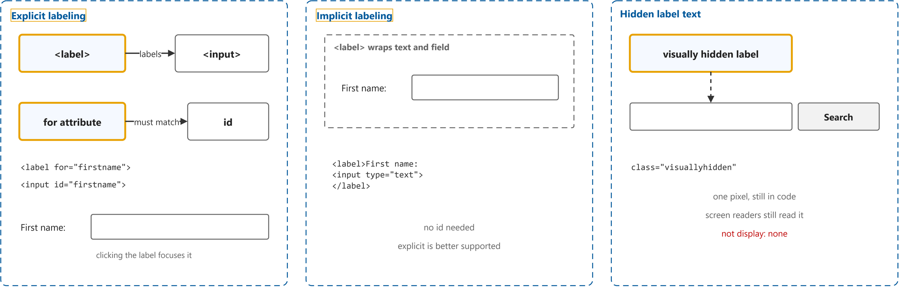
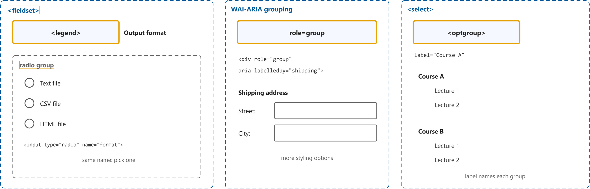
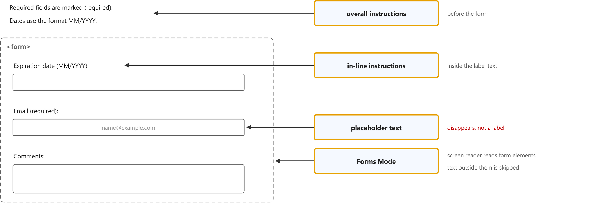
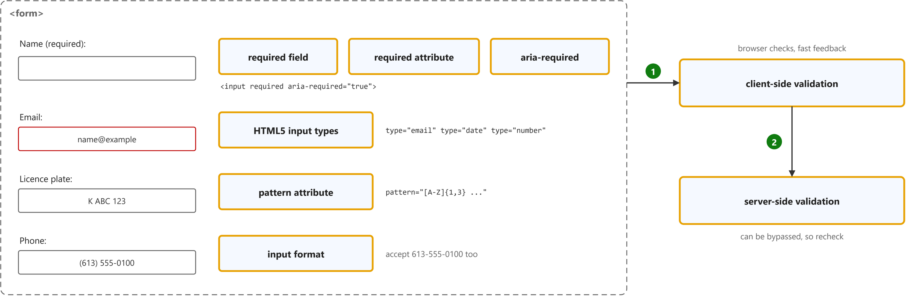
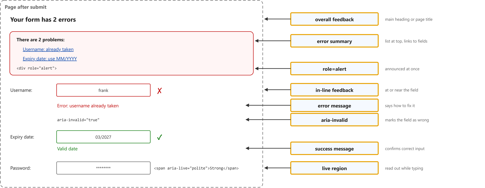

# Forms Tutorial

Study notes on [W3C WAI tutorial](https://www.w3.org/WAI/tutorials/forms/), which CST8914 Accessible by Design (Algonquin College, Fall 2026) uses in week 7. Each section follows one part of the source. Start from the figure: the framed terms are the ones to learn, and the table below it defines them in the same order, each with a citation linked to the passage.

## [Labeling Controls](https://www.w3.org/WAI/tutorials/forms/labels/)

| Term | Definition | 中文解释 | Source |
|---|---|---|---|
| **explicit labeling** (显式标签) | "Whenever possible, use the label element to associate text with form elements explicitly." | 显式标签是用 &lt;label for> 指向输入框 id，把文字和控件明确绑在一起的做法。点击标签文字就能聚焦输入框，屏幕阅读器读到输入框时会读出这段标签。 | [Eggert, 2024, "Associating labels explicitly" section, para. 1](https://www.w3.org/WAI/tutorials/forms/labels/#associating-labels-explicitly:~:text=Whenever%20possible%2C%20use%20the%20label%20element%20to%20associate%20text) |
| **`<label>`** (`<label>` 标签元素) | "Labels need to describe the purpose of the form control. ... Web browsers provide the label as a larger clickable area, for example, to select or activate the control." | &lt;label> 是写表单控件说明文字的 HTML 元素，告诉用户这个框要填什么。和控件关联后，点文字也能选中控件，屏幕阅读器会把它当作控件的名字读出来。 | [Eggert, 2024, para. 1 and para. 2](https://www.w3.org/WAI/tutorials/forms/labels/#:~:text=Labels%20need%20to%20describe%20the%20purpose%20of%20the%20form%20control) |
| **`for` attribute** (`for` 属性) | "The for attribute of the label must exactly match the id of the form control." | for 是 &lt;label> 上的属性，值写成目标控件的 id。两个值一字不差才算关联成功，否则屏幕阅读器读不到标签。 | [Eggert, 2024, "Associating labels explicitly" section, para. 1](https://www.w3.org/WAI/tutorials/forms/labels/#associating-labels-explicitly:~:text=The%20for%20attribute%20of%20the%20label%20must%20exactly%20match) |
| **implicit labeling** (隐式标签) | "In this case, the label element is used as a container for both the form control and the label text, so that the two are associated implicitly." *Note: The same paragraph adds that explicit labels are generally better supported by assistive technology.* | 隐式标签是把输入框直接放进 &lt;label> 里面，不用 for 和 id 也能关联。适合拿不到控件 id 的情况，但辅助技术对显式标签支持更好。 | [Eggert, 2024, "Associating labels implicitly" section, para. 1](https://www.w3.org/WAI/tutorials/forms/labels/#associating-labels-implicitly:~:text=the%20label%20element%20is%20used%20as%20a%20container%20for%20both) |
| **visually hidden label** (视觉隐藏标签) | "The label can be hidden visually, though it still needs to be provided within the code to support other forms of presentation and interaction, such as for screen reader and speech input users." *Note: The tutorial hides it with a CSS class that keeps it in a 1 by 1 pixel area; display: none and visibility: hidden would hide it from screen readers too.* | 视觉隐藏标签是屏幕上看不见、但代码里仍然存在的标签，比如搜索框旁边已有“搜索”按钮时。屏幕阅读器和语音输入用户仍能拿到这个标签。 | [Eggert, 2024, "Hiding label text" section, para. 1](https://www.w3.org/WAI/tutorials/forms/labels/#hiding-label-text:~:text=The%20label%20can%20be%20hidden%20visually%2C%20though%20it%20still) |

## [Grouping Controls](https://www.w3.org/WAI/tutorials/forms/grouping/)

| Term | Definition | 中文解释 | Source |
|---|---|---|---|
| **`<fieldset>`** (`<fieldset>` 字段组) | "Grouping needs to be carried out visually and in the code, for example, by using the &lt;fieldset> and &lt;legend> elements to associate related form controls." | &lt;fieldset> 是把一组相关表单控件包在一起的容器元素。屏幕阅读器进入这组控件时会知道它们属于同一个问题。 | [Eggert, 2026, para. 1](https://www.w3.org/WAI/tutorials/forms/grouping/#:~:text=Grouping%20needs%20to%20be%20carried%20out%20visually%20and%20in%20the%20code) |
| **`<legend>`** (`<legend>` 组标题) | "The &lt;fieldset> element provides a container for related form controls, and the &lt;legend> element acts as a heading to identify the group." | &lt;legend> 是 &lt;fieldset> 里的标题，说明这一组控件是关于什么的。屏幕阅读器会在读组内控件时把它一起读出来，所以要写得短。 | [Eggert, 2026, "Associating related controls with fieldset" section, para. 1](https://www.w3.org/WAI/tutorials/forms/grouping/#associating-related-controls-with-fieldset:~:text=element%20provides%20a%20container%20for%20related%20form%20controls) |
| **radio group** (单选按钮组) | "Radio button groups should always be grouped using &lt;fieldset>." | 单选按钮组是同一个问题下、name 相同、只能选一个的几个单选按钮。用 &lt;fieldset> 包起来后，屏幕阅读器用户能听到它们回答的是哪个问题。 | [Eggert, 2026, "Radio buttons" section, para. 1](https://www.w3.org/WAI/tutorials/forms/grouping/#radio-buttons:~:text=Radio%20button%20groups%20should%20always%20be%20grouped%20using) |
| **`role="group"`** (`role="group"` 分组角色) | "WAI-ARIA provides a grouping role that functions similarly to fieldset and legend." | role="group" 是 ARIA 的分组角色，配合 aria-labelledby 给一组控件起名，效果和 fieldset 加 legend 类似。它的好处是样式更自由。 | [Eggert, 2026, "Associating related controls with WAI-ARIA" section, para. 1](https://www.w3.org/WAI/tutorials/forms/grouping/#associating-related-controls-with-wai-aria:~:text=WAI%2DARIA%20provides%20a%20grouping%20role%20that%20functions%20similarly) |
| **`<optgroup>`** (`<optgroup>` 选项分组) | "For select elements with groups of options, the optgroup element can be used to indicate such groups." | &lt;optgroup> 是下拉框 &lt;select> 里把选项分组的元素，用 label 属性写组名。选项很多时，用户能先看组名再找选项。 | [Eggert, 2026, "Grouping items in select elements" section, para. 1](https://www.w3.org/WAI/tutorials/forms/grouping/#grouping-items-in-select-elements:~:text=For%20select%20elements%20with%20groups%20of%20options%2C%20the%20optgroup) |

## [Form Instructions](https://www.w3.org/WAI/tutorials/forms/instructions/)

| Term | Definition | 中文解释 | Source |
|---|---|---|---|
| **overall instructions** (整体说明) | "Where relevant, provide overall instructions that apply to the entire form. For example, indicate any required and optional input, allowed data formats, and timing limitations." | 整体说明是放在表单前面、对整张表都适用的说明，比如必填怎么标、日期格式、时间限制。放在 &lt;form> 之前，屏幕阅读器进入表单模式前就能读到。 | [Eggert, 2024, "Overall instructions" section, para. 1](https://www.w3.org/WAI/tutorials/forms/instructions/#overall-instructions:~:text=Where%20relevant%2C%20provide%20overall%20instructions%20that%20apply%20to%20the) |
| **in-line instructions** (行内说明) | "In addition to overall instructions, it is also important to provide relevant instructions within the labels of the form controls." | 行内说明是写在单个控件标签里的提示，比如“到期日 (MM/YYYY)”。屏幕阅读器读标签时就会一起读出格式要求。 | [Eggert, 2024, "In-line instructions" section, para. 1](https://www.w3.org/WAI/tutorials/forms/instructions/#in-line-instructions:~:text=In%20addition%20to%20overall%20instructions%2C%20it%20is%20also%20important) |
| **placeholder text** (占位文字) | "Placeholder text provides instructions or an example of the required data format inside form fields that have not yet been edited by the user." *Note: The next paragraph says placeholder text is not a replacement for labels.* | 占位文字是输入框里灰色的示例文字，一开始打字就消失。它对比度低、会消失，辅助技术也不把它当标签，所以不能代替 &lt;label>。 | [Eggert, 2024, "Placeholder text" section, para. 1](https://www.w3.org/WAI/tutorials/forms/instructions/#placeholder-text:~:text=Placeholder%20text%20provides%20instructions%20or%20an%20example%20of%20the) |
| **Forms Mode** (表单模式) | "Screen readers often switch to “Forms Mode” when they are processing content within a &lt;form> element. In this mode they usually only read aloud form elements such as &lt;input>, &lt;select>, &lt;textarea>, &lt;legend>, and &lt;label>." | 表单模式是屏幕阅读器进入 &lt;form> 后切换的模式，此时通常只读输入框、标签、legend 这类表单元素。夹在表单中间的普通段落说明可能被跳过，所以说明要放进标签或表单之前。 | [Eggert, 2024, Important note at the top](https://www.w3.org/WAI/tutorials/forms/instructions/#:~:text=when%20they%20are%20processing%20content%20within%20a) |

## [Validating Input](https://www.w3.org/WAI/tutorials/forms/validation/)

| Term | Definition | 中文解释 | Source |
|---|---|---|---|
| **required field** (必填字段) | "Forms frequently include required input that needs to be clearly identified using labels." | 必填字段是不填就不能提交的输入项。要在标签文字里写明“(required)”，不能只靠颜色或星号。 | [Eggert, 2019, "Validating required input" section, para. 1](https://www.w3.org/WAI/tutorials/forms/validation/#validating-required-input:~:text=Forms%20frequently%20include%20required%20input%20that%20needs%20to%20be) |
| **`required` attribute** (`required` 属性) | "Also, the required attribute can be added to form controls, to programmatically indicate that they are required." | required 是 HTML 的布尔属性，标记控件必须填写。浏览器会阻止空着提交，并弹出它自己的提示。 | [Eggert, 2019, "Validating required input" section, para. 1](https://www.w3.org/WAI/tutorials/forms/validation/#validating-required-input:~:text=the%20required%20attribute%20can%20be%20added%20to%20form%20controls) |
| **`aria-required`** (`aria-required` 必填状态) | "The aria-required attribute informs assistive technologies about required controls so that they are appropriately announced to the users (as opposed to validating the input)." | aria-required 是告诉辅助技术“这个控件必填”的 ARIA 属性。屏幕阅读器会读出“必填”，但它本身不做校验。 | [Eggert, 2019, "Validating required input" section, note under the example](https://www.w3.org/WAI/tutorials/forms/validation/#validating-required-input:~:text=attribute%20informs%20assistive%20technologies%20about%20required%20controls) |
| **HTML5 input types** (HTML5 输入类型) | "HTML5 also provides input types for other data, including email, url, number, range, date, or time." | HTML5 输入类型是 type="email"、"date"、"number" 这类专用的输入框类型。浏览器会帮着校验格式，手机上还会弹出对应的键盘或日期选择器。 | [Eggert, 2019, "Validating common input" section, para. 1](https://www.w3.org/WAI/tutorials/forms/validation/#validating-common-input:~:text=HTML5%20also%20provides%20input%20types%20for%20other%20data%2C%20including) |
| **`pattern` attribute** (`pattern` 属性) | "The HTML5 pattern attribute allows the use of regular expressions to specify custom formats for the input." | pattern 是用正则表达式规定输入格式的 HTML 属性，比如车牌号、邮编。格式不对时浏览器会拦下并提示。 | [Eggert, 2019, "Validating patterned input" section, para. 1](https://www.w3.org/WAI/tutorials/forms/validation/#validating-patterned-input:~:text=pattern%20attribute%20allows%20the%20use%20of%20regular%20expressions%20to) |
| **input format** (输入格式) | "Validation should aim to be as accommodating as possible of different forms of input for particular data types." | 输入格式是同一种数据的不同写法，比如电话号码用空格、横线或括号。校验应尽量都接受，用户不用猜系统要哪种写法。 | [Eggert, 2019, "Be forgiving of different input formats" section, para. 1](https://www.w3.org/WAI/tutorials/forms/validation/#be-forgiving-of-different-input-formats:~:text=Validation%20should%20aim%20to%20be%20as%20accommodating%20as%20possible) |
| **client-side validation** (客户端校验) | "In general, client-side validation results in a better user experience and makes resolving validation errors more understandable." | 客户端校验是在浏览器里、提交之前检查输入。反馈快、错误好懂，但可能被绕过。 | [Eggert, 2019, "Client-side validation benefits" section, para. 1](https://www.w3.org/WAI/tutorials/forms/validation/#client-side-validation-benefits:~:text=In%20general%2C%20client%2Dside%20validation%20results%20in%20a%20better%20user) |
| **server-side validation** (服务器端校验) | "Client-side validation alone does not ensure security; therefore data needs to be validated on the server-side as well." | 服务器端校验是数据到了服务器后再检查一遍。浏览器里的校验可以被绕过，所以服务器必须再查。 | [Eggert, 2019, para. 1](https://www.w3.org/WAI/tutorials/forms/validation/#:~:text=Client%2Dside%20validation%20alone%20does%20not%20ensure%20security) |

## [User Notification](https://www.w3.org/WAI/tutorials/forms/notifications/)

| Term | Definition | 中文解释 | Source |
|---|---|---|---|
| **overall feedback** (整体反馈) | "When a form is submitted, it is important that the user is notified whether the submission was successful or if errors occurred." | 整体反馈是提交后告诉用户“成功了”还是“有错”的总消息，常放在主标题、页面标题或对话框里。屏幕阅读器用户一打开新页面就能知道结果。 | [Eggert, 2022, "Overall feedback" section, para. 1](https://www.w3.org/WAI/tutorials/forms/notifications/#overall-feedback:~:text=When%20a%20form%20is%20submitted%2C%20it%20is%20important%20that%20the) |
| **error summary** (错误汇总) | "When errors occur, it is helpful to list them at the top of the page, before the form. The list should have a distinctive heading so that it is easy to identify." | 错误汇总是放在表单上方、列出所有错误的列表。每条错误写出字段名、怎么改，并链接到对应输入框，点一下就能跳过去。 | [Eggert, 2022, "Listing errors" section, para. 1](https://www.w3.org/WAI/tutorials/forms/notifications/#listing-errors:~:text=When%20errors%20occur%2C%20it%20is%20helpful%20to%20list%20them) |
| **`role="alert"`** (`role="alert"` 警告角色) | "In addition to the advice above, this container should have the role attribute set to alert to make assistive technology users aware of this change." | role="alert" 是 ARIA 的警告角色，加在动态插入的错误列表容器上。内容一出现，屏幕阅读器会马上读出来。 | [Eggert, 2022, "Listing errors" section, para. 2](https://www.w3.org/WAI/tutorials/forms/notifications/#listing-errors:~:text=this%20container%20should%20have%20the%20role%20attribute%20set%20to) |
| **in-line feedback** (行内反馈) | "In addition to overall feedback, more specific feedback at or near the form controls can better help users to use your form." | 行内反馈是显示在每个输入框旁边的具体提示，告诉用户这一项对还是错。要同时用文字和图标，不能只靠红绿颜色。 | [Eggert, 2022, "In-line feedback" section, para. 1](https://www.w3.org/WAI/tutorials/forms/notifications/#inline:~:text=In%20addition%20to%20overall%20feedback%2C%20more%20specific%20feedback%20at) |
| **error message** (错误消息) | "In particular, error messages should be easy to understand and should provide simple instructions on how they can be resolved." | 错误消息是说明哪里填错、该怎么改的文字。好的错误消息会写“请按 MM/YYYY 填写日期”，而不是只写“无效输入”。 | [Eggert, 2022, para. 1](https://www.w3.org/WAI/tutorials/forms/notifications/#:~:text=error%20messages%20should%20be%20easy%20to%20understand%20and%20should) |
| **`aria-invalid`** (`aria-invalid` 无效状态) | "Indicates the entered value does not conform to the format expected by the application." *Note: The tutorial lists it among related WCAG techniques as ARIA21, Using aria-invalid to Indicate An Error Field.* | aria-invalid 是标记“这个输入不合格”的 ARIA 状态，校验失败时由脚本设为 true。屏幕阅读器读到该输入框时会说它无效。 | [Diggs et al., 2023, "aria-invalid" section, para. 1](https://www.w3.org/TR/wai-aria-1.2/#aria-invalid:~:text=Indicates%20the%20entered%20value%20does%20not%20conform%20to%20the) |
| **success message** (成功消息) | "Success messages are also important to confirm task completion." | 成功消息是确认“已完成”或“这项填对了”的提示。用户不用猜操作有没有生效。 | [Eggert, 2022, para. 1](https://www.w3.org/WAI/tutorials/forms/notifications/#:~:text=Success%20messages%20are%20also%20important%20to%20confirm%20task%20completion) |
| **live region** (实时区域) | "The displayed message in this example is coded using a &lt;span> element that has an aria-live attribute with the value polite. The contents of this so called “live region” are conveyed to screen readers and other assistive technology." | 实时区域是带 aria-live 的页面区域，内容一变化就会被屏幕阅读器读出来，焦点不用移过去。值 polite 表示等用户空下来再读，不打断。 | [Eggert, 2022, "Binary messages" section, note under the example](https://www.w3.org/WAI/tutorials/forms/notifications/#binary-messages:~:text=The%20displayed%20message%20in%20this%20example%20is%20coded%20using) |
