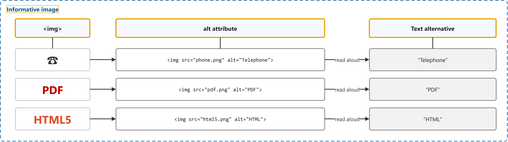
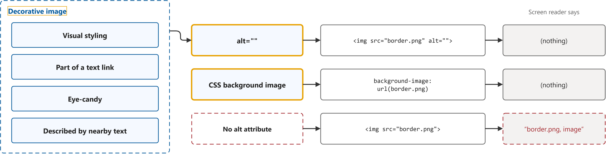
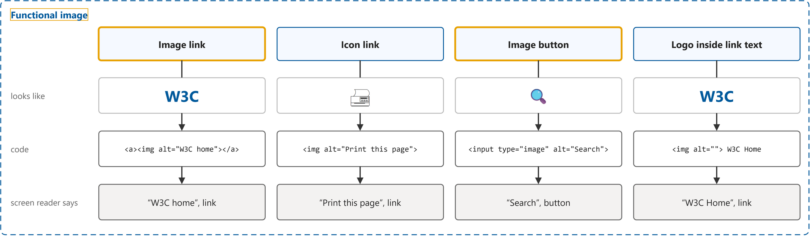
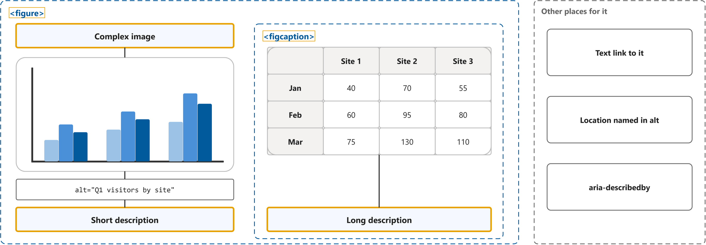
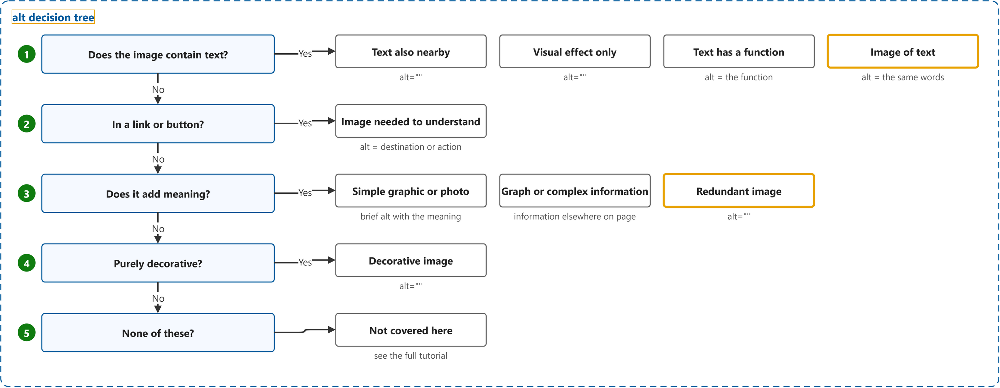

# Images Tutorial

Study notes on [W3C WAI tutorial](https://www.w3.org/WAI/tutorials/images/), which CST8914 Accessible by Design (Algonquin College, Fall 2026) uses in week 7. Each section follows one part of the source. Start from the figure: the framed terms are the ones to learn, and the table below it defines them in the same order, each with a citation linked to the passage.

## [Informative Images](https://www.w3.org/WAI/tutorials/images/informative/)

| Term | Definition | 中文解释 | Source |
|---|---|---|---|
| **informative image** (信息性图片) | "Informative images convey a simple concept or information that can be expressed in a short phrase or sentence. The text alternative should convey the meaning or content that is displayed visually, which typically isn’t a literal description of the image." | 信息性图片是传达一个简单意思的图片，一句短话就能说清，比如电话图标、一张说明拧瓶盖方向的小图。屏幕阅读器用户听到的 alt 要说出这张图想表达的意思，而不是逐字描述画面。 | [Eggert, 2019, "Overview" section, para. 1](https://www.w3.org/WAI/tutorials/images/informative/#:~:text=Informative%20images%20convey%20a%20simple%20concept%20or%20information%20that) |
| **``** (图片元素) | "The &lt;img> HTML element embeds an image into the document." | `` 是在网页里放一张图片的 HTML 元素，src 写图片地址，alt 写替代文字。屏幕阅读器遇到它时，念的是 alt 里的文字。 | [MDN contributors, n.d., para. 1](https://developer.mozilla.org/en-US/docs/Web/HTML/Reference/Elements/img#:~:text=element%20embeds%20an%20image%20into%20the%20document) |
| **alt attribute** (替代文本属性) | "Defines text that can replace the image in the page." | alt 属性是写在 `` 上的一段文字，图片看不到时用它代替图片。屏幕阅读器会把它念出来，图片加载失败时浏览器也会显示它。 | [MDN contributors, n.d., "Attributes" section, alt](https://developer.mozilla.org/en-US/docs/Web/HTML/Reference/Elements/img#alt:~:text=Defines%20text%20that%20can%20replace%20the%20image%20in%20the%20page) |
| **text alternative** (文本替代) | "Text that is programmatically associated with non-text content or referred to from text that is programmatically associated with non-text content." *Note: The Images Tutorial opens with the rule: images must have text alternatives that describe the information or function represented by them.* | 文本替代是和图片等非文字内容绑定在一起的文字，代替它传达同样的信息或功能。对图片来说最常见的就是 alt；看不见图的人听到这段文字，就能得到同样的内容。 | [W3C, 2024, "Glossary" section, entry "text alternative"](https://www.w3.org/TR/WCAG22/#glossary:~:text=Text%20that%20is%20programmatically%20associated%20with%20non%2Dtext%20content%20or%20referred) |

## [Decorative Images](https://www.w3.org/WAI/tutorials/images/decorative/)

| Term | Definition | 中文解释 | Source |
|---|---|---|---|
| **decorative image** (装饰性图片) | "Decorative images don’t add information to the content of a page. For example, the information provided by the image might already be given using adjacent text, or the image might be included to make the website more visually attractive." | 装饰性图片是不带任何信息、只为好看的图片，比如边框、分隔线、氛围照片，或者旁边文字已经说过的图。给它空 alt，屏幕阅读器就直接跳过，不打扰用户。 | [Eggert, 2019, "Overview" section, para. 1](https://www.w3.org/WAI/tutorials/images/decorative/#:~:text=add%20information%20to%20the%20content%20of%20a%20page) |
| **empty alt (alt="")** (空替代文本) | "In these cases, a null (empty) alt text should be provided (alt="") so that they can be ignored by assistive technologies, such as screen readers." *Note: Leaving out alt is not the same: without it, some screen readers announce the file name (same paragraph).* | 空 alt 是写了 alt 属性但引号里什么都没有（alt=""），意思是「这张图不用念」。屏幕阅读器会跳过这张图；如果干脆不写 alt，有的屏幕阅读器反而会念出图片文件名。 | [Eggert, 2019, "Overview" section, para. 2](https://www.w3.org/WAI/tutorials/images/decorative/#:~:text=In%20these%20cases%2C%20a%20null%20%28empty%29) |
| **CSS background image** (背景图) | "The background-image CSS property sets one or more background images on an element." *Note: Decorative Images, Overview, para. 4: where possible, decorative images should be provided using CSS background images.* | CSS 背景图是用 CSS 的 background-image 放上去的图，不写在 HTML 里。它不属于页面内容，屏幕阅读器不会念，所以纯装饰的图最好用这种方式放。 | [MDN contributors, n.d., para. 1](https://developer.mozilla.org/en-US/docs/Web/CSS/Reference/Properties/background-image#:~:text=CSS%20property%20sets%20one%20or%20more%20background%20images%20on%20an%20element) |

## [Functional Images](https://www.w3.org/WAI/tutorials/images/functional/)

| Term | Definition | 中文解释 | Source |
|---|---|---|---|
| **functional image** (功能性图片) | "Functional images are used to initiate actions rather than to convey information. They are used in buttons, links, and other interactive elements." | 功能性图片是用来点、用来操作的图片，比如当链接的 logo、打印图标、搜索按钮上的放大镜。它的 alt 要写点了以后做什么或去哪里（如「打印本页」），不写它长什么样（如「打印机」）。 | [Eggert, 2017, "Overview" section, para. 1](https://www.w3.org/WAI/tutorials/images/functional/#:~:text=Functional%20images%20are%20used%20to%20initiate%20actions%20rather%20than%20to%20convey) |
| **image link** (图片链接) | "The text alternative of an image used as a link or as a button should describe the functionality of the link or button rather than the visual image." | 图片链接是链接里只有一张图、没有文字的链接，比如点了回首页的 logo。这时图片的 alt 就是链接的名字，屏幕阅读器念「W3C home，链接」，所以要写目的地。 | [Eggert, 2026, list item "Functional images"](https://www.w3.org/WAI/tutorials/images/#:~:text=The%20text%20alternative%20of%20an%20image%20used%20as%20a%20link) |
| **image button** (图片按钮) | "&lt;input> elements of type image are used to create graphical submit buttons, i.e., submit buttons that take the form of an image rather than text." *Note: Functional Images, Example 5 uses &lt;input type="image" alt="Search">.* | 图片按钮是用一张图当提交按钮的表单控件（`<input type="image">`），比如放大镜搜索按钮。它的 alt 写按钮的作用，例如「Search」，屏幕阅读器会念成「Search，按钮」。 | [MDN contributors, n.d., para. 1](https://developer.mozilla.org/en-US/docs/Web/HTML/Reference/Elements/input/image#:~:text=elements%20of%20type%20image%20are%20used%20to%20create%20graphical%20submit%20buttons) |

## [Complex Images](https://www.w3.org/WAI/tutorials/images/complex/)

| Term | Definition | 中文解释 | Source |
|---|---|---|---|
| **`<figure>`** (图文容器) | "The &lt;figure> HTML element represents self-contained content, potentially with an optional caption, which is specified using the &lt;figcaption> element." | `<figure>` 是把一张图和它的说明包在一起的 HTML 元素。用它包住复杂图片和长描述，屏幕阅读器就知道两者是一组。 | [MDN contributors, n.d., para. 1](https://developer.mozilla.org/en-US/docs/Web/HTML/Reference/Elements/figure#:~:text=element%20represents%20self%2Dcontained%20content%2C%20potentially%20with%20an%20optional%20caption) |
| **complex image** (复杂图片) | "Complex images contain substantial information – more than can be conveyed in a short phrase or sentence." | 复杂图片是信息量很大、一句话说不完的图片，比如柱状图、流程图、组织结构图、地图。它需要两部分文字：一句短描述加一段长描述。 | [Eggert, 2026, "Overview" section, para. 1](https://www.w3.org/WAI/tutorials/images/complex/#:~:text=Complex%20images%20contain%20substantial%20information) |
| **short description** (短描述) | "The first part is the short description to identify the image and, where appropriate, indicate the location of the long description." | 短描述是写在 alt 里的一句话，说明这是一张什么图，必要时告诉用户详细说明在哪里。屏幕阅读器用户先听到它，再决定要不要去读长描述。 | [Eggert, 2026, "Overview" section, para. 2](https://www.w3.org/WAI/tutorials/images/complex/#:~:text=The%20first%20part%20is%20the%20short%20description%20to%20identify%20the%20image) |
| **`<figcaption>`** (图注) | "The &lt;figcaption> HTML element represents a caption or legend describing the rest of the contents of its parent &lt;figure> element, providing the &lt;figure> an accessible name." | `<figcaption>` 是写在 `<figure>` 里面的图注元素。复杂图片的长描述或指向长描述的链接可以放在这里，它也成为这组图文的名字。 | [MDN contributors, n.d., para. 1](https://developer.mozilla.org/en-US/docs/Web/HTML/Reference/Elements/figcaption#:~:text=element%20represents%20a%20caption%20or%20legend%20describing%20the%20rest%20of%20the%20contents) |
| **long description** (长描述) | "The second part is the long description – a textual representation of the essential information conveyed by the image." | 长描述是把复杂图片里的关键信息完整写成文字，比如图表的数值、趋势和对比。它可以放在正文、旁边的链接页或 `<figcaption>` 里，所有人都能读。 | [Eggert, 2026, "Overview" section, para. 2](https://www.w3.org/WAI/tutorials/images/complex/#:~:text=The%20second%20part%20is%20the%20long%20description) |

## [An alt Decision Tree](https://www.w3.org/WAI/tutorials/images/decision-tree/)

| Term | Definition | 中文解释 | Source |
|---|---|---|---|
| **alt decision tree** (替代文本决策树) | "This decision tree describes how to use the alt attribute of the &lt;img> element in various situations." | alt 决策树是一串按顺序问的是非题（图里有字吗？在链接或按钮里吗？带意思吗？纯装饰吗？），帮你判断一张图属于哪一类、alt 该怎么写。从第一题往下问，答「是」就停在那一类。 | [Eggert, 2024, "Overview" section, para. 1](https://www.w3.org/WAI/tutorials/images/decision-tree/#:~:text=This%20decision%20tree%20describes%20how%20to%20use%20the%20alt%20attribute) |
| **image of text** (文字图片) | "Readable text is sometimes presented within an image. If the image is not a logo, avoid text in images. However, if images of text are used, the text alternative should contain the same words as in the image." | 文字图片是把一段可读的文字做成了图片，比如做成图的标语。能用真文字就别用图；如果用了，alt 要写和图里一模一样的字，屏幕阅读器才能念出来。 | [Eggert, 2026, list item "Images of text"](https://www.w3.org/WAI/tutorials/images/#:~:text=Readable%20text%20is%20sometimes%20presented%20within%20an%20image) |
| **redundant image** (冗余图片) | "If the text included an explanation of how the dog wears a bell, the image might be considered redundant and therefore decorative." *Note: In the decision tree: an image that shows content redundant to real text nearby gets an empty alt attribute.* | 冗余图片是内容已经被旁边真文字说过一遍的图片。它给不了新信息，所以按装饰图处理，用空 alt，免得屏幕阅读器把同样的话念两遍。 | [Eggert, 2019, "Example 2: Images used to supplement other information" section, para. 3](https://www.w3.org/WAI/tutorials/images/informative/#example-2-images-used-to-supplement-other-information:~:text=If%20the%20text%20included%20an%20explanation%20of%20how%20the%20dog) |
