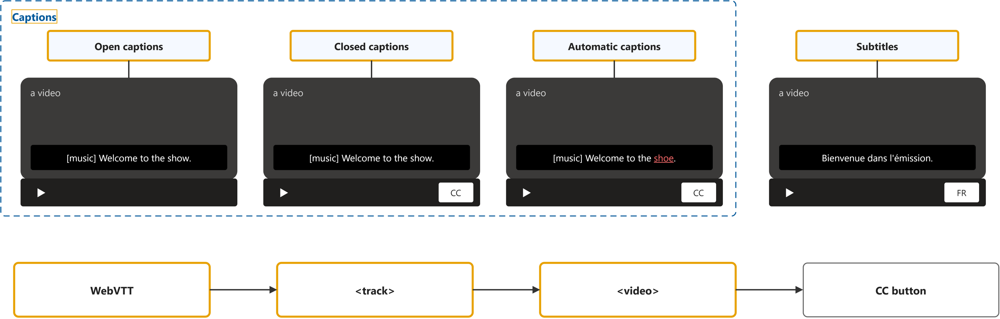
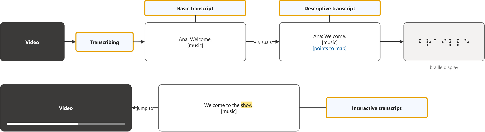
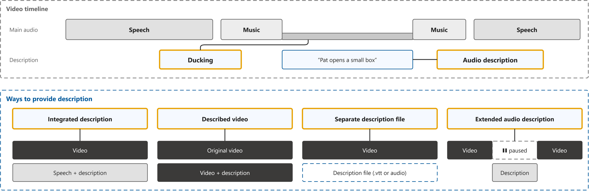
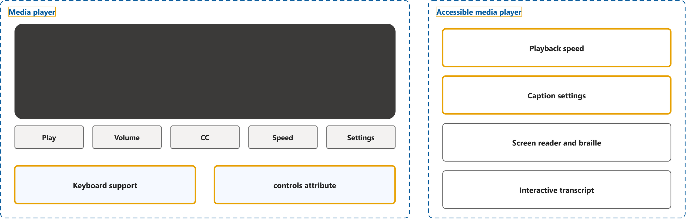

# Making Audio and Video Media Accessible

Study notes on [W3C WAI guide](https://www.w3.org/WAI/media/av/), which CST8914 Accessible by Design (Algonquin College, Fall 2026) uses in week 7. Each section follows one part of the source. Start from the figure: the framed terms are the ones to learn, and the table below it defines them in the same order, each with a citation linked to the passage.

## [Captions/Subtitles](https://www.w3.org/WAI/media/av/captions/)

| Term | Definition | 中文解释 | Source |
|---|---|---|---|
| **captions** (字幕（同语言）) | "Captions are a text version of the speech and non-speech audio information needed to understand the content. They are synchronized with the audio and usually shown in a media player when users turn them on." | 字幕是把视频里的说话和有意义的声音（如 [音乐]、[掌声]）写成文字，和声音同步出现在播放器里。给听不见的人用，他们靠读字幕获得声音里的内容。 | [Henry, 2024, introductory para. 1](https://www.w3.org/WAI/media/av/captions/#:~:text=Captions%20are%20a%20text%20version%20of%20the%20speech%20and%20non%2Dspeech) |
| **subtitles** (字幕（翻译）) | "Subtitles for spoken audio translated into another language." *Note: The same section notes that some regions use subtitles for both meanings.* | 这里的 subtitles 指把对白翻译成另一种语言的字幕，主要给听得见但听不懂这种语言的人。它的做法和 captions 一样，但本身不算无障碍措施。 | [Henry, 2024, "Captions and Subtitles" section, bullet 2](https://www.w3.org/WAI/media/av/captions/#captions-and-subtitles:~:text=Subtitles%20for%20spoken%20audio%20translated%20into%20another%20language) |
| **automatic captions** (自动字幕) | "Automatically-generated captions do not meet user needs or accessibility requirements, unless they are confirmed to be fully accurate. Usually they need significant editing." | 自动字幕是语音识别软件自己生成的字幕。它常常听错词（少一个 not 意思就反了），只能当草稿，人工校对到完全准确才算数。 | [Henry, 2024, "Automatic Captions are Not Sufficient" section, para. 1](https://www.w3.org/WAI/media/av/captions/#automatic-captions-are-not-sufficient:~:text=Automatically%2Dgenerated%20captions%20do%20not%20meet%20user%20needs%20or%20accessibility%20requirements) |
| **closed captions** (可关闭字幕) | "Most are “closed captions” that can be hidden or shown by people watching the video." | 可关闭字幕是观众自己按 CC 按钮打开或关闭的字幕，是网上视频最常见的形式。字幕放在单独的文件里，不烧进画面。 | [Henry, 2024, "Introduction" section, para. 3](https://www.w3.org/WAI/media/av/captions/#introduction:~:text=that%20can%20be%20hidden%20or%20shown%20by%20people%20watching%20the%20video) |
| **open captions** (开放字幕) | "They can be “open captions” that are always displayed and cannot be turned off." | 开放字幕是直接做进画面里的字幕，一直显示，观众关不掉。好处是任何播放器都能看到，坏处是不能调大小、颜色。 | [Henry, 2024, "Introduction" section, para. 3](https://www.w3.org/WAI/media/av/captions/#introduction:~:text=that%20are%20always%20displayed%20and%20cannot%20be%20turned%20off) |
| **WebVTT** (字幕格式) | "The most common format for captions on the web is WebVTT: The Web Video Text Tracks Format." | WebVTT 是网页上最常用的字幕文件格式（.vtt），每段文字前写开始和结束时间。播放器按这些时间把字幕显示在画面上。 | [Henry, 2024, "Caption File Format" section, para. 1](https://www.w3.org/WAI/media/av/captions/#caption-file-format:~:text=The%20most%20common%20format%20for%20captions%20on%20the%20web%20is%20WebVTT) |
| **`<track>`** (文字轨道元素) | "The &lt;track> HTML element is used as a child of the media elements, &lt;audio> and &lt;video>. Each track element lets you specify a timed text track (or time-based data) that can be displayed in parallel with the media element, for example to overlay subtitles or closed captions on top of a video or alongside audio tracks." | `<track>` 是写在 `<video>` 里面、挂上字幕文件的 HTML 元素，kind="captions" 表示字幕，src 指向 .vtt 文件，srclang 写语言。有了它，播放器的 CC 按钮才有字幕可开。 | [MDN contributors, n.d., para. 1](https://developer.mozilla.org/en-US/docs/Web/HTML/Reference/Elements/track#:~:text=element%20is%20used%20as%20a%20child%20of%20the%20media%20elements) |
| **`<video>`** (视频元素) | "The &lt;video> HTML element embeds a media player which supports video playback into the document." | `<video>` 是在网页里放视频播放器的 HTML 元素，里面用 `<source>` 写视频文件，用 `<track>` 挂字幕。加上 controls 属性，浏览器才显示播放按钮。 | [MDN contributors, n.d., para. 1](https://developer.mozilla.org/en-US/docs/Web/HTML/Reference/Elements/video#:~:text=element%20embeds%20a%20media%20player%20which%20supports%20video%20playback) |

## [Transcripts](https://www.w3.org/WAI/media/av/transcripts/)

| Term | Definition | 中文解释 | Source |
|---|---|---|---|
| **transcribing** (听写转录) | "Get a text version of the audio, called “transcribing”." | 听写转录就是把音频里的话一句句打成文字。它是做字幕和文字稿的第一步，很费时间，所以很多机构外包。 | [Henry, 2024, "Process – Skills and Tools" section, step 1](https://www.w3.org/WAI/media/av/transcripts/#process-skills-and-tools:~:text=Get%20a%20text%20version%20of%20the%20audio) |
| **transcript** (文字稿) | "Basic transcripts are a text version of the speech and non-speech audio information needed to understand the content." | 文字稿（基本文字稿）是把音频里的说话和重要声音整理成一篇可以单独阅读的文字，通常放在视频下面。听不见的人、听不清的人都可以直接读它。 | [Henry, 2024, introductory para. 1](https://www.w3.org/WAI/media/av/transcripts/#:~:text=Basic%20transcripts%20are%20a%20text%20version%20of%20the%20speech%20and) |
| **descriptive transcript** (描述性文字稿) | "Descriptive transcripts also include text description of the visual information needed to understand the content." *Note: The same paragraph: descriptive transcripts are required to provide video content to people who are both Deaf and blind.* | 描述性文字稿是在文字稿里再加上画面上的重要信息（谁出场、屏幕上出现什么字）。又聋又盲的人用盲文显示器读它，才能同时得到声音和画面的内容。 | [Henry, 2024, introductory para. 1](https://www.w3.org/WAI/media/av/transcripts/#:~:text=Descriptive%20transcripts%20also%20include%20text%20description%20of%20the%20visual%20information) |
| **interactive transcript** (交互式文字稿) | "Interactive transcripts highlight text phrases as they are spoken. Users can select text in the transcript and go to that point in the video." | 交互式文字稿是跟着视频播放、念到哪句就高亮哪句的文字稿，点一句话视频就跳到那里。它是播放器的功能，用的就是字幕文件。 | [Henry, 2024, "Introduction" section, para. 6](https://www.w3.org/WAI/media/av/transcripts/#introduction:~:text=Interactive%20transcripts%20highlight%20text%20phrases%20as%20they%20are%20spoken) |

## [Description of Visual Information](https://www.w3.org/WAI/media/av/description/)

| Term | Definition | 中文解释 | Source |
|---|---|---|---|
| **audio description** (口述影像) | "Description provides content to people who are blind and others who cannot see the video adequately. It describes visual information needed to understand the content, including text displayed in the video." *Note: Terminology section: description provided via audio is called "audio description" in WCAG, also "video description" or "described video".* | 口述影像是用声音把视频画面里的重要信息讲出来，比如「她打开盒子，看到一枚戒指，哭了」。看不见画面的人靠它知道发生了什么；WCAG 里叫 audio description。 | [Henry, 2024, introductory para. 2](https://www.w3.org/WAI/media/av/description/#:~:text=Description%20provides%20content%20to%20people%20who%20are%20blind) |
| **ducking** (压低主音（闪避）) | "Make the description clear above other noises. When mixing the descriptions with the main audio, lower the main audio level when the description plays and raise the description audio level. When the description is finished playing, lower the description audio level and raise the main audio level to its normal setting. Repeat this process (known as “ducking”) for every description instance." | ducking 是混音时的做法：口述影像响起时把原来的声音调小，讲完再调回去。这样描述的声音不会被背景音乐盖住，盲人用户听得清。 | [Henry, 2024, "Tips for Combining Audio Files" section, para. 2](https://www.w3.org/WAI/media/av/description/#combining:~:text=Make%20the%20description%20clear%20above%20other%20noises) |
| **integrated description** (融入式描述) | "integrated description — description is included in the main speakers’ scripts" | 融入式描述是讲者在录视频时就把画面内容说出来（如「我现在点右上角的设置」），不需要另加一条描述音轨。最适合培训和教学视频，也最省钱。 | [Henry, 2024, "Introduction" section, bullet 1](https://www.w3.org/WAI/media/av/description/#introduction:~:text=description%20is%20included%20in%20the%20main%20speakers) |
| **described video** (带描述的视频) | "This resource uses “described video” in some places as a shortened form of “a video that includes description of the visual information in audio”." | 带描述的视频是另做一版视频，把口述影像直接混进音轨里，通常换一个声音来讲，和原声区分开。网页上同时提供原版和带描述版两个视频。 | [Henry, 2024, "Terminology" section, para. 2](https://www.w3.org/WAI/media/av/description/#terminology:~:text=in%20some%20places%20as%20a%20shortened%20form%20of) |
| **separate description file** (单独描述文件) | "separate file — description is in a timed text file or synched audio file; must be supported by the media player" | 单独描述文件是把描述放在一个带时间的文字文件（如 WebVTT）或同步的音频文件里，视频本身不改。播放器要支持这种文件，才能在合适的时间念出或播放描述。 | [Henry, 2024, "Introduction" section, bullet 3](https://www.w3.org/WAI/media/av/description/#introduction:~:text=description%20is%20in%20a%20timed%20text%20file%20or%20synched%20audio%20file) |
| **extended audio description** (扩展口述影像) | "audio description that is added to an audiovisual presentation by pausing the video so that there is time to add additional description" | 扩展口述影像是在说话之间的空隙不够时，让视频先暂停、讲完描述再继续播放。这样再长的画面说明也能放进去，WCAG 1.2.7（AAA）要求它。 | [W3C, 2024, "Glossary" section, entry "extended audio description"](https://www.w3.org/TR/WCAG22/#glossary:~:text=audio%20description%20that%20is%20added%20to%20an%20audiovisual%20presentation%20by%20pausing) |

## [Media Players](https://www.w3.org/WAI/media/av/player/)

| Term | Definition | 中文解释 | Source |
|---|---|---|---|
| **media player** (媒体播放器) | "Modern browsers provide a default media player. Most have limited functionality to support accessibility." | 媒体播放器是网页上播放音频视频的那组界面：画面加上播放、音量、字幕等按钮。浏览器自带一个，但无障碍功能有限，所以通常选专门做过无障碍的播放器。 | [Henry, 2024, "Introduction" section, para. 1](https://www.w3.org/WAI/media/av/player/#introduction:~:text=Modern%20browsers%20provide%20a%20default%20media%20player) |
| **keyboard support** (键盘操作支持) | "Provide keyboard support" *Note: The same list also asks for a visible keyboard focus indicator, clear labels and enough colour contrast.* | 键盘操作支持是指播放器的每个按钮都能用 Tab 走到、用 Enter 或空格按下，不用鼠标。用键盘、语音输入或屏幕阅读器的人才能播放、暂停、开字幕。 | [Henry, 2024, "Player Accessibility Functionality" section, bullet 1](https://www.w3.org/WAI/media/av/player/#player-accessibility-functionality:~:text=Provide%20keyboard%20support) |
| **`controls` attribute** (播放控件属性) | "If this attribute is present, the browser will offer controls to allow the user to control video playback, including volume, seeking, and pause/resume playback." | controls 属性写在 `<video>` 上，让浏览器显示自带的播放、音量、进度条按钮。不写它视频就没有控制按钮；写了也要实际用键盘和屏幕阅读器测一下。 | [MDN contributors, n.d., "Attributes" section, controls](https://developer.mozilla.org/en-US/docs/Web/HTML/Reference/Elements/video#controls:~:text=If%20this%20attribute%20is%20present%2C%20the%20browser%20will%20offer%20controls) |
| **accessible media player** (无障碍媒体播放器) | "Accessible media players provide a user interface that works without a mouse, through speech interface, when the page is zoomed larger, and with screen readers." | 无障碍媒体播放器是专门为残障用户做好的播放器（如 AblePlayer），不用鼠标、用语音、放大页面或用屏幕阅读器都能操作。通常直接用现成的，比自己写省事。 | [Henry, 2024, "Player Accessibility Functionality" section, para. 1](https://www.w3.org/WAI/media/av/player/#player-accessibility-functionality:~:text=Accessible%20media%20players%20provide%20a%20user%20interface%20that%20works%20without%20a%20mouse) |
| **playback speed** (播放速度) | "Changing the speed of the video" | 播放速度是让用户把视频放慢或加快的设置。阅读或理解较慢的人可以放慢，跟上字幕和画面。 | [Henry, 2024, "Player Accessibility Functionality" section, second list, bullet 1](https://www.w3.org/WAI/media/av/player/#player-accessibility-functionality:~:text=Changing%20the%20speed%20of%20the%20video) |
| **caption settings** (字幕显示设置) | "Setting how captions are displayed (e.g., text style, text size, colors, and position of the captions)" | 字幕显示设置是让用户自己调字幕的字体、大小、颜色和位置。低视力的人可以把字放大、换成高对比颜色。 | [Henry, 2024, "Player Accessibility Functionality" section, second list, bullet 2](https://www.w3.org/WAI/media/av/player/#player-accessibility-functionality:~:text=Setting%20how%20captions%20are%20displayed) |
