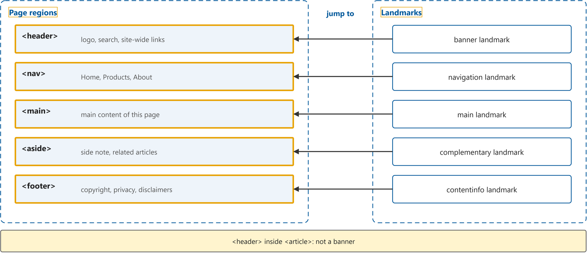
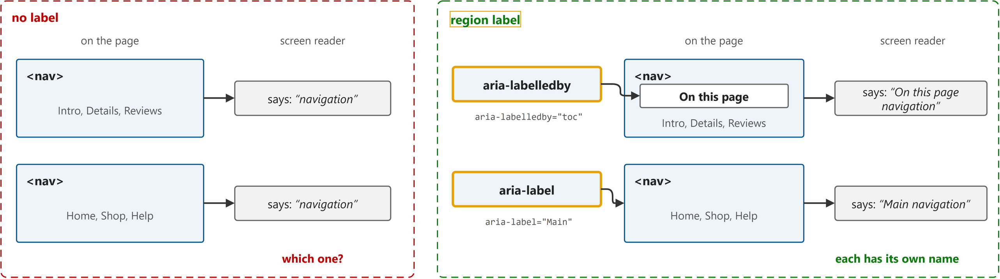
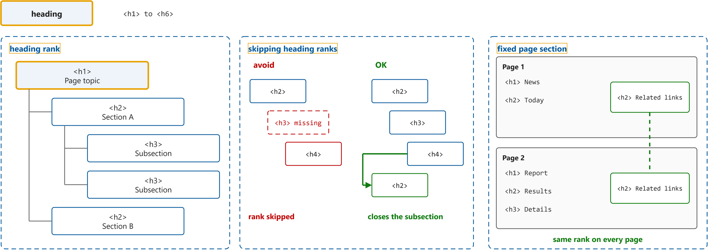
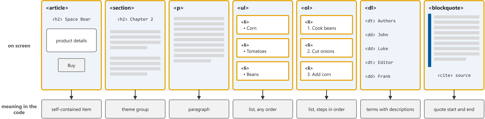

# Page Structure Tutorial

Study notes on [W3C WAI tutorial](https://www.w3.org/WAI/tutorials/page-structure/), which CST8914 Accessible by Design (Algonquin College, Fall 2026) uses in week 7. Each section follows one part of the source. Start from the figure: the framed terms are the ones to learn, and the table below it defines them in the same order, each with a citation linked to the passage.

## [Page Regions](https://www.w3.org/WAI/tutorials/page-structure/regions/)

| Term | Definition | 中文解释 | Source |
|---|---|---|---|
| **page region** (页面区域) | "Mark up different regions of web pages and applications, so that they can be identified by web browsers and assistive technologies." *Note: The tutorial covers five regions: page header, page footer, navigation, main content and complementary content.* | 页面区域是网页里各管一件事的大块，比如页头、导航、主要内容、侧栏和页脚。用对应的 HTML 元素标出来以后，屏幕阅读器用户可以直接跳到想去的那一块。 | [Eggert, 2026, "Overview" section, para. 1](https://www.w3.org/WAI/tutorials/page-structure/regions/#:~:text=Mark%20up%20different%20regions%20of%20web%20pages%20and%20applications) |
| **landmark** (地标) | "A type of region on a page to which the user may want quick access. Content in such a region is different from that of other regions on the page and relevant to a specific user purpose, such as navigating, searching, perusing the primary content, etc." | 地标是辅助技术认得的页面区域，比如 banner、navigation、main。屏幕阅读器用户打开地标列表，就能直接跳到某一块，不用从头一行行听。 | [Diggs & Nurthen, 2023, "2. Important Terms" section, Landmark](https://www.w3.org/TR/wai-aria-1.2/#dfn-landmark:~:text=A%20type%20of%20region%20on%20a%20page%20to%20which) |
| **`<header>`** (页头) | "Most websites have a region at the top of every page that contains site-wide information, such as the website logo, search function, and navigation options. HTML5 provides the `<header>` element, which can be used to define such a region." | `<header>` 是标出页面最上方页头的元素，里面放整站共用的东西，比如 logo、搜索框和导航。屏幕阅读器会把页面级的页头报成 banner 地标；放在 `<article>` 或 `<section>` 里的 `<header>` 不算。 | [Eggert, 2026, "Page header" section, para. 1](https://www.w3.org/WAI/tutorials/page-structure/regions/#page-header:~:text=Most%20websites%20have%20a%20region%20at%20the%20top%20of) |
| **`<nav>`** (导航区) | "The HTML5 `<nav>` element can be used to identify a navigation menu. A web page can have any number of navigation menus." | `<nav>` 是标出导航菜单的元素，一页可以有好几个。屏幕阅读器用户能在地标列表里看到它并直接跳过去；有多个时要给每个加标签来区分。 | [Eggert, 2026, "Navigation" section, para. 1](https://www.w3.org/WAI/tutorials/page-structure/regions/#navigation:~:text=The%20HTML5%20%3Cnav%3E%20element%20can%20be%20used%20to%20identify) |
| **`<main>`** (主要内容区) | "Use the HTML5 `<main>` element to identify the main content region of a web page or application." | `<main>` 是标出这一页主要内容的元素。屏幕阅读器用户可以一下跳到这里，跳过页头和导航。 | [Eggert, 2026, "Main content" section, para. 1](https://www.w3.org/WAI/tutorials/page-structure/regions/#main-content:~:text=Use%20the%20HTML5%20%3Cmain%3E%20element%20to%20identify%20the%20main) |
| **`<aside>`** (补充内容区) | "Use the HTML5 `<aside>` element to identify regions that support the main content, yet are separate and meaningful sections on their own; For example, a side note explaining or annotating the main content." | `<aside>` 是标出补充内容的元素，比如旁注或相关文章，它配合主要内容，但单独看也有意义。屏幕阅读器把它报成 complementary 地标。 | [Eggert, 2026, "Complementary content" section, para. 1](https://www.w3.org/WAI/tutorials/page-structure/regions/#complementary-content:~:text=Use%20the%20HTML5%20%3Caside%3E%20element%20to%20identify%20regions%20that) |
| **`<footer>`** (页脚) | "Similar to the page header, most websites also have a region at the bottom of every page that contains site-wide information, such as copyright information, privacy statements, or disclaimers. HTML5 provides the `<footer>` element, which can be used to define such a region." | `<footer>` 是标出页面最下方页脚的元素，里面放版权、隐私声明这类整站信息。页面级的页脚会被报成 contentinfo 地标；放在 `<article>` 或 `<section>` 里的不算。 | [Eggert, 2026, "Page footer" section, para. 1](https://www.w3.org/WAI/tutorials/page-structure/regions/#page-footer:~:text=Similar%20to%20the%20page%20header%2C%20most%20websites%20also%20have) |

## [Labeling Regions](https://www.w3.org/WAI/tutorials/page-structure/labels/)

| Term | Definition | 中文解释 | Source |
|---|---|---|---|
| **region label** (区域标签) | "Provide labels to distinguish two page regions of the same type, such as “main navigation” and “sub-navigation” menus using a `<nav>` element on the same page." *Note: Unique regions such as `<main>` need no extra label.* | 区域标签是给页面区域起的名字，用来区分同一页里两个同类区域，比如两个 `<nav>`。屏幕阅读器会连名字一起念，比如“Main navigation”。 | [Eggert, 2017, "Overview" section, para. 1](https://www.w3.org/WAI/tutorials/page-structure/labels/#:~:text=Provide%20labels%20to%20distinguish%20two%20page%20regions%20of%20the) |
| **aria-labelledby** (引用标签属性) | "Use `aria-labelledby` to point to an existing element by its (unique) `id`. The label of the region is the content of the referenced element." | aria-labelledby 是一个属性，它指向页面上另一个元素的 id，用那个元素的文字当这个区域的名字。常见做法是指向区域里的标题，这样看得见的标题和屏幕阅读器念的名字一致。 | [Eggert, 2017, "Using aria-labelledby" section, para. 1](https://www.w3.org/WAI/tutorials/page-structure/labels/#using-aria-labelledby:~:text=Use%20aria%2Dlabelledby%20to%20point%20to%20an%20existing%20element%20by) |
| **aria-label** (标签属性) | "Use the WAI-ARIA `aria-label` attribute to label the region. Consider this approach if the label should not appear visually on the page." | aria-label 是一个属性，直接把名字写在属性值里。名字不显示在屏幕上，只有屏幕阅读器会念出来。 | [Eggert, 2017, "Using aria-label" section, para. 1](https://www.w3.org/WAI/tutorials/page-structure/labels/#using-aria-label:~:text=Use%20the%20WAI%2DARIA%20aria%2Dlabel%20attribute%20to%20label%20the%20region) |

## [Headings](https://www.w3.org/WAI/tutorials/page-structure/headings/)

| Term | Definition | 中文解释 | Source |
|---|---|---|---|
| **heading** (标题) | "Headings communicate the organization of the content on the page. Web browsers, plug-ins, and assistive technologies can use them to provide in-page navigation." | 标题是一段内容上方说明主题的文字，用 `<h1>` 到 `<h6>` 标出。屏幕阅读器用户可以按标题在页面里跳来跳去，先听一遍标题就知道页面讲什么。 | [Eggert, 2017, "Overview" section, para. 1](https://www.w3.org/WAI/tutorials/page-structure/headings/#:~:text=Headings%20communicate%20the%20organization%20of%20the%20content%20on%20the) |
| **heading rank** (标题级别) | "Nest headings by their rank (or level). The most important heading has the rank 1 (`<h1>`), the least important heading rank 6 (`<h6>`)." *Note: Also called heading level.* | 标题级别是 1 到 6 的数字，数字越小越重要。级别相同或更高的标题开始新的一节，级别更低的标题开始它下面的小节，屏幕阅读器用户靠它听出层次。 | [Eggert, 2017, "Heading ranks" section, para. 1](https://www.w3.org/WAI/tutorials/page-structure/headings/#heading-ranks:~:text=Nest%20headings%20by%20their%20rank%20%28or%20level%29.%20The%20most) |
| **`<h1>`** (一级标题) | "The `<h1>` to `<h6>` HTML elements represent six levels of section headings. `<h1>` is the highest section level and `<h6>` is the lowest." | `<h1>` 是级别最高的标题元素，通常是这一页的主标题。屏幕阅读器用户常按 1 直接跳到它，听到这一页讲什么。 | [MDN contributors, 2026, para. 1](https://developer.mozilla.org/en-US/docs/Web/HTML/Reference/Elements/Heading_Elements#:~:text=The%20%3Ch1%3E%20to%20%3Ch6%3E%20HTML%20elements%20represent%20six%20levels) |
| **skipping heading ranks** (跳级标题) | "Skipping heading ranks can be confusing and should be avoided where possible: Make sure that a `<h2>` is not followed directly by an `<h4>`, for example." | 跳级标题是指标题级别中间漏了一级，比如 `<h2>` 后面直接是 `<h4>`。屏幕阅读器用户会以为漏听了一节；但关掉小节回到 `<h2>` 是可以的。 | [Eggert, 2017, "Heading ranks" section, para. 2](https://www.w3.org/WAI/tutorials/page-structure/headings/#heading-ranks:~:text=Skipping%20heading%20ranks%20can%20be%20confusing%20and%20should%20be) |
| **fixed page section** (固定页面区块) | "In fixed sections of the page, for example in sidebars, the heading ranks should not change depending on the ranks in the content area. In those cases, consistency across pages is more important." | 固定页面区块是每页都出现的部分，比如侧栏。它里面的标题级别每页保持一样，不跟着主要内容变，用户换页后还能在同样的级别找到它。 | [Eggert, 2017, "Exception for fixed page sections" section, para. 1](https://www.w3.org/WAI/tutorials/page-structure/headings/#exception-for-fixed-page-sections:~:text=In%20fixed%20sections%20of%20the%20page%2C%20for%20example%20in) |

## [Content Structure](https://www.w3.org/WAI/tutorials/page-structure/content/)

| Term | Definition | 中文解释 | Source |
|---|---|---|---|
| **`<article>`** (独立文章) | "The HTML5 `<article>` element represents a complete or self-contained composition in a web page. Examples of articles include an item at a shopping site or a news article on a news site." | `<article>` 是包住一篇完整、单独拿出去也能看懂的内容的元素，比如一条新闻或一个商品。屏幕阅读器可以告诉用户一篇从哪里开始、到哪里结束。 | [Eggert, 2026, "Articles" section, para. 1](https://www.w3.org/WAI/tutorials/page-structure/content/#articles:~:text=The%20HTML5%20%3Carticle%3E%20element%20represents%20a%20complete%20or%20self%2Dcontained) |
| **`<section>`** (主题区块) | "The HTML5 `<section>` element marks a general region of a web page or an article. It is used for thematic grouping of content." | `<section>` 是把同一主题的内容放在一起的元素，通常以一个标题开头。它让页面按主题分块，读起来有层次。 | [Eggert, 2026, "Sections" section, para. 1](https://www.w3.org/WAI/tutorials/page-structure/content/#sections:~:text=The%20HTML5%20%3Csection%3E%20element%20marks%20a%20general%20region%20of) |
| **`
`** (段落) | "Use the paragraph element (`
`) to mark up paragraphs of text, such as this one. The consistent styling of paragraphs improves text readability. It also gives users more control when customizing their view." | `
` 是段落元素，一段文字放一个 `
`。段落样式统一更好读，用户也能自己调整段落的显示。 | [Eggert, 2026, "Paragraphs" section, para. 1](https://www.w3.org/WAI/tutorials/page-structure/content/#paragraphs:~:text=Use%20the%20paragraph%20element%20%28%3Cp%3E%29%20to%20mark%20up%20paragraphs) |
| **`<ul>`** (无序列表) | "Unordered lists are used when the order of the items is not relevant. List items in unordered lists are marked with a bullet." | `<ul>` 是无序列表元素，项目之间没有先后顺序，前面显示圆点。屏幕阅读器会说“列表，3 项”，用户先知道有多少项。 | [Eggert, 2026, "Lists" section, bullet 1](https://www.w3.org/WAI/tutorials/page-structure/content/#lists:~:text=Unordered%20lists%20are%20used%20when%20the%20order%20of%20the) |
| **`<li>`** (列表项) | "The li element represents a list item." | `<li>` 是列表里的一项，放在 `<ul>` 或 `<ol>` 里面。屏幕阅读器会念出这是第几项、一共几项。 | [WHATWG, 2026, "4.4.8 The li element" section, para. 1](https://html.spec.whatwg.org/multipage/grouping-content.html#the-li-element:~:text=The%20li%20element%20represents%20a%20list%20item) |
| **`<ol>`** (有序列表) | "Ordered lists are used for sequential information and are automatically enumerated by the browser." | `<ol>` 是有序列表元素，用于有先后顺序的内容，比如步骤，浏览器自动编号。屏幕阅读器用户能听到每一步的序号。 | [Eggert, 2026, "Lists" section, bullet 2](https://www.w3.org/WAI/tutorials/page-structure/content/#lists:~:text=Ordered%20lists%20are%20used%20for%20sequential%20information%20and%20are) |
| **`<dl>`** (描述列表) | "A description list consists of one or more term and description groupings. Each grouping associates one or more terms (the contents of `<dt>` elements) with one or more descriptions (the contents of `<dd>` elements)." | `<dl>` 是描述列表元素，把名词（`<dt>`）和它的说明（`<dd>`）配成一组一组。辅助技术能读出哪个说明属于哪个名词。 | [Eggert, 2026, "Description lists" section, para. 1](https://www.w3.org/WAI/tutorials/page-structure/content/#description-lists:~:text=A%20description%20list%20consists%20of%20one%20or%20more%20term) |
| **`<blockquote>`** (块引用) | "Use the `<blockquote>` element for longer and more complex quotes. It can contain paragraphs, headings, and other text structure elements." | `<blockquote>` 是包住较长引文的元素，里面可以有段落和标题，出处用 `<cite>` 标出。辅助技术能告诉用户引文从哪里开始、到哪里结束。 | [Eggert, 2026, "Blockquote" section, para. 1](https://www.w3.org/WAI/tutorials/page-structure/content/#blockquote:~:text=Use%20the%20%3Cblockquote%3E%20element%20for%20longer%20and%20more%20complex) |
