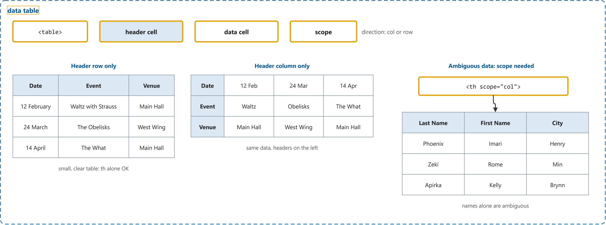
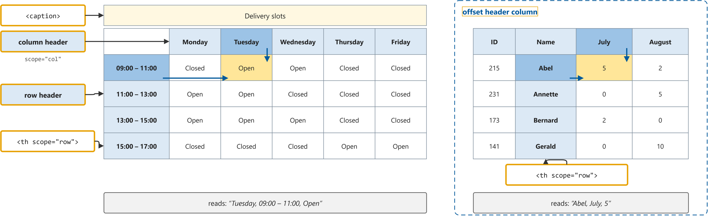
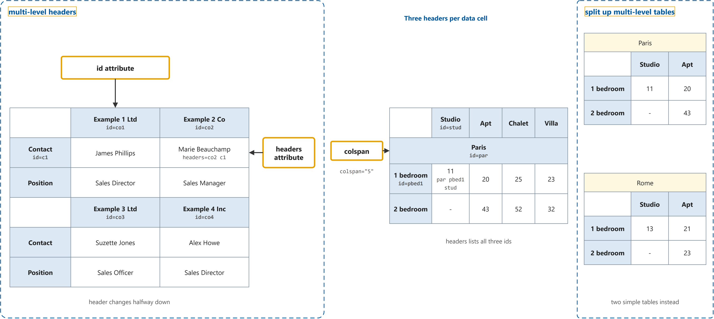

# Tables Tutorial

Study notes on [W3C WAI tutorial](https://www.w3.org/WAI/tutorials/tables/), which CST8914 Accessible by Design (Algonquin College, Fall 2026) uses in week 7. Each section follows one part of the source. Start from the figure: the framed terms are the ones to learn, and the table below it defines them in the same order, each with a citation linked to the passage.

## [Tables with One Header](https://www.w3.org/WAI/tutorials/tables/one-header/)

| Term | Definition | 中文解释 | Source |
|---|---|---|---|
| **data table** (数据表格) | "Data tables are used to organize data with a logical relationship in grids. Accessible tables need HTML markup that indicates header cells and data cells and defines their relationship." *Note: Tables used only for layout are not data tables; the tutorial does not cover them.* | 数据表格是按行和列排列、彼此有关系的数据。只有把表头格和数据格标清楚，屏幕阅读器才能在念每个格子时带上它的表头。 | [Eggert, 2023, para. 2](https://www.w3.org/WAI/tutorials/tables/#:~:text=Data%20tables%20are%20used%20to%20organize%20data%20with%20a) |
| **`<table>`** (表格元素) | "The table element represents data with more than one dimension, in the form of a table." | `<table>` 是包住整张表格的元素，里面再放行和格子。屏幕阅读器看到它就进入表格模式，用户可以按行按列移动。 | [WHATWG, 2026, "4.9.1 The table element" section, para. 1](https://html.spec.whatwg.org/multipage/tables.html#the-table-element:~:text=The%20table%20element%20represents%20data%20with%20more%20than%20one) |
| **header cell (`<th>`)** (表头单元格) | "The th element represents a header cell in a table." | 表头单元格是写着行名或列名的格子，用 `<th>` 标出。屏幕阅读器在用户移动到某个数据格时，会先念它对应的表头。 | [WHATWG, 2026, "4.9.10 The th element" section, para. 1](https://html.spec.whatwg.org/multipage/tables.html#the-th-element:~:text=The%20th%20element%20represents%20a%20header%20cell%20in%20a) |
| **data cell (`<td>`)** (数据单元格) | "The td element represents a data cell in a table." | 数据单元格是放具体数值的普通格子，用 `<td>` 标出。它单独看往往没意义，要靠表头说明它是什么。 | [WHATWG, 2026, "4.9.9 The td element" section, para. 1](https://html.spec.whatwg.org/multipage/tables.html#the-td-element:~:text=The%20td%20element%20represents%20a%20data%20cell%20in%20a) |
| **scope** (表头范围属性) | "Defines the cells that the header (defined in the `<th>`) element relates to." | scope 是写在 `<th>` 上的属性，说明这个表头管哪些格子：col 管它下面这一列，row 管它右边这一行。屏幕阅读器靠它把表头和数据格对上。 | [MDN contributors, 2026, "Attributes" section, scope](https://developer.mozilla.org/en-US/docs/Web/HTML/Reference/Elements/th#scope:~:text=Defines%20the%20cells%20that%20the%20header%20%28defined%20in%20the) |
| **`scope="col"`** (列表头) | "The scope attribute with the value col defines the direction of the header cells and associates them with the corresponding data cells." | `scope="col"` 表示这个表头管它所在的整列。当各列的数据看起来差不多（比如都是名字）时，它让屏幕阅读器念出“Last Name”还是“First Name”。 | [Eggert, 2019, "Table with ambiguous data" section, para. 1](https://www.w3.org/WAI/tutorials/tables/one-header/#table-with-ambiguous-data:~:text=The%20scope%20attribute%20with%20the%20value%20col%20defines%20the) |

## [Tables with Two Headers](https://www.w3.org/WAI/tutorials/tables/two-headers/)

| Term | Definition | 中文解释 | Source |
|---|---|---|---|
| **`<caption>`** (表格标题) | "Additionally, you can use the `<caption>` element to identify the table in a document. This is particularly useful for screen-reader users browsing the web page in “table mode” where they can navigate from table to table." | `<caption>` 是表格的标题，写在 `<table>` 里第一个位置，显示在表格上方。屏幕阅读器用户在表格之间跳转时，先听到标题就知道这张表讲什么。 | [Eggert, 2019, "Overview" section, para. 2](https://www.w3.org/WAI/tutorials/tables/two-headers/#:~:text=Additionally%2C%20you%20can%20use%20the%20%3Ccaption%3E%20element%20to%20identify) |
| **column header** (列表头) | "This page covers tables that have a simple row header and a simple column header. In such tables, the relationship between the headers and data cells becomes quickly ambiguous." | 列表头是表格顶部那一行、写着每一列名字的格子，比如 Monday、Tuesday。和行表头同时出现时，要用 scope 说明方向，否则对应关系容易混淆。 | [Eggert, 2019, "Overview" section, para. 1](https://www.w3.org/WAI/tutorials/tables/two-headers/#:~:text=This%20page%20covers%20tables%20that%20have%20a%20simple%20row) |
| **row header** (行表头) | "In the header column, the row value associates the individual headers with their rows." | 行表头是每一行开头、写着这一行名字的格子，比如时间段 09:00 – 11:00。屏幕阅读器念某个格子时，会把行表头和列表头一起念出来。 | [Eggert, 2019, "Table with header cells in the top row and first column" section, para. 2](https://www.w3.org/WAI/tutorials/tables/two-headers/#table-with-header-cells-in-the-top-row-and-first-column:~:text=In%20the%20header%20column%2C%20the%20row%20value%20associates%20the) |
| **`scope="row"`** (行表头) | "The scope attribute can be set to row or col to denote that a header applies to the entire row or column, respectively." | `scope="row"` 表示这个表头管它所在的整行。表格同时有行表头和列表头时，每个 `<th>` 都要写清楚方向。 | [Eggert, 2019, "Overview" section, para. 1](https://www.w3.org/WAI/tutorials/tables/two-headers/#:~:text=The%20scope%20attribute%20can%20be%20set%20to%20row%20or) |
| **offset header column** (错位的表头列) | "In this table, the row header cells are in the second rather than in the first column." | 错位的表头列是指行表头不在第一列，而在第二列，比如先是编号、再是姓名。用 `scope="row"` 后，姓名左右两边的格子都会和它对应。 | [Eggert, 2019, "Table with an offset column of header cells" section, para. 1](https://www.w3.org/WAI/tutorials/tables/two-headers/#table-with-an-offset-column-of-header-cells:~:text=In%20this%20table%2C%20the%20row%20header%20cells%20are%20in) |

## [Tables with Multi-Level Headers](https://www.w3.org/WAI/tutorials/tables/multi-level/)

| Term | Definition | 中文解释 | Source |
|---|---|---|---|
| **multi-level headers** (多级表头) | "This page covers tables that have multi-level header cells associated per data cell. Such tables are too complex to identify a strict horizontal or vertical association between header and data cells." | 多级表头是一个数据格同时属于好几个表头，或者表头在表格中途改变的情况。这时只靠 scope 不够，要用 id 和 headers 把每个数据格和它的表头一一连起来。 | [Eggert, 2019, "Overview" section, para. 1](https://www.w3.org/WAI/tutorials/tables/multi-level/#:~:text=This%20page%20covers%20tables%20that%20have%20multi%2Dlevel%20header%20cells) |
| **`id` attribute** (唯一标识属性) | "In such tables, each table header is represented by a (document-wide) unique id." | `id` 属性给每个表头格起一个在整页里唯一的名字，比如 id="co1"。数据格就靠这个名字找到自己的表头。 | [Eggert, 2019, "Overview" section, para. 1](https://www.w3.org/WAI/tutorials/tables/multi-level/#:~:text=In%20such%20tables%2C%20each%20table%20header%20is%20represented%20by) |
| **`headers` attribute** (关联表头属性) | "Data cells refer to those ids by listing one or more in their headers attribute, separated by spaces." | `headers` 属性写在数据格上，列出它对应的所有表头的 id，中间用空格隔开，比如 headers="co2 c1"。屏幕阅读器按这个列表念出表头。 | [Eggert, 2019, "Overview" section, para. 1](https://www.w3.org/WAI/tutorials/tables/multi-level/#:~:text=Data%20cells%20refer%20to%20those%20ids%20by%20listing%20one) |
| **colspan** (跨列) | "A non-negative integer value indicating how many columns the header cell spans or extends. The default value is 1." | colspan 是让一个格子横着占好几列的属性，比如 colspan="5" 让“Paris”这一格横跨整张表。屏幕阅读器把它当成这几列共同的表头。 | [MDN contributors, 2026, "Attributes" section, colspan](https://developer.mozilla.org/en-US/docs/Web/HTML/Reference/Elements/th#colspan:~:text=A%20non%2Dnegative%20integer%20value%20indicating%20how%20many%20columns%20the) |
| **split up multi-level tables** (拆分多级表格) | "In many cases, it is worth considering to restructure the information in such tables to make them less complex for all readers, for example by splitting the information in smaller, more manageable tables as shown in Example 3." | 拆分多级表格是把一张复杂的大表拆成几张简单的小表，比如 Paris 一张、Rome 一张。这样所有人都更容易看懂，也不用写 id 和 headers。 | [Eggert, 2019, "Overview" section, para. 4](https://www.w3.org/WAI/tutorials/tables/multi-level/#:~:text=In%20many%20cases%2C%20it%20is%20worth%20considering%20to%20restructure) |
