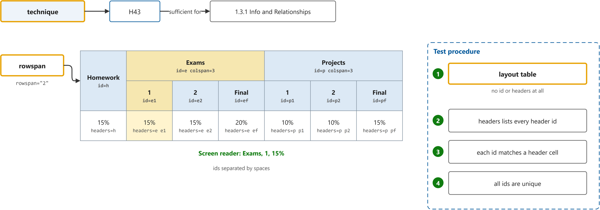

# Techniques for WCAG 2.2

Study notes on [W3C](https://www.w3.org/WAI/WCAG22/Techniques/), which CST8914 Accessible by Design (Algonquin College, Fall 2026) uses in week 7. Each section follows one part of the source. Start from the figure: the framed terms are the ones to learn, and the table below it defines them in the same order, each with a citation linked to the passage.

## [H43: Using id and headers attributes to associate data cells with header cells in data tables](https://www.w3.org/WAI/WCAG22/Techniques/html/H43)

| Term | Definition | 中文解释 | Source |
|---|---|---|---|
| **technique** (技术（WCAG Technique）) | "Techniques are examples of ways to meet Web Content Accessibility Guidelines (WCAG). They are not required to meet WCAG." *Note: H43 is sufficient for 1.3.1 Info and Relationships.* | 技术是 W3C 给出的满足 WCAG 成功标准的具体做法示例，比如 H43。它不是硬性要求，用别的方法满足成功标准也可以。 | [W3C, 2026, "About this Technique" section, para. 3](https://www.w3.org/WAI/WCAG22/Techniques/html/H43#technique:~:text=Techniques%20are%20examples%20of%20ways%20to%20meet%20Web%20Content) |
| **rowspan** (rowspan 跨行) | "A non-negative integer value indicating how many rows the header cell spans or extends. The default value is 1" | rowspan 是让一个格子竖着占好几行的属性，比如 rowspan="2" 让“Homework”占两行表头。屏幕阅读器把它当成这两行共同的表头。 | [MDN contributors, 2026, "Attributes" section, rowspan](https://developer.mozilla.org/en-US/docs/Web/HTML/Reference/Elements/th#rowspan:~:text=A%20non%2Dnegative%20integer%20value%20indicating%20how%20many%20rows%20the) |
| **layout table** (布局表格) | "Check for layout tables: determine whether the content has a relationship with other content in both its column and its row. If "no", the table is a layout table. If "yes", the table is a data table." | 布局表格是只用来排版、行列之间没有数据关系的表格。它不能加 id 和 headers，否则屏幕阅读器会念出并不存在的表头关系。 | [W3C, 2026, "Procedure" section, step 1](https://www.w3.org/WAI/WCAG22/Techniques/html/H43#procedure:~:text=Check%20for%20layout%20tables%3A%20determine%20whether%20the%20content%20has) |
