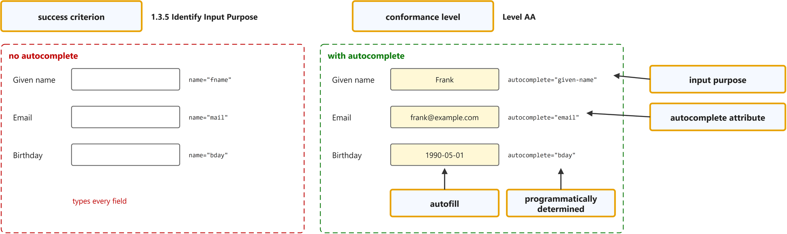
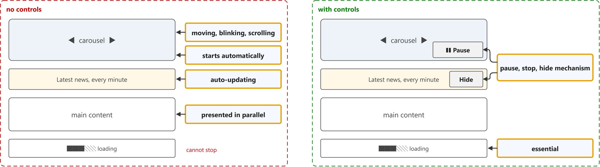
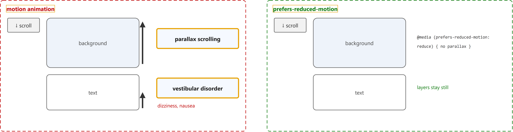
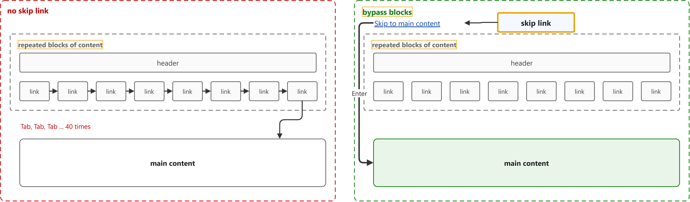
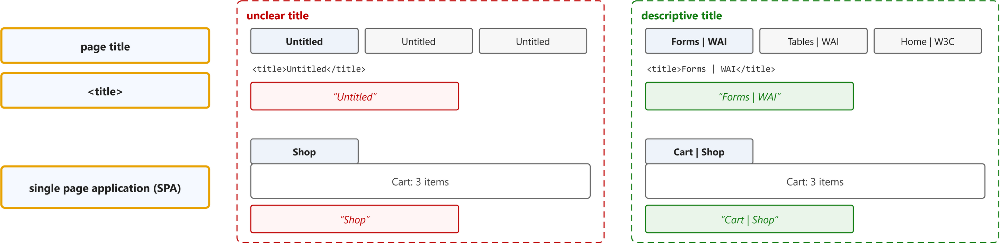
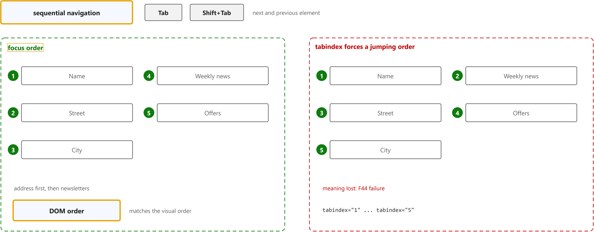
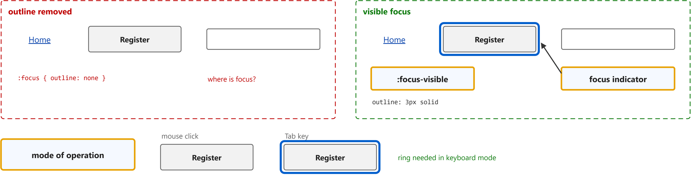
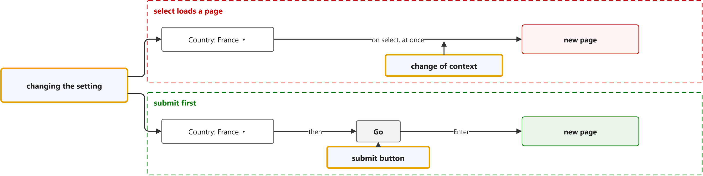
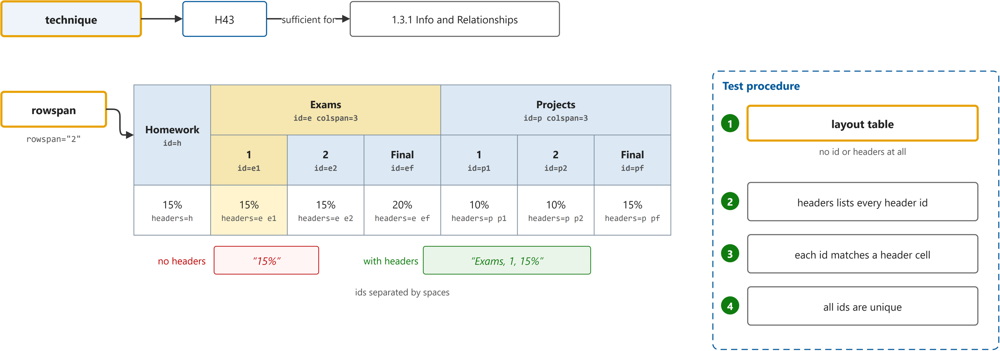

# WCAG 2.2

Study notes on [W3C, Understanding WCAG 2.2 and Techniques for WCAG 2.2](https://www.w3.org/WAI/WCAG22/Understanding/), which CST8914 Accessible by Design (Algonquin College, Fall 2026) uses in week 7. Each section follows one part of the source. Start from the figure: the framed terms are the ones to learn, and the table below it defines them in the same order, each with a citation linked to the passage.

## [1.3.5 Identify Input Purpose](https://www.w3.org/WAI/WCAG22/Understanding/identify-input-purpose.html)

| Term | Definition | 中文解释 | Source |
|---|---|---|---|
| **success criterion** (成功标准) | "For each guideline, testable success criteria are provided to allow WCAG 2.2 to be used where requirements and conformance testing are necessary such as in design specification, purchasing, regulation, and contractual agreements." | 成功标准是 WCAG 里一条条可以测试的具体要求，比如 1.3.5、2.4.7。网页做没做到可以逐条检查，法规和合同也按它来要求。 | [Campbell et al., 2024, "WCAG 2 Layers of Guidance" section, Success Criteria item](https://www.w3.org/TR/WCAG22/#wcag-2-layers-of-guidance:~:text=testable%20success%20criteria%20are%20provided%20to%20allow%20WCAG%202.2) |
| **conformance level** (符合性级别) | "In order to meet the needs of different groups and different situations, three levels of conformance are defined: A (lowest), AA, and AAA (highest)." *Note: 1.3.5 Identify Input Purpose is Level AA.* | 符合性级别是给每条成功标准分的等级：A 最基本，AA 居中，AAA 最高。大多数法规要求做到 AA，例如 1.3.5 就是 AA 级。 | [Campbell et al., 2024, "WCAG 2 Layers of Guidance" section, Success Criteria item](https://www.w3.org/TR/WCAG22/#wcag-2-layers-of-guidance:~:text=three%20levels%20of%20conformance%20are%20defined) |
| **autofill** (自动填充) | "In addition to repurposing this taxonomy, when the autocomplete attribute technique is used to meet this success criterion for HTML content, browsers and other user agents can suggest and 'autofill' the right content by autocompleting these fields based on past user input stored in the browser." | 自动填充是浏览器用以前保存的信息替用户填好表单。记忆困难、读写困难或手动不便的用户只需确认，不用重新输入。 | [W3C, 2026, "Intent" section, para. 8](https://www.w3.org/WAI/WCAG22/Understanding/identify-input-purpose.html#intent:~:text=browsers%20and%20other%20user%20agents%20can%20suggest%20and) |
| **programmatically determined** (可被程序确定) | "determined by software from author-supplied data provided in a way that different user agents, including assistive technologies, can extract and present this information to users in different modalities" | 可被程序确定是指信息写在代码里，软件能直接读出来，而不是只靠人看页面去猜。浏览器和屏幕阅读器因此能用自己的方式把它呈现给用户。 | [W3C, 2026, "Key Terms" section, definition](https://www.w3.org/WAI/WCAG22/Understanding/identify-input-purpose.html#dfn-programmatically-determined:~:text=determined%20by%20software%20from%20author%2Dsupplied%20data%20provided%20in%20a%20way) |
| **input purpose** (输入用途) | "The intent of this success criterion is to ensure that the purpose of a form input collecting information about the user can be programmatically determined, so that user agents can extract and present this purpose to users using different modalities." | 输入用途是一个输入框要收集的是用户的哪类信息，比如名字、邮箱、生日。把用途写进代码后，浏览器和辅助技术就能认出它并帮忙。 | [W3C, 2026, "Intent" section, para. 1](https://www.w3.org/WAI/WCAG22/Understanding/identify-input-purpose.html#intent:~:text=The%20intent%20of%20this%20success%20criterion%20is%20to%20ensure%20that%20the%20purpose) |
| **`autocomplete` attribute** (自动填充属性) | "The HTML autocomplete attribute only accepts a certain number of specific well-defined fixed values. This allows a more fine-grained definition or identification of purpose than the type attribute ..." | autocomplete 是 HTML 输入框上写明用途的属性，取值是固定的词，比如 given-name、email、bday。比 type 更细，能说明这是“用户自己的”名字还是邮箱。 | [W3C, 2026, "Intent" section, para. 6](https://www.w3.org/WAI/WCAG22/Understanding/identify-input-purpose.html#intent:~:text=only%20accepts%20a%20certain%20number%20of%20specific%20well%2Ddefined%20fixed%20values) |

## [2.2.2 Pause, Stop, Hide](https://www.w3.org/WAI/WCAG22/Understanding/pause-stop-hide.html)

| Term | Definition | 中文解释 | Source |
|---|---|---|---|
| **moving, blinking, scrolling** (移动、闪烁、滚动内容) | "“Moving, blinking and scrolling” refers to content in which the visible content conveys a sense of motion." | 移动、闪烁、滚动内容是画面上会动的东西，比如自动轮播、滚动新闻条、动画。自动开始、超过 5 秒、又和其他内容并排时，必须能暂停、停止或隐藏。 | [W3C, 2026, "Intent" section, para. 3](https://www.w3.org/WAI/WCAG22/Understanding/pause-stop-hide.html#intent:~:text=refers%20to%20content%20in%20which%20the%20visible%20content%20conveys%20a%20sense%20of%20motion) |
| **starts automatically** (自动开始) | "In the context of this Success Criterion, “starts automatically” broadly refers to animations/updates that are not the direct result of a user's intentional activation, for example, selecting a link or button." | 自动开始是指动画或更新不是用户点了链接或按钮才出现的，而是页面自己开始的。这种内容最容易打扰正在阅读的人。 | [W3C, 2026, "Intent" section, para. 2](https://www.w3.org/WAI/WCAG22/Understanding/pause-stop-hide.html#intent:~:text=broadly%20refers%20to%20animations%2Fupdates%20that%20are%20not%20the%20direct%20result) |
| **auto-updating** (自动更新) | "“Auto-updating” refers to content that updates or disappears based on a preset time interval." | 自动更新是按固定时间间隔自己刷新或消失的内容，比如天气、新闻、股价。它没有 5 秒例外，必须能暂停、停止、隐藏或调整更新频率。 | [W3C, 2026, "Intent" section, para. 3](https://www.w3.org/WAI/WCAG22/Understanding/pause-stop-hide.html#intent:~:text=refers%20to%20content%20that%20updates%20or%20disappears%20based%20on) |
| **presented in parallel** (与其他内容并列) | "For any moving, blinking or scrolling information that (1) starts automatically, (2) lasts more than five seconds, and (3) is presented in parallel with other content, there is a mechanism for the user to pause, stop, or hide it unless the movement, blinking, or scrolling is part of an activity where it is essential" | 与其他内容并列是指会动的内容和用户要看的其他内容同时出现在页面上。如果页面上只有一个加载动画，就不算并列，不需要暂停按钮。 | [W3C, 2026, "Success Criterion (SC)" section, Moving, blinking, scrolling clause](https://www.w3.org/WAI/WCAG22/Understanding/pause-stop-hide.html#success-criterion:~:text=is%20presented%20in%20parallel%20with%20other%20content%2C%20there%20is%20a%20mechanism) |
| **pause, stop, hide mechanism** (暂停、停止、隐藏机制) | "For a mechanism to be considered “a mechanism for the user to pause,” it must provide the user with a means to pause that does not tie up the user or the focus so that the page cannot be used." *Note: WCAG defines mechanism as a process or technique for achieving a result.* | 暂停、停止、隐藏机制是让用户关掉会动内容的控件，比如“暂停”按钮。它不能要求用户一直按住或一直把焦点放在上面，否则页面就没法用了。 | [W3C, 2026, "Intent" section, para. 8](https://www.w3.org/WAI/WCAG22/Understanding/pause-stop-hide.html#intent:~:text=it%20must%20provide%20the%20user%20with%20a%20means%20to%20pause) |
| **essential** (必不可少的) | "if removed, would fundamentally change the information or functionality of the content, and information and functionality cannot be achieved in another way that would conform" | 必不可少的是指去掉它，内容的信息或功能就根本变了，而且没有别的合规做法能替代。这类动画可以不提供关闭方式。 | [W3C, 2026, "Key Terms" section, definition](https://www.w3.org/WAI/WCAG22/Understanding/pause-stop-hide.html#dfn-essential:~:text=if%20removed%2C%20would%20fundamentally%20change%20the%20information%20or%20functionality) |

## [2.3.3 Animation from Interactions](https://www.w3.org/WAI/WCAG22/Understanding/animation-from-interactions.html)

| Term | Definition | 中文解释 | Source |
|---|---|---|---|
| **motion animation** (运动动画) | "addition of steps between conditions to create the illusion of movement or to give a sense of a smooth transition" | 运动动画是在两个状态之间插入中间帧，让东西看起来在移动或平滑过渡，比如滚动时元素滑入、翻页效果。由用户操作触发的非必要动画应该能关掉。 | [W3C, 2025, "Key Terms" section, definition](https://www.w3.org/WAI/WCAG22/Understanding/animation-from-interactions.html#dfn-motion-animation:~:text=addition%20of%20steps%20between%20conditions%20to%20create%20the%20illusion%20of%20movement) |
| **`prefers-reduced-motion`** (减少动态偏好) | "The prefers-reduced-motion CSS media feature is used to detect if a user has enabled a setting on their device to minimize the amount of non-essential motion." *Note: The Understanding page uses it in its second example.* | prefers-reduced-motion 是 CSS 媒体查询特性，用来检测用户有没有在系统里开启“减少动态效果”。开了的话，页面就在 @media 里把非必要动画关掉。 | [MDN contributors, n.d., para. 1](https://developer.mozilla.org/en-US/docs/Web/CSS/Reference/At-rules/@media/prefers-reduced-motion#:~:text=CSS%20media%20feature%20is%20used%20to%20detect%20if%20a%20user%20has%20enabled) |
| **parallax scrolling** (视差滚动) | "Parallax scrolling occurs when backgrounds move at a different rate to foregrounds." | 视差滚动是页面滚动时背景和前景以不同速度移动的效果。它看着有层次感，却是常见的非必要动画，容易让人头晕。 | [W3C, 2025, "Intent" section, para. 1](https://www.w3.org/WAI/WCAG22/Understanding/animation-from-interactions.html#intent:~:text=Parallax%20scrolling%20occurs%20when%20backgrounds%20move%20at%20a%20different%20rate) |
| **vestibular disorder** (前庭功能障碍) | "Vestibular (inner ear) disorder reactions include dizziness, nausea and headaches." | 前庭功能障碍是内耳平衡系统的问题。这类用户看到大片移动的画面会头晕、恶心、头痛，严重时要卧床休息。 | [W3C, 2025, "Intent" section, para. 1](https://www.w3.org/WAI/WCAG22/Understanding/animation-from-interactions.html#intent:~:text=disorder%20reactions%20include%20dizziness%2C%20nausea%20and%20headaches) |

## [2.4.1 Bypass Blocks](https://www.w3.org/WAI/WCAG22/Understanding/bypass-blocks.html)

| Term | Definition | 中文解释 | Source |
|---|---|---|---|
| **repeated blocks of content** (重复内容块) | "Examples of repeated blocks of content include but are not limited to navigation links, header content, and advertising frames." | 重复内容块是每个页面都出现的同一块内容，比如导航链接、页眉、广告。键盘和屏幕阅读器用户每到一页都得把它们重新走一遍。 | [W3C, 2026, "Intent" section, para. 1](https://www.w3.org/WAI/WCAG22/Understanding/bypass-blocks.html#intent:~:text=Examples%20of%20repeated%20blocks%20of%20content%20include%20but%20are%20not) |
| **bypass blocks** (绕过内容块) | "A mechanism is available to bypass blocks of content that are repeated on multiple web pages." | 绕过内容块是提供一种办法让用户跳过重复内容，直接到主要内容。办法可以是跳转链接、地标区域、标题，或可折叠的菜单。 | [W3C, 2026, "Success Criterion (SC)" section, SC text](https://www.w3.org/WAI/WCAG22/Understanding/bypass-blocks.html#success-criterion:~:text=A%20mechanism%20is%20available%20to%20bypass%20blocks%20of%20content) |
| **skip link** (跳转链接) | "There is a link at the top of the page that jumps to the main story." *Note: The matching technique is G1, adding a link at the top of each page that goes directly to the main content area.* | 跳转链接是页面最上方的“跳到主要内容”链接，按一次 Tab 就能看到。键盘用户按回车就跳过页眉和导航，不用再按几十次 Tab。 | [W3C, 2026, "Examples" section, bullet 1](https://www.w3.org/WAI/WCAG22/Understanding/bypass-blocks.html#examples:~:text=There%20is%20a%20link%20at%20the%20top%20of%20the%20page%20that%20jumps) |

## [2.4.2 Page Titled](https://www.w3.org/WAI/WCAG22/Understanding/page-titled.html)

| Term | Definition | 中文解释 | Source |
|---|---|---|---|
| **page title** (页面标题) | "Titles identify the current location without requiring users to read or interpret page content." | 页面标题是标签页、书签和搜索结果里显示的网页名字。好的标题说明页面主题，用户不用读正文就知道自己在哪一页。 | [W3C, 2026, "Intent" section, para. 1](https://www.w3.org/WAI/WCAG22/Understanding/page-titled.html#intent:~:text=Titles%20identify%20the%20current%20location%20without%20requiring%20users%20to) |
| **`<title>`** (页面标题元素) | "The descriptive title of an HTML web page is marked up with the &lt;title> element so that it will be displayed in the title bar of the user agent." | &lt;title> 是写在 &lt;head> 里、给整个网页起名字的 HTML 元素。浏览器把它显示在标签页上，屏幕阅读器打开页面时先读它。 | [W3C, 2026, "Examples" section, An HTML web page](https://www.w3.org/WAI/WCAG22/Understanding/page-titled.html#examples:~:text=The%20descriptive%20title%20of%20an%20HTML%20web%20page%20is%20marked%20up) |
| **single page application (SPA)** (单页应用) | "In cases such as Single Page Applications (SPAs), where various distinct pages/views are all nominally served from the same URI and the content of the page is changed dynamically, the title of the page should also be changed dynamically to reflect the content or topic of the current view." | 单页应用是网址不变、靠脚本切换不同视图的网页应用。每次切换视图时也要用脚本更新页面标题，否则标题和内容对不上。 | [W3C, 2026, "Intent" section, para. 3](https://www.w3.org/WAI/WCAG22/Understanding/page-titled.html#intent:~:text=where%20various%20distinct%20pages%2Fviews%20are%20all%20nominally%20served%20from%20the%20same%20URI) |

## [2.4.3 Focus Order](https://www.w3.org/WAI/WCAG22/Understanding/focus-order.html)

| Term | Definition | 中文解释 | Source |
|---|---|---|---|
| **sequential navigation** (顺序导航) | "navigated in the order defined for advancing focus (from one element to the next) using a keyboard interface" *Note: WCAG defines the term as navigated sequentially.* | 顺序导航是用键盘的 Tab 和 Shift+Tab 一个接一个地在可聚焦元素之间移动。屏幕阅读器和键盘用户主要靠这种方式操作网页。 | [W3C, 2026, "Key Terms" section, definition of navigated sequentially](https://www.w3.org/WAI/WCAG22/Understanding/focus-order.html#dfn-navigated-sequentially:~:text=navigated%20in%20the%20order%20defined%20for%20advancing%20focus) |
| **focus order** (焦点顺序) | "If a web page can be navigated sequentially and the navigation sequences affect meaning or operation, focusable components receive focus in an order that preserves meaning and operability." *Note: Using tabindex to force an order that loses meaning is failure F44.* | 焦点顺序是按 Tab 时焦点经过各元素的先后次序。它要符合内容的逻辑，比如先填完地址再到订阅选项，而不是来回乱跳。 | [W3C, 2026, "Success Criterion (SC)" section, SC text](https://www.w3.org/WAI/WCAG22/Understanding/focus-order.html#success-criterion:~:text=focusable%20components%20receive%20focus%20in%20an%20order%20that%20preserves%20meaning) |
| **DOM order** (文档顺序) | "If no scripting or tabindex attributes are used, the navigation order is the order that components appear in the content stream." *Note: Technique C27 makes the DOM order match the visual order.* | DOM 顺序是元素在 HTML 源代码里出现的先后。没有脚本和 tabindex 时，Tab 就按这个顺序走，所以让源代码顺序和视觉顺序一致最省事。 | [W3C, 2026, "Intent" section, para. 2](https://www.w3.org/WAI/WCAG22/Understanding/focus-order.html#intent:~:text=If%20no%20scripting%20or%20tabindex%20attributes%20are%20used%2C%20the%20navigation%20order) |

## [2.4.7 Focus Visible](https://www.w3.org/WAI/WCAG22/Understanding/focus-visible.html)

| Term | Definition | 中文解释 | Source |
|---|---|---|---|
| **focus indicator** (焦点指示器) | "pixels that are changed to visually indicate when a user interface component is in a focused state" | 焦点指示器是标出当前键盘焦点位置的视觉提示，比如按钮外的一圈轮廓、输入框里的光标。没有它，看得见屏幕的键盘用户不知道自己在哪。 | [W3C, 2026, "Key Terms" section, definition](https://www.w3.org/WAI/WCAG22/Understanding/focus-visible.html#dfn-focus-indicator:~:text=pixels%20that%20are%20changed%20to%20visually%20indicate%20when%20a%20user%20interface) |
| **`:focus-visible`** (键盘焦点伪类) | "The :focus-visible pseudo-class applies while an element matches the :focus pseudo-class and the UA (User Agent) determines via heuristics that the focus should be made evident on the element." *Note: Understanding 2.4.7 links technique C45, using CSS :focus-visible to provide keyboard focus indication.* | :focus-visible 是 CSS 伪类，在浏览器判断需要显示焦点时生效，通常是用键盘操作时。用它写焦点样式，键盘用户看得到焦点环，鼠标点击时又不会多出一圈框。 | [MDN contributors, n.d., para. 1](https://developer.mozilla.org/en-US/docs/Web/CSS/Reference/Selectors/:focus-visible#:~:text=pseudo%2Dclass%20applies%20while%20an%20element%20matches%20the) |
| **mode of operation** (操作模式) | "“Mode of operation” accounts for user agents which may not always show a focus indicator, or only show the focus indicator when the keyboard is used." | 操作模式是指用户使用页面的方式，比如用键盘还是用鼠标。浏览器可能只在用键盘时显示焦点，作者只需保证至少有一种模式下焦点是可见的。 | [W3C, 2026, "Intent" section, para. 2](https://www.w3.org/WAI/WCAG22/Understanding/focus-visible.html#intent:~:text=accounts%20for%20user%20agents%20which%20may%20not%20always%20show%20a%20focus%20indicator) |

## [3.2.2 On Input](https://www.w3.org/WAI/WCAG22/Understanding/on-input.html)

| Term | Definition | 中文解释 | Source |
|---|---|---|---|
| **changing the setting** (更改设置) | "Changing the setting of any user interface component is changing some aspect in the control that will persist when the user is no longer interacting with it." | 更改设置是改变控件里会保留下来的值，比如选下拉选项、勾复选框、在输入框里打字。点链接或按钮不算更改设置。 | [W3C, 2026, "Intent" section, para. 1](https://www.w3.org/WAI/WCAG22/Understanding/on-input.html#intent:~:text=Changing%20the%20setting%20of%20any%20user%20interface%20component%20is%20changing) |
| **change of context** (情境变化) | "major changes that, if made without user awareness, can disorient users who are not able to view the entire page simultaneously" *Note: Changes of context include changes of user agent, viewport, focus, or content that changes the meaning of the web page.* | 情境变化是会让用户迷失的大变化，比如打开新窗口、跳到新页面、焦点被移走，或内容变得意思完全不同。只是选了一个选项就自动发生，屏幕阅读器用户会不知道发生了什么。 | [W3C, 2026, "Key Terms" section, definition of changes of context](https://www.w3.org/WAI/WCAG22/Understanding/on-input.html#dfn-changes-of-context:~:text=major%20changes%20that%2C%20if%20made%20without%20user%20awareness%2C%20can%20disorient) |
| **submit button** (提交按钮) | "A button that submits a form and navigates the user to a new page is activating a control, not changing a setting." *Note: Technique G80 is providing a submit button to initiate a change of context.* | 提交按钮是用户主动点击后才提交表单、跳到新页面的按钮。变化由用户自己决定何时发生，所以不违反 3.2.2。 | [W3C, 2026, "Intent" section, note 1](https://www.w3.org/WAI/WCAG22/Understanding/on-input.html#intent:~:text=A%20button%20that%20submits%20a%20form%20and%20navigates%20the%20user) |

## [H43: Using id and headers attributes to associate data cells with header cells in data tables](https://www.w3.org/WAI/WCAG22/Techniques/html/H43)

| Term | Definition | 中文解释 | Source |
|---|---|---|---|
| **technique** (技术) | "Techniques are examples of ways to meet Web Content Accessibility Guidelines (WCAG). They are not required to meet WCAG." *Note: H43 is sufficient for 1.3.1 Info and Relationships.* | 技术是 W3C 给出的满足 WCAG 成功标准的具体做法示例，比如 H43。它不是硬性要求，用别的方法满足成功标准也可以。 | [W3C, 2026, "About this Technique" section, para. 3](https://www.w3.org/WAI/WCAG22/Techniques/html/H43#technique:~:text=Techniques%20are%20examples%20of%20ways%20to%20meet%20Web%20Content) |
| **rowspan** (跨行) | "A non-negative integer value indicating how many rows the header cell spans or extends. The default value is 1" | rowspan 是让一个格子竖着占好几行的属性，比如 rowspan="2" 让“Homework”占两行表头。屏幕阅读器把它当成这两行共同的表头。 | [MDN contributors, 2026, "Attributes" section, rowspan](https://developer.mozilla.org/en-US/docs/Web/HTML/Reference/Elements/th#rowspan:~:text=A%20non%2Dnegative%20integer%20value%20indicating%20how%20many%20rows%20the) |
| **layout table** (布局表格) | "Check for layout tables: determine whether the content has a relationship with other content in both its column and its row. If "no", the table is a layout table. If "yes", the table is a data table." | 布局表格是只用来排版、行列之间没有数据关系的表格。它不能加 id 和 headers，否则屏幕阅读器会念出并不存在的表头关系。 | [W3C, 2026, "Procedure" section, step 1](https://www.w3.org/WAI/WCAG22/Techniques/html/H43#procedure:~:text=Check%20for%20layout%20tables%3A%20determine%20whether%20the%20content%20has) |
