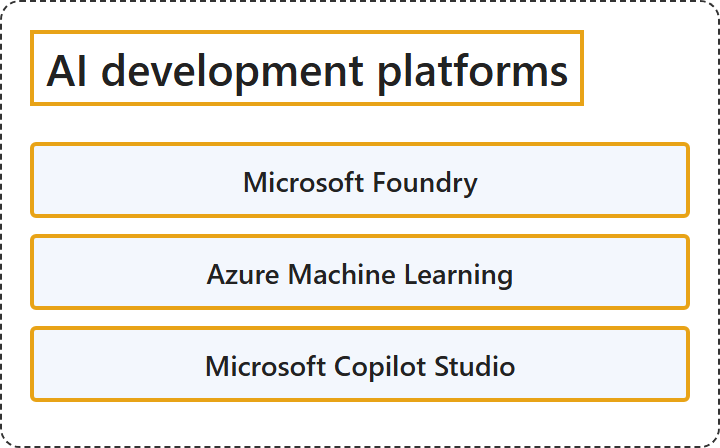

# 13.1 AI Development Platforms

## Classification

## Glossary

| Term | Definition | 中文翻译 | Source |
|---|---|---|---|
| **Microsoft Foundry** Microsoft Foundry | "Microsoft Foundry: A **unified platform as a service (PaaS)** for **developing and deploying generative AI applications and agents**." | Microsoft Foundry：一个**统一的平台即服务 (PaaS)**，用于**开发和部署生成式 AI 应用程序和智能体**。 | [Microsoft, 2026, "AI development platforms" section, list item 1](https://learn.microsoft.com/en-us/azure/architecture/ai-ml/ai-get-started#:~:text=A%20unified%20platform%20as%20a%20service%20%28PaaS%29%20for%20developing%20and%20deploying%20generative%20AI) |
| **Azure Machine Learning** Azure 机器学习 | "Azure Machine Learning: A **cloud service** for **building, training, and deploying machine learning models at scale**." | Azure 机器学习：一项**云服务**，用于**大规模构建、训练和部署机器学习模型**。 | [Microsoft, 2026, "AI development platforms" section, list item 2](https://learn.microsoft.com/en-us/azure/architecture/ai-ml/ai-get-started#:~:text=A%20cloud%20service%20for%20building%2C%20training%2C%20and%20deploying%20machine%20learning%20models) |
| **Microsoft Copilot Studio** Microsoft Copilot Studio | "Microsoft Copilot Studio: A **low-code platform** for **building, customizing, and deploying AI-powered agents**." | Microsoft Copilot Studio：一个**低代码平台**，用于**构建、自定义和部署 AI 驱动的智能体**。 | [Microsoft, 2026, "AI development platforms" section, list item 3](https://learn.microsoft.com/en-us/azure/architecture/ai-ml/ai-get-started#:~:text=A%20low-code%20platform%20for%20building%2C%20customizing%2C%20and%20deploying%20AI-powered%20agents) |

## References

- Microsoft. (2026, October 13). *Get started with AI architecture design*. Azure Architecture Center. https://learn.microsoft.com/en-us/azure/architecture/ai-ml/ai-get-started
