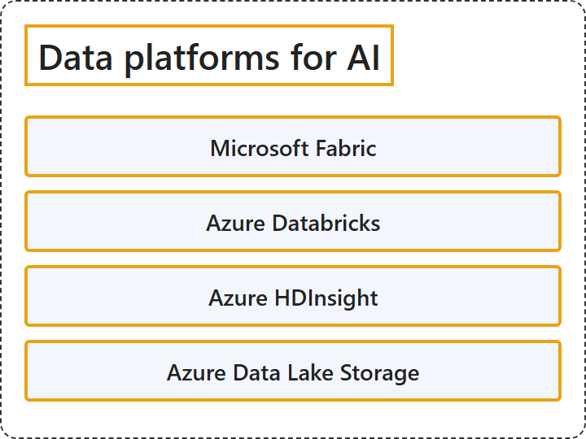

# 13.3 Data platforms for AI

## Classification

## Glossary

| Term | Definition | 中文翻译 | Source |
|---|---|---|---|
| **Microsoft Fabric** Microsoft Fabric | "Microsoft Fabric: An **end-to-end analytics and data platform** that covers **data ingestion, transformation, real-time event routing, and reporting**." | Microsoft Fabric：一个**端到端的分析和数据平台**，涵盖**数据引入、转换、实时事件路由和报告**。 | [Microsoft, 2026, "Data platforms for AI" section, list item 1](https://learn.microsoft.com/en-us/azure/architecture/ai-ml/ai-get-started#:~:text=An%20end-to-end%20analytics%20and%20data%20platform) |
| **Azure Databricks** Azure Databricks | "Azure Databricks: A **Spark-based analytics platform** for **data engineering, data science, and machine learning**." | Azure Databricks：一个**基于 Spark 的分析平台**，用于**数据工程、数据科学和机器学习**。 | [Microsoft, 2026, "Data platforms for AI" section, list item 2](https://learn.microsoft.com/en-us/azure/architecture/ai-ml/ai-get-started#:~:text=A%20Spark-based%20analytics%20platform%20for%20data%20engineering) |
| **Azure HDInsight** Azure HDInsight | "Azure HDInsight: A **managed Apache Spark service** for **big data processing and analytics**." | Azure HDInsight：一项**托管的 Apache Spark 服务**，用于**大数据处理和分析**。 | [Microsoft, 2026, "Data platforms for AI" section, list item 3](https://learn.microsoft.com/en-us/azure/architecture/ai-ml/ai-get-started#:~:text=A%20managed%20Apache%20Spark%20service%20for%20big%20data%20processing) |
| **Azure Data Lake Storage** Azure Data Lake Storage | "Azure Data Lake Storage: A **scalable, centralized repository** for **storing structured and unstructured data**." | Azure Data Lake Storage：一个**可扩展的集中式存储库**，用于**存储结构化和非结构化数据**。 | [Microsoft, 2026, "Data platforms for AI" section, list item 4](https://learn.microsoft.com/en-us/azure/architecture/ai-ml/ai-get-started#:~:text=A%20scalable%2C%20centralized%20repository%20for%20storing%20structured%20and%20unstructured%20data) |

## References

- Microsoft. (2026, October 13). *Get started with AI architecture design*. Azure Architecture Center. https://learn.microsoft.com/en-us/azure/architecture/ai-ml/ai-get-started
