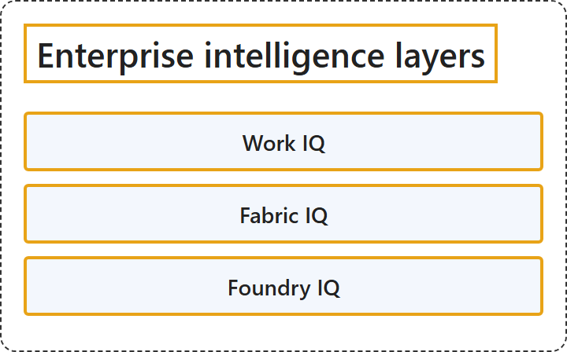

# 13.4 Enterprise intelligence layers

## Classification

## Glossary

| Term | Definition | 中文翻译 | Source |
|---|---|---|---|
| **Work IQ** Work IQ | "Work IQ **captures intelligence about how work happens inside an organization**. It uses **signals from Microsoft 365** such as emails, chats, meetings, documents, and collaboration patterns." | Work IQ **捕获关于组织内部工作如何进行的智能**。它使用**来自 Microsoft 365 的信号**，例如电子邮件、聊天、会议、文档和协作模式。 | [Microsoft, 2026, "Enterprise Intelligence Layers" section, list item 1](https://learn.microsoft.com/en-us/azure/architecture/ai-ml/ai-get-started#:~:text=captures%20intelligence%20about%20how%20work%20happens%20inside%20an%20organization) |
| **Fabric IQ** Fabric IQ | "Fabric IQ provides **intelligence derived from structured enterprise data managed in Microsoft Fabric**, including analytics models, key performance indicators (KPIs), and business entities." | Fabric IQ 提供**源自 Microsoft Fabric 中所管理的结构化企业数据的智能**，包括分析模型、关键绩效指标 (KPI) 和业务实体。 | [Microsoft, 2026, "Enterprise Intelligence Layers" section, list item 2](https://learn.microsoft.com/en-us/azure/architecture/ai-ml/ai-get-started#:~:text=provides%20intelligence%20derived%20from%20structured%20enterprise%20data) |
| **Foundry IQ** Foundry IQ | "Foundry IQ provides a **unified, multisource knowledge layer** that allows AI agents to **retrieve and ground responses in enterprise data**." | Foundry IQ 提供一个**统一的多源知识层**，让 AI 智能体能够**基于企业数据检索并生成有依据的响应**。 | [Microsoft, 2026, "Enterprise Intelligence Layers" section, list item 3](https://learn.microsoft.com/en-us/azure/architecture/ai-ml/ai-get-started#:~:text=provides%20a%20unified%2C%20multisource%20knowledge%20layer) |

## References

- Microsoft. (2026, October 13). *Get started with AI architecture design*. Azure Architecture Center. https://learn.microsoft.com/en-us/azure/architecture/ai-ml/ai-get-started
