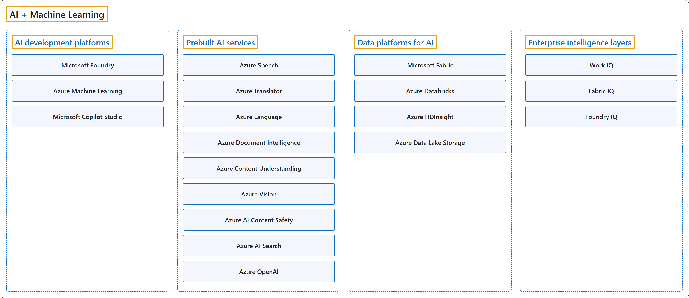

# 13. AI + Machine Learning

## Classification

## Glossary

| Term | Definition | 中文翻译 | Source |
|---|---|---|---|
| **AI + Machine Learning** AI 和机器学习 | "**AI** enables machines to **analyze data, generate content, synthesize speech, make predictions, and support decision-making** across industries." | **AI** 让机器能够在各个行业中**分析数据、生成内容、合成语音、做出预测并辅助决策**。 | [Microsoft, 2026c, para. 1](https://learn.microsoft.com/en-us/azure/architecture/ai-ml/ai-get-started#:~:text=AI%20enables%20machines%20to%20analyze%20data) |
| **[AI development platforms](ai-development-platforms.md)** AI 开发平台 | "**Microsoft Foundry**: A **unified platform as a service (PaaS)** for **developing and deploying generative AI applications and agents**." | **Microsoft Foundry**：一个**统一的平台即服务（PaaS）**，用于**开发和部署生成式 AI 应用和智能体**。 | [Microsoft, 2026c, "AI development platforms" section, list item 1](https://learn.microsoft.com/en-us/azure/architecture/ai-ml/ai-get-started#:~:text=A%20unified%20platform%20as%20a%20service%20(PaaS)) |
| **[Prebuilt AI services](prebuilt-ai-services.md)** 预构建 AI 服务 | "**Foundry Tools**: A suite of **prebuilt and customizable APIs and models** for **adding intelligent features to applications**." | **Foundry Tools**：一套**预构建、可自定义的 API 和模型**，用于**给应用程序添加智能功能**。 | [Microsoft, 2026c, "Prebuilt AI services" section, list item 1](https://learn.microsoft.com/en-us/azure/architecture/ai-ml/ai-get-started#:~:text=A%20suite%20of%20prebuilt%20and%20customizable%20APIs) |
| **[Data platforms for AI](data-platforms-for-ai.md)** 面向 AI 的数据平台 | "**Microsoft Fabric**: An **end-to-end analytics and data platform** that covers **data ingestion, transformation, real-time event routing, and reporting**." | **Microsoft Fabric**：一个**端到端的分析和数据平台**，涵盖**数据引入、转换、实时事件路由和报表**。 | [Microsoft, 2026c, "Data platforms for AI" section, list item 1](https://learn.microsoft.com/en-us/azure/architecture/ai-ml/ai-get-started#:~:text=An%20end-to-end%20analytics%20and%20data%20platform) |
| **[Enterprise intelligence layers](enterprise-intelligence-layers.md)** 企业智能层 | "AI architecture at Microsoft introduces **three complementary intelligence layers** or **IQs** that represent **key sources of context for AI systems**." | 微软的 AI 架构引入了**三个互补的智能层**，也就是 **IQ**，它们代表 **AI 系统的关键上下文来源**。 | [Microsoft, 2026c, "Enterprise Intelligence Layers" section, para. 1](https://learn.microsoft.com/en-us/azure/architecture/ai-ml/ai-get-started#:~:text=AI%20architecture%20at%20Microsoft%20introduces%20three) |

## Coverage

| Certification | Skill area |
|---|---|
| AI-901 Microsoft Azure AI Fundamentals | [Identify AI concepts and capabilities (40–45%)](https://learn.microsoft.com/en-us/credentials/certifications/resources/study-guides/ai-901#identify-ai-concepts-and-capabilities-4045) [Implement AI solutions by using Microsoft Foundry (55–60%)](https://learn.microsoft.com/en-us/credentials/certifications/resources/study-guides/ai-901#implement-ai-solutions-by-using-microsoft-foundry-5560) |
| AI-103 Developing AI Apps and Agents on Azure | [Plan and manage an Azure AI solution (25–30%)](https://learn.microsoft.com/en-us/credentials/certifications/resources/study-guides/ai-103#plan-and-manage-an-azure-ai-solution-2530) [Implement generative AI and agentic solutions (30–35%)](https://learn.microsoft.com/en-us/credentials/certifications/resources/study-guides/ai-103#implement-generative-ai-and-agentic-solutions-3035) |

## References

- Microsoft. (2026a). *Study guide for Exam AI-103: Developing AI apps and agents on Azure*. Microsoft Learn. https://learn.microsoft.com/en-us/credentials/certifications/resources/study-guides/ai-103
- Microsoft. (2026b). *Study guide for Exam AI-901: Microsoft Azure AI Fundamentals*. Microsoft Learn. https://learn.microsoft.com/en-us/credentials/certifications/resources/study-guides/ai-901
- Microsoft. (2026c). *Get started with AI architecture design*. Azure Architecture Center. https://learn.microsoft.com/en-us/azure/architecture/ai-ml/ai-get-started
