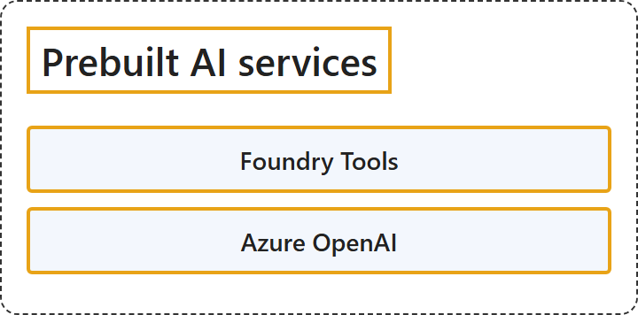

# 13.2 Prebuilt AI Services

## Classification

## Glossary

| Term | Definition | 中文翻译 | Source |
|---|---|---|---|
| **Foundry Tools** Foundry Tools | "Foundry Tools: A **suite of prebuilt and customizable APIs and models** for **adding intelligent features to applications**. Foundry Tools includes capabilities for speech, translation, language understanding, document intelligence, content understanding, vision, content safety, and search." | Foundry Tools：一套**预构建且可自定义的 API 和模型**，用于**向应用程序添加智能功能**。Foundry Tools 包括语音、翻译、语言理解、文档智能、内容理解、视觉、内容安全和搜索等功能。 | [Microsoft, 2026, "Prebuilt AI services" section, list item 1](https://learn.microsoft.com/en-us/azure/architecture/ai-ml/ai-get-started#:~:text=A%20suite%20of%20prebuilt%20and%20customizable%20APIs%20and%20models) |
| **Azure OpenAI** Azure OpenAI | "Azure OpenAI: Provides **access to OpenAI models**, including GPT and DALL-E, through **Azure-managed infrastructure** with enterprise security, networking, and responsible AI controls." | Azure OpenAI：提供**对 OpenAI 模型的访问**，通过的是 **Azure 托管的基础结构**，包括 GPT 和 DALL-E，并具有企业安全、网络和负责任 AI 控制。 | [Microsoft, 2026, "Prebuilt AI services" section, list item 2](https://learn.microsoft.com/en-us/azure/architecture/ai-ml/ai-get-started#:~:text=Provides%20access%20to%20OpenAI%20models) |

## References

- Microsoft. (2026, October 13). *Get started with AI architecture design*. Azure Architecture Center. https://learn.microsoft.com/en-us/azure/architecture/ai-ml/ai-get-started
