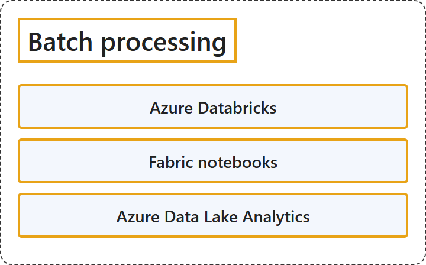

# 11.2 Batch Processing

## Classification

## Glossary

| Term | Definition | 中文翻译 | Source |
|---|---|---|---|
| **Azure Databricks** Azure Databricks | "Azure Databricks is a **unified, open analytics platform** for **building, deploying, sharing, and maintaining enterprise-grade data, analytics, and AI solutions at scale**." | Azure Databricks 是一个**统一、开放的分析平台**，用于**大规模构建、部署、共享和维护企业级数据、分析和 AI 解决方案**。 | [Microsoft, 2026b, para. 1](https://learn.microsoft.com/en-us/azure/databricks/introduction/#:~:text=is%20a%20unified%2C%20open%20analytics%20platform) |
| **Fabric notebooks** Fabric 笔记本 | "The Microsoft Fabric notebook is a **primary code item** for **developing Apache Spark jobs and machine learning experiments**." | Microsoft Fabric 笔记本是一种**主要的代码项**，用于**开发 Apache Spark 作业和机器学习实验**。 | [Microsoft, 2026a, para. 1](https://learn.microsoft.com/en-us/fabric/data-engineering/how-to-use-notebook#:~:text=is%20a%20primary%20code%20item%20for%20developing%20Apache%20Spark%20jobs) |
| **Azure Data Lake Analytics** Azure Data Lake Analytics | "Azure Data Lake Analytics is an **on-demand analytics job service** that **simplifies big data**." | Azure Data Lake Analytics 是一种**按需分析作业服务**，它**简化了大数据处理**。 | [Microsoft, 2023, para. 1](https://learn.microsoft.com/en-us/azure/data-lake-analytics/data-lake-analytics-overview#:~:text=is%20an%20on-demand%20analytics%20job%20service) |

## References

- Microsoft. (2023, December 19). *What is Azure Data Lake Analytics?* Microsoft Learn. https://learn.microsoft.com/en-us/azure/data-lake-analytics/data-lake-analytics-overview
- Microsoft. (2026a, April 24). *How to use Microsoft Fabric notebooks*. Microsoft Learn. https://learn.microsoft.com/en-us/fabric/data-engineering/how-to-use-notebook
- Microsoft. (2026b, September 11). *What is Azure Databricks?* Microsoft Learn. https://learn.microsoft.com/en-us/azure/databricks/introduction/
