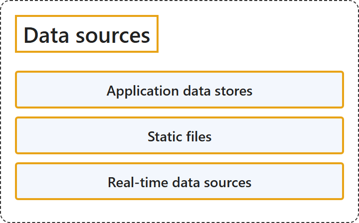

# 11.1 Data Sources

## Classification

## Glossary

| Term | Definition | 中文翻译 | Source |
|---|---|---|---|
| **Application data stores** 应用程序数据存储 | (context) "**Application data stores**, such as **relational databases**." | （语境）**应用程序数据存储**，例如**关系数据库**。 | [Microsoft, 2025, "Components of a big data architecture" section, list item 1](https://learn.microsoft.com/en-us/azure/architecture/databases/guide/big-data-architectures#:~:text=Application%20data%20stores%2C%20such%20as%20relational%20databases) |
| **Static files** 静态文件 | (context) "**Static files that applications produce**, such as **web server log files**." | （语境）**应用程序生成的静态文件**，例如 **Web 服务器日志文件**。 | [Microsoft, 2025, "Components of a big data architecture" section, list item 1](https://learn.microsoft.com/en-us/azure/architecture/databases/guide/big-data-architectures#:~:text=Static%20files%20that%20applications%20produce) |
| **Real-time data sources** 实时数据源 | (context) "**Real-time data sources**, such as **Internet of Things (IoT) devices**." | （语境）**实时数据源**，例如**物联网（IoT）设备**。 | [Microsoft, 2025, "Components of a big data architecture" section, list item 1](https://learn.microsoft.com/en-us/azure/architecture/databases/guide/big-data-architectures#:~:text=Real-time%20data%20sources%2C%20such%20as%20Internet%20of%20Things) |

## References

- Microsoft. (2025). *Big data architectures*. Azure Architecture Center. https://learn.microsoft.com/en-us/azure/architecture/databases/guide/big-data-architectures
