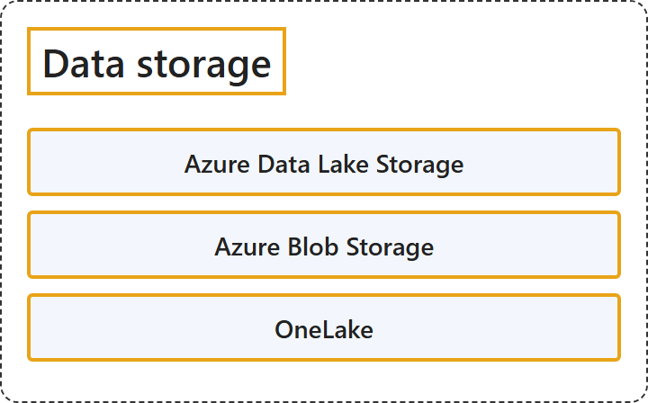

# 11.1 Data storage

## Classification

## Glossary

| Term | Definition | 中文翻译 | Source |
|---|---|---|---|
| **Azure Data Lake Storage** Azure Data Lake Storage | "Azure Data Lake Storage is a **set of capabilities dedicated to big data analytics**, built on **Azure Blob Storage**." | Azure Data Lake Storage 是一组**专用于大数据分析的功能**，构建在 **Azure Blob 存储**之上。 | [Microsoft, 2026b, para. 1](https://learn.microsoft.com/en-us/azure/storage/blobs/data-lake-storage-introduction#:~:text=is%20a%20set%20of%20capabilities%20dedicated%20to%20big%20data%20analytics) |
| **Azure Blob Storage** Azure Blob 存储 | "Azure Blob Storage is Microsoft's **object storage solution for the cloud**. Blob Storage is optimized for **storing massive amounts of unstructured data**." | Azure Blob 存储是 Microsoft 的**云对象存储解决方案**。Blob 存储针对**存储海量非结构化数据**进行了优化。 | [Microsoft, 2026a, para. 1](https://learn.microsoft.com/en-us/azure/storage/blobs/storage-blobs-introduction#:~:text=object%20storage%20solution%20for%20the%20cloud) |
| **OneLake** OneLake | "Microsoft OneLake is a **unified data lake for your whole organization**. Every Microsoft Fabric tenant automatically includes OneLake, and it's the **single place for all your analytics data**." | Microsoft OneLake 是**面向整个组织的统一数据湖**。每个 Microsoft Fabric 租户都会自动包含 OneLake，它是**存放所有分析数据的唯一位置**。 | [Microsoft, 2026c, para. 1](https://learn.microsoft.com/en-us/fabric/onelake/onelake-overview#:~:text=is%20a%20unified%20data%20lake%20for%20your%20whole%20organization) |

## References

- Microsoft. (2026a, May 15). *Introduction to Azure Blob Storage*. Microsoft Learn. https://learn.microsoft.com/en-us/azure/storage/blobs/storage-blobs-introduction
- Microsoft. (2026b, July 3). *Introduction to Azure Data Lake Storage*. Microsoft Learn. https://learn.microsoft.com/en-us/azure/storage/blobs/data-lake-storage-introduction
- Microsoft. (2026c, August 23). *What is OneLake?* Microsoft Learn. https://learn.microsoft.com/en-us/fabric/onelake/onelake-overview
