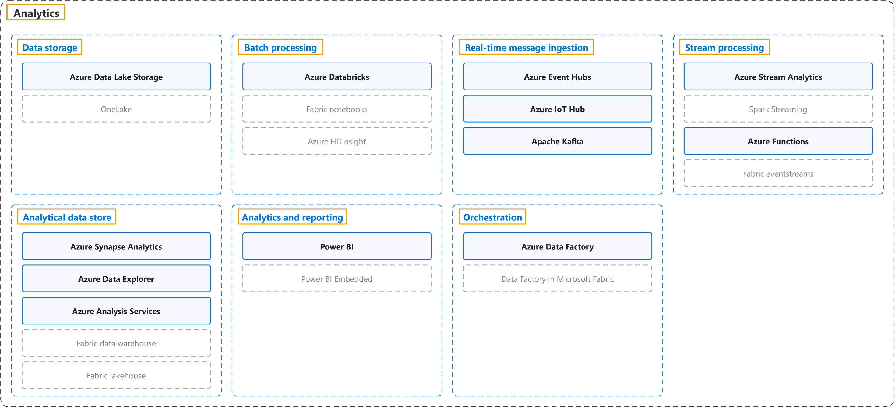

# 9. Analytics

## Classification

## Glossary

| Term | Definition | 中文翻译 | Source |
|---|---|---|---|
| **Analytics** 分析 | "**Big data analytics** refers to the **methods, tools, and applications** used to **collect, process, and derive insights** from varied, high-volume, high-velocity data sets." | **大数据分析**是指用来从多样、大量、高速的数据集中**收集、处理并获得洞察**的**方法、工具和应用程序**。 | [Microsoft, n.d., "What is big data analytics?" section, para. 1](https://azure.microsoft.com/en-us/resources/cloud-computing-dictionary/what-is-big-data-analytics#:~:text=Big%20data%20analytics%20refers%20to%20the%20methods) |
| **[Data storage](data-storage.md)** 数据存储 | "Data for **batch processing** operations is typically stored in a **distributed file store** that can hold **high volumes of large files** in various formats." | 用于**批处理**的数据通常存放在**分布式文件存储**中，它可以容纳各种格式的**大量大文件**。 | [Microsoft, 2025, "Components of a big data architecture" section, list item 2](https://learn.microsoft.com/en-us/azure/architecture/databases/guide/big-data-architectures#:~:text=Data%20for%20batch%20processing%20operations%20is%20typically%20stored) |
| **[Batch processing](batch-processing.md)** 批处理 | "The datasets are large, so a big data solution often processes data files by using **long-running batch jobs** to **filter, aggregate, and otherwise prepare data** for analysis." | 数据集很大，所以大数据解决方案通常用**长时间运行的批处理作业**来处理数据文件，对数据进行**筛选、聚合等准备**，以供分析。 | [Microsoft, 2025, "Components of a big data architecture" section, list item 3](https://learn.microsoft.com/en-us/azure/architecture/databases/guide/big-data-architectures#:~:text=The%20datasets%20are%20large%2C%20so%20a%20big%20data%20solution) |
| **[Real-time message ingestion](real-time-message-ingestion.md)** 实时消息引入 | "If the solution includes **real-time sources**, the architecture must **capture and store real-time messages** for **stream processing**." | 如果解决方案包含**实时数据源**，架构就必须**捕获并存储实时消息**，供**流处理**使用。 | [Microsoft, 2025, "Components of a big data architecture" section, list item 4](https://learn.microsoft.com/en-us/azure/architecture/databases/guide/big-data-architectures#:~:text=If%20the%20solution%20includes%20real-time%20sources) |
| **[Stream processing](stream-processing.md)** 流处理 | "After the solution **captures real-time messages**, it must process them by **filtering, aggregating, and preparing the data** for analysis." | 解决方案**捕获实时消息**之后，必须对它们进行**筛选、聚合和数据准备**，以供分析。 | [Microsoft, 2025, "Components of a big data architecture" section, list item 5](https://learn.microsoft.com/en-us/azure/architecture/databases/guide/big-data-architectures#:~:text=After%20the%20solution%20captures%20real-time%20messages) |
| **[Analytical data store](analytical-data-store.md)** 分析数据存储 | "Many big data solutions **prepare data for analysis** and then **serve the processed data** in a **structured format** that **analytical tools can query**." | 许多大数据解决方案先**为分析准备数据**，再以**分析工具可以查询**的**结构化格式**提供**处理后的数据**。 | [Microsoft, 2025, "Components of a big data architecture" section, list item 6](https://learn.microsoft.com/en-us/azure/architecture/databases/guide/big-data-architectures#:~:text=Many%20big%20data%20solutions%20prepare%20data%20for%20analysis) |
| **[Analytics and reporting](analytics-and-reporting.md)** 分析和报表 | "Most big data solutions strive to **provide insights into the data** through **analysis and reporting**." | 大多数大数据解决方案都力求通过**分析和报表**来**提供对数据的洞察**。 | [Microsoft, 2025, "Components of a big data architecture" section, list item 7](https://learn.microsoft.com/en-us/azure/architecture/databases/guide/big-data-architectures#:~:text=Most%20big%20data%20solutions%20strive%20to%20provide%20insights) |
| **[Orchestration](orchestration.md)** 编排 | "Most big data solutions consist of **repeated data processing operations** that are **encapsulated in workflows**." | 大多数大数据解决方案由**重复执行的数据处理操作**组成，这些操作**封装在工作流中**。 | [Microsoft, 2025, "Components of a big data architecture" section, list item 8](https://learn.microsoft.com/en-us/azure/architecture/databases/guide/big-data-architectures#:~:text=Most%20big%20data%20solutions%20consist%20of%20repeated) |

## Coverage

| Certification | Skill area |
|---|---|
| DP-900 Microsoft Azure Data Fundamentals | [Describe an analytics workload (25–30%)](https://learn.microsoft.com/en-us/credentials/certifications/resources/study-guides/dp-900#describe-an-analytics-workload-2530) |

**CST8911 Introduction to Cloud Computing**

| Week | Group | Terms in the course | Source |
|---|---|---|---|
| 1 | Analytical data store | managed data warehouse | Lecture 1: slide 11 |
| 2 | Data storage | Azure Data Lake Storage data lake | Reading: Azure Blob Storage (product page) |
| 4 | Orchestration | Azure Data Factory extract, transform, and load (ETL) | Lecture 3: slide 9 |
| 6 | Analytical data store | Azure Data Explorer | Lecture 5: slide 10 |
|  | Analytics and reporting | Power BI | Lecture 5: slide 9 |
|  | Orchestration | pipeline | Lecture 5: slide 10 |
| 7 | Analytics | big data analytics | Lecture 6: slide 8 |

**CST8912 Cloud Solution Architecture**

| Week | Group | Terms in the course | Source |
|---|---|---|---|
| 2 | Batch processing | batch processing Azure Databricks Apache Spark | Design Cloud Compute Solution: slides 7, 14, 15 |
| 4 | Analytics | big data analytics | Design Cloud Storage Solution: slide 20 |
|  | Data storage | Azure Data Lake Storage Gen2 (ADLS Gen2) | Design Cloud Storage Solution: slide 20 |
|  | Analytical data store | Azure Synapse Analytics | Design Cloud Storage Solution: slide 22 |
|  | Analytics and reporting | Power BI | Design Cloud Storage Solution: slide 22 |
|  | Orchestration | Azure Data Factory | Design Cloud Storage Solution: slide 22 |
| 5 | Analytics | real-time analytics | Design Cloud Database Solution: slide 15 |
|  | Analytical data store | data warehouse Azure Analysis Services | Design Cloud Database Solution: slide 16 |
|  | Orchestration | Azure Data Factory Studio pipeline | Lab 4: Azure Data Factory (Steps 12–21) |

**CST8913 Cloud Migration**

| Week | Group | Terms in the course | Source |
|---|---|---|---|
| 2 | Analytics | Microsoft Fabric | Lab 2: Azure services (Lab 2 case study) |
|  | Analytics and reporting | business intelligence (BI) | Introduction to Cloud Computing: slide 13 |
| 3 | Data storage | Azure Data Lake Storage | Target Cloud Architecture: slide 10 |
|  | Batch processing | Azure Databricks | Target Cloud Architecture: slide 8 |
|  | Real-time message ingestion | Azure Event Hubs | Target Cloud Architecture: slide 8 |
|  | Stream processing | stream processing | Target Cloud Architecture: slide 8 |
|  | Analytical data store | Azure Synapse Analytics | Target Cloud Architecture: slide 10 |
|  | Analytics and reporting | Power BI | Target Cloud Architecture: slide 10 |
| 5 | Analytical data store | data warehouse | Rehosting Migration: slide 4 |

**CST8915 Full-stack Cloud-native Development**

| Week | Group | Terms in the course | Source |
|---|---|---|---|
| 3 | Data storage | Data Lake Storage Gen2 | Microservices: slides 32, 33 |
|  | Batch processing | batch analytics Azure Databricks | Microservices: slides 32, 33 |
|  | Real-time message ingestion | Azure Event Hubs (Azure Events Hub) Apache Kafka | Microservices: slides 32, 33 |
|  | Stream processing | real-time stream processing streaming extract, transform, load (streaming ETL) Azure Stream Analytics | Microservices: slides 32, 33 |
|  | Analytical data store | Azure Data Explorer | Microservices: slides 32, 33 |
|  | Analytics and reporting | Power BI | Microservices: slides 32, 33 |

**CST8916 Remote Data and Real-time Applications**

| Week | Group | Terms in the course | Source |
|---|---|---|---|
| 1 | Analytics | real-time analytics data processing and analytics | Introduction to Remote Data and Real-time Applications: slides 19, 20, 27 |
|  | Stream processing | stream analytics | Introduction to Remote Data and Real-time Applications: slide 27 |
| 6 | Analytics | big data data analytics real-time analytics | Popular Cloud Services for Real-time Applications II: slides 6, 7, 10 |
|  | Data storage | Data Lake Storage Gen2 Azure Data Lake Gen 1 (retired) | Popular Cloud Services for Real-time Applications II: slides 7, 12 |
|  | Batch processing | batch analytics Azure Databricks batch processing | Popular Cloud Services for Real-time Applications II: slides 7, 10 |
|  | Real-time message ingestion | Azure Event Hubs Apache Kafka Azure IoT Hub | Popular Cloud Services for Real-time Applications II: slides 6, 8, 20 |
|  | Stream processing | real-time stream processing streaming ETL Azure Stream Analytics | Popular Cloud Services for Real-time Applications II: slides 7, 11 |
|  | Analytical data store | Azure Data Explorer Azure Synapse Analytics | Popular Cloud Services for Real-time Applications II: slides 7, 12 |
|  | Analytics and reporting | Power BI | Popular Cloud Services for Real-time Applications II: slide 7 |

## References

- Microsoft. (n.d.). *What is big data analytics?* Microsoft Azure. Retrieved October 24, 2026, from https://azure.microsoft.com/en-us/resources/cloud-computing-dictionary/what-is-big-data-analytics
- Microsoft. (2025). *Big data architectures*. Azure Architecture Center. https://learn.microsoft.com/en-us/azure/architecture/databases/guide/big-data-architectures
- Microsoft. (2026). *Study guide for Exam DP-900: Microsoft Azure Data Fundamentals*. Microsoft Learn. https://learn.microsoft.com/en-us/credentials/certifications/resources/study-guides/dp-900
