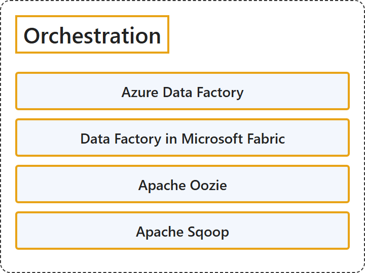

# 11.7 Orchestration

## Classification

## Glossary

| Term | Definition | 中文翻译 | Source |
|---|---|---|---|
| **Azure Data Factory** Azure 数据工厂 | "Azure Data Factory is a **managed cloud service** that's built for these complex **hybrid extract-transform-load (ETL), extract-load-transform (ELT), and data integration projects**." | Azure 数据工厂是一项**托管云服务**，专为这些复杂的**混合提取-转换-加载 (ETL)、提取-加载-转换 (ELT) 和数据集成项目**而构建。 | [Microsoft, 2026a, para. 2](https://learn.microsoft.com/en-us/azure/data-factory/introduction#:~:text=is%20a%20managed%20cloud%20service) |
| **Data Factory in Microsoft Fabric** Microsoft Fabric 中的数据工厂 | (context) "Data Factory in Microsoft Fabric helps you solve one of business's toughest challenges: **turning scattered data into useful insights**." | （语境）Microsoft Fabric 中的数据工厂帮助你解决业务中最棘手的挑战之一：**把分散的数据转化为有用的见解**。 | [Microsoft, 2026b, para. 1](https://learn.microsoft.com/en-us/fabric/data-factory/data-factory-overview#:~:text=helps%20you%20solve%20one%20of%20business) |
| **Apache Oozie** Apache Oozie | "Oozie is a **workflow scheduler system** to **manage Apache Hadoop jobs**." | Oozie 是一个**工作流调度系统**，用于**管理 Apache Hadoop 作业**。 | [Apache Software Foundation, n.d.-a, para. 1](https://oozie.apache.org/#:~:text=Oozie%20is%20a%20workflow%20scheduler%20system) |
| **Apache Sqoop** Apache Sqoop | "Apache Sqoop(TM) is a **tool designed for efficiently transferring bulk data** between **Apache Hadoop and structured datastores** such as relational databases." | Apache Sqoop(TM) 是一种**专为高效传输批量数据而设计的工具**，在 **Apache Hadoop 与结构化数据存储**（例如关系数据库）之间传输。 | [Apache Software Foundation, n.d.-b, para. 1](https://sqoop.apache.org/#:~:text=is%20a%20tool%20designed%20for%20efficiently%20transferring%20bulk%20data) |

## References

- Apache Software Foundation. (n.d.-a). *Apache Oozie workflow scheduler for Hadoop*. Apache Oozie. Retrieved October 27, 2026, from https://oozie.apache.org/
- Apache Software Foundation. (n.d.-b). *Sqoop*. Apache Sqoop. Retrieved October 27, 2026, from https://sqoop.apache.org/
- Microsoft. (2026a, June 19). *What is Azure Data Factory?* Microsoft Learn. https://learn.microsoft.com/en-us/azure/data-factory/introduction
- Microsoft. (2026b, August 5). *What is Data Factory in Microsoft Fabric?* Microsoft Learn. https://learn.microsoft.com/en-us/fabric/data-factory/data-factory-overview
