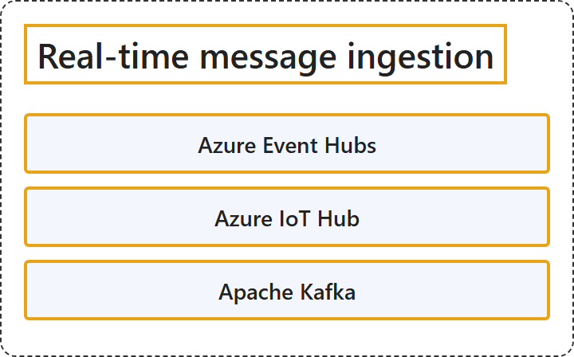

# 11.3 Real-time message ingestion

## Classification

## Glossary

| Term | Definition | 中文翻译 | Source |
|---|---|---|---|
| **Azure Event Hubs** Azure 事件中心 | "Azure Event Hubs is a **fully managed, real-time data streaming platform** that can **ingest millions of events per second** with low latency." | Azure 事件中心是一个**完全托管的实时数据流式处理平台**，能够以低延迟**每秒引入数百万个事件**。 | [Microsoft, 2026a, para. 1](https://learn.microsoft.com/en-us/azure/event-hubs/event-hubs-about#:~:text=is%20a%20fully%20managed%2C%20real-time%20data%20streaming%20platform) |
| **Azure IoT Hub** Azure IoT 中心 | "Azure IoT Hub is a **managed service** that acts as a **central message hub in a cloud-based IoT solution**." | Azure IoT 中心是一项**托管服务**，充当**基于云的 IoT 解决方案中的中央消息中心**。 | [Microsoft, 2026b, para. 2](https://learn.microsoft.com/en-us/azure/iot-hub/iot-concepts-and-iot-hub#:~:text=is%20a%20managed%20service%20that%20acts%20as%20a%20central%20message%20hub) |
| **Apache Kafka** Apache Kafka | "Apache Kafka® is an **event streaming platform**." | Apache Kafka® 是一个**事件流平台**。 | [Apache Software Foundation, n.d., "Apache Kafka® is an event streaming platform. What does that mean?" section heading](https://kafka.apache.org/intro#:~:text=is%20an%20event%20streaming%20platform) |

## References

- Apache Software Foundation. (n.d.). *Introduction*. Apache Kafka. Retrieved October 27, 2026, from https://kafka.apache.org/intro
- Microsoft. (2026a, January 28). *What is Azure Event Hubs?* Microsoft Learn. https://learn.microsoft.com/en-us/azure/event-hubs/event-hubs-about
- Microsoft. (2026b, May 21). *What is Azure IoT Hub?* Microsoft Learn. https://learn.microsoft.com/en-us/azure/iot-hub/iot-concepts-and-iot-hub
