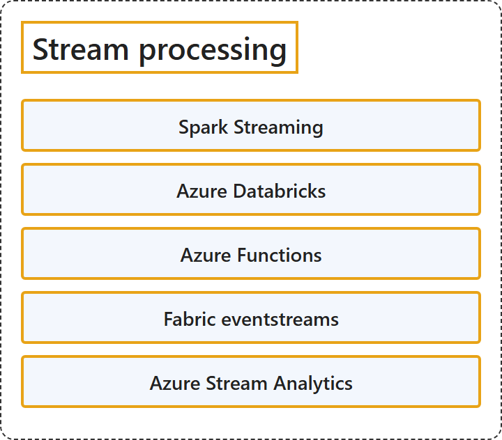

# 11.4 Stream Processing

## Classification

## Glossary

| Term | Definition | 中文翻译 | Source |
|---|---|---|---|
| **Spark Streaming** Spark Streaming | "Spark Streaming is an **extension of the core Spark API** that enables **scalable, high-throughput, fault-tolerant stream processing of live data streams**." | Spark Streaming 是**核心 Spark API 的扩展**，能够对**实时数据流进行可扩展、高吞吐量、容错的流处理**。 | [Apache Software Foundation, n.d., "Overview" section, para. 2](https://spark.apache.org/docs/latest/streaming-programming-guide.html#:~:text=is%20an%20extension%20of%20the%20core%20Spark%20API) |
| **Azure Databricks** Azure Databricks | "Azure Databricks is a **unified, open analytics platform** for **building, deploying, sharing, and maintaining enterprise-grade data, analytics, and AI solutions at scale**." | Azure Databricks 是一个**统一、开放的分析平台**，用于**大规模构建、部署、共享和维护企业级数据、分析和 AI 解决方案**。 | [Microsoft, 2026c, para. 1](https://learn.microsoft.com/en-us/azure/databricks/introduction/#:~:text=is%20a%20unified%2C%20open%20analytics%20platform) |
| **Azure Functions** Azure Functions | "Azure Functions is a **serverless solution** that allows you to **build robust apps while using less code**, and with less infrastructure and lower costs." | Azure Functions 是一种**无服务器解决方案**，让你可以**用更少的代码构建可靠的应用**，同时使用更少的基础结构，成本也更低。 | [Microsoft, 2026d, para. 1](https://learn.microsoft.com/en-us/azure/azure-functions/functions-overview#:~:text=is%20a%20serverless%20solution%20that%20allows%20you%20to%20build%20robust%20apps) |
| **Fabric eventstreams** Fabric 事件流 | (context) "Use the eventstreams feature in Microsoft Fabric Real-Time Intelligence to **bring real-time events into Fabric**, **transform them**, and then **send them to various destinations without writing any code**." | （语境）使用 Microsoft Fabric 实时智能中的事件流功能，**把实时事件引入 Fabric**、**转换它们**，然后**无需编写任何代码就把它们发送到各种目标**。 | [Microsoft, 2026a, para. 1](https://learn.microsoft.com/en-us/fabric/real-time-intelligence/event-streams/overview#:~:text=Use%20the%20eventstreams%20feature%20in%20Microsoft%20Fabric%20Real-Time%20Intelligence) |
| **Azure Stream Analytics** Azure 流分析 | "Azure Stream Analytics is a **fully managed stream processing engine** that **analyzes and processes large volumes of streaming data** with submillisecond latencies." | Azure 流分析是一种**完全托管的流处理引擎**，以亚毫秒级延迟**分析和处理大量流数据**。 | [Microsoft, 2026b, para. 1](https://learn.microsoft.com/en-us/azure/stream-analytics/stream-analytics-introduction#:~:text=is%20a%20fully%20managed%20stream%20processing%20engine) |

## References

- Apache Software Foundation. (n.d.). *Spark Streaming programming guide*. Apache Spark documentation. Retrieved October 27, 2026, from. https://spark.apache.org/docs/latest/streaming-programming-guide.html
- Microsoft. (2026a, September 2). *Overview of Microsoft Fabric eventstreams*. Microsoft Learn. https://learn.microsoft.com/en-us/fabric/real-time-intelligence/event-streams/overview
- Microsoft. (2026b, February 6). *Welcome to Azure Stream Analytics*. Microsoft Learn. https://learn.microsoft.com/en-us/azure/stream-analytics/stream-analytics-introduction
- Microsoft. (2026c, September 11). *What is Azure Databricks?* Microsoft Learn. https://learn.microsoft.com/en-us/azure/databricks/introduction/
- Microsoft. (2026d, September 21). *What is Azure Functions?* Microsoft Learn. https://learn.microsoft.com/en-us/azure/azure-functions/functions-overview
