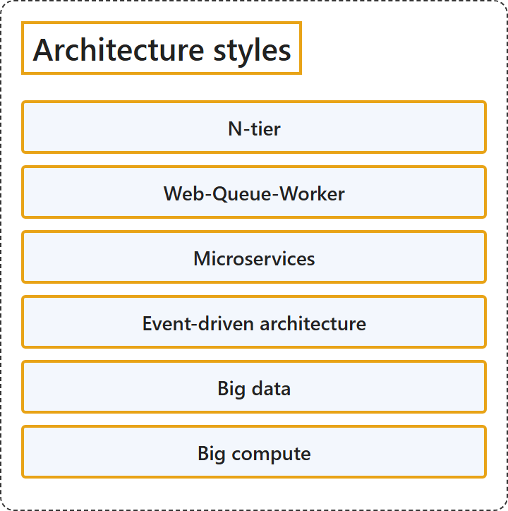

# 27.1 Architecture Styles

## Classification

## Glossary

| Term | Definition | 中文翻译 | Source |
|---|---|---|---|
| **N-tier** N 层 | "N-tier is a **traditional architecture for enterprise applications** that **divides an application into logical layers and physical tiers**." | N 层是一种**面向企业应用程序的传统体系结构**，它**把应用程序划分为逻辑层和物理层级**。 | [Microsoft, 2025, "A quick tour of the styles" section, "N-tier", para. 1](https://learn.microsoft.com/en-us/azure/architecture/guide/architecture-styles/#:~:text=is%20a%20traditional%20architecture%20for%20enterprise%20applications) |
| **Web-Queue-Worker** Web-队列-辅助角色 | "Web-Queue-Worker is an architecture that consists of a **web front end, a message queue, and a back-end worker**." | Web-队列-辅助角色是一种体系结构，由 **Web 前端、消息队列和后端辅助角色**组成。 | [Microsoft, 2025, "A quick tour of the styles" section, "Web-Queue-Worker", para. 1](https://learn.microsoft.com/en-us/azure/architecture/guide/architecture-styles/#:~:text=is%20an%20architecture%20that%20consists%20of%20a%20web%20front%20end) |
| **Microservices** 微服务 | "The Microservices architecture **decomposes applications into a collection of small, autonomous services**." | 微服务体系结构**把应用程序分解为一组小型的自治服务**。 | [Microsoft, 2025, "A quick tour of the styles" section, "Microservices", para. 1](https://learn.microsoft.com/en-us/azure/architecture/guide/architecture-styles/#:~:text=architecture%20decomposes%20applications%20into%20a%20collection%20of%20small%2C%20autonomous%20services) |
| **Event-driven architecture** 事件驱动体系结构 | "Event-driven architectures use a **publish-subscribe model** where **event producers generate streams of events**, and **event consumers respond to those events** in near real time." | 事件驱动体系结构使用**发布-订阅模型**，其中**事件生成者生成事件流**，**事件使用者近实时地响应这些事件**。 | [Microsoft, 2025, "A quick tour of the styles" section, "Event-driven architecture", para. 1](https://learn.microsoft.com/en-us/azure/architecture/guide/architecture-styles/#:~:text=architectures%20use%20a) |
| **Big data** 大数据 | "Big data architectures handle the **ingestion, processing, and analysis of data** that's **too large or complex for traditional database systems**." | 大数据体系结构负责**数据的引入、处理和分析**，这些数据**对传统数据库系统来说过于庞大或复杂**。 | [Microsoft, 2025, "A quick tour of the styles" section, "Big data", para. 1](https://learn.microsoft.com/en-us/azure/architecture/guide/architecture-styles/#:~:text=architectures%20handle%20the%20ingestion%2C%20processing%2C%20and%20analysis%20of%20data) |
| **Big compute** 大计算 | "Big compute architectures support **large-scale workloads** that require **hundreds or thousands of cores** for computationally intensive operations." | 大计算体系结构支持**大规模工作负载**，这些工作负载需要**数百或数千个核心**来执行计算密集型操作。 | [Microsoft, 2025, "A quick tour of the styles" section, "Big compute", para. 1](https://learn.microsoft.com/en-us/azure/architecture/guide/architecture-styles/#:~:text=architectures%20support%20large-scale%20workloads) |

## References

- Microsoft. (2025, October 14). *Architecture styles*. Azure Architecture Center. https://learn.microsoft.com/en-us/azure/architecture/guide/architecture-styles/
