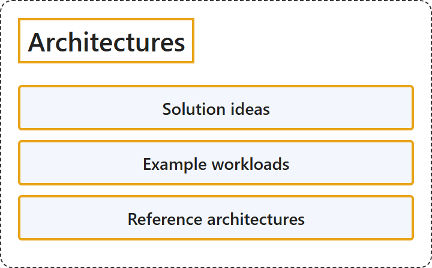

# 27.5 Architectures

## Classification

## Glossary

| Term | Definition | 中文翻译 | Source |
|---|---|---|---|
| **Solution ideas** 解决方案构想 | (context) "Azure Architecture Center is home to articles about **solution ideas**, example workloads, and reference architectures. These articles typically list the **common components and considerations** that align with the Well-Architected Framework." | （语境）Azure 架构中心收录有关**解决方案构想**、示例工作负载和参考体系结构的文章。这些文章通常列出**常见组件和注意事项**，与 Well-Architected Framework 保持一致。 | [Microsoft, 2026, "Evaluate reference architectures" section, para. 1](https://learn.microsoft.com/en-us/azure/architecture/guide/#:~:text=Azure%20Architecture%20Center%20is%20home%20to%20articles%20about%20solution%20ideas) |
| **Example workloads** 示例工作负载 | (context) "Azure Architecture Center is home to articles about solution ideas, **example workloads**, and reference architectures. These articles typically list the **common components and considerations** that align with the Well-Architected Framework." | （语境）Azure 架构中心收录有关解决方案构想、**示例工作负载**和参考体系结构的文章。这些文章通常列出**常见组件和注意事项**，与 Well-Architected Framework 保持一致。 | [Microsoft, 2026, "Evaluate reference architectures" section, para. 1](https://learn.microsoft.com/en-us/azure/architecture/guide/#:~:text=Azure%20Architecture%20Center%20is%20home%20to%20articles%20about%20solution%20ideas) |
| **Reference architectures** 参考体系结构 | (context) "Azure Architecture Center is home to articles about solution ideas, example workloads, and **reference architectures**. These articles typically list the **common components and considerations** that align with the Well-Architected Framework." | （语境）Azure 架构中心收录有关解决方案构想、示例工作负载和**参考体系结构**的文章。这些文章通常列出**常见组件和注意事项**，与 Well-Architected Framework 保持一致。 | [Microsoft, 2026, "Evaluate reference architectures" section, para. 1](https://learn.microsoft.com/en-us/azure/architecture/guide/#:~:text=Azure%20Architecture%20Center%20is%20home%20to%20articles%20about%20solution%20ideas) |

## References

- Microsoft. (2026, January 30). *Azure application architecture fundamentals*. Azure Architecture Center. https://learn.microsoft.com/en-us/azure/architecture/guide/
