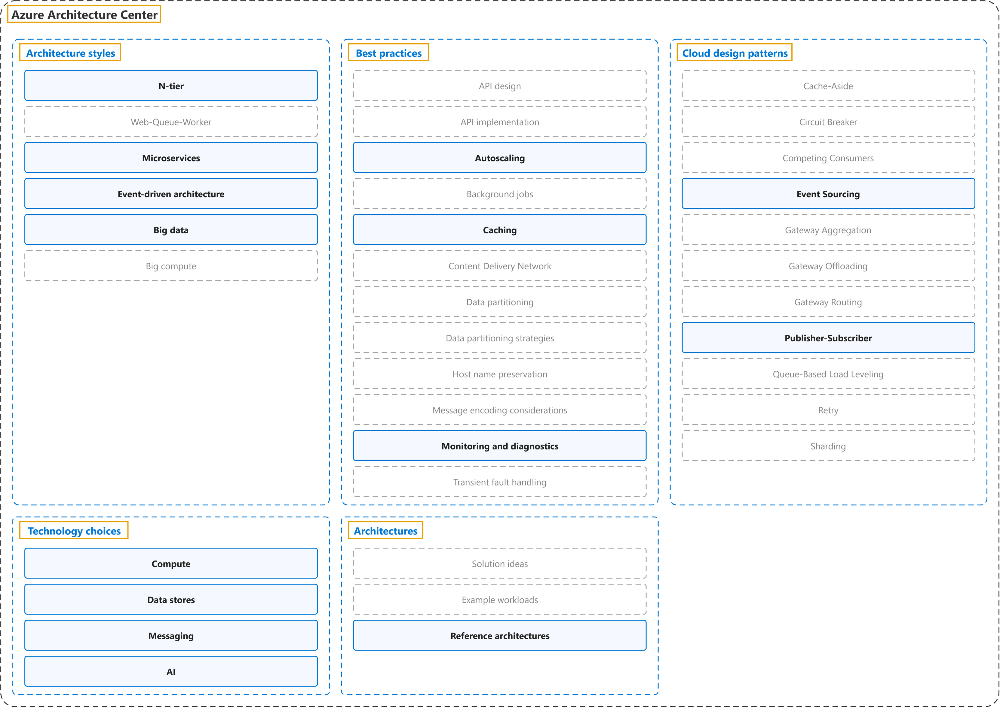

# 19. Azure Architecture Center

## Classification

## Glossary

| Term | Definition | 中文翻译 | Source |
|---|---|---|---|
| **Azure Architecture Center** Azure 体系结构中心 | "The **Azure Architecture Center** provides **guidance for designing and building solutions on Azure** by using **established patterns and practices**." | **Azure 体系结构中心**通过**成熟的模式和做法**，提供**在 Azure 上设计和构建解决方案的指导**。 | [Microsoft, 2026b, para. 1](https://learn.microsoft.com/en-us/azure/architecture/#:~:text=The%20Azure%20Architecture%20Center%20provides%20guidance) |
| **[Architecture styles](architecture-styles.md)** 体系结构样式 | "An **architecture style** is a **family of architectures** that **share specific characteristics**." | **体系结构样式**是**具有某些共同特征**的**一类架构**。 | [Microsoft, 2025, para. 1](https://learn.microsoft.com/en-us/azure/architecture/guide/architecture-styles/#:~:text=An%20architecture%20style%20is%20a%20family) |
| **[Best practices](best-practices.md)** 最佳做法 | "The **best practices** in this article provide guidance for **common concerns that arise in distributed systems**, such as caching, data partitioning, API design, and transient fault handling." | 本文中的**最佳做法**为**分布式系统中常见的问题**提供指导，例如缓存、数据分区、API 设计和暂时性故障处理。 | [Microsoft, 2026c, para. 1](https://learn.microsoft.com/en-us/azure/architecture/best-practices/index-best-practices#:~:text=The%20best%20practices%20in%20this%20article%20provide) |
| **[Cloud design patterns](cloud-design-patterns.md)** 云设计模式 | "**Software design patterns** are **named and repeatable approaches** that you can apply to **processing or data storage**." | **软件设计模式**是**有名称、可重复使用的方法**，可以用于**处理或数据存储**。 | [Microsoft, 2026a, "Use design patterns to solve common problems and introduce strategic tradeoffs" section, para. 1](https://learn.microsoft.com/en-us/azure/architecture/guide/#:~:text=Software%20design%20patterns%20are%20named%20and%20repeatable) |
| **[Technology choices](technology-choices.md)** 技术选择 | "... you can choose the **main technology components** for the architecture." | ……你可以为架构选择**主要的技术组件**。 | [Microsoft, 2026a, "Make informed technology choices" section, para. 1](https://learn.microsoft.com/en-us/azure/architecture/guide/#:~:text=you%20can%20choose%20the%20main%20technology%20components) |
| **[Architectures](architectures.md)** 架构 | "**Azure Architecture Center** is home to articles about **solution ideas, example workloads, and reference architectures**." | **Azure 体系结构中心**收录了关于**解决方案构想、示例工作负载和参考体系结构**的文章。 | [Microsoft, 2026a, "Evaluate reference architectures" section, para. 1](https://learn.microsoft.com/en-us/azure/architecture/guide/#:~:text=Azure%20Architecture%20Center%20is%20home%20to%20articles) |

## Coverage

| Certification | Skill area |
|---|---|
| AZ-305 Designing Microsoft Azure Infrastructure Solutions | [Design infrastructure solutions (30–35%)](https://learn.microsoft.com/en-us/credentials/certifications/resources/study-guides/az-305#design-infrastructure-solutions-3035) |

**CST8911 Introduction to Cloud Computing**

| Week | Group | Terms in the course | Source |
|---|---|---|---|
| 2 | Best practices | autoscaling | Lecture 2: slide 5 |
| 6 | Architectures | cloud reference architecture | Lecture 5: slide 6 |
| 7 | Architecture styles | microservices big data analytics | Lecture 6: slides 6, 8 |
|  | Best practices | best practice | Lecture 6: slide 2 |

**CST8912 Cloud Solution Architecture**

| Week | Group | Terms in the course | Source |
|---|---|---|---|
| 2 | Azure Architecture Center | Azure Architecture Center | Design Cloud Compute Solution: slide 13 |
|  | Architecture styles | microservices | Design Cloud Compute Solution: slide 12 |
|  | Best practices | autoscale cache | Design Cloud Compute Solution: slides 7, 14, 15 |
|  | Architectures | reference architecture | Design Cloud Compute Solution: slides 14, 15 |
| 3 | Architecture styles | N-tier architecture | Design Cloud Networking Solution: slide 18 |
| 4 | Architecture styles | event-driven architecture big data analytics | Design Cloud Storage Solution: slides 16, 20 |
| 6 | Best practices | best practice | Week 6 – Cloud Architecture best practices: slide 4 |

**CST8913 Cloud Migration**

| Week | Group | Terms in the course | Source |
|---|---|---|---|
| 2 | Azure Architecture Center | Azure Architecture Center | Reading: Cloud Adoption Framework (Units 5–7) |
| 3 | Architecture styles | N-tier architecture | Target Cloud Architecture: slide 6 |
|  | Architectures | reference architecture | Target Cloud Architecture: slide 6 |

**CST8915 Full-stack Cloud-native Development**

| Week | Group | Terms in the course | Source |
|---|---|---|---|
| 1 | Architecture styles | microservices architecture | Introduction to Cloud-Native Applications: slide 36 |
|  | Cloud design patterns | API gateway publish-subscribe | Introduction to Cloud-Native Applications: slide 42 |
| 3 | Architecture styles | microservices architecture | Microservices: slides 4, 5 |

**CST8916 Remote Data and Real-time Applications**

| Week | Group | Terms in the course | Source |
|---|---|---|---|
| 5 | Architecture styles | event-driven architecture | Popular Cloud Services for Real-time Applications I: slide 15 |
|  | Best practices | best practice | Popular Cloud Services for Real-time Applications I: slide 5 |
|  | Cloud design patterns | API gateway database-per-service pattern | Popular Cloud Services for Real-time Applications I: slides 30, 38 |
| 6 | Architecture styles | big data | Popular Cloud Services for Real-time Applications II: slide 6 |
|  | Cloud design patterns | event sourcing | Popular Cloud Services for Real-time Applications II: slide 9 |

## References

- Microsoft. (2025). *Architecture styles*. Azure Architecture Center. https://learn.microsoft.com/en-us/azure/architecture/guide/architecture-styles/
- Microsoft. (2026a). *Azure application architecture fundamentals*. Azure Architecture Center. https://learn.microsoft.com/en-us/azure/architecture/guide/
- Microsoft. (2026b). *Azure Architecture Center*. Microsoft Learn. https://learn.microsoft.com/en-us/azure/architecture/
- Microsoft. (2026c). *Best practices in cloud applications*. Azure Architecture Center. https://learn.microsoft.com/en-us/azure/architecture/best-practices/index-best-practices
