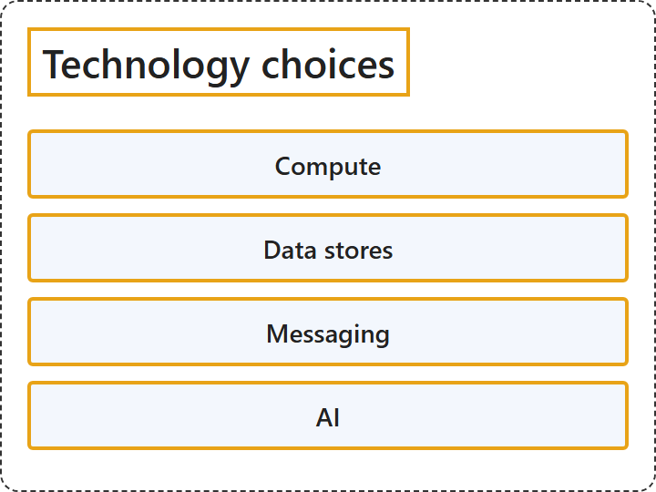

# 27.4 Technology choices

## Classification

## Glossary

| Term | Definition | 中文翻译 | Source |
|---|---|---|---|
| **Compute** 计算 | "Compute refers to the **hosting model for the computing resources**, or **application platform**, that your applications run on." | 计算指的是**计算资源的托管模型**，即你的应用程序运行所在的**应用程序平台**。 | [Microsoft, 2026, "Make informed technology choices" section, list item 1](https://learn.microsoft.com/en-us/azure/architecture/guide/#:~:text=refers%20to%20the%20hosting%20model%20for%20the%20computing%20resources) |
| **Data stores** 数据存储 | "Data stores include **databases and storage** for **files, caches, logs, and anything else** that an application might persist to storage." | 数据存储包括**数据库和存储**，用于保存**文件、缓存、日志以及应用程序可能持久保存的任何其他内容**。 | [Microsoft, 2026, "Make informed technology choices" section, list item 2](https://learn.microsoft.com/en-us/azure/architecture/guide/#:~:text=include%20databases%20and%20storage%20for%20files%2C%20caches%2C%20logs) |
| **Messaging** 消息传送 | "Messaging technologies enable **asynchronous messaging** between **components of the system**." | 消息传送技术支持**异步消息传送**，在**系统组件**之间。 | [Microsoft, 2026, "Make informed technology choices" section, list item 3](https://learn.microsoft.com/en-us/azure/architecture/guide/#:~:text=technologies%20enable%20asynchronous%20messaging) |
| **AI** AI | "AI technologies solve problems that are **computationally complex** to implement in **traditional application code**." | AI 技术解决那些**计算上很复杂**、难以用**传统应用程序代码**实现的问题。 | [Microsoft, 2026, "Make informed technology choices" section, list item 4](https://learn.microsoft.com/en-us/azure/architecture/guide/#:~:text=technologies%20solve%20problems%20that%20are%20computationally%20complex) |

## References

- Microsoft. (2026, January 30). *Azure application architecture fundamentals*. Azure Architecture Center. https://learn.microsoft.com/en-us/azure/architecture/guide/
