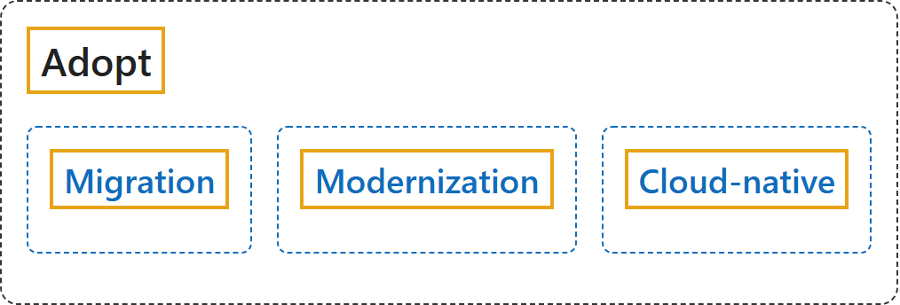

# 26.4 Adopt

## Classification

## Glossary

| Term | Definition | 中文解释 | Source |
|---|---|---|---|
| **Adopt** 采用 | (context) "**How will we migrate, modernize, and build workloads?**" | （语境）**我们要怎样迁移、现代化和构建工作负载？** | [Microsoft, 2026a, "How the Cloud Adoption Framework works" section, table row 4](https://learn.microsoft.com/en-us/azure/cloud-adoption-framework/overview#:~:text=How%20will%20we%20migrate%2C%20modernize%2C%20and%20build%20workloads%3F) |
| **Migration** 迁移 | (context) "This plan **translates high-level migration strategies** into **actionable deployment sequences**." | （语境）该计划把**高层次的迁移策略转化**为**可执行的部署顺序**。 | [Microsoft, 2026d, para. 1](https://learn.microsoft.com/en-us/azure/cloud-adoption-framework/migrate/plan-migration#:~:text=This%20plan%20translates%20high-level%20migration%20strategies) |
| **Modernization** 现代化 | "Modernization is **improving how a workload meets requirements** by **expanding its capabilities or making it more efficient to maintain and evolve**." | 现代化是**改进工作负载满足要求的方式**，方法是**扩展其能力，或使其更易于维护和演进**。 | [Microsoft, 2026b, "What is modernization?" section, para. 1](https://learn.microsoft.com/en-us/azure/cloud-adoption-framework/modernize/prepare-organization-cloud-modernization#:~:text=Modernization%20is%20improving%20how%20a%20workload%20meets%20requirements) |
| **Cloud-native** 云原生 | "A **cloud-native solution** creates **business value by building new workloads or enhancing existing ones**." | **云原生解决方案**通过**构建新工作负载或增强现有工作负载来创造业务价值**。 | [Microsoft, 2026c, para. 1](https://learn.microsoft.com/en-us/azure/cloud-adoption-framework/cloud-native/plan-cloud-native-solutions#:~:text=A%20cloud-native%20solution%20creates%20business%20value) |

## References

- Microsoft. (2026a, September 4). *Cloud Adoption Framework for Azure*. Microsoft Learn. https://learn.microsoft.com/en-us/azure/cloud-adoption-framework/overview
- Microsoft. (2026b, October 19). *Modernization preparation*. Cloud Adoption Framework. Microsoft Learn. https://learn.microsoft.com/en-us/azure/cloud-adoption-framework/modernize/prepare-organization-cloud-modernization
- Microsoft. (2026c, March 25). *Plan the cloud-native solutions*. Cloud Adoption Framework. Microsoft Learn. https://learn.microsoft.com/en-us/azure/cloud-adoption-framework/cloud-native/plan-cloud-native-solutions
- Microsoft. (2026d, March 25). *Plan your migration*. Cloud Adoption Framework. Microsoft Learn. https://learn.microsoft.com/en-us/azure/cloud-adoption-framework/migrate/plan-migration
