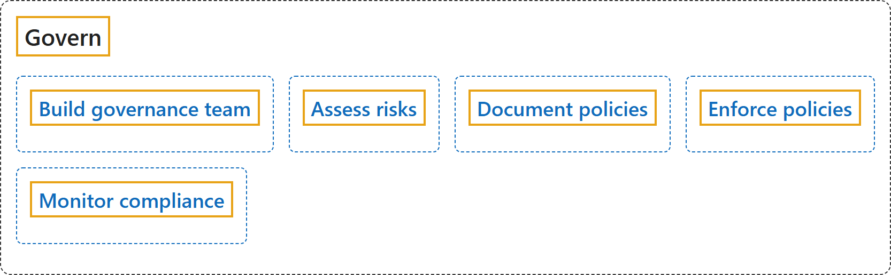

# 26.5 Govern

## Classification

## Glossary

| Term | Definition | 中文解释 | Source |
|---|---|---|---|
| **Govern** 治理 | "**Cloud governance** is how an organization **controls its use of cloud services by establishing guardrails**." | **云治理**是组织**通过建立防护措施来控制其云服务使用**的方式。 | [Microsoft, 2026b, para. 1](https://learn.microsoft.com/en-us/azure/cloud-adoption-framework/govern/build-cloud-governance-team#:~:text=Cloud%20governance%20is%20how%20an%20organization%20controls%20its) |
| **Build governance team** 组建治理团队 | (context) "The first step is to **establish a dedicated cloud governance team** to **oversee cloud governance across the organization**." | （语境）第一步是**建立专门的云治理团队**，**在整个组织中监督云治理**。 | [Microsoft, 2026b, para. 4](https://learn.microsoft.com/en-us/azure/cloud-adoption-framework/govern/build-cloud-governance-team#:~:text=establish%20a%20dedicated%20cloud%20governance%20team) |
| **Assess risks** 评估风险 | "A "risk" in this context is **any potential unwanted outcome**, such as a security breach, compliance violation, service outage, or cost overrun, that could result from **how the cloud is used**." | 此处的"风险"指**任何潜在的不良后果**，例如安全漏洞、合规违规、服务中断或成本超支，这些后果可能源于**云的使用方式**。 | [Microsoft, 2026a, para. 1](https://learn.microsoft.com/en-us/azure/cloud-adoption-framework/govern/assess-cloud-risks#:~:text=is%20any%20potential%20unwanted%20outcome) |
| **Document policies** 记录策略 | (context) "For each significant risk or group of risks, there should be **one or more corresponding governance policies**." | （语境）对于每个重大风险或每组风险，都应有**一个或多个相应的治理策略**。 | [Microsoft, 2026c, para. 1](https://learn.microsoft.com/en-us/azure/cloud-adoption-framework/govern/document-cloud-governance-policies#:~:text=there%20should%20be%20one%20or%20more%20corresponding%20governance%20policies) |
| **Enforce policies** 执行策略 | "**Cloud governance enforcement** means **implementing controls, processes, and tools** so that **cloud usage adheres to the governance policies**." | **云治理执行**是指**实施控制、流程和工具**，使**云的使用遵守治理策略**。 | [Microsoft, 2026d, para. 1](https://learn.microsoft.com/en-us/azure/cloud-adoption-framework/govern/enforce-cloud-governance-policies#:~:text=Cloud%20governance%20enforcement%20means%20implementing%20controls) |
| **Monitor compliance** 监视合规性 | "Monitoring is about **continuously measuring how well the cloud environment complies with your governance policies** and **detecting when it becomes noncompliant** with those policies." | 监视就是**持续衡量云环境遵守治理策略的程度**，并**检测它何时变得不合规**。 | [Microsoft, 2026e, para. 1](https://learn.microsoft.com/en-us/azure/cloud-adoption-framework/govern/monitor-cloud-governance#:~:text=Monitoring%20is%20about%20continuously%20measuring) |

## References

- Microsoft. (2026a, March 9). *Assess cloud risks*. Cloud Adoption Framework. Microsoft Learn. https://learn.microsoft.com/en-us/azure/cloud-adoption-framework/govern/assess-cloud-risks
- Microsoft. (2026b, October 1). *Build a cloud governance team*. Cloud Adoption Framework. Microsoft Learn. https://learn.microsoft.com/en-us/azure/cloud-adoption-framework/govern/build-cloud-governance-team
- Microsoft. (2026c, June 25). *Document cloud governance policies*. Cloud Adoption Framework. Microsoft Learn. https://learn.microsoft.com/en-us/azure/cloud-adoption-framework/govern/document-cloud-governance-policies
- Microsoft. (2026d, October 1). *Enforce cloud governance policies*. Cloud Adoption Framework. Microsoft Learn. https://learn.microsoft.com/en-us/azure/cloud-adoption-framework/govern/enforce-cloud-governance-policies
- Microsoft. (2026e, June 25). *Monitor cloud compliance*. Cloud Adoption Framework. Microsoft Learn. https://learn.microsoft.com/en-us/azure/cloud-adoption-framework/govern/monitor-cloud-governance
