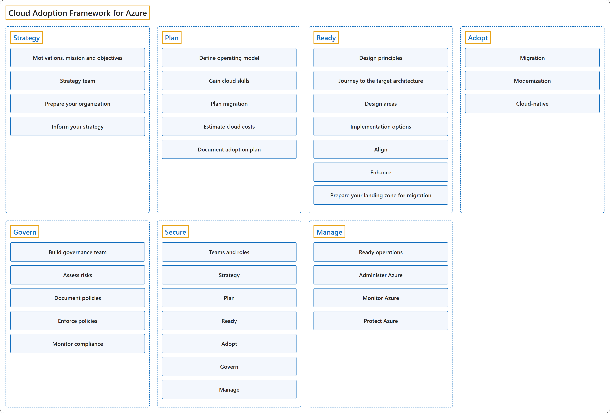

# 18. Cloud Adoption Framework for Azure

## Classification

## Glossary

Each phase is defined by the key decision it answers, as the framework's overview table puts it.

| Term | Definition | 中文翻译 | Source |
|---|---|---|---|
| **Cloud Adoption Framework for Azure** Azure 云采用框架 | "The **Microsoft Cloud Adoption Framework (CAF)** helps **decision makers** make **better decisions, faster**." | **Microsoft 云采用框架（CAF）**帮助**决策者**做出**更好的决策**，而且**更快**。 | [Microsoft, 2026, para. 1](https://learn.microsoft.com/en-us/azure/cloud-adoption-framework/overview#:~:text=The%20Microsoft%20Cloud%20Adoption%20Framework%20(CAF)%20helps) |
| **[Strategy](strategy.md)** 战略 | "**What should our Azure adoption look like?**" | **我们的 Azure 采用应该是什么样子？** | [Microsoft, 2026, "How the Cloud Adoption Framework works" section, table row 1](https://learn.microsoft.com/en-us/azure/cloud-adoption-framework/overview#:~:text=What%20should%20our%20Azure%20adoption%20look%20like) |
| **[Plan](plan.md)** 规划 | "**How will we prepare for Azure adoption?**" | **我们要怎样为采用 Azure 做准备？** | [Microsoft, 2026, "How the Cloud Adoption Framework works" section, table row 2](https://learn.microsoft.com/en-us/azure/cloud-adoption-framework/overview#:~:text=How%20will%20we%20prepare%20for%20Azure%20adoption) |
| **[Ready](ready.md)** 就绪 | "**How will we build our Azure landing zone?**" | **我们要怎样构建 Azure 登陆区？** | [Microsoft, 2026, "How the Cloud Adoption Framework works" section, table row 3](https://learn.microsoft.com/en-us/azure/cloud-adoption-framework/overview#:~:text=How%20will%20we%20build%20our%20Azure%20landing%20zone) |
| **[Adopt](adopt.md)** 采用 | "**How will we migrate, modernize, and build workloads?**" | **我们要怎样迁移、现代化和构建工作负载？** | [Microsoft, 2026, "How the Cloud Adoption Framework works" section, table row 4](https://learn.microsoft.com/en-us/azure/cloud-adoption-framework/overview#:~:text=How%20will%20we%20migrate%2C%20modernize%2C%20and%20build) |
| **[Govern](govern.md)** 治理 | "**How will we control our Azure environment?**" | **我们要怎样控制 Azure 环境？** | [Microsoft, 2026, "How the Cloud Adoption Framework works" section, table row 5](https://learn.microsoft.com/en-us/azure/cloud-adoption-framework/overview#:~:text=How%20will%20we%20control%20our%20Azure%20environment) |
| **[Secure](secure.md)** 安全 | "**How will we protect our Azure environment?**" | **我们要怎样保护 Azure 环境？** | [Microsoft, 2026, "How the Cloud Adoption Framework works" section, table row 6](https://learn.microsoft.com/en-us/azure/cloud-adoption-framework/overview#:~:text=How%20will%20we%20protect%20our%20Azure%20environment) |
| **[Manage](manage.md)** 管理 | "**How will we operate and optimize Azure over time?**" | **我们要怎样长期运营和优化 Azure？** | [Microsoft, 2026, "How the Cloud Adoption Framework works" section, table row 7](https://learn.microsoft.com/en-us/azure/cloud-adoption-framework/overview#:~:text=How%20will%20we%20operate%20and%20optimize%20Azure) |

## Coverage

| Certification | Skill area |
|---|---|
| AZ-305 Designing Microsoft Azure Infrastructure Solutions | [Design identity, governance, and monitoring solutions (25–30%)](https://learn.microsoft.com/en-us/credentials/certifications/resources/study-guides/az-305#design-identity-governance-and-monitoring-solutions-2530) [Design infrastructure solutions (30–35%)](https://learn.microsoft.com/en-us/credentials/certifications/resources/study-guides/az-305#design-infrastructure-solutions-3035) |

## References

- Microsoft. (2026). *Cloud Adoption Framework for Azure*. Microsoft Learn. https://learn.microsoft.com/en-us/azure/cloud-adoption-framework/overview
