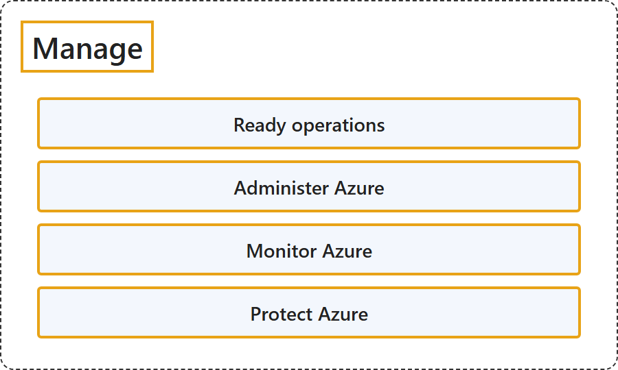

# 26.7 Manage

## Classification

## Glossary

| Term | Definition | 中文解释 | Source |
|---|---|---|---|
| **Manage** 管理 | (context) "The Cloud Adoption Framework (CAF) **Manage methodology** introduces the **RAMP approach (Ready, Administer, Monitor, Protect)** to help you build these capabilities." | （语境）云采用框架（CAF）的**管理方法**引入了 **RAMP 方法（就绪、管理、监视、保护）**，帮助你构建这些能力。 | [Microsoft, 2026d, para. 2](https://learn.microsoft.com/en-us/azure/cloud-adoption-framework/manage/ready-cloud-operations#:~:text=Manage%20methodology%20introduces%20the%20RAMP%20approach) |
| **Ready operations** 就绪运营 | (context) "RAMP provides a **structured way to organize teams, define responsibilities, and implement the processes and tools** that keep your Azure operations secure, compliant, and resilient." | （语境）RAMP 提供一种**组织团队、定义职责并实施流程和工具的结构化方式**，使你的 Azure 运营保持安全、合规且有复原能力。 | [Microsoft, 2026d, para. 2](https://learn.microsoft.com/en-us/azure/cloud-adoption-framework/manage/ready-cloud-operations#:~:text=RAMP%20provides%20a%20structured%20way%20to%20organize%20teams) |
| **Administer Azure** 管理 Azure | (context) "You need **strong administrative control over your cloud operations** to ensure the cloud **aligns with your business objectives**." | （语境）你需要**对云运营进行强有力的管理控制**，以确保云**与业务目标保持一致**。 | [Microsoft, 2026a, para. 1](https://learn.microsoft.com/en-us/azure/cloud-adoption-framework/manage/administer#:~:text=You%20need%20strong%20administrative%20control%20over%20your%20cloud%20operations) |
| **Monitor Azure** 监视 Azure | "**Monitoring your Azure cloud estate** involves **continuously observing and analyzing the performance, health, and security** of your cloud resources and applications." | **监视 Azure 云资产**包括**持续观察和分析云资源与应用程序的性能、运行状况和安全性**。 | [Microsoft, 2026b, para. 1](https://learn.microsoft.com/en-us/azure/cloud-adoption-framework/manage/monitor#:~:text=Monitoring%20your%20Azure%20cloud%20estate%20involves) |
| **Protect Azure** 保护 Azure | (context) "**Reliability** ensures your cloud services **remain operational with minimal downtime**. **Security** safeguards the **confidentiality, integrity, and availability** of your resources." | （语境）**可靠性**确保云服务**以最少的停机时间保持运行**。**安全性**保护资源的**机密性、完整性和可用性**。 | [Microsoft, 2026c, para. 1](https://learn.microsoft.com/en-us/azure/cloud-adoption-framework/manage/protect#:~:text=Reliability%20ensures%20your%20cloud%20services%20remain%20operational) |

## References

- Microsoft. (2026a, October 27). *Administer your Azure cloud estate*. Cloud Adoption Framework. Microsoft Learn. https://learn.microsoft.com/en-us/azure/cloud-adoption-framework/manage/administer
- Microsoft. (2026b, October 27). *Monitor your Azure cloud estate*. Cloud Adoption Framework. Microsoft Learn. https://learn.microsoft.com/en-us/azure/cloud-adoption-framework/manage/monitor
- Microsoft. (2026c, October 27). *Protect your cloud estate*. Cloud Adoption Framework. Microsoft Learn. https://learn.microsoft.com/en-us/azure/cloud-adoption-framework/manage/protect
- Microsoft. (2026d, April 7). *Ready your Azure cloud operations*. Cloud Adoption Framework. Microsoft Learn. https://learn.microsoft.com/en-us/azure/cloud-adoption-framework/manage/ready-cloud-operations
