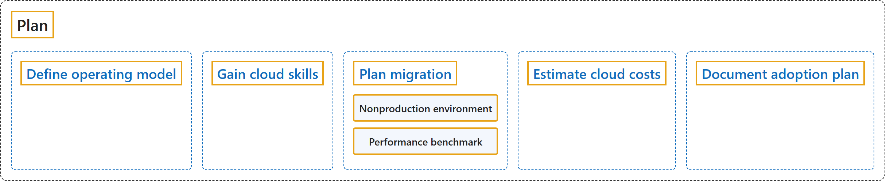

# 26.2 Plan

Sources: [Cloud Adoption Framework: Plan](https://learn.microsoft.com/en-us/azure/cloud-adoption-framework/plan/); [Plan your migration](https://learn.microsoft.com/en-us/azure/cloud-adoption-framework/migrate/plan-migration).

## Classification

## Glossary

| Term | Definition | 中文解释 | Source |
|---|---|---|---|
| **Nonproduction environment** 非生产环境 | (context) "**Move non-production environments before production.** **Nonproduction environments** provide a **safe space to test the full migration process**." | （语境）**先迁移非生产环境，再迁移生产环境。** **非生产环境**提供了一个**测试完整迁移过程的安全空间**。 | [Microsoft, 2025, "Prioritize workloads to migrate" section, item 3](https://learn.microsoft.com/en-us/azure/cloud-adoption-framework/migrate/plan-migration#:~:text=Move%20non-production%20environments%20before%20production.%20Nonproduction%20environments%20provide) |
| **Performance benchmark** 性能基准 | (context) "Set measurable metrics including **performance benchmarks**, functionality validation, and user acceptance criteria." | （语境）设定可衡量的指标，包括**性能基准**、功能验证和用户验收标准。 | [Microsoft, 2025, "Engage stakeholders on migration plan" section, item 5](https://learn.microsoft.com/en-us/azure/cloud-adoption-framework/migrate/plan-migration#:~:text=Set%20measurable%20metrics%20including%20performance%20benchmarks%2C%20functionality%20validation%2C) |

## References

- Microsoft. (2025, August 1). *Plan your migration*. Cloud Adoption Framework. Microsoft Learn. https://learn.microsoft.com/en-us/azure/cloud-adoption-framework/migrate/plan-migration
